---

id: 999278

title: "Easytier异地组网部署记录"

created_at: 2025-09-30T03:05:15.716Z

username: _Ooo

display_username: "Ooo"

---


# Easytier异地组网部署记录


# Easytier部署指南

## 一、web控制台搭建

### 1、下载对应CPU架构的二进制文件

[EasyTier 核心 Github](https://github.com/EasyTier/EasyTier)

### 2、注册为服务

移动二进制文件并设置执行权限

```
mv easytier-web-embed /usr/local/bin/easytier-web-embed
chmod +x /usr/local/bin/easytier-web-embed
```

创建 systemd 服务单元文件

```
vi /etc/systemd/system/easytier-web-embed.service
```

内容如下

```
[Unit]
Description=easytier-web-embed Service
After=network.target

[Service]
Type=simple
ExecStart=/usr/local/bin/easytier-web-embed
User=root
Restart=on-failure
RestartSec=5

[Install]
WantedBy=multi-user.target
```

加载服务

```
systemctl daemon-reload
systemctl enable easytier-web-embed --now
```

可以使用下面的命令查看服务状态和日志：

```
systemctl status easytier-web-embed
journalctl -u easytier-web-embed -f
```

### 3、配置好反代

安装好Nginx，添加以下配置

```
vi /etc/nginx/conf.d/easytier-web.conf
```

内容如下

```
# HTTP 服务器块，用于重定向到 HTTPS
server {
    listen 80;
    server_name easytier.aabbcc.com; # 替换为你的域名

    # 强制将所有 HTTP 请求重定向到 HTTPS
    return 301 https://$host$request_uri;
}

# HTTPS 服务器块
server {
    listen 443 ssl;
    server_name easytier.aabbcc.com; # 替换为你的域名

    # SSL 证书配置
    ssl_certificate /etc/nginx/ssl/easytier.aabbcc.com.pem; # 证书文件路径
    ssl_certificate_key /etc/nginx/ssl/easytier.aabbcc.com.key; # 私钥文件路径

    # SSL 协议和加密套件配置（建议配置）
    ssl_protocols TLSv1.2 TLSv1.3; # 使用安全的协议版本
    ssl_ciphers ECDHE-ECDSA-AES256-GCM-SHA384:ECDHE-RSA-AES256-GCM-SHA384; # 使用强密码套件
    ssl_prefer_server_ciphers on;
    ssl_session_cache shared:SSL:10m;
    ssl_session_timeout 10m;

    # 反向代理配置
    location / {
        # 代理到本地的 11211 端口
        proxy_pass http://localhost:11211;

        # 设置传递给后端服务器的请求头信息
        proxy_set_header Host $host;
        proxy_set_header X-Real-IP $remote_addr;
        proxy_set_header X-Forwarded-For $proxy_add_x_forwarded_for;
        proxy_set_header X-Forwarded-Proto $scheme;

        # 可选：配置超时时间
        proxy_connect_timeout 90;
        proxy_send_timeout 90;
        proxy_read_timeout 90;
    }
}
```

### 4、放行对应端口

| 服务 | 说明 | 端口 | 协议 |

| --- | --- | --- | --- |

| api-server | 后面前端需要连接的 | 默认 11211，tcp，反代后那就是你自己 https 的端口 | tcp |

| web-server | 前端 dashboard | 默认 11211，tcp，反代后那就是你自己 https 的端口 | tcp |

| config-server | 后续节点需要链接的，需要你服务器防火墙单独开放这个端口 | 默认 22020，udp | udp |

### 5、访问web控制台

打开反代的域名，就可以看到官方同款的 Dashboard 了，API Host 那里由于前面把两个服务反代成同一个域名，所以还写同域名即可

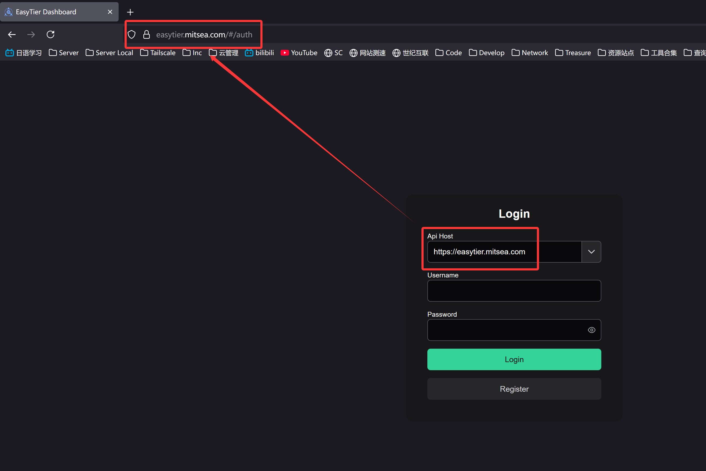

注册并登陆，就能看到控制台了

[img2792×970 18.9 KB](https://cdn3.ldstatic.com/original/4X/6/2/f/62fe4e58b2aa0d1f20575c88db65c65cc3dc1b9e.avif)

## 二、中心化部署

easytier其实主打的是去中心化，然后easytier也是可以做到中心化的。

按中心化的使用逻辑，需要需要有一个中枢，用来管理所有节点，所有节点也要连接到这个中枢上。而步骤一部署的web控制台便是中心化部署架构中的中枢角色。

架构如下：

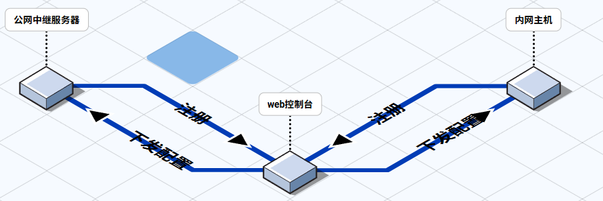

### 中继服务器配置如下：

1. 移动二进制文件并设置执行权限

`mv easytier-core /usr/local/bin/easytier-core chmod +x /usr/local/bin/easytier-core `

2. 创建 systemd 服务单元文件

`vi /etc/systemd/system/easytier.service `


中继服务器上启动 easytier 时需要连接上刚才部署的 config-server。config-server 斜杠后面是用户名。示例中用户名是 abc。


内容如下

`[Unit] Description=easytier-core Service After=network.target  [Service] Type=simple ExecStart=/usr/local/bin/easytier-core --config-server udp://<web控制台ip>:22020/abc User=root Restart=on-failure RestartSec=5  [Install] WantedBy=multi-user.target `

3. 加载服务

`systemctl daemon-reload systemctl enable easytier --now `

可以使用下面的命令查看服务状态和日志：

`systemctl status easytier journalctl -u easytier -f `

4. 去到 Dashboard 那边，这里就能看到设备了。点设备右边的齿轮

[img3738×930 27.8 KB](https://cdn3.ldstatic.com/original/4X/9/e/2/9e2b04cc3b1f8cf6ac21455f24e997f6a21886c7.avif)

5. 点 Create

[img1900×532 10.4 KB](https://cdn3.ldstatic.com/original/4X/a/1/4/a144ec4005de2963fefbc0c60beba2d90bf0035e.avif)

6. 填写信息

[img1632×1196 33.1 KB](https://cdn3.ldstatic.com/original/4X/f/3/a/f3a8ebd29419bc4bd48dd6469011a8b3d3e06c6f.avif)

下面的高级设置中，网络白名单同样是填上你的网络名称，这样其他设备就无法使用这台设备做为中转了

自定义路由打开，然后下面留空，因为他默认会接受其他所有设备的子网路由，所以这里建议打开但是什么都不填，后续可以自己再加

[img892×562 12.8 KB](https://cdn3.ldstatic.com/original/4X/c/1/d/c1ddd769ff73dfa241f3fca016fb8bbde09f57e2.avif)

加完后，这里选择刚才创建的网络

[img772×406 14.8 KB](https://cdn3.ldstatic.com/original/4X/4/e/2/4e25919f9fb2bd738b0ca7fad0e0d0e1f8ce689f.avif)

加完后就可以看到这里是本机

[img1956×1634 38.8 KB](https://cdn3.ldstatic.com/original/4X/e/2/0/e203bbb772b0797b0fe4e72d94793a9da9f03003.avif)

### 内网主机配置如下：

1. 和中转服务器一样创建并启动服务。

2. 然后在 Dashboard 里就可以看到另一个机器了，点击它右边的齿轮

[img3326×864 20.8 KB](https://cdn3.ldstatic.com/original/4X/e/6/3/e6346474626da53256a9cc0da7c9684f6d9bce76.avif)

3. 这边无法直接选择刚才的网络，还是要点右边的 Create 手动添加一下

[img1900×558 12 KB](https://cdn3.ldstatic.com/original/4X/7/8/6/78612df1fb8df044a1ff128fa9fe565e675440f6.avif)

4. 填写一样的网络名称、网络密码和公共服务器，IP 地址换一个同网段的另一个 IP 即可

[img1674×1242 21.1 KB](https://cdn3.ldstatic.com/original/4X/c/f/d/cfd76536e692d42dc26c38be70cba4d37a602d57.avif)

5. 注意 网络方式 那里不要选手动，不然即便填了一样的网络名称和密码，两个机器之间互相也是看不到的

网络白名单和自定义路由也是一样

[img892×562 12.8 KB](https://cdn3.ldstatic.com/original/4X/c/1/d/c1ddd769ff73dfa241f3fca016fb8bbde09f57e2.avif)

6. 加完后，这里选择刚才创建的网络

[img842×428 11.8 KB](https://cdn3.ldstatic.com/original/4X/a/4/1/a41eb1526d6e1924ba55dd66dbe16b46c2037e3e.avif)

7. 可以看到两个设备之间可以通信了

[img1918×1708 42.1 KB](https://cdn3.ldstatic.com/original/4X/d/c/d/dcd76f4569c70419cf549c77b52ed26494cf620b.avif)

## 三、去中心化部署

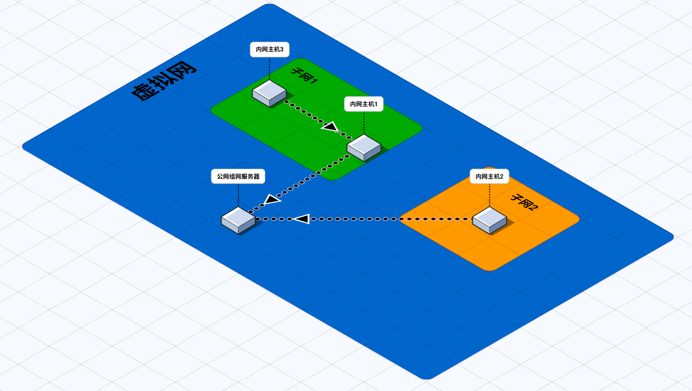

去中心化部署的核心思想是：不区分服务器和客户端，只要一个设备可以与虚拟网中任意一个节点通信，就可以加入虚拟网。

在如图的网络架构中，公网组网服务器的作用是，协助没有公网 IP 的主机实现P2P打洞或者作为中转服务器。P2P打洞成功，两台无公网IP的主机直连，流量不经过服务器。P2P打洞失败，公网组网服务器作为两台无公网IP的主机的桥梁，所有流量经过公网组网服务器，消耗公网组网服务器流量。

公网组网服务器配置示例如下，其中高级设置可默认：

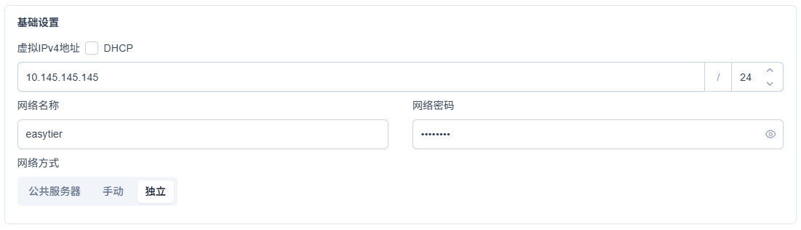

其余内网主机配置如下：

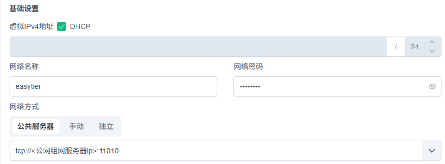

以上便部署完成。

如果公网组网服务器连接到了web控制台，可以在控制台看到节点信息。

## 四、高级设置用法

### 关闭转发

> 为何需要关闭转发功能？

> 关闭公网组网服务器的转发功能，可以避免无公网IP的主机间通信消耗公网组网服务器的流量带宽资源。适用于公网组网服务器流量有限或者带宽较低的场景。

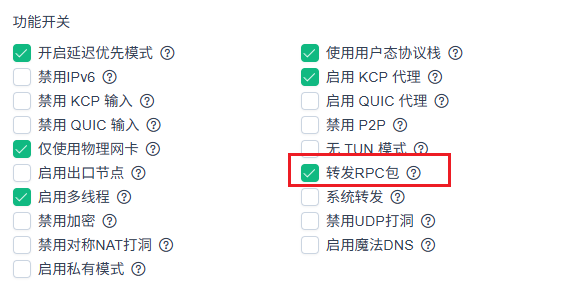


默认情况下， EasyTier 的每个节点都允许为其他虚拟网提供转发服务，即使该节点已经指定了 网络名 (`--network-name`) 和 网络密钥 (`--network-secret`)、并已加入一个虚拟网。

若需改变此行为，可通过 `--relay-network-whitelist` 参数限定可被转发的网络名白名单（空格分割的通配符列表，如 `"ab* abc"`）。当该参数的列表为空时，就不会为所有其他网络提供转发服务。

EasyTier 可以做到不转发其他虚拟网的网络包，而是只帮助他们建立 P2P 链接，只需将白名单置空，并设置仅转发 RPC 流量即可。

总结上述说明，关闭转发功能，最关键的配置是**打开网络白名单并置空**。其次，根据文档要求勾选“转发RPC包”，使其可转发RPC 流量。

### 关闭打洞

> 为何需要关闭打洞功能？

> 关闭公网组网服务器的打洞功能，可以为无公网IP的主机间通信提供相对稳定的链接，可以有效缓解两个无公网主机在不同运营商网络下，可能出现的高延迟及不稳定问题。适用于追求低延迟稳定链接的场景，但需要注意公网组网服务器的资源消耗。

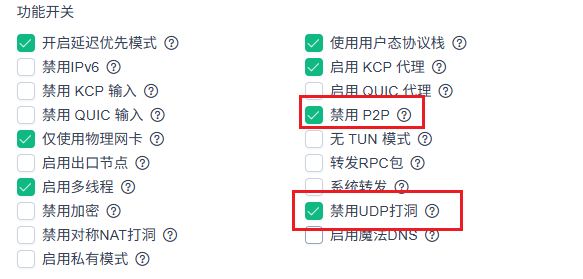

关闭打洞功能，关键配置是**禁用P2P**和**禁用UDP打洞**。其余无公网主机也建议勾选这两项功能。关闭后所有流量经由公网组网服务器转发。

如果公网组网服务器开启了网络白名单功能，需要添加上允许转发流量的虚拟网名称。**其余无公网主机**不担任流量转发任务，可**留空**。


> 关于仅打洞和仅转发两种工作模式的测试方法：

> 公网服务器上安装好dstat，并通过`dstat -tn -N <网卡名称> 10`开启监控（10代表10s报告一次）。两个不同子网下的主机通过iperf3进行测速。

> iperf3的服务端启动命令：iperf3 -s

> iperf3的客户端启动命令：iperf3 -c <服务端ip> -t 60 -i 5      #持续测试60s，5s报告一次。

> 可以通过dstat的数据变化，看到是否消耗了公网服务器的带宽和流量。

### 私有模式

如果希望 EasyTier 仅在你的虚拟网络中提供服务，而不希望其他虚拟网的节点连接到你的节点，可以使用 `--private-mode true` 参数启动 EasyTier。

这会仅允许使用与本节点网络相同的网络名称和密码的节点通过本节点进行握手和中转。

例如，当前节点网络名称和密码均为easytier，那么开启私有模式后，仅允许网络名为 `easytier` 且密钥为 `easytier` 的节点连接到该 EasyTier 节点。

### 带宽延迟优化

文档参考：[KCP 代理 | EasyTier - 简单、安全、去中心化的异地组网方案](https://easytier.cn/guide/network/kcp-proxy.html)

默认开启**启用KCP代理**和**使用用户态协议栈**。实际效果未测试。

### 子网代理

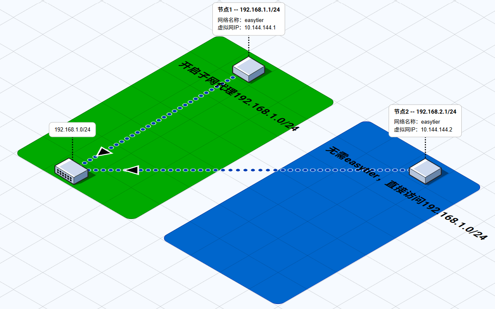

以图为例，开启子网代理功能，需要在**节点1上配置子网代理CIDR**，添加上代理的网段。

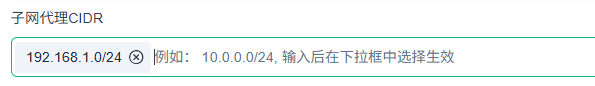

由于虚拟网中的节点会自动传播子网代理信息，一般出于安全考虑，虚拟网中的所有节点都需要打开自定义路由选项并留空。

以图为例，节点2需要访问节点1代理的网段，则需要在**节点2自定义路由中，添加上192.168.1.0/24网段**。

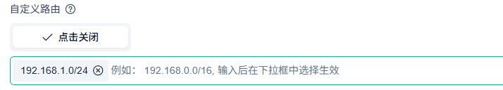

### 使用 WireGuard 客户端接入

假设网络拓扑如下，A 节点和 B 节点使用双节点组网方式组网，并且 B 节点通过子网代理代理了 `10.1.1.0/24` 子网。

> 一般A节点为有公网IP的节点，B节点为内网主机

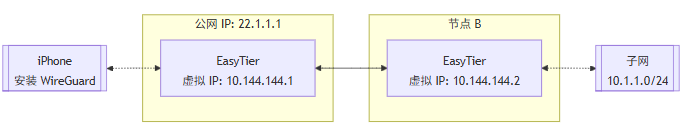

1. 我们需要 iPhone 通过节点 A 访问 EasyTier 网络，则可进行如下配置。

在A节点上，打开VPN Portal，任意配置一个WireGuard 网络使用的网段。同时A节点防火墙需要放开22022端口。

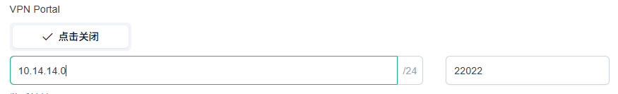

2. 获取 WireGuard 客户端配置

如果节点A连接到了web控制台，可以直接在控制台中查看

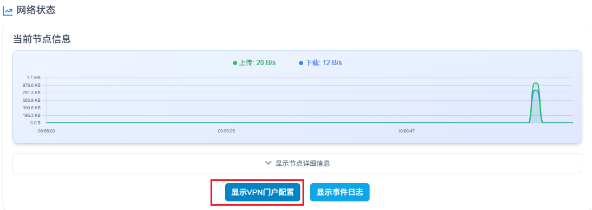

3. 复制VPN门户配置下的内容，粘贴到[wireguard配置生成网站](https://www.wireguardconfig.com/qrcode)，修改完成后生成配置二维码。

`#需要修改以下两处 #其中Address任意配置一个WireGuard 网络使用的网段下的一个IP即可 Address = 10.11.11.0/32  #Endpoint需要填写节点A的公网IP或者域名 Endpoint = 0.0.0.0:22022 `

注：如果节点A没有连接到web控制台，可使用 `easytier-cli` 获取 WireGuard 客户端的配置。

`easytier-cli vpn-portal `


---


*来源: https://linux.do/t/topic/999278.json*

