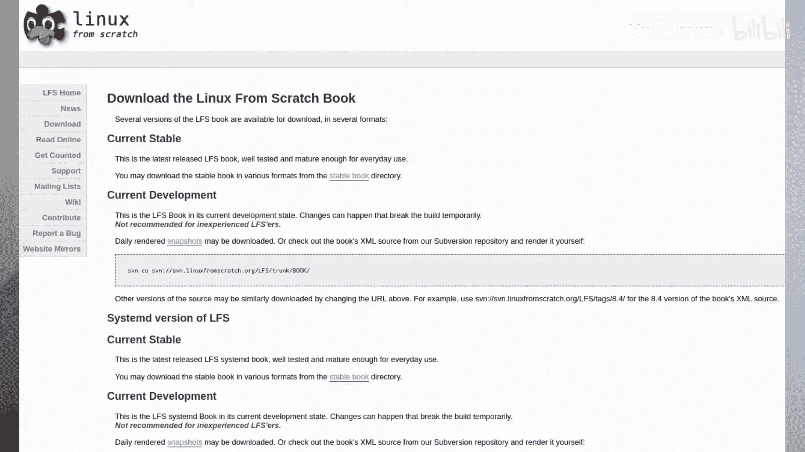
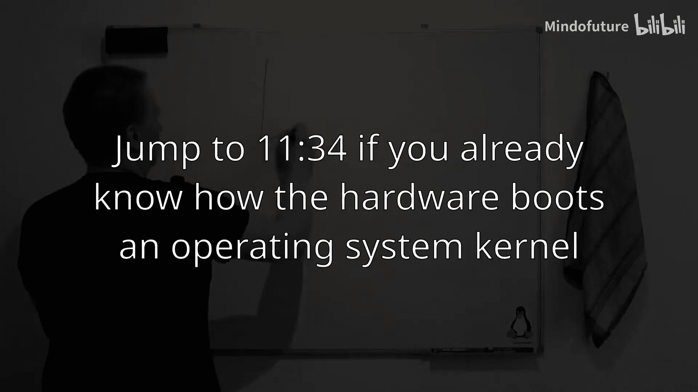

# 从零编写Linux操作系统-｜-Build-A-Linux-From-Scratch-p01-P01_Part_1-Overview--BV1A78EzUEdf_p1-

Hi， everyone。 My name is Victor Engerman， and it's been a while hu。

So some of you may have already seen on my Facebook page that I have ordered。Two books on Amazon。

 this one here。And this one。And you might have already guessed what I'm going to do now。

 I want to make a video series or actually multiple video seriess about Linux and the Linux kernel。

So。This here is going to be the first of these video seriess。

And this one is going to be about Linux from scratch。And what's Linux from scratch？ Well。

 if I completely oversimplify it， I would say that Linux from scratch is a Linux distribution。

But if you go to Linux from scratch dot org to the download section。

 you will immediately see that I just completely oversimplified things because。

If Linux from scratch was just a normal Linux distribution， you would get an isoophil there。

 You would download it， put it on a USB stick or on a C or a DVD。

And then you would be able to boot from it and have a running Linux system。

But on Linux from scratcht。org。You will get a Pf filing debt。So。

Here I've printed that PDF file out。There's actually only half of it。And yeah。

 why am I telling you that a Pf file is a Linux distribution。Well。

 Linux from scratch is actually a collection of instructions， so to say。

If you follow these instructions， you know， it's like download this tower ball， extracted。

 compile it and。If you follow all these instructions。

 you will get all the components of a Linux system and then it tells you how to put them together so that you can boot from that system in whatever way you want。

But why would you want to do that， I mean， there are easier ways to get a running Linux system。

 right？Well， for me， it's learning。 I know Linux systems pretty well。

 I have been using Linux for 16 years now， and I've used a lot of different distributions。嗯。But。Yeah。

 I， I just want to make another step down and。I think Linux from Sc really dissects Linux so that you really get to know each and every programr that it contains and each and every directory。

 each configuration file， each option in each configuration file。

So that's a real dissection of the Linux system。 And I think this will give you and me。

Real great knowledge about Linux systems， the anatomy of them and。Yeah。

 another thing that you might want to do is maybe you want to build an IoT device。

 so this here is a Raspberry Pi。With a screen attached， yeah， Rasp Pis can run Linux systems。

 Maybe you want to build an IoT device based on resp Pis。

Or maybe you want to build your own IoT device and try to get Linux running on that so that you can communicate with it over the network or something。

嗯。Or another idea that I'm thinking of is stripping the Linux kernel down to。

A minimum that is required to run it on a K V M virtual machine。So that you would be able to bundle。

Such a system with any program。 And then any program like whatever A DHCP server， A DNS server。

 whatever could be bundled with such a system and then distributed as a virtual machine。 and then。

Yeah， running a program。Would just be much easier because you wouldn't have to fiddle with configuration settings or whatever you just download a virtual machine。

Stick it in your K VM， and run it and。You're good to go， right？

That would make it much easier to move from one hardware to another。

 You could just take all your virtual machines， move them to a different hardware。

So you wouldn't have to reinstall and reconfigure everything when you change your hardware。

Or maybe you would want to start your own Linux distribution and not have it based on Ubantu or Debian or arch or whatever。

 so that would be another idea that you could have。嗯。But so， yeah， let's start talking about。

How you can actually do that， How you can。Make such a Linux from scratch system。So。

I think a good starting point， even if I'm repeating myself now is。

Looking at the boot process of a computer， you know， because。In the end， we are talking about。

Being independent from any provider of anything。You know。

 whether it's Microsoft or some distribution， whatever。

 So I think it's a good idea to know the hardware that you're running on， at least。To some degree。

And those who have seen my other video series。We already know this。

 but I don't want to go into details as much as I did there。So just bear with me。

 And if you've seen my other video series， you can just skip ahead。

So。Your computer。Has a main board， okay。And on that mainboard， you will have a CPU。

A hard disk or some other form。 I mean， we don't use disks anymore， but I still say hard disk。系。

And you have some。Random X's memory Ram。And。A bias， which was just a rom chip or an E E prom。

To be more precise。嗯。And if you want to know more about these topics。shouthout out to Ben Eta。

 He has some very good video series about hardware design and two of his video series are absolutely great。

 one about building a computer on breadboards。So he basically builds a main board and uses。And。

MOS 6502 processor as O CPU。And the other video series is about。Yeah， creating a CPU on Bradbots。

Yeah， great video series is absolutely left and I will put links in the description。嗯。

But let's continue。So when you start your computer。

The first thing that will happen is that your main board is going to run the firmware that is stored in your bio。

You know， an E E problemm is。Like a storage device。 Okay， so。This is where your firmware sits。

And maybe that's transferred to the Ram。 it could run from the bio， actually， but。

So let's say this is your RE。The Ram is basically just a huge， huge array of bys。And so， let's say。

First thing that we do is we copy the firmware to the RA。And then。

We tell the CPU to run the code from there by setting its instruction point up to。Yeah。

 maybe it's the first。Maybe the first bite of the firmware。Not necessarily。

 but let's say for simplicity， let's say it does it like that。Now。

 the firmware of the main board that came from the bio will then basically just tell the。

The whole computer to talk to the hard drive。Okay。So for our simplicity。

 I will pretend like it was still。Disk based。 I mean。

 the communication with hard drives is still really pretending like it was disk based。

 So we discussed that in my other video series。Even if you have an SSD or an M2 hard drive。

 they will pretend that they would have a disk。Okay， so if this is your disk。Then。

The first sector of that disc is the masterbo record。MBR。

And the firmware of the main board will tell the CPU to talk to the hard drive。And copy。

The master boot record。Into the。RM also。Okay。And。Then， the firmware will。

Tell the CPU to start running。That code from the master Bo record by setting the instruction pointer in there what you have on that master boot record is called a boot loader。

And that bootloader knows just some things about partition tables and file systems。

So the boot loader will then be able to look at something like slash boot。You know， the Uni。

The Unix directories start with slash， It's like C colon and Windows。So to look at slash boot， slash。

 whatever comes from its configuration file， I'll just call it kernel。You know。

 it might be called VM Linux， whatever magic。But。Yeah， so the bootloader within then。

Copy that into the Ramm。And will then tell the CPU。By heading the instruction pointer。

To start running the current。Okay。😊，So this is as far as we've got in my first video series。

 because at this point。We started writing this kernel and everything that came after that was really hard coded in the kernel。

But that's actually not a good idea in reality because。Stuff shouldn't run inside the kernel。

 because。Running in the kernel means it has very high access rates。And thats a security problem。

 for example， that。Of course。😊，Things should not do more than what they are there for。

So a kernel is really just therefore for communication between different processes。

 including driver processes or system service processes or demons as they are called in the UniX world。

And。So。So the kernel shouldn't， for example， know about network protocols or。It'。

Might not have to know about hard drives， although that's debatable， I mean。Lonos Toalt says that。

They tried to move all the file system stuff out of the kernel into kernel modules。

 and they were able to do that。 It's not like they had failed at it。

 It's just that things were more complicated and slower。 So you had no benefit。

 So why would you want to do that in the end。Right。So。Yeah， what。

What happens in reality is stuff doesn't run inside the kernel。

 The kernel is really just therefore communication between things。嗯。So。Instead of doing stuff itself。

 the kernel will then just start some initialization program。Like the O in the old days。

 you would have a program named in it。That would be the system V in it。These days。

It's more common to have a system D。Initialization， and。

So most of what happens in the boot process is actually done by the initialization systems。

 so they would look at their configurations and then their configuration might say， hey。

 bring up this service and that driver like your network driver and some DHCP client service。

 for example， so。To bring up your network。To mount some hard drives and。Stuff like that， of course。

This would normally be the boot partition。And then you would have a separate。Root partition。

So part of the initialization process would actually be to。To mount this part。Depending on the file。

 at C， F， S tab。So at the FS tab。We'll have an entry， for example， to。To mount this partition。S。

Slash。Ro。And then。For convenience， you would also mount。Your boot partition。On a subdirectory boot。

Okay， and this is needs to be done pretty early in the process because， I mean。

 when your initialization system then wants to start some programs， start some。And demons。

Los on drivers。 They are loaded usually from the route partition。 And well。

 it needs to be mounted to do that。Okay， so I think that's enough about the boot process of computers in general and Linux systems in particular。

So let's talk about how we are gonna set up。Our Linux system。

 such that it can be booted on our machine。So the bio is just there。 It just has its firmware。

 and I'm not going to touch the firmware because it's too risky for me。

 I don't want to break my machine。And this whole communication with the RAM and the CPU is all hardwired in the main board。

What we need to do is at this point， we can hook into it。By providing it with。A hard drive that has。

A part table， a master boot record， then a part with a kernelel， a boot partition。

 and then a root part with。All the programs and demons and。Drivers and stuff。

 And also the configuration files。So。That's going to be the point where we start。

 We will create this whole。Hart drive， my hard drive is actually rather full。

 so I'm not going to do this in a virtual machine， but I will put this on this little USB key。

This is 30 gigabytes。They。Linux from scratch actually advises you to take something of 30 gigaby size。

 They say 10 gigyte is the least you should have just for all the files and compilation stuff and。

In between， so 10 gigabytes is what you really need to build your system and then 30 you should have something like 30 gigabytes if you really want to do stuff with your system afterwards。

So yeah， this is going to be our hard drive。I'm going to use F disk to put a partition table on it。嗯。

呃。Put X2 file systems on the partitions。And then we will fill these partitions with programs and drivers and demons。

And in the end， we will then need to。To run some gr programs to really put the boot loader。

In the master Boot record and then we will be able to boot from it。Okay。

 so how are we going to do all that？So as I said， we'll use this USB key。Our USB stick。

And the USB stick is again， just like a big array of bytes。

The first thing will need the masterboard record。 And then we will have a。Boot。

And then we have a boot partition with about 100 megabytes。

And the rest is going to be the root petition。So how do we do all that？

The Linux from scratchbook subdivids the whole process into three stages。て。

The first stage they would call the built machine。The second stage， the host machine。

And the third stage is the target machine。So。In the first stage。

 you would just run on your regular PC with。Your。With the operating system that you have installed there。

 and you would。Just use package management from your operating system to create some things to install some packages like GCC。

Make whatever autoCon auto tools， just a tool chain。And this tool chain。

 they don't really use that much because。In the next step。They tell you to download a lot of files。嗯。

Like the Linux。Soce code。啊。Grup。Call you Tis。Also， GCC make。Bison。All that stuff。

Now the reason why you need all that is。TheThe first stage is relatively short。

 you know you just installed these things， downloaded these things。

 and now you will just use this tool chain to create a new tool chain and that new tool chain is going to be the one that we will be using more than this one。

So。One of the first things that you will do is。Let's give these things names like a。B and C。

So remember this GCC。From your distribution， it's going to be a GCC that will run on A and produce binaries for a。

But your machine B might be already a different machine with a different processor。

 So you might not already， you might already not be able to use this GCC to。To run on B。

So what you would do now is create a tool chain。That。Can run。Still on A， that's important。

We put on B。A tool train that can run on A。Because at first we will still run on A。

But one that runs on A and produces binaries for B。So this is one of the first things you will do。

 you will make a new chain。Using this Gcc。And this source code to build a so called cross compiler。

To create this Gcc。And then you will use this cross compiler to。Compile a lot of the other stuff。

 not everything， but a lot of the other stuff， like I think bi is in there。Fleex， autocon。

 Auto make M4。You know， another tool chain。Right， so。

And since we are using this GCC here that produces binaries for B。

 all this is going to be able to run on B。And then we will also。Use this compiler。

And the GCC source code。To produce another。Gcc。嗯。Which can run on B。

knowBecause when we've built it with this GCC， then it runs on B。

 but this is going to be another cross compiler that will then produce binaries for C。Okay。And。

Once we have compiled a lot of these things， including core us， you know。

 core us is an important package here。C utility contains。Really basic stuff like。MK doer。

And C D and M V and R M， you know， the just the lowest level。

Stuff of managing directories and creating them， removing them， deleting them， moving them。嗯。

Why do we need all that。Because once we have compiled all this。嗯。

There comes a really interesting stage。嗯。Because at this point。嗯。

We will go into a change root environment， C，H route。And。

So we will have this mounted under slash M and T。Slash LFS。You know， for Linux from scratch。

 mount Linux from scratch， by the way， we will store that mount point。In an environment variable。嗯。

Okay， so。We've mounted it there， put everything in there， and then we will change root into there。

And after we've done that， this is a really interesting point。After we've done this change route。

 it's gonna be as if。We had booted from this machine or this system。So this is an issue of isolation。

 We will still actually be running on the kernel from machine A。

And have booted from the grub on machine A， but everything outside of M& T LFS is going to be invisible and everything below M and T LFS is going to be going to look to the system as if M and T LFS was our root partition。

Okay。So that's really an interesting point because at that point。嗯。呃。

We are so isolated here from our original system。 it's going to be as if we had mount as if we had booted from this system。

And that's really an important thing because。You have really a good isolation。 Then， you know。

 if you are using this G C， you are。Absolutely not able to accidentally link against some libraries from here。

 you know， because these libraries are just going to be like not existent at this point。O。

And once we have achieved that， then。Then we can start using this GCC。

Because now we are running on B。 I mean， you can take the the USB key at this point。

 go to a different machine。 if you， if your B is a different machine， this is a point where you can。

Take your USB key。Put it in a different machine that different machine still needs to have its own operating system。

嗯。And then you would need to do all this mounting stuff setting the variable on that machine。

 But we are gonna do this on one machine anyway， so。So at this point， again。

 we will start using this GCC。To compile all these。Source codes again。To create the things。

In slash bin。Slash lip。Slash whatever。Epen。Slash。Lip 64 and so on。嗯。

And then we will really compile everything all。嗯。All the packages here and。

Since this is the compiler for C。That produces bin for C， this is going to be able to run on C then。

And。Interestingly enough， we will also build another GCC here， but I mean。This G。

 all the GCCs we've had so far。Will not help us when we are on C。

 so we will need to create another GCC that runs on C and produces binaries for C。Okay。

And once we have done all that， then our root partition is filled， we need to compile Linux and gr。

To put on the boot partition and then use Gr to create the master boot record。

And at this point we would be able to boot from our USB stick except that well。

 just because we have a kernel， we haven't told it to do anything。

 you know it needs to start the in system and the in system needs to be configured so that it we need to tell it which services to run which drive us to load and so on so in the end we also need to。

Yeah。Write all the configuration files。Because yeah， in the end。

I know most of these programs already。And just compiling them isn't that interesting， to be honest。

Oh。They， I think all of them or almost all of them just use the auto tools， auto make autocon。

So you will usually just have。This classic triplet of configureg。Make。Make install。

And then a lot of text is gonna be running from the bottom to the top of the screen very fast。And。

Also， you will usually have some parameters to configure that will tell it to put the resulting files。

Onto your root partition。Somewhere relative to the mount point of the root partition。

 So it's going to be。Some form of dollar， L， F S。In here or down here。

And that's really not so interesting， and it's going to take quite some time I think。

They said it would take about5 hours。嗯。Maybe we can speed it up with。With parallel compilation。But。

Yeah， as I said， this is， I don't think it's such an interesting part。

 I think the configuration is more interesting， but then I will use this time for all the compilation to talk about the directory structure。

 You know， which directories are there， Why are they there， What would you put there， normally。

And also the selection of these packages， you know， why are these packages in there。

 what do they provide， which programs are in there， why would you want to have these programs。嗯。

So I hope this is not going to be all too boring in the end。

And I hope this was not too boring for you。Yeah， if you liked this video， like it， share it。

 subscribe。And maybe turn your a blocker off while you're watching this video set would help me a lot。

And yeah， see you next time。But。