# 从零编写Linux操作系统-｜-Build-A-Linux-From-Scratch-p03-P03_Part_3-Downloading--BV1A78EzUEdf_p3-

Hi， everyone， and welcome back to this tutorial on building a Linux from scratch system。

Last time we have prepared our USB key， so we've。Partitioned it， formatted it。

 and created some directories on it。So。This is where we left off。And now。

We will use this sources directory here to。You have to download all the packages and then start installing them。

Of course， we need some information about where to download these packages。

And Linux from scratchtch has this list of packages in Cha 3。2。And I will just。

Copy of this whole list。Okay。Controt C。

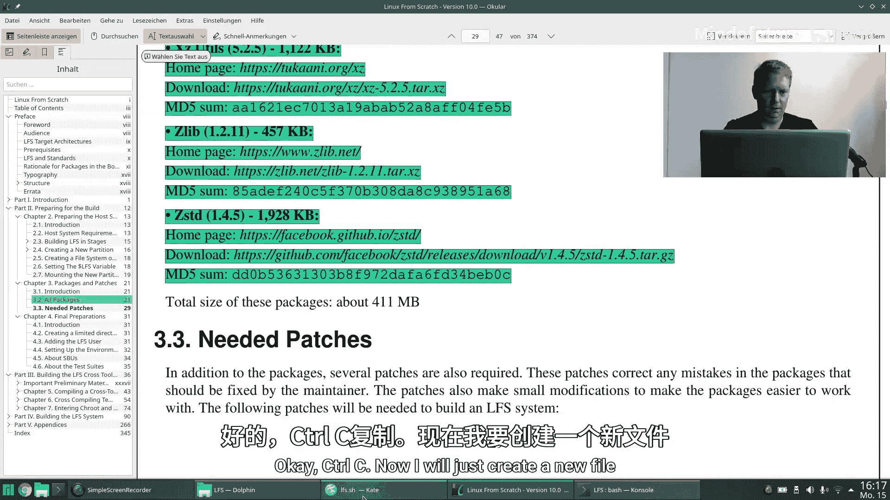

Now， I will just create a new file。

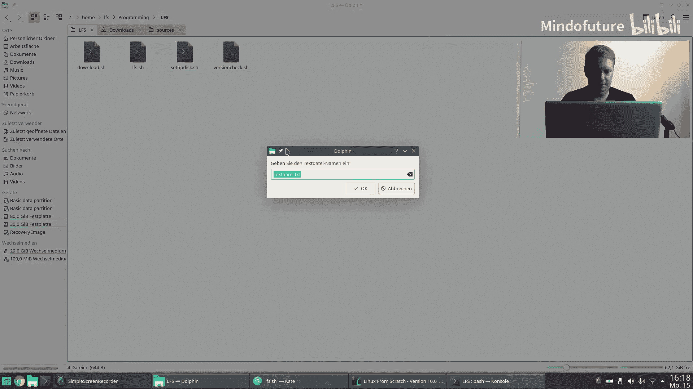

Packages， C， SV。Well CSV is， you probably know that。Like a。Like an Excel table。

But with a very simple。File structure， so。You basically have one table rope per line， and then。

The columns。Get separated with semicolons。And I will now change this file or yeah。

 this list such that。The first column is going be the name of the package。

 The second column is going to be the version of the package。I don't need the homepage。

Then the third column is gonna be。The URL， where you can download it。嗯。But， I want to。

Change this URL such that the version number。I want to。Replace a version number just with an at sign。

So， that。Later， I just want to be able to just change the version number here。To something useful。

And then。I just wanted to download that。Following as as as long as they still follow that same naming convention。

So。So this ad here basically tells me they are naming conventions where the version number is supposed to go。

And then in a script， I just want to。Replace that with the version number from， from the front。Okay。

And also， I want the package names to be all lower case。Okay， so I'm gonna do that now。

The fourth column is gonna be there。M5 some。We will have to check the M5 sums because， well。

 a lot of these。Downloads will go over the H T TP protocol， and H T TP is insecure， so。

Just to protect ourselves against men in the middle attacks。We will need to check the M5 sums。

It's good practice， anyways。

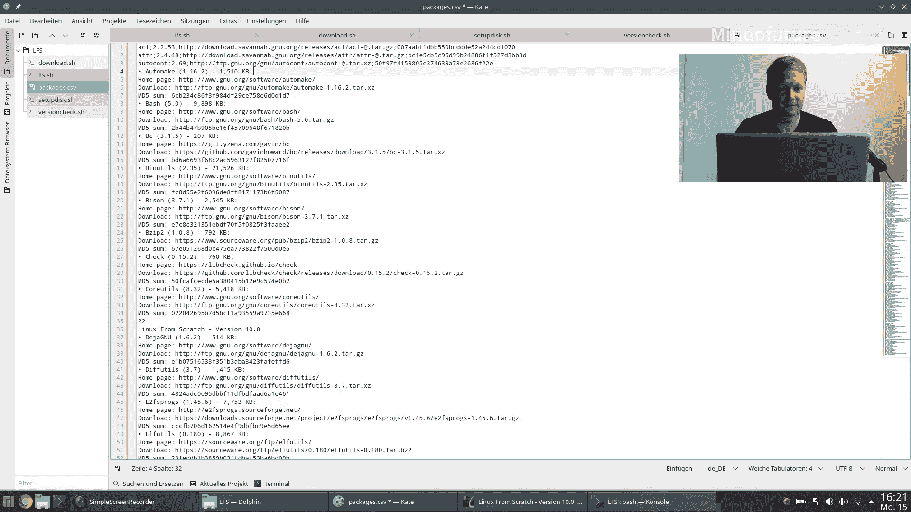

Okay， so this is going to take a while， so I will just fast forward now。

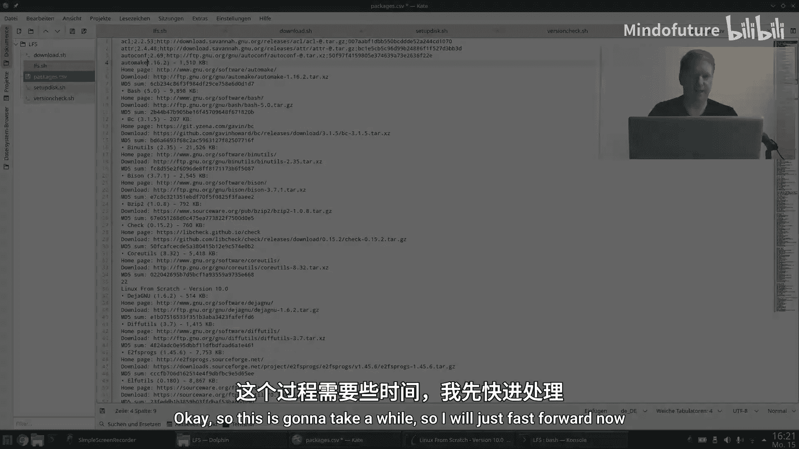

Okay， so now I've finished。Creating this。Table here。We could， if we wanted to， we could。

You can open this with a。Whether a spreadsheet application like Excel or in this case。

Lira offers Kic。So as you can see， we have package name， version， download URL and。M5 sum。Don't save。

And。Yeah， so this is how the file now looks。Okay， so in our LF S script。Right now。

 we are running this。And still in the directory home， LF S programming， LF S。嗯。But。I want to。

Really work on the USB stick。 So I want to C D to that mount point。And yeah， I would just copy。

The scripts are there， so that。Once we've。See deep into that。 we will still be able to。To use these。

Scrips。So。Just copy。Recursor flee。哦子。Scrips， and also the package。Packs， C， SV。2， L F S。Saauces。

And then， we will change directory。To that location， Do L F S。Sources。Okay。And later。

 when we've created the。It's a cross compiler。嗯。Well， of course， we want to use that cross compiler。

 so。We have to modify our path variable。So。So this is a list of directories where。嗯。Bash looks for。

Programs when you want to start a program。Okay。And then， we want to start。Downloading the files。

 So I'm gonna source down。Load dot S H。嗯。Yeah， keep in mind。When we execute that。

 we have copied everything here。 and we've moved here to。To the USB stick。So。How do we do that？So。

We will address though。Run through this list of packages。And。

Yeah we're going to pipe it into this while loop that keeps reading。Line by line。

 the lines of the packages。And then inside that loop。嗯。

We can then extract the columns for each of these。Rose。So。The name of the package。It's gonna be。

In that line。But we extract it from there by using the cut program。And we。

This cut program allows us to go to a specific point in that line。And。With this dash D semi column。

 we tell it to skip。To semi columns。 So always to the start of a column。And。

The name was the first entry of our。Okay， and。Because it gonna be the value。Okay。

 so now we can extract the name。小不要是。Was事。The second column。So URL is the third column。

But keep in mind。嗯。That the URL didn't have the version number。 So instead of the version number。

 we had the。This at。So we have to replace that back now like this。Using the stream editor replace。

The sign at。With。Of the version。So the value that we've read here。Because of that。

 we need to read the version before we read the URL。And yeah。

 the version number might be in there multiple times。 in some cases， it is in there multiple times。

So we need this global。But here。Okay， and then the same thing for the M5 sum。That was the fourth。可了。

Now， I。From that URL， I want to extract the file names， the name of the file that we download。

So we could， we will just。Run the program base name。On the URL。Okay。

 so base name just gives us the last part of this URL string when you cut everything at forward slashes。

Okay， so。That's just form。For testing。

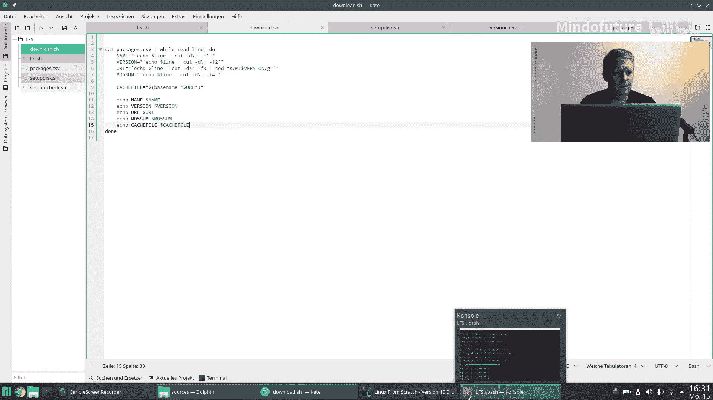

Okay， so now let's test if this works。Okay， this looks good， right， so。We have here an entry for VIm。

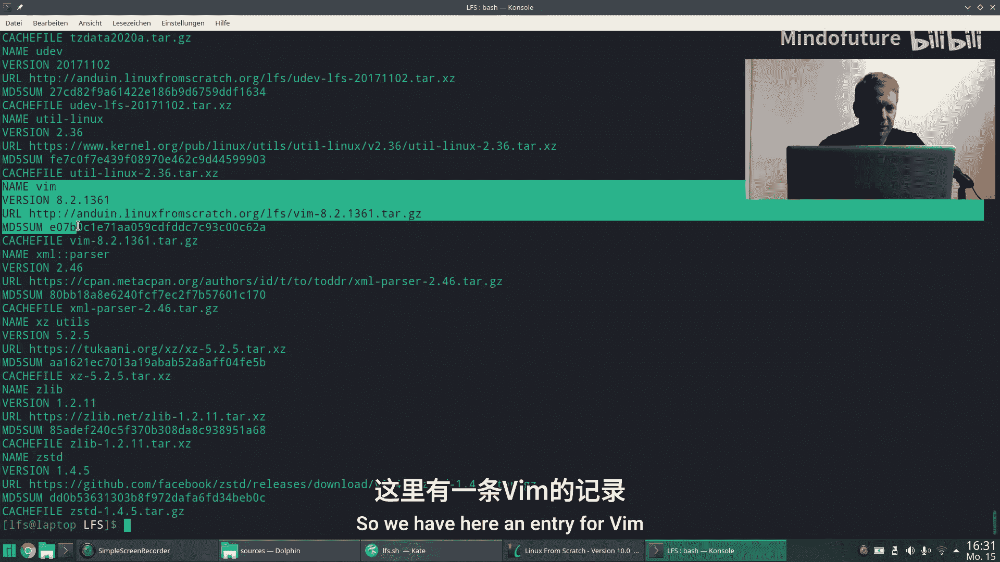

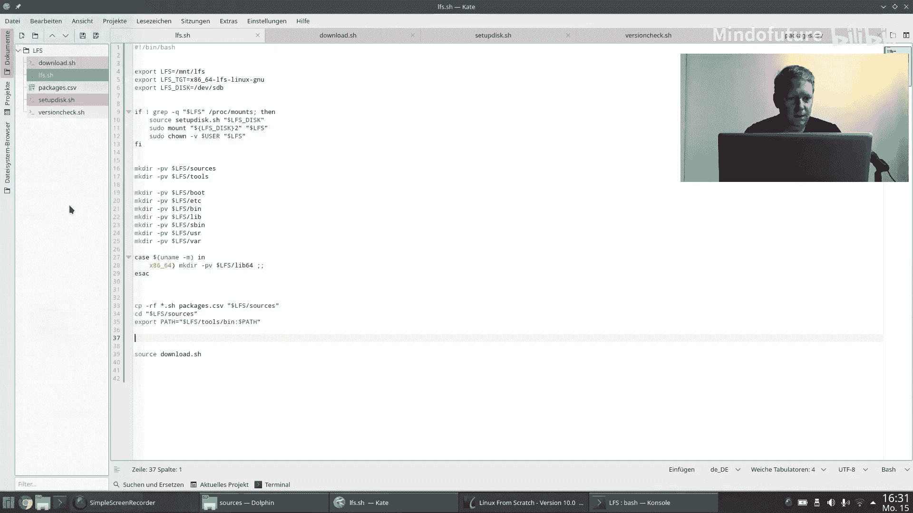

Let's see。The entry for them。Version 8，2。1361。Bim 82，1361。 That looks good。

The URL index from scratch dot org， L F S Vim。And I been。Looks good。The M5 some easier or7。E 7。

 Okayk， that looks also good。 And this is。The correct base name of the file。 Okay， so。

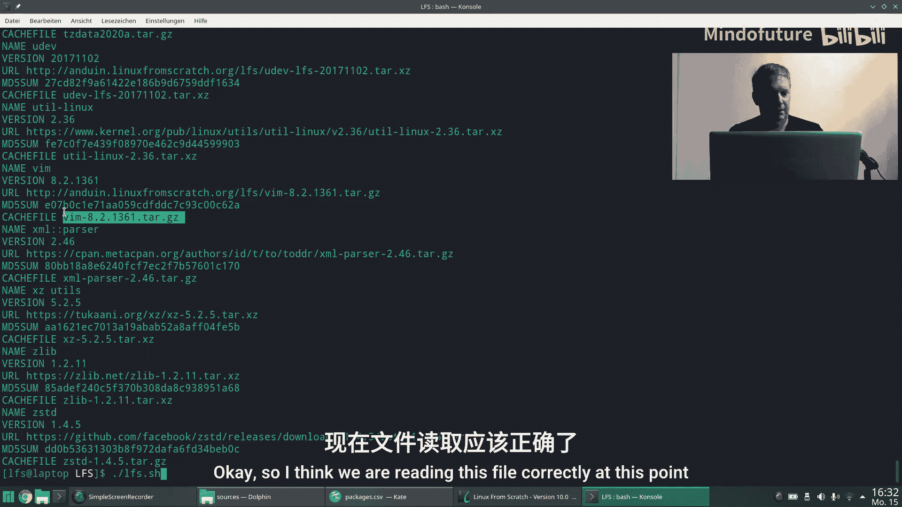

I think we are reading this file correctly， at this point。So yeah， what we can now do is。

We can just W get the URL。And after we've downloaded the URL。As I said， we you should really check。

That the M5 sum is correct， so。If it's not correct。Okay。

 so we we pass the M5 sum and the file name to M5 sum。The program， M D5 some， and。

If that rejects this input， then I will just。Remove the file again。Because in that case。

 we just can't be sure that it's correct。We might be under men in the middle attack at this point。

 so yeah， I'm not going to proceed at this point。Although， of course， it's quite unlikely， but。Good。

Okay。Now。嗯。If we have already downloaded the file， I would really like to avoid causing more traffic on their servers and also some of these packages are pretty large and it takes a while for them to download so if I already have them。

 then I just don't need to download them again。Because。If I have them。

 this also means that the file was correct。 so it had passed this test because otherwise I would have deleted it before。

So。So I can now basically just skip all this if the file is already there。Nothing it's。

 so simple that you cannot do it。Wrong with three times in a row。ok。So。All of this is only done if。

The file isn't already there。

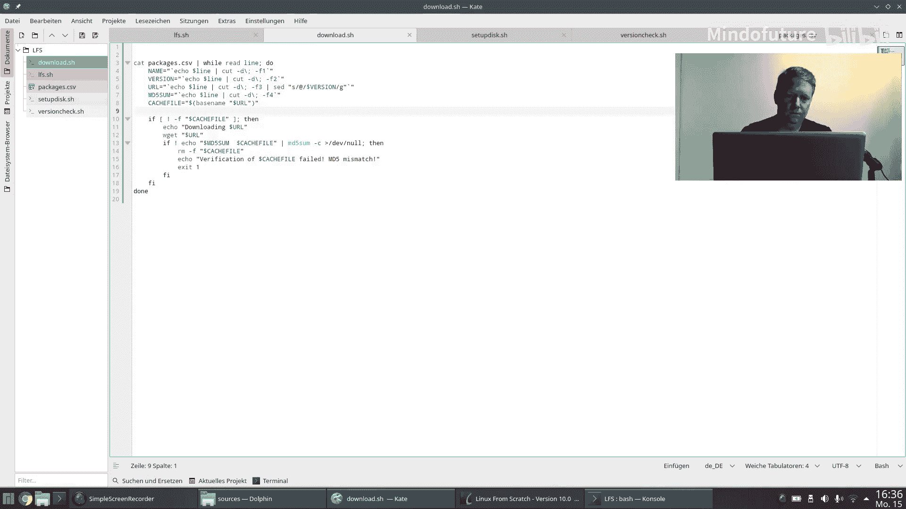

Okay， let's run this。And this is looking good。 We are downloading all this stuff This takes a while now。

 so I will fast forward again。Oh， great。 One of the packages could not be downloaded。

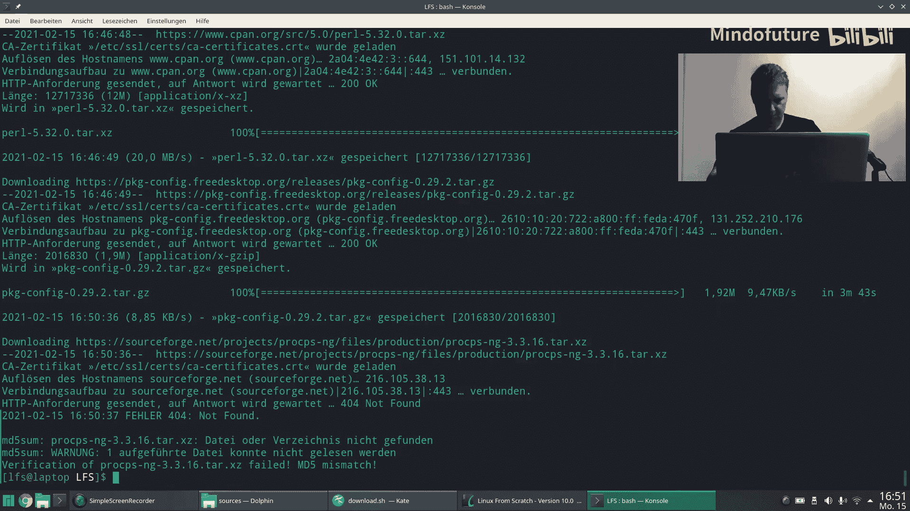

I made a mistake in the peet Trustcy as we。

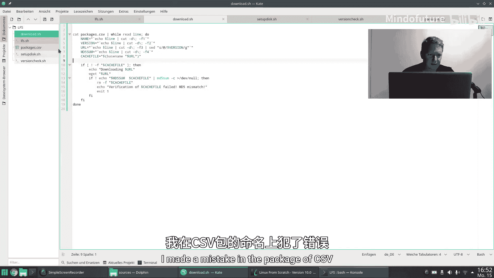

I had run this through。AB script that replaced uppercase letters with lower case letters。

For this here， for the package names。But this here needs to be an uppercase P。That's real。

Same thing for Python。

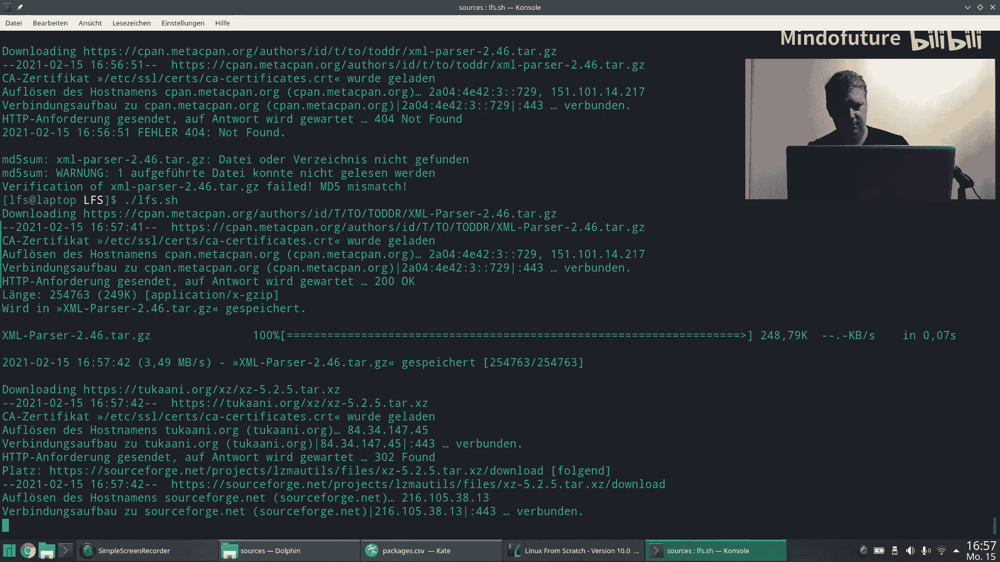

Okay， I think。This is。Looking good right now。So。Here are all these package files。

93t sounds reasonable。Yeah， so。I think this is O for this video。

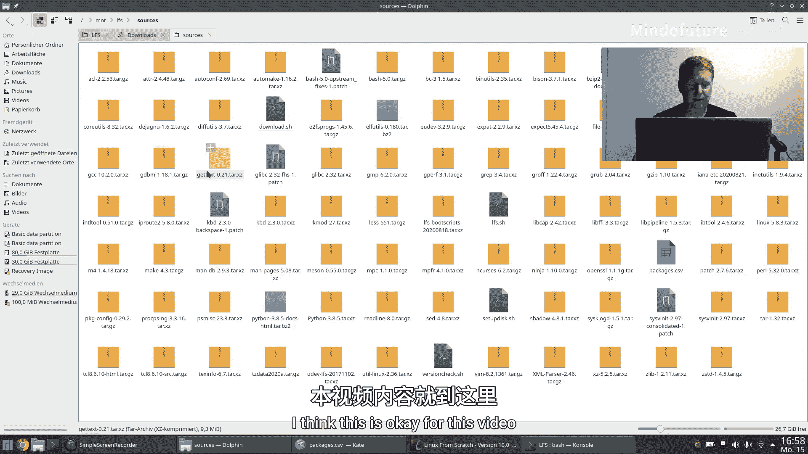

So。Yeah， in the next video， we will start installing these things。So yeah， if you like this video。

 like it， share it， subscribe and please turn your ad blocker off that would help me a lot。And yeah。

 see next time when we start installing all that stuff。Bye。

