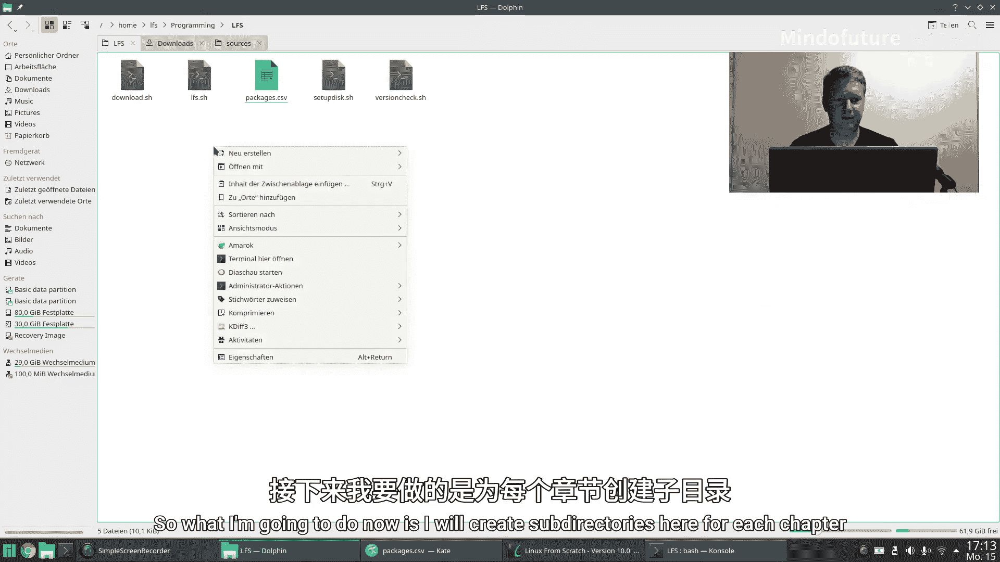
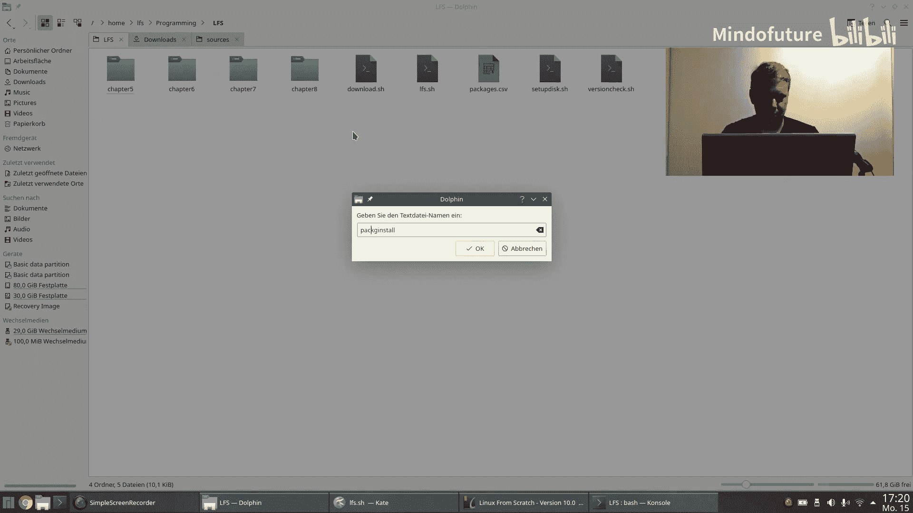
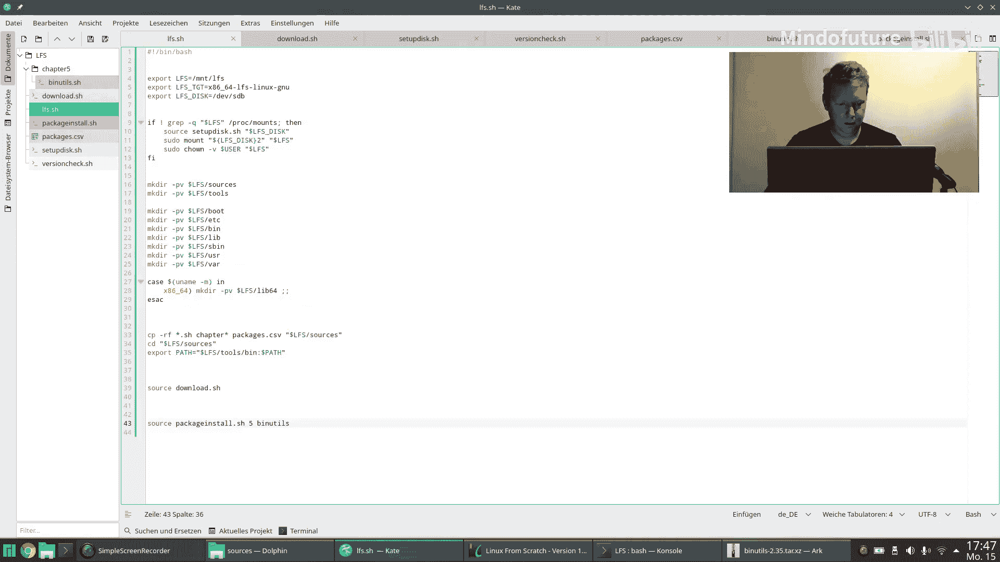
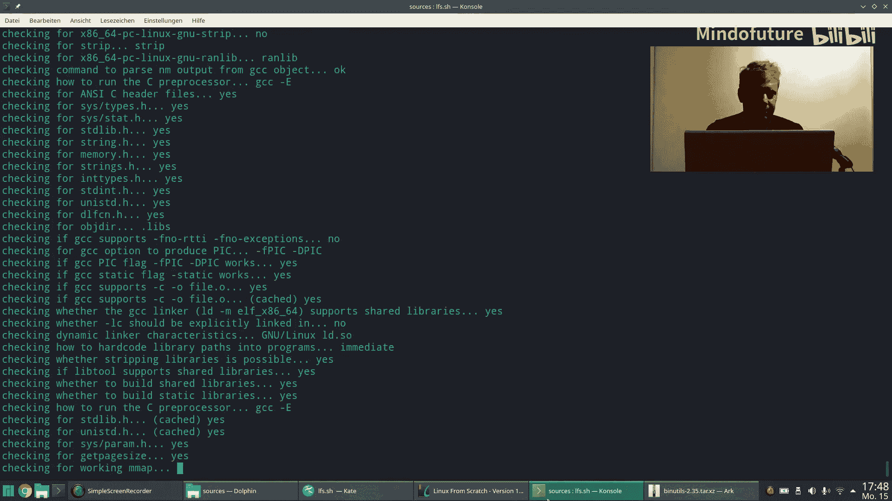
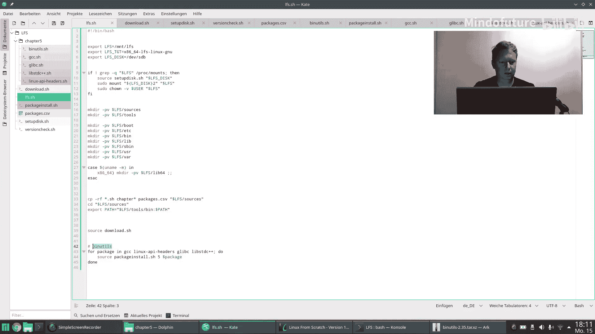
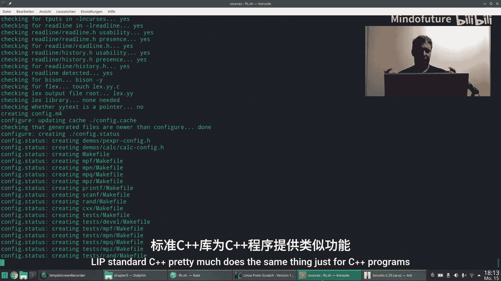
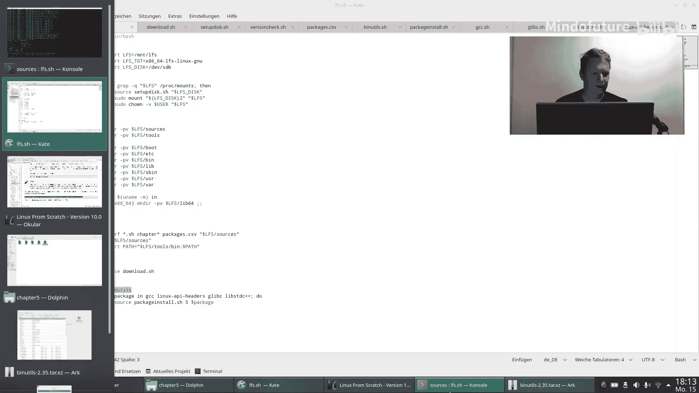

# 从零编写Linux操作系统-｜-Build-A-Linux-From-Scratch-p04-P04_Part_4-Compiling--BV1A78EzUEdf_p4-

Hi， everyone， and welcome back to this tutorial on building a Linux from scratch system。

Now in the last two videos。We have。Prepare the USB stick， and installed some。嗯。

We parted it installed file systems and created some directories and。And in the last video。

 we've downloaded all these source codes from the list in the Linux from scratch。A book。And yeah。

 now。So far， this was relatively trivial。And now， we want to start。Really installing this stuff。So。嗯。

What I'm going to do now is。嗯。I will create subdirecties here for each chapter。

Right now we are at the beginning of chapter5， so I will start with chapter5。Chapter 6。7。Driptter 8。

And。Then， I will go。To the corresponding。嗯。Part of the book。Here is chapterpt 5。And here we have。

 for example。The binuts。Package。And then in each of these chapters。

So so each package has its own chapter and。These chapters， then give you some。

Some codes telling you how to install。These packages and explaining the the parameters。And。Ylow。Also。

 explain the。The package。Content。 So why do you install it like venuenus contains a linker。

 an assmbler and some other tools。嗯。This is actually so binut tilts this is only pass one。

 we will later compile that again， as I told you before。嗯。Like here would be past two。And I think。

 yeah。So Cha 8，18， I think is the last time we compile it。And。The last time you compiled something。

That chapter also then contains descriptions of the things that you find in these packages。So。

Like binutts， for example， contains AR， which。Can。Create archive files。I think you use them for。

For combining different object files into a library archive。本。L D Saliner N M and read E。

A programme to look into object files。So， yeah。Let's start。Doing all of that。So， in chapterpt 5。

The first thing we need is。The program bin。AndThen， as a。And I really want to emphasize。

Linux from scratch advises you not to just copy and paste。These instructions。But， yeah， as a first。

Approxiation。I will just do that。So this is one of these examples that I told you about。

Where you really just have a configure， make。Make install。And here was。嗯。

Some parameters telling it where to put。The resulting file。

And which architecture to build it for and some other stuff。Yeah， as I said。

 these parameters are then。Explained very well in these chapters。嗯。For example， here。Disable NlS。

 Dis internationalization。Because this is just a temporary tool。 so we don't need that fancy stuff。

And。Dable W error。Willll just disable some error messages。好呃。

Warnings are not going to become error messages。I personally prefer write to use W error。Because。

I want my programs to really not even have warnings。And W error is a parameter that。

Really forces you to resolve all warnings。 And that's why I personally like W error， but。Of course。

People use different versions of these programs。 and the developers of binuts， for example。

 might have。Not optimized it for our version of GCC or whatever。 So you might get some problems。

 and that's why。It really makes sense to disable Warrow in many cases here。Okay。

So this would be the script here。So as I said， we will。呃。Run the script， and。

But we will still look at the output of the script and， and if something goes wrong。

 we still have to resolve it， so。But we will then resolve it by changing this script。

 So I think just copy and pasting it， although it's not advised。

I still think it makes sense as a first approximation and then if something goes wrong。

 then we can look at things and fix things。嗯。Good。So what I'm going to do now is。

I am going to create yet another。Oh。Scrt。

Package， install S， H。And I think you probably already have a hunch what this is going to do。

AfterI've already created this。Script here。So。From the LFS script。

Before I forget it down here where we copy all the scripts to the LFS sources directory。

I will also copy all these chapter directories。Okay。But。

And then I want to invoke this new script like this。Sace。Package， install。SH。

And then just give it something like bin。Your tilts。嗯。But， I will need。

Another parameter here for to tellt。嗯。To take the script from from Chapter 5， because。

 as you've seen， some of these packages will be recompiled it again and again in different chapters。

 so。Yeah， we really need to have。We really need to specify here which script to run。Okay。So。嗯。Yeah。

 this will work a little bit like the download script。Because we will。Again。

 run through this package as CSV， This package of CSV is kind of like a central hub for our scripts here。

 That's why I actually created this package as CSV in the first place， you know in the。In the books。

 they give you the location。Of a text file that contains all the URLs and a text file containing all the M5 sums。

 And you could just download that list， stick that into W you get。

 and it would download all these files。 And then you could take that list of M5 sums and stick that into M5 and。

Check all the packages for the M5 sums。 but I wanted the central packages CSV so that I can。

 on one hand， use it for downloading stuff and now use it for coordination of things like。Here。I如。

I want to tell it， hey， I want to install bino tilts。

 And now this script is supposed to look into this packages CSv。And then。Look at。This line。

WeOf course， we've already downloaded the T XZ file。But。This file is。Supposed to give us。呃。

For each a package name， a fire name。 that's reallyo。An important part here。

Because for the same thing。You might have different downloads here， for example。

 G C has this T X file， for example， but then also a patch file down here。So。

Or there are some cases like Li S TD C， plus， plus。Which comes from the GCC package。Right， so。

There is no direct connection between the name of the package and the name of the file that you get。

So。That's really an important thing。嗯。So if I say I want to install GCC。

I needed to extract this file。 And if I。Want to install Li standard C plus plus。

 It needs to unpack the same file。So that's really one major reason why I have this。嗯。This file here。

O。So。Okay。One thing I need to。嗯。Highlight here is that reading this CSV file like this is relatively slow。

And。That's why I will just。Put another program in between here。I will just grab。说。嗯。

For the package name。And。So package was。What the second parameter。

And the first parameter a chapter down。Okay， so。Okay， so I'm gonna。

Just throw out every package or every line。That's not for this package that I'm trying to install at this point。

嗯。And。Also， as I've shown you， there are sometimes the same package name。But different files。

 But that only happening in cases where you have a patch file。 So I will。Throughhrow out。

Cases where you have。Okay， I think like this should work。Yeah， this name is。

Actually pointless because we have the package already。Vers URL M。

 we don't need the M D5 sum anymore at this point。But the cache file that's the file that we need to extract。

嗯。And I will also create another。Variable。Okay， this is a bit complicated。

So the cache file will generally be named。Something dot， tar， dot， something， right， G， Z， X， E。嗯。

I'm sure we have some tabizi somewhere。I don't see one right now， but the point is。

I want to create a directory name from that。By removing this trailing。Dot， tower， dot， whatever。So。

I'll echo that。ああ、さ年。Okay。Just remove。So I'll， I'll do。I do a regular expression of whatever string。

嗯。Which I capture in this capture group here。With this back slash open parentheses。

 back slash close parentheses， that's a capture group。That will allow me to then map this string。

 to just。The stuff inside that capture track group。And then。Something dot tower。Dot。上害。Okay。Okay。

 that's quite complicated， as I told you， this will just recognize anything。 in particular。

 the start of the file name。This here will capture it in a capture group。

That I can then use back here。Men， dot， tar， dot。Whatever， G Z X C。Busy。Whatever。But this。

This is risky business， so。I was。嗯。Just。Tryries us。Okay， yeah， that that looks good， right。So its。

It preserves the name of the file， the name the version of the file， but it removes the extension。

 This is actually something that I kind of dislike in the Linux world that these dot tower dot something it's always quite hard to deal with that because。

You can have dots somewhere as part of your file name， and。Dot tower， dot3 Z， for example。

It's hard to capture the fact that。呃。Tar is part of the file extension， right？Normally。

 you would just say that well the file extension is。The stuff that comes behind the last。Period sign。

 So， but then。You would have something like who123 do Ta as the directory name。

 and that's not what we want， right？So， okay， whatever。Hi， digress。嗯。Good， so this seems to work。

So what we can then do。Is。Yeah， create that directory。And then extract the package file down。Okay。

 how do we extract？Extracting tough heights。I mean。I'm not a huge fan of Tfa， as I've already said。

Because T is very widely used in the Linux world， or in the Uni world。And。

But not in the Windows world。 And I always try to make my programs cross platform compatible。

 And since its not this format isn't used in the Windows world。

 I tend to package my programs as zip files。 So I don't。 I just don't use tower files much。

And that's why I always have problems when I try to or untar something because I never have the correct parameters in my head。

嗯。But at least I'm not the only one。Who has that problem。

 I remember an XKCD comic that pretty much made fun of that problem that people just never know the parameters of the tar。

Okay， tower。Extract。File。到了cash file。And where do I extract it。2。到了。Okay。

Now we have a small problem here。Because。Many of these packages。 and I haven't checked if。

 if it's the case for all of these。 If it's the case for all of these。

You could probably just circumvent it。But many of these packages just contain one directory。

 which then contains all the other files。 So if we just extract this。Let's see， like。In new tills。

Contains the directory binutils。 So if you extract it， you will have the directory binutil 2，3，5。

Slash binuts，2，3，5， slash something。And。I really want to go into that directory。嗯。

But the scripts from the from the Linux from scratch book。Usually。嗯。

Require you to be in the directory of the source codes。So。For these cases， where you really have。

Just one directory。In your package。嗯。I will。Then just take everything from that directory and move it。

Up one directory。So something like this。So we count。

We list the content of the directory wait we are in the wrong directory for this。I could。嗯。

I could just change directory into the directory。But some of these scripts will move around inside the directory。

 so I don't think this is a good idea。Because our script might get confused if one of these LFS scripts。

Changes to some subdirecty like the build directory also so。 So instead of。CD， I will use。Push deep。

 so。This is a C D。 So we are changing into that directory， but we store the old directory。On a stick。

So。After we've， we have finished。Running the script。

 we will just pop D and be just where we were before。

And that really gets rid of the problem with any change directories inside the script。Okay。So。Okay。

 so。We go into the directory。We create a list of the directory。And if that。

Then we count the number of entries。 And if that is one。嗯。B。嗯。

We will move everything from that subdirectory。Okay。

 so this gives us the name of the sub directory and everything in there， you know this。Stop here。

Will then be moved to the current directory。Good。Okay。そう。So we have extracted the directory。But we。

 we've extracted the package。 We've changed into the。Into the directory。

 we've made sure that we will get out properly again。So。

So now we really only need to run the script from that directory。So。One thing。I will put a sleep。

5 here。Because I wanted。Just some some time before。 So after we've compiled something。

 I really just want to be able to see， okay， we are done with this thing and now starts the next thing。

Com。And I'm doing this after doing this echo so that we can really see what is it doing now。So， if。

If we install one package， it will tell us compiling package， done compiling package。

 and when the next package is then compiled。It will tell us， okay。

 now I will start compiling the next package， but it will wait for five seconds so that we can look at it and see。

 okay， now this package is done and this one is the next。

So that will just give us a good hint at where we are in this whole process。So。Okay。あえるんです。Yes。

Although let's just say。Parent directory。Chapter。Tptile。And then。

The name of the script is just going to be taken from the package。And yeah。

 I think it's a good idea that if， if we。Just store everything。

 the whole output of the whole process in a log file。About just。And， of course。

 we need to make sure that this。Dirrey exists。And I want to be able to about this whole thing from。

From these scripts。So。If that script fails。And I want to at this whole thing。And this exit would now。

Bypass this pub D， so we would end up in the wrong directory。 So I will just put another pub D here。

Okay。And we need to redirect。The standard error from， for this script。To stand it out。

So that both standard out and standard error are locked in this log file。Okay。

I think that looks good。

So， let's try this。Scrt。Okay， it's。Extracting binnuils。This doesn't look bad。

So this is part of the configure。Scrt。That's what the autoconf does。

And this looks like it's compiling。Yes。

Okay， so this package will take a while。 I will fast forward now again。

 we've already discussed why we need the bin u package， because it's。Contains an assembler， a linker。

 and some other tools like the tools that。Combined。Sttic libraries。From object files。嗯。

So that's why we have that package。Yeah， as I said， this will take it sometime。

 so I will fast forward now。Okay， so this really looks。Pretty good。Looks like everything。

Compiled fine。So， let's continue。So。The next thing that we would need is。The first pass of the Gcc。

Then we will need the Linux API headers。Gip C and Li standard C plus plus。So。

So I'm going to do the same thing。Just copy and paste。Now， one thing。I want to point out。

Here we have this oops。The version of the。嗯。Of the Gcc。

 I will just put dollar version here because we are coming from。啊。From this package install。

 where we have set this version。还有。So。If we ever change the version。Then， this script would just。

Would just break。If we changed it in the packages。It would download a different。Version of that。

Package， but the script would definitely fail， because。

We wouldn't have the matching version here in the script。 So I think it just makes sense to。

To take this from a。From that environment variable。嗯。Although， I think。It's a good。

 It would be a good idea。啊。To export this， I'm not sure。

I think because of the way we invoke this with sauce， I think we don't need to export it。

 but just to be safe。嗯。What am I doing and what's just。

This was the wrong script here I was in Li standard C++。Okay。

But Li standard C plus plus had those same。The same version， right， because。

We are pulling it from the same location。So it needs to have the same version。Anyways， so。ok。Okay。

Okay， this is a coat for。GCC。Again， here we have a fixed。Version number here。 I think it's。

 it just makes sense to。Sa。I don't know which version we have。嗯。

I will just take whatever is there and try using it if it fails well。

 then we need to look at it again， but。嗯。But if， if we have a fixed version and that version doesn't match when we are。

Then we are guaranteed to fail。It just makes sense to me to at least try doing something right instead of definitely doing something wrong in that。

In that case。Okay， so we are extracting this and。Well， then they want to move。This directory。To MPFR。

 this one to GM and this one to MPC。 Yeah， MPFR GM and MPC are libraries used by Gcc for different things like。

I think。MPC is for multi precision calculations。嗯。MPF Rs， I think。Hello。

Multi precision floating points。 So I think these all have something to do with。Floating points。

 calculations。MPF。GMP MPC。嗯。So。These tar commands really try to extract these packages here。And。

Then want to move them into these。Yeah。More standardized。Diirectctorory names。I think。Since。

I don't want to use fixed version numbers here。I will just tell it to the to。

Uninst directly into MPFR。GM。And。MPC。And， yeah， since these。嗯。Tawballs。Again。

 contain just a single directory that contains everything。With these names here。I will just say dash。

 dash。Striip dash components。Equals one。That just means remove this first directory from there。Okay。

Okay。そ。So now we have done all these scripts。Okay， venue new to GC。Theinux API head us。Glipy。And。

Lip standard seat。スプラス。So I commented out the binnu tilts because this already。

 we've done this already。

So。Yeah， let's install here。Next for packages。GCC will take a long time again。

 so I'm going to fast forward here again now。I mean。We could talk about what Gcc is for。

 but cannot on Gcc is Gcc。 It's the new compiler collection。 This is。Our C plus plus compiler。

 and our C compiler。嗯。Yeah， it's pretty obvious what this is for。GlippsC， of course， is。A library。

 which。All the other programs are gonna link against， because。

This library is going to contain the communication with the Linux kernel。So。

Pretty much everything other programs do， like opening files or opening network sockets works by talking to the Giy and calling functions from Gipsy like F Open F close。

Socket， whatever， which then in turn do the system calls to the Linux kernel。So。Yeah。

 G C really is the。The adapta between the kernelel and your programs。

Which lets your programs just call some function like like F open。

 and it will take care of how it's done。On that system。So， yeah。

Lip standard C++ pretty much does the same thing just for C++ programs。

And Linux RP headers or Linux API headers。

Of course， they are there for the trilip C to know。To know the signatures。

 So it's for the communication。嗯。Yeah， these are relief for the Gpsy to know how。

How to communicate with。With a con。These things are pretty。Ped dry， so。

I think it's a good thing if you， if you are really pedantic with the version numbers here， but。

Because if anything doesn't fit， they are。Everything will just break so。

This is a part of the Linux from scratch， where I'd say you should really try to follow the their code。

Very closely， but。I haven't done that exactly here myself。Who am I to tell you that？嗯。

And the Linux API headers， of course。嗯。These are the headers for a kernel that we aren't even running yet。

 so。It's kind of funny， but these headers tell Giy how to communicate with the kernel that isn't even there yet。

 but。This will， later， than。Be used for。For communicating with the colonel that will then be there。

Okay。

So， that looks pretty good。It looks like everything went through。Yeah。啊。

I think that's enough for today this was chapter5， next time we will do chapter6。

 maybe even get into the change root environment already。So tune in next time。

 if you liked this video。Like it share it， subscribe。

And please turn off your ad blocker while watching these videos that would help me a lot。And yeah。

 see you next time， bye。