# 从零编写Linux操作系统-｜-Build-A-Linux-From-Scratch-p05-P05_Part_5-chroot--BV1A78EzUEdf_p5-

Hi everyone and welcome back to this tutorial on building a Linux from scratch system。Now。

 in the last videos， we have already prepared our USB key。Formatted it。

Created some directories on it and downloaded all the source codes and。Started compiling them。嗯。

And yeah， this is pretty much where we continue right now。So。Put it in again。

And I must remember to mount it because otherwise， my script will。Start over and format it again， so。

Yeah。I really should make sure that it is mounted。Okay。Okay， interesting。

I think it I might have put the USB key in a different USB port。 So now it's。

Has gotten a different device name。 So it's S D C now apparently。So now I have to do it like this。O。

Let's make that sure。Yes。Good， so。Now， we continue and。Yeah。

 the next steps are pretty much the same as。The last steps from the last video。I will just have。

Scrip tiles for all the packages that we will use now。And。This time， we need。The packages。M 4。嗯。

You know what， I， I will not create them manually。Because it's a bit that would be a bit much。

I will do this like this。Chapter 6。And instead， because I will later need a list of these。

Packages anyways。I will just create them in a loop now。Ppy and。So the packages that we will need now。

The packages。M 4。And curseus。The bash。Ca you tilt， the few tilt。发有。Thank you， tilts。Beno。Ok。Grep。

Dre zip。Make。Pch。Set the stream at a。Chaor。Except。Bin you tilts。

 So way we build the binnu tilt again。And GCC。Okay， so now I have created all these files here。

In case you're wondering。嗯。If you don't know， I mean this。Kind of came out of nowhere。

These packages that I selected here。They pretty much。Not pretty much。

 they correspond exactly to the table of contents of the Linux from scratch manual so。

As what you have seen M4 andcursor batch call utility utilities file， find utilities Co。

 grab Git make patch set tar Ex u and Gcc。 These are really。The， the sub chapterpts of Chapter 6。

In this LFS book， right？嗯。Okay， now I have opened the book in Ocular。But I。Should better open it。

With Chrome。Because， yeah。Last time， we。嗯。I had opened it in。嗯。In Ocular。

 and that kind of broke the copy and paste。I don't know why， but。Whatever。 So here we go again。

Copy and paste。All the coat from。script and this time it doesn't。Doesn't break a copy and paste。

I think this is one that's a bit funny of。It。You built make。With a make file。

 So you need to have make to get make。Okay， now。We might want to hunt for。Cases where， we have to。

Version number of things in the script， you know， Xus。5，2，5， and。嗯。In that package install script。

 we set the variable。Where was it。Here。We set the version number。

So we take the version number from the CSV file and store that in the environment variable version。

So， we might want to。You sit here。Of course， only in cases where it's relevant。Okay。

 so this looks good so far。😔，嗯。Now。Now we can do the same thing that we did with chapterpt 5。

So now we have tripor6。Then， of course， here， we need to。Change this  to 6。 also， because now we are。

Taking our scripts from the chapterpter 6 directory。And this list of。Packages isn't correct anymore。

But， I had， luckily。Written that down already here。So I can just copy it from there。😔，Okay。

 now one thing that we should do。嗯。In this package install script is。嗯。We create the directory here。

 right， after we've determined。The name for this directory。

And I think maybe I should make this a bit bigger。嗯。

So here is the name of the directory that we want to use。And here， we create that directory。But。

We already had the binnu tiltil in Gcc in Chapter 5， right， so。These files will already be extracted。

 and when you look at something like M4。They do some changes to the files， so。

It would really not be a good idea to just， I don't know。If we did it like this。

If we only tried to create the directory。This parameter dash P means if it's already there。

 everything's fine so。Yeah， this might lead to situations where you have changed some files in a previous。

Run， and then。You are using basically files from a that have been changed。

And you cannot be certain that。The same change needs to be。Done again in this in the next run and。

Just。嗯。This would this might just screw stuff up， so。Because of that。I will just。Test， if。

This directory already exists。Okay。And actually the Linux from scratchbook actually advises you to do that anyways。

After you've compiled。One package， they advise you to delete the directory directly and not wait for the next run through。

 But I think that's okay to do it here。Okay。So yeah， we've already done chapter 5 right。

 so I will just comment this out for now because well。

 the stuff from chapter 5 is already compiled and I don't want to compile it again。

And everything else。Doesn't do anything， right， so。might try to create some directories。

 but they are already there， so。That will just be ignored。嗯。The USB key is mounted。

 So this is gonna be ignored。The download。嗯。We'll just skip everything because everything is already there。

嗯。Yeah， this is actually a good thing that we should execute every time we start our LF S script again because we are running the script from the USB key and。

Well， if we had。We are editing them。On the local hard drive， but running them from the USB key。

 So it's really a good idea to copy them over here。

So that they are up to date on the key before we run them。Okay。Alright， this looks good。Okay。

 so I will start this。I'm actually curious to see what happens with M4。

 because I've had problems with that package。When I tried this before， but I mean。

 I was able to solve the problems， but。I have changed something in between。

 So I'm curious to see if this is going to work now。

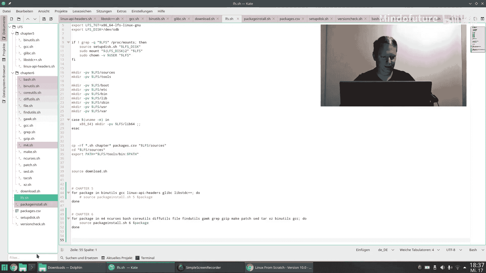

So。Okay。

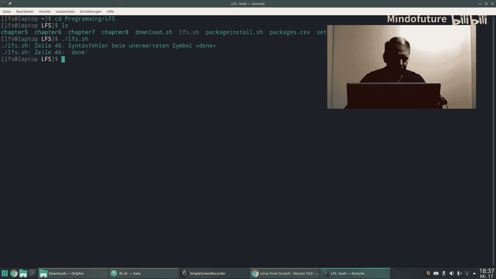

46。Okay， it's complaining that probably that nothing is done here。I will just。

I will just put something that doesn't do anything in between。

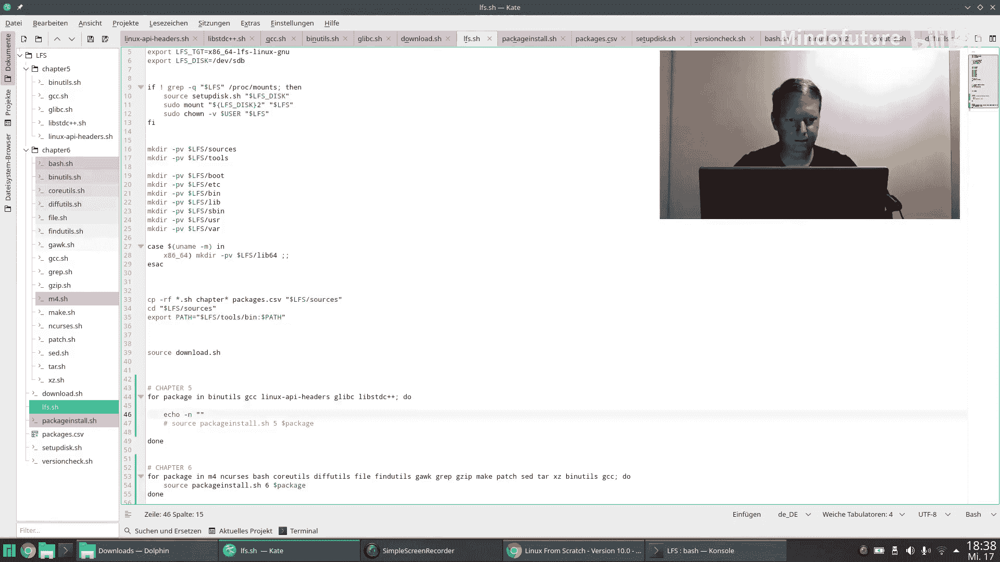

Okay， now it's compiling。Okay， so this is going to take a while again and。

I'm going to have lunch now， so see you later。

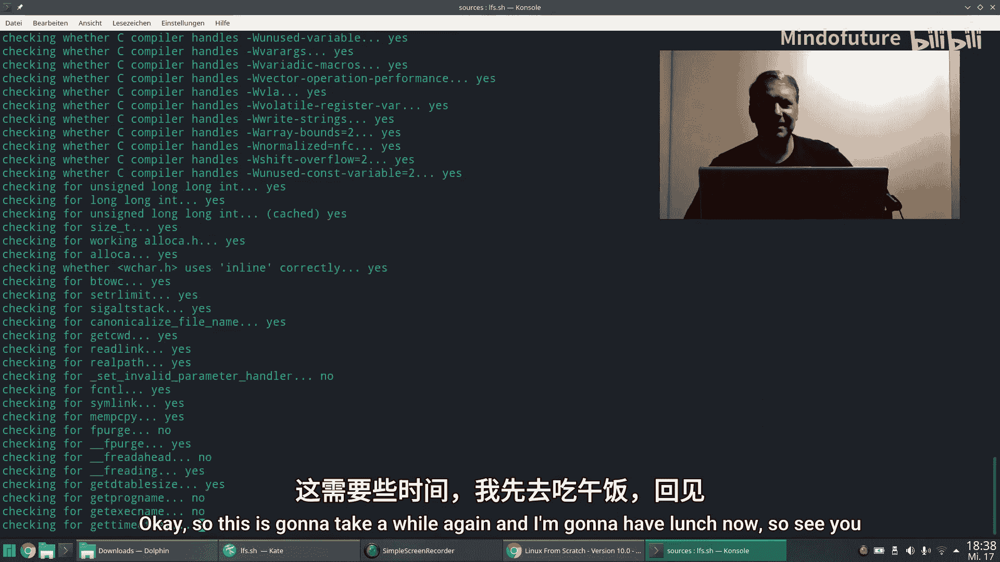

。Okay， so this took quite a while。嗯。Yeah， I think I should look into the log files。

Because as I told you， I've had。Problems with。M4 before。I don' know what。 I will just。

Take a whole directory。Yeah， M4 had problems as I had before。This is exactly the same problem that I。

😔，Have seen before。Id already written an email to the developers of Linux from scratch， but。

They thought it was something。I must have done wrong。I don't know， I think。

I followed their instructions very well， so。Okay， so。Yeah。

We have this error here and the compilation didn't succeed。So。Now， I am going to。Compile this again。

It's actually a good thing that we have had a problem now because。嗯。Would be a bit boring。

 And you wouldn't learn so much if everything just runs through smoothly， right， so。嗯。So。

 the error message。Complaints about a parameter W A B I。Which is a deprecated parameter and。

They give。嗯。Yeah， they give an alternative for the parameter。That you should give to the C compiler。

 so。I'm going to take that。And yeah， if you know a little bit of make and the auto tools。嗯。

You know that this variable C flags。Is there。嗯。Yeah， you， you can。You can tell the make。

System to or at least be if it if it's been generated by autoomic。嗯。

You can tell it to give some additional parameters to the C compiler like this。嗯。Last time I did it。

 I also had F permissive。Here。Although I think that should not be necessary because。Yeah， the。

In my protocols from last time I did this。I've seen the compiler then complain that F permissive is not even a parameter for C。

IIt would be one for C plus plus， so。I'm a bit on the fence if I should put it here or not。

Because without permissive。I think this second error here。Might still occur。嗯。Again。

The compiler had told me that F permissive was not a parameter for it， so。嗯。

It might be a waste of a parameter， but I would。诶。I was to put it there just in case。嗯。Okay。So， now。

 I will only。Recompile M4。I hope that everything else。Well just run。Through。Actually。

 why I'm doing this in a loop。Doesn't even make sense。Okay。

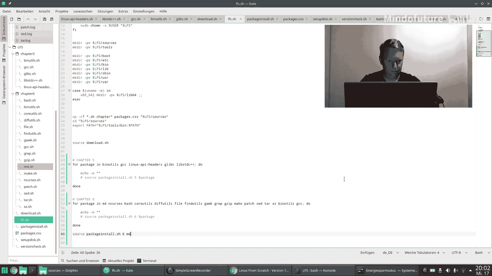

Yeah， I think the should work now。Well， this was quick。I was just。Thinking about。

Talking about the packages and what they are。What the reason for them。

And the reason why they are in there。But okay， it's already run through。fewew warnings， but。

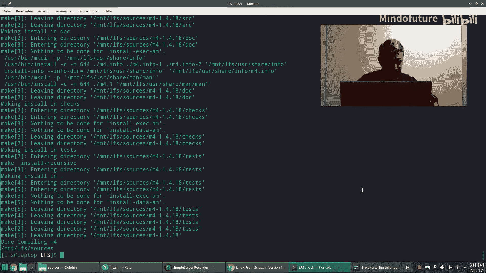

Okay， so yeah， that was a bit quicker than I than I expected。嗯。Yeah。

 so then let's go to the next topic， although。At this point。

 I want to make a backup of the whole thing。So。第一。Linux from scratch。Book also has some。

Instructions on how to make a backup。So， I will。

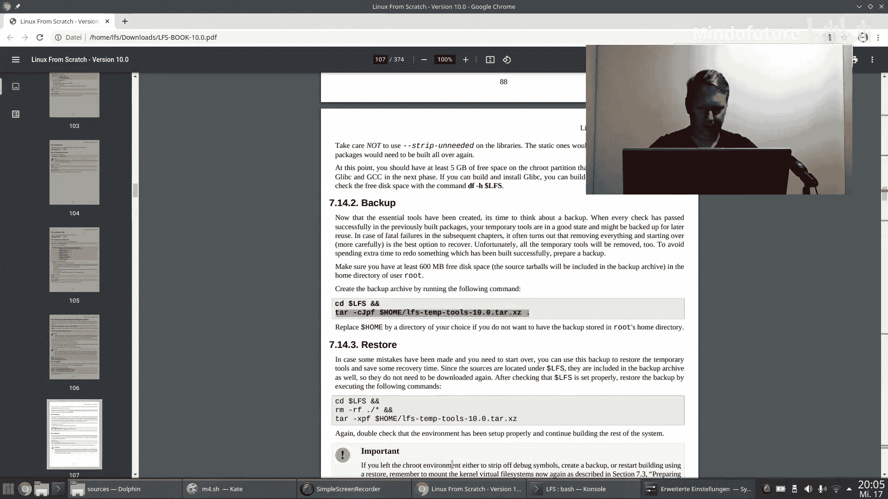

Do that now。So you need to go to your Linux from scratch Mopoint。And yeah， this tament is。

Kind of crazy， but。I've tried it before。 It works， so。Okay， so now while this is making a backup。

 this is。This will take some time again。嗯。

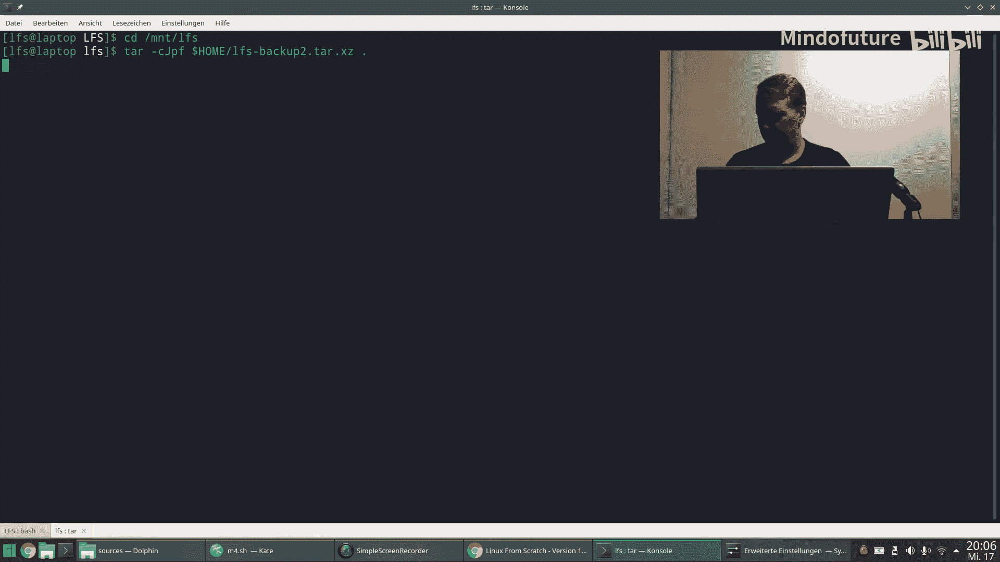

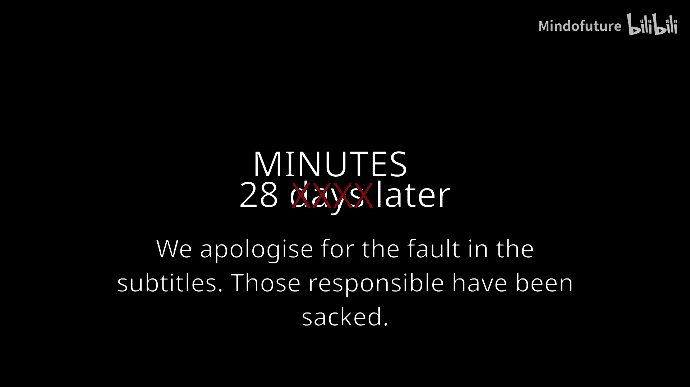

嗯。Soう。Then。I promised you to go to the change route environment。Today。So I want to deliver。

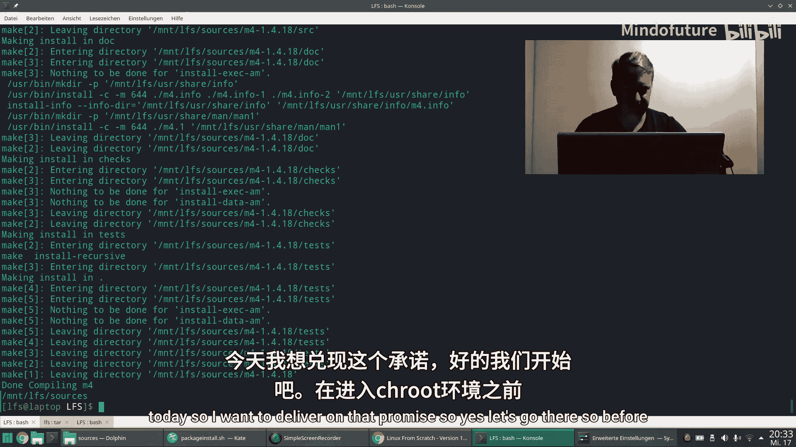

On that promise so。Yes， let's go there。So before we go into the change route。

 we need to do some preparation。So I created these two new。Scrips。

Let's start writing these scripts here。So。Now， most of these scripts I just invoke using this source command。

And。Invoking it like that doesn't require them to be executable。But。Now， the next。

 these two scripts that I just created。Will be。Invoked。In a different way， so。

They need to be executed。 They need to be executable。So this prepare change route。

Needs to be run as rude。So， we。Run this S。With Su。嗯。But we need to pass。The LFS。

Variable into the change route， into the script。嗯。We could actually do that。嗯。Doing it like this。嗯。

Now， since I'm running this not from a source。Comment。I have this chaang here。

And since we are running this as root， we really risk breaking our， our working machine here， so。嗯。

So I am taking the variable from the parameters。And， oh。嗯。Require this variable to not be empty。So。

 just some。So just a sanity check to really make sure。

That we are not accidentally running this without that parameter。Okay。Now。嗯。We had created。

All this directory is here。And。All the directories except the sources directory。Now， need to。

Be given。To the root user。And remember， we are running this She script S root。

 so we don't need zdo in here。O。And again， this。Little thing here。Okay。

 so now we have given all the directories to root。嗯。If we run into problems after this。

We'll have a problem， but。Might be a， It might be a good idea to， to have some script that。

Does all this stuff in reverse。In the opposite direction。Okay。Now we created a few more directories。

Namely the deaf directorate proc。Ss and run。And now comes comes a really interesting part of this entering the change route environment。

Because。So far， we've really just created some directories and ran some programs and downloaded some source codes and compiled them。

嗯。But now this。It's really low level stuff。Because if we enter the。The change route。

Staff might want to talk to devices。Like， I don't know。

I'm not sure if the keyboard would even work without。A deaf directory。Not certain， but。Anyhow。

 we just need the de directory。So。So， we。Basically， do something like a s。

So we mount with the bind option。嗯。So here we've created the deaf directory。

And now we have something like a。Like a or hard link from our original deaf directory to that。

Deaf directory actually， no， it's not a heart link。 It's a slink。More or less， because。

Hardlings don't work across different file systems of or between different partitions。

 And we are running this on a different partition， so。It's not a hard link。Okay。

Then we do the same thing with。Deef P T， S。Deef P， T， S。嗯。If you're wondering。嗯。Deef P， T， S is。

Whereas a。You know， on Linux， everything is a file。At least in theory， and。啊。So。

Your shelves like this。ACons session here must be something like a file also。And。So。With a command。

 T， T， Y， you can ask。The shell， hey， what is your file。And we have the files， de PTS。 and remember。

 PTS is the directory that we are talking about here。

So FPTS contains also so called pseudolu tailortype。嗯。And okay， so this is pseudo tillor type 1。

And this is pseudo tail type 5。And now I could do something like echo echo。Hello。

And sent that to deaf P， T， S。5。And then， it will show up。Over here， there's hello。And one thing。

 this is really just something that comes out and is then put on your screen。

 but it doesn't have any effect， so。So。If I set something like echo， echo。Hello。Then。

This doesn't become。Anything。Executable over here。 It's just text that you can see。

 but it's not something in your keyboard buffer or something that。

Would have any effect if you sent it out again， So this is really just something that came out of your shell as if it was printed by some program that you are running。

This whole topic with pseudotelotypes is actually quite interesting。

You might really want to look into that。Like theres， for example， the program screen。嗯。

Which is something like。嗯。How do I explain that screen can。Can launch multiple。Shell S。In parallel。

So。So here we have， I've just created two sessions。In this screen。And now， I can do。

Something in one of these sessions and then。Control a shift to。Go to the other session。

Control A control A， and then you can switch between these multiple sessions。Now， I've closed。

Both sessions。 that's why screen has now terminated and。Now， I've closed that。Whole session。O。

So much about that。That's。I' digress again， this is。But I just find that so fascinating。Okay。

 now we also need M K not。We need。嗯。Note files。For our console， and for defll。With excess rights。

600 and。666， respectively。This is a character device， So parameter C， and then 5，1。

These numbers are the so called major and minor numbers。And yeah， you can Google for that。 M not。Mei。

知啊。M know。Numbers list。And there you will find， I don't know whether this isn't the first result here。

 but。This is actually part of the Linux source code documentation。So， if you download the。

So Linux source code， this is in the Doc subfold。Let me make that a bit bigger。1。

3 is the null device。嗯。I guess you've already done stuff with that。For example。

 you redirect some outputs there just to suppress the outputs。And。5，1。Is the system console。本当す。6，6。

6。The number of the beast。嗯。Yeah。Do you know。All these。Octa。Excces right。

So the first digit is for the。For the owner of a file， second is for the group of a file。

 third is for any other user。And。Well。So。Each of these digits。Can be any number between 1 and 7。

between 0 and 7， actually， these are oc numbers。And that means you have three bits to each of them。

The first bit， the four that represents a four is for reading， so a read， right？The second one。

Is for writing， and the third is for executing。 So RW X is something I always have in my mind。

 So a 6 means4 plus 2 means you have read and write access。0，0 means the group and the。

And any other person has no access。And here everyone has read and write access。O。

So now we are almost done setting up the change route。We need to mount a few more things。

The proc file system。Se。Communication with running programs。You know processes。I think。PS， S and top。

Hello。Probably use them in the background to find out which processes are running and stuff。So。

I think that's what propp is for。Then you need to access F S。Mounted2。S。

This assess for communication with a kernel。嗯。And then。And now。

The last thing we need to prepare the change route， that's actually something。

When I thought about making my own Linux system。Before I had looked into Linux from scratch。呃。

This is something I would not have thought of。So。What they are doing here is。They are looking at。嗯。对。

At the location， de， SHM。And S， H M is shared memory。嗯。Why are they looking at that。

Well some distributions put that interface to shared memory， not to deaf S H M。 They put it to。嗯。

Some other location probably run SHM。嗯。But no matter where they put it。We just replicate that by。

So if they put it somewhere else。It is a bit crazy to explain if they put that somewhere else。Then。

 they will still have。A symbollink。Under the position， de， S， H M。And then， we have to。I'll find out。

 where does that point。And just have to create that file。 and that。Then。Yeah。

 allows us to access shared memory。I don't know who found that out。But。Anyhow。

So this is the stuff that we need to do as a preparation for the change route。

And inside that change route， I will for now just echo test and pipe that to slash test dot T X T because。

In case anything goes wrong， I don't want to break anything， right？

Even if we are not actually in a change route， then we just create this file text dot TXT somewhere on our drive。

 and then we will see， oh， something went wrong。Because this isn't in the wrong location。

So that's why for now， I will really only have this。For this insight， change route。嗯。Okay。そう。

We've prepared the change route now。Okay。How do we enter the change route now。

Because now everything is there for us to work with。Well， pseudo。Because change route。

Requires route permissions， not。That's， I think， a given。

So our LFS location is now going to become the new route。

That's why I have this as first parameter here。And now I need to tell it what to run inside that change route。

嗯。Well。We will run our bash。 You know， we've compiled our own bash。And we want to run that。嗯。

Please log N plus H is to turn on history so you can use the。Up arrow to。

Return to comments that you've already given。And inside that bash。I will run。This。Inight， truth。Scr。

Nowhere is that。That at it was at dollar L F S slash。Saces， slash。Inside true do this age。

 But when L F S is a new route。Then this has to go away from here。Okay。

And this is not all we have to do。Because。If we did it like that。

 we would not have any environment variables。And especially not the pass variable， for example。So。

Instead of running bash directly。We first run。User。并。And。😊。

Which is a program that just sets environment variables。And we set the variables， home equals。

Slash route， although that directory doesn't even exist yet。嗯。Term equals。Tm。So。I， actually， not。Oh。

Maybe we should set this to bin bash。But。Whatever， I'll leave it like that。

The path variable is where the batchsh looks for programs when you enter a commanded。

 these are the paths。That the bash。Checks to find。The program that you' are trying to start。Actually。

 did you know the program which？It's also a useful program。

If you don't know where a program that you're running is located。Like。Which C。嗯。Let's say， which G C。

嗯。Which will tell you。The location。Of so if， if you launch Gcc。

This is going to be the location that it's been taken from。And it finds that really。

 by just going through the path variable from first to last， and。It finds a G C in here。

 And that's why which。Then reports this as a location， and that's where。Gcc is started from。

I digress again。Then user then as spin user as。Okay。

And now there's only one thing left that we need to do or one variable left。

And that's a variable PS1。And。Well， PS1。What is PS1。嗯。Well， PS1 now the list doesn't tell you much。

 maybe。P S1 controls。This。嗯。Prompt， how is it formatted and。Here's this。Back slash open bracket。

 That's this bracket here。Then back slash0，3，3。Is the start of a V T 100 color code。

These VT 100 or unzi escapescape codes， as they are also called。

 That's actually quite an interesting topic， so。I want to tell you a little bit about it。Yeah。

 here on Wikipedia， you can look into that topic。So these F escape sequences are the interesting part。

嗯。So it says here， escapee， open bracket。And。

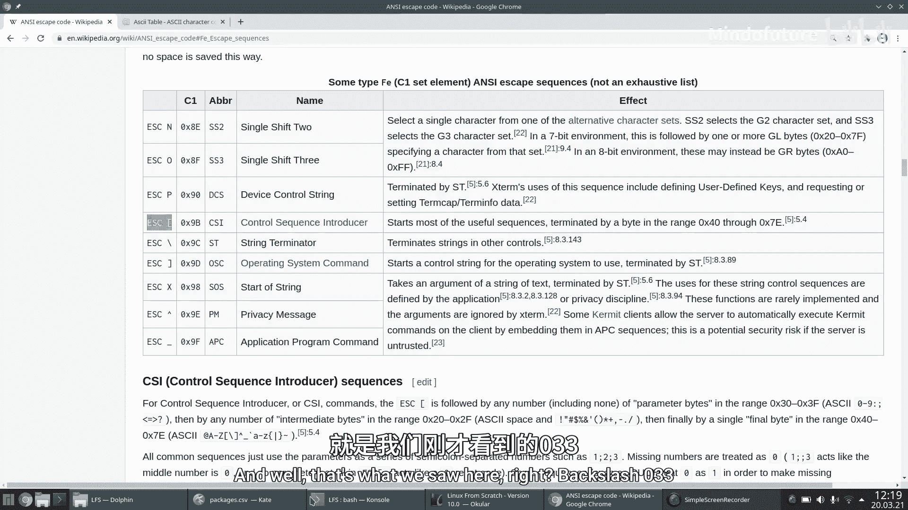

Well， that's what we saw here， right？Ex slash 0s，3，3。

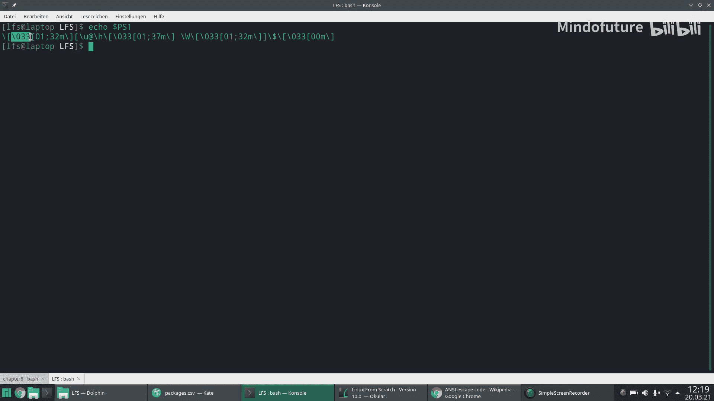

Open bracket now，0，3，3 is theoc representation。

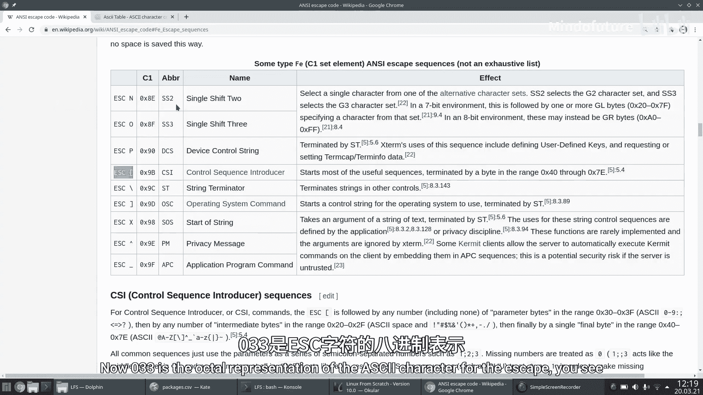

Of the Ski character。For the escape。You see down here， you might also see a0 x1 B。

 which would be the hexadadeimmal representation or even a decimal 27。

 Some systems also support something like backlash E。For this character。So let's escape。

So we have here escape open bracket。

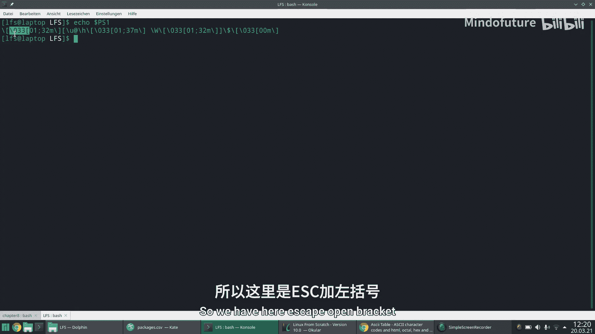

And then。That's the control sequence introducer， and then you have this list here。

 which tells you what does the following stuff mean。

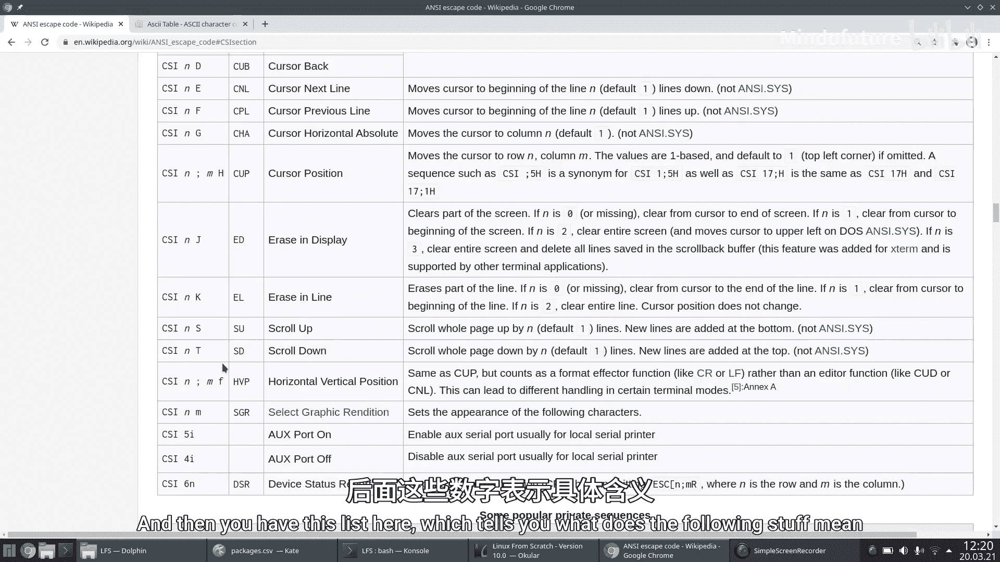

And。What did we have here， We had 0，1 semicolon。3，2。 And then this M。

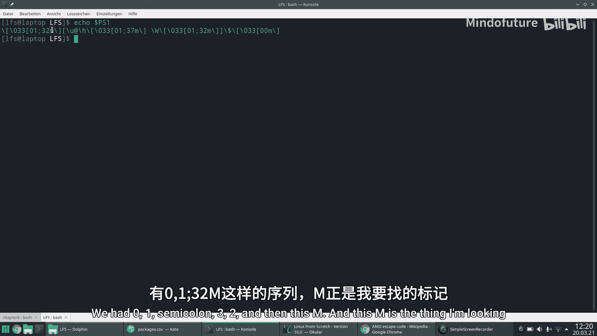

And this M is。The thing I'm looking for right now。So。Escape open bracket。

 something means select graphic Randition。Then， down here。It tells us。

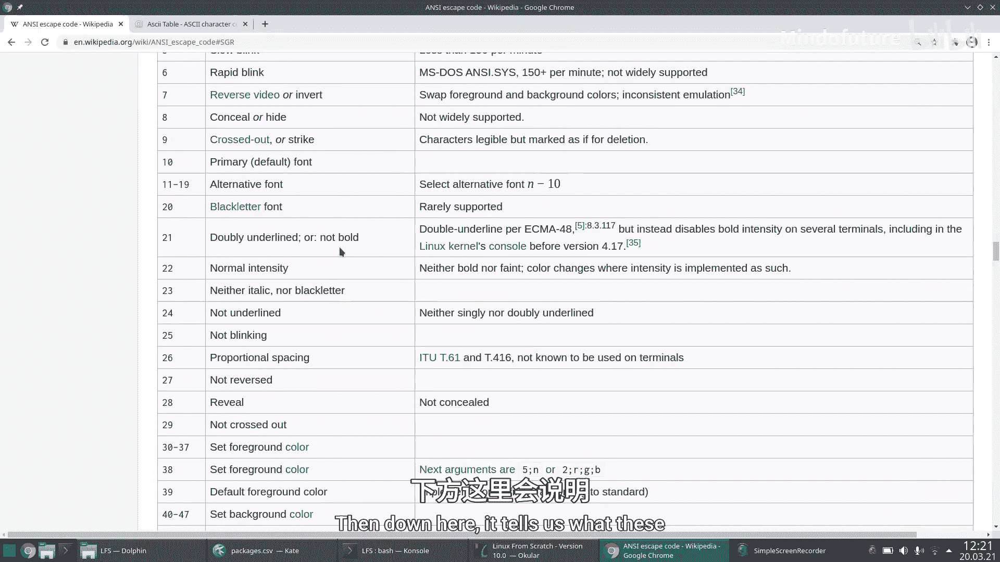

What are what these。What these numbers in between。

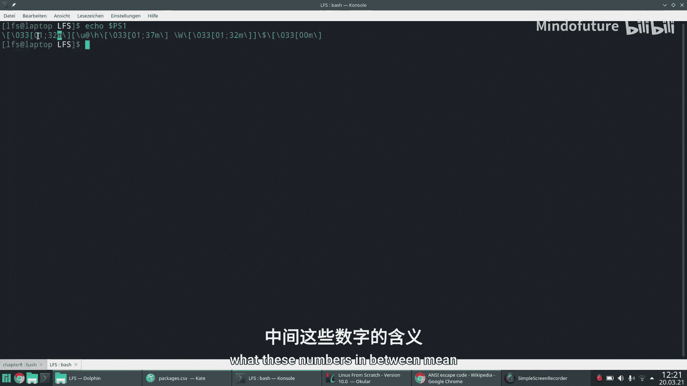

Ming。So。0，1 is actually just a one。 So that's。That means it increases intensity of the color。

 so the color becomes a bit more。嗯。

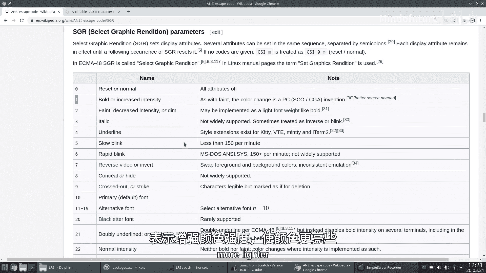

Laterer。And then， we had 32。

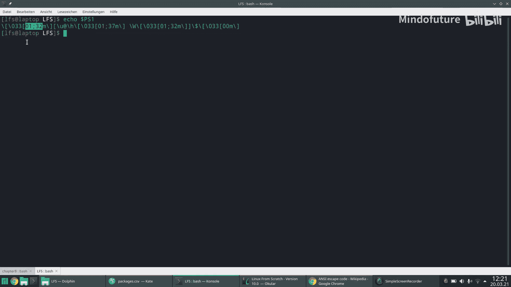

32 is in the range of set foreground color。

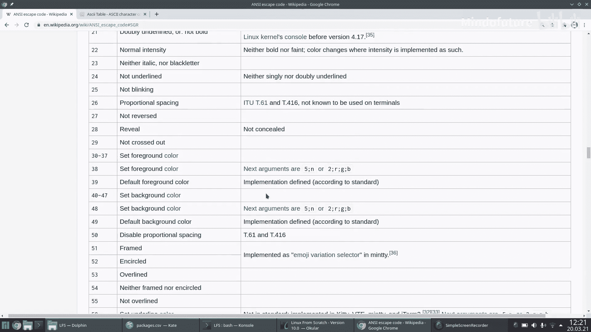

So we have to look down here and 32 is green。Yeah， that's what we are seeing， right。

 So this text here is green。And then later， we set the color。2 color，37。37 is white。

 That's what we see。Here。And yeah， you can just。Play with us a bit。We can just change that variable。

So I might just change the color in the front there to 33 instead。

 so then it's yellow instead of green。Or if I。嗯。If I remove this one here。Then， yeah。

 it's not very visible， but you might see that the。The green is a bit darker here now than here。So。

You can do all sorts of stuff with that， so。I might put some extra text in here。

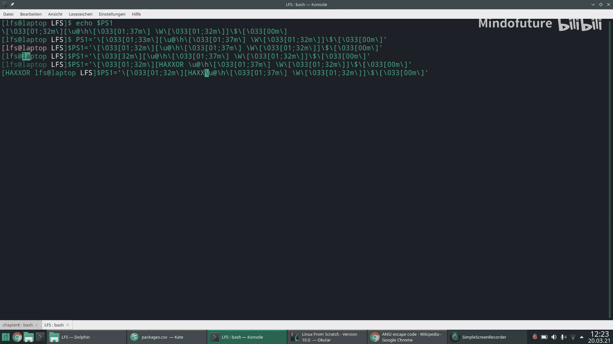

But okay， back to our topic。Then， you get。You get a backslash U， which is your username at。At。

Back slash H is your host name。Then。They change the color， from green to white。

Then back slash W is the。AWorking directory。And then。Back to color 32， Back to green。And。

And back slash dollar is either a dollar sign for normal users or a。Hello。A pound signed for。

Administrator users。So that's this P1 variable。In the LFS book。They said it to El route。Uuza。Coll on。

 working directory。And。😔，Either a dollar sign or pound sign。Depending on your excess rates。是哎。So。

 this will then。Run。嗯。Our insight， Tru script。Inside the tro。O。Okay， some status message in there。

Okay。

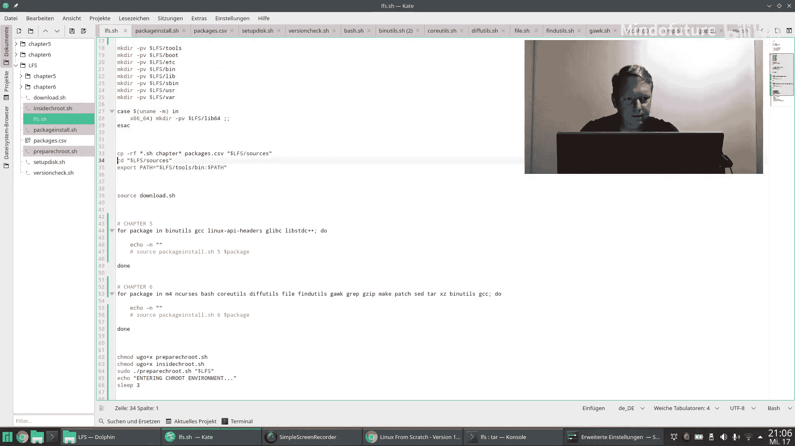

Okay， screw the backup， we're going live。

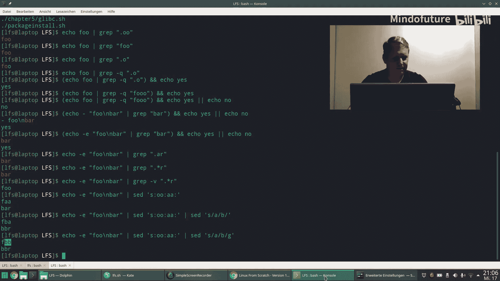

We're doing it live。

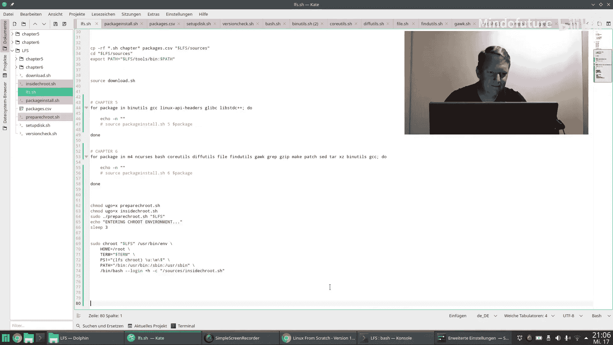

Entering change route environment。 Hello from In Change route。That is looking good。

 That is looking good。

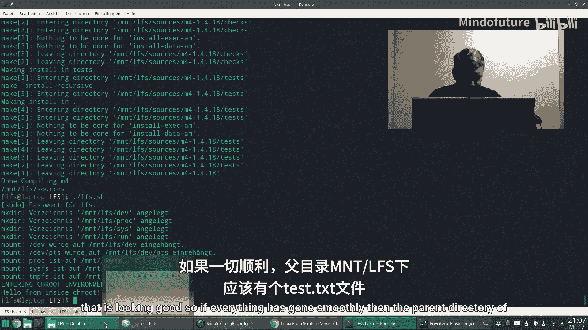

So if everything has gone smoothly。Then the parent directory of this。You know， M N T。

 LF S should contain a file named。Named test dot T， X T containing the just a text test。

And there it is。Containing a text test。So this was successfully run inside the change root environment。

Yes。Great， this is one big step。😊，On your path to your Linux from scratch system。As I said。

We might want to。To have some。Additional script。Which。And does all this stuff here。

 especially which gives the access back to our main user。Not our LFS user。

 but yeah for now I'm really happy and I think this is now really enough for this video so yeah。

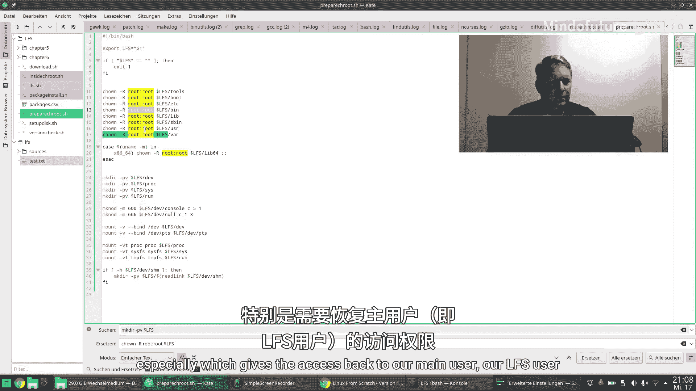

は。Great， so。Then。That's enough for today。 tune in next time。When we were built。

A few more tools for the。For system B， And then we can finally really start。

Building our final target system。Our system， C。And I'm really looking forward to that。

 So don't miss it and。Yeah， if you like this video， like it share it。

 subscribe and maybe turn off your ad blocker， that would help me a lot and see you next time。Bye。

