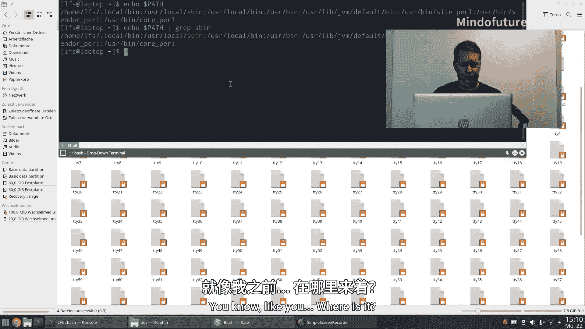
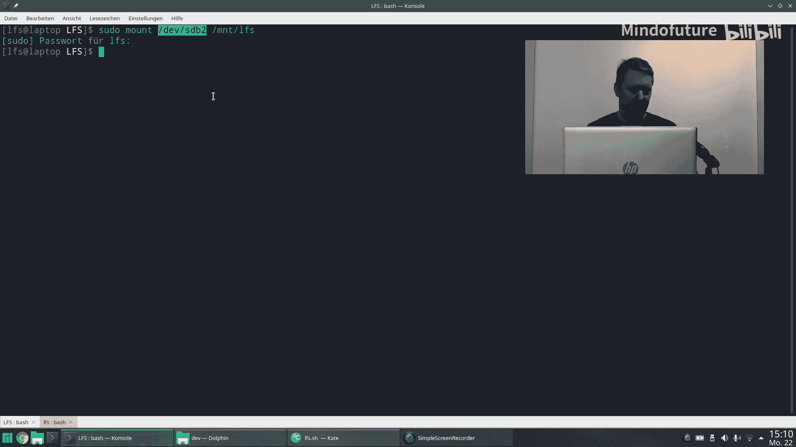
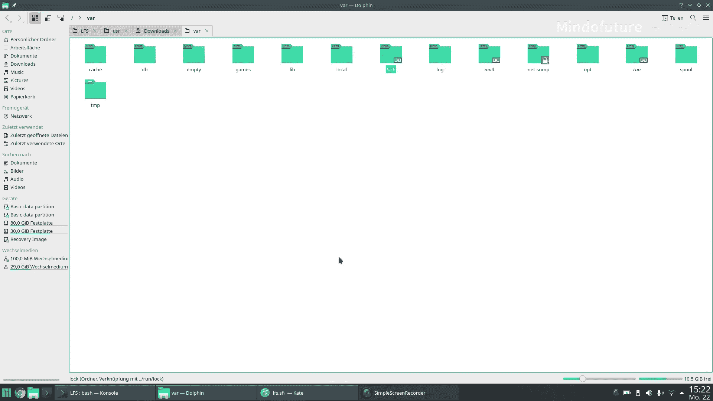
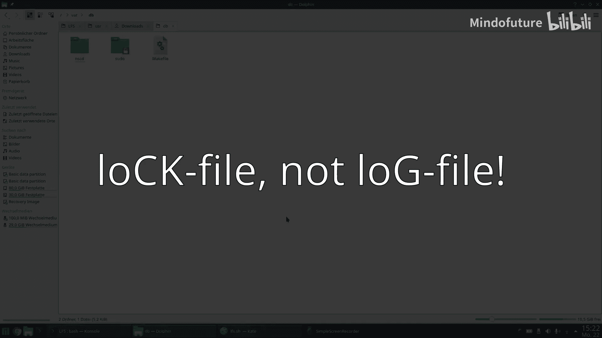
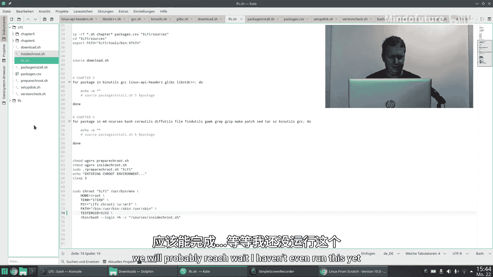
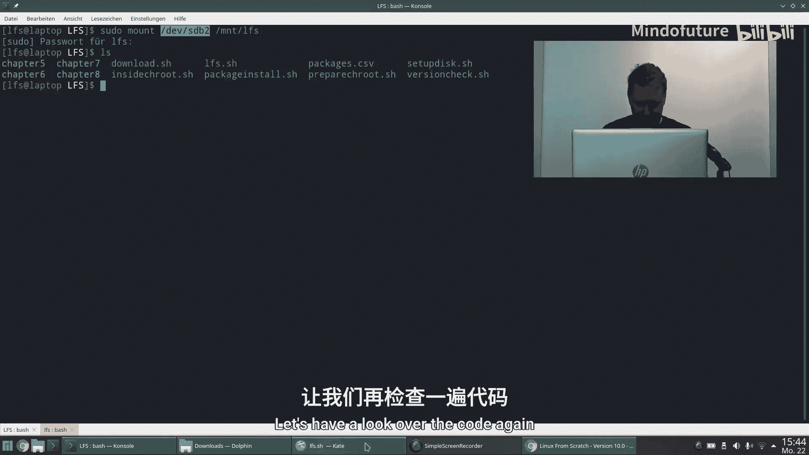
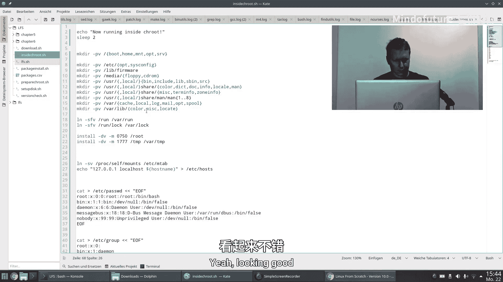
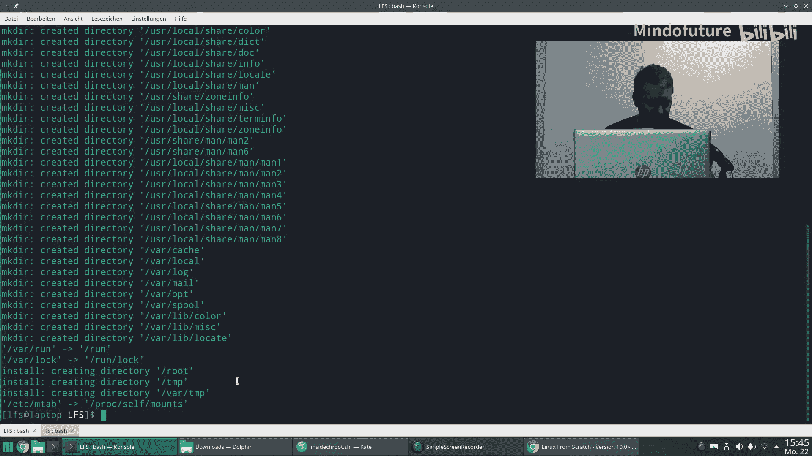
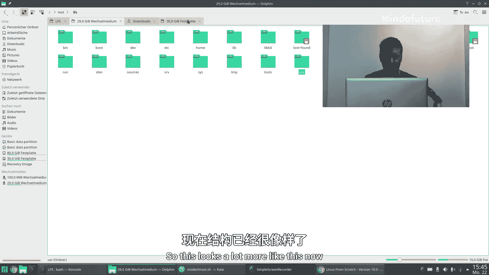

# 从零编写Linux操作系统-｜-Build-A-Linux-From-Scratch-p06-P06_Part_6-Directories__Users_and_Groups--BV1A78EzUEdf_p6-

Hello， world。 welcome back to this tutorial on building a Linux from scratch system。

Now the last time。We've managed to enter the change route environment。And yeah。

 this is where we will continue。We are in chapter seven now。And。Yeah， so。

Pretty much the first thing we will do inside the train route environment is we will create a lot of directories。

So I think this is a good time to start talking about the directories in Linuxux systems or Uniux systems in general。

嗯。And。Yeah， so just let's look at the ones that we already have。嗯。So we have a boot directory。

This is where you would find the boot loader and the configuration of the boot loader， and also the。

The cornerer。Possibly initial run drive， so initial in it RD stuff。嗯。That would be in boot。

 Then we have。Esy。Well， this is where you will find a lot of configuration files for the whole system。

So。Configuration files that would be system wide。 so not your personal configuration for your for your user。

 but system wide stuff like hardware configuration。嗯。And I really don't know why it's called Etsy。

I've read there was a discussion on slashdo once where they debated what Etsy stands for and。

I think the best answer I've seen there was extended text configuration also， but。I don't know it。

It really looks like eta。 and like they just couldn't decide a name for that directory or。

Maybe they decided to put the configurations there after。

Creating the directory for any miscellaneous stuff， you know？So。

They could have named it Cf G if you ask me， but okay。That's the way it is。 So yeah。

 that's where you find your configurations。So。We don't have a home directory yet。

 We will create one today， I think。Yeah。The home directory。So maybe I will show you this here。

In a new tap。Yeah。So this is a rude directory of my。Of my system A， so to speak。

 so the whole machine， my whole computer here， and here we have a home directory and in there you find the directories follow the different users。

So there would be the configuration file for the different users like。For example。

 the different lock ins， the different cookies for websites that you've used or。

Your most recently used lists for， for your office applications or。Whatever， so。Also。

 your your desktops， the stuff that's on your desktop， your downloads would be in there。A。Then。

There is the。The bin directory。嗯。This is where you put binaries。

 so that's why they are called pin binaries are。Uix or Linux equivalent of dot E X E files on Windows。

 So these are really programs。And。On Windows， you would normally put programs together with their libraries into one directory under C program files。

On Uni systems， you separate them。So you have the binaries。

 which are the programs that you can start， and then the libraries are in L。And。Also。

 lip 64 for 64 bit libraries。嗯。The reason for that is because on Uni like systems。

 you are trying to get to use the same libraries more， you know， on， on Windows。

 each program has their own libraries。Here we are trying to have the programs have all the programs use the same libraries。

嗯。For consistency or for to save space， probably。Okay， then， we have。Espin。

EpenN is for system programs， so also binaries， but。So， bin would contain。

Something like maybe a web browser or an office solution。And aspenin would contain stuff like。

 like F diskk or。MKFS， you know these programs to manage the hardware。So。

Bin is more as a stuff for users and S spin is for system management。

And I don't think normal users even get access to S spinN。Let me see。Yeah， I as you can see here。

 I don't have access to Aspen。 I only have access to user local aspen。Yeah。

 because that's stuff for system management and as a normal user。

 I'm not allowed to do any system management， so I don't need access to these files anyways so。

Administrators， the rude user would have。Epen。In their path variable。Then， we have。

A very important directory， called user。Or USR。Which contains a lot of interesting things。

 So in user， you have another bin directory， another Etsy directory。Of。A lip directory。And。Also。

 a local directory in there that has another bin directory at sea。Lip， aspin。So。

The reason for that is。So the user directory is stuff that is。Yeah， more。For the regular usage。

So the user directory is for stuff that。Is for the user。 I mean。

 B is already also stuff that's for the user， but。I think the。The difference between。

Bin and user bin is， for example， is that。Bin would be stuff that's more necessary。

So stuff that you need to boot your machine。Because。

The directory bin is required to be on the same part as is required to be on your route partition。

And user bin is not required to be there。嗯。So。The idea is that。When you are booting。

 you might need stuff from pin。But once you have booted。

 part of your boot process might be to mount another hard drive or maybe some network location and mount that to USR。

 and then you have these additional programs that don't need to be installed on your hard drive。嗯。

So like if you run a big company， maybe everybody mounts the user directory。

From the common network source， and then。Then you only need to manage that network source。

 So you only need to install stuff there。 And then everybody in the company has it。

 so you don't have to go to each machine and install it everywhere。嗯。Yeah。

And the same reasoning is behind the。The fact that the root directory is here。Root is。Yeah。

 the the home directory of the route user。So that the。Administrator Yuza。So。

Well home directories are normally under home， why is this one not under home yet for the same reason。

Because the home directory might be loaded from some other。Network resource or some other hard drive。

 And maybe if that drive is broken， or the network is down or something。

 then you might not be able to log in as a route if。The route directory was in here， but that's why。

The route directory is， again， required to be on the same partition as。On on the route part。Okay。

One thing I forgot to mention。Is an user shell。There's a lot of stuff。That would be。嗯。

Like image resources， like the icons here for。For your file manager would be in there or your desktop background images will be in there。

Probably。You see theres the there are some icons。 They are a bit distributed。

There's also the include directory here， which contains。Yeah， they include the。As。

The header files for C and C plus plus。And they。Of。Again。

 user is at least shared between the different users on your on the same machine。

 So why would you have the same library twice， It doesn't make sense， so。

You would put that under user。Actually， I think include should be under user share， but。Whatever。

 So these are things that。Every user might need for some reason， And it。

 it doesn't make sense to limit that， because。Yeahep。

 why would you limit one desktop background image to one user alone， I mean。If you put it here。

 everybody can take these background image essay。As they want。In all their says。

 background images are。And it's accessible to also everyone can select any one of these。So。

The main pages are also in here， somewhere。Here， there's the main pages。

 a documentation of the different programs。嗯。Okay， these might be the most important directories。

At least the most important real directories。There's also de。 We've seen de before。好。

Deaf is not an extra directory on the hard drive。Deaf is a so called virtual directory that is created by the colonel at runtime。

This is where you would find。Stuff like。Here are， for example， the。好。

The files that represent my hard drives， right， S D A and SD D B are the hard drives。 S D B is Sir。

USB key。And then。You have。Please， as。Filees here that represent the different partitions on the hard drive。

 So if you want to access the hard drive。嗯。You would， at some point， talk to one of these files。

You know。Like you。Where is it？

Yeah， here。This is how I mounted the USB key， right。

Se take this device file and mount it under M N T LF S。

And MT LFS is another。嗯。Diirctory or M N T itself is another directory。This is where you would mount。

嗯。Whatever。You can mount network locations， hard drives， you can mount them there。

 it's not really common to do that anymore。Because yeah， I think with。With a USB。Harart drives。

 external hard drives。 This became a bit。嗯。This became too inflexible。So， when you attach。

Hard drive just。While the machine is running。嗯。The system must do something with it。

 and if you're locked in as a normal user。You cannot just mount it to the system location。

 So instead。Nowadays。It would be。Mounted probably to media or something。Yeah today。

 this might be mounted on slash media or something。嗯。Whatever。Then， theres more。嗯。

Then there are a few more virtual。あ。Diirrectories， we've already seen death。And there's also proc。

Which contains entries for all the running processes。 So these should be the process Is。 and then。嗯。

You have。All sorts of things。To interact with the running processes。

 I think if you run something like。PS，哦。Which lists all your running processes。

 that's probably reading proc。Or also top。That's probably reading this directory。Okay。Then。

 we also have。Rang。I think that's for system services for。For demons， you know， I have Zambar here。

 which is。Windows network。Sharing。Protocol。Open VPn。Why do I have a open VPN on this。Oh。

May ask Q L solve of all。What else do we have here。Cps the printing system。The HCP。

 which configures your network automatically。呃Do。说了。看到吗？Yeah， for something like cloud computing。

Yeah。Good stuff。 system D。And then。We also have ss。嗯。Which。Contains all kinds of stuff to。

 to communicate with the kernel。So。For example， I think devices。嗯。

I think these are the the running kernel mods。Like for。Like the different drivers。Here， F S is。

Probably something to do with， yeah， these are different file systems。X 4 and fuse of file systems。

Modules is probably something to do with kernel modules， I guess， if you。If you mo probe something。

 so you load some kernel module， then。It might talk directly through this director here。

 I'm not sure about that， but。嗯。Might be done through。Some。好。Some system calls， but。Yeah， buses。

Your A P， I A。A C 90s，7less， I think， for audio。Your CPUU。

In Vi Mamoous sounds like it has something to do with my graphics card and video。Your PC i。Yeah。

 so that's what this is for。oxen。Also in here， okay。So。That much abouts us。There's also temp。Well。

 you need some place to put some temporary files。 sometimes。 Yeah， that's temp。Dendrous。Opt。

That's a bit。We are at this point， we are somewhere。Where it's a bit debatable， you know。

The distributions don't do these things the same way always。

 So you might find different things in opt so。Here I have EM SDDK， which is。

Which is a programming language， or a。A compiler for L N V M。Cang based compiler for LLVM。

 which produces Web assembly。Files from your source code。嗯。Google Chrome is in here。

But it doesn't have to be， you know， Google Chrome can also be on。呃Be。

I don't see a reason why it should be here。 Other distributions also might put their desktop managers in here。

 like。Zua， I think， at least at some point， put KDE orgonome here。It depends on the distribution。

 what you will find there。Then we have VA。I think Var stands for various。

 which is just some stuff that didn't fit under anything else。Like。Yeah。

 what doesva Ma have to do here？It doesn't make sense to me， vlock。

Lock files could be on on the route directory if you ask me， lock files for mutual exclusion stuff。

嗯。

You have a temp directory here。Yeah， you would。You might put games here， but that's， again。

 that's also。Some were dependent on the distribution。 I have a spool directory here。Spool is。

 of course， the printer queue。And then we have SRV。Which contains yeah。Fileles for different server。

嗯。Yes， however if you share something like through F T P。Or H T T P。 Okay， these are empty here。

 But if you installed a web server like Apache or an FTP server， like。Pro FTPD or something。嗯。

You might put the files that you share through these systems here。But that's also not standardized。

 I've also seen stuff。And。VarW， WW for the patchtry。

 So the stuff in in optt var and S RV is kind of like dependent on the distribution。Okay。So。

Then let's start creating all these directories。嗯。Yeah， these are a lot of directories， so。

It's not in ocular now。Okay creating directories。So， inside。Inside tro。ok。Now。

 remember in the change route。系。The Mount point L F S is now our route， so we can just。Great stuff。

 under。The route directory without the dollar LF S。嗯。

Since we are in a subhe now and we haven't passed the variable LF S。

 you could actually have the LF S variable here， and it would work， but。啊。Whatever。

So since these are。Quite many directories。 I will just copy。This。So what do we have We have Etsy。

 Etsy up， Etsy this config。Lp， lip Farmwell。Media floppy， media city Rome。User bin。

 user include user lip， user， S bin user， S L C user， local bin， user local include。

 and so on user local share color。Dicked dock in full。Yeah， stuff， stuff， stuff， many directories。

We've discussed the important ones of these。Then assumingsembling from run to v run， because some。

Some distributions do that and。Some programs expect that， because of these distributions。等那个。

Assembling from runlock to Vlock。Same reason。あ。Then we create the root directory with。

Relatively strict access rights。 So the the root user has read right execute。

And everyone else only has。Read and execute。And then temp and var temp， everybody has。Read write。

 execute here。Yeah。Whatever。So。Then。Send link for。Proc safe。Mounce2 at sea M tap。Now。This is again。

 something for compatibility with older systems。So all systems had this。Directly at at the Mt， so。

So this is a list that tells you which。Which device file is mounted to which mount point and the。

The options， and so on。嗯。This is how it was done in previous days， but。At some point。

 this was moved to， I think， proa。Mouns also works。And。Yeah， proox health mounts also works， so。So。

Yeah， since proc is a virtue of file system， I think proc mounts and pro health mounts up。

Probably handled by the kernel。 So we don't have to submitlink pro self mounts to pro mounts。嗯。

But this one， for historic reasons。Okay。Then。The Etsy host。Its the hosts file。

It's something like a local cache for DNS entries。So。If you say something like Ping local host。Then。

Then your network subsystem might look at this file and see， okay， local host is。The I P 1，27，0，0，1。

 and then it will。拼。This。I p。Okay。And also。嗯。Yeah。So we basically give the Esy hosts file two entries here。

Both for 1，27，0，0，1。1 under the name local host， and then the current host name。

Like this machine has a name laptop and。So I also put the word laptop in there。

This wouldn't make sense if I。Wasn't going to run the。The system that I'm building on this machine。

 because then I might have the same host name。Twice on the same network。So。Yeah。

I think that only makes sense as long as we are running this on the same machine。

Later that we are building it on。Okay。And now。We create the。The different users and the user groups。

Now， there is， again， a lot of。Typing， and I just want to save that。嗯。

So I just copy and paste again from the L F S。System。So we have a user named Ro。This is the。

Random number generator salt， I think user I D group， I D。系啊。that's just some。String to。

Describe the user。His home directory， and。The program that is run when you log in as set user。

So if you log in as root， you get a bash。At least as long as you are log in on text mode。啊。

Then we have been a demon message bus， and nobody。Something that they。Do sometimes is。

So the they said defafll as。嗯。As a home directory， so something that you cannot really access。

And Ben Fas as your a program that you run when you log in。

That's almost a bit funny if you think about it， because bin faults。

Does nothing but terminate immediately with an error condition。 So if you log in。

This program is run and returns， which means that you've fgged out again。 So if you log in as bin。

It will immediately log out again。Okay。Then now。Different user groups。With a name。Possibly again。

 a random number number generator thought。AGroup Id。And know， here。Root has。

The user ID0 and the group ID0 means he is in the group route。Okay。Now，In the L F S book。

 what they do next。Is they install another user。And。This is a bit complicated。 I will。

Copy this again。Over here。Because I don't want to type it。嗯。So what they do is save。A pent， another。

Entry to the password file， okay？And。Every line in the password file corresponds to a user， right。

And this is the user name here。 So we are creating a user named tester。And。Well。

He gets his own test lab group。With I D 10 and1。And。He's in that group， then。

home Testa is his home directory。 We create that home directory here。EAnd he will use bin bash。Now。

 what is up with this。Think here。What does that do？And， I mean。Why don't we just put this。

Use it in here directly。So。The thing about this。Coode here is， maybe we will just try。

Out what these different parts do。So， LSN。TTY gives us a lot of information about the T TY。Location。

 which is the。File of the pseudo terminal that we are currently running on。Okay。

 so this is the current pseudo terminal of this terminal session here。And。LSN。

Give us all these information about that file。嗯。Good。诶。In particular。It gives us this number 1001。

And I'm pointing that out， because。In the next step of this。take quite down。Apparently。

 I haven't copied this。Yes。Okay， so in the next step。This cut。Extract that number1001 by 1001。

 in my case， in on on this machine with this user， this is my user I D。So。So if I echo dollar U I D。

 this is my user I D。I could also get it like this。So。Why does that code do that。嗯。So。

 the reasoning here is。Sometimes some， I think， some tests。Need to be run。With limited user rights。

 so。This whole stuff here is run as rude。Right， because we are in a chain route here。And。

Some stuff is not supposed to run as rude。And that's why we've created this additional user。

And we will run stuff as this user。Now， the thing about that is。嗯。Remember that we are still running。

Our system B on top of our system A， right， so。We， we are still using the kernel of system a。And。

We cannot just create a user on system B and expect this to work， because。If we create。

If we created a user just with any random number as user ID。

 and then we told the kernel from the underlying system， hey， run something as this user。

 the kernel would not possibly not know what to do because that might not be a user ID that the underlying system knows。

So。That's why we meet。An actual user I D from from a user。

 from a normal user of the of the underlying system。So yeah， that's why we are doing this。

When I tested this。This did not work out well。嗯。Because the thing is。Yeah。

 I'm writing this as a script and。The program TTY。Doesn't work inside a script。So inside the script。

 it will just say， hey， I'm not on a TTY here on any tail type。So if you run TTY from a script。

 it will just print not a TTY。And well。Men。L， S N will try to。To read。The files not A and TTY。嗯。

And they are probably not there。诶。Even if they were there。

 I don't even want to know what would happen then they would probably belong to the root user so then you might extract the user ID0 here and then you had you would have multiple users with the same。

user I。I think that this would really be a very bad idea。 So what I've done instead。Yes。Of course。

 the problem here is that we don't have any user I。 We are inside the change route。 And in theory。

 we the outside of the change route doesn't exist。 so we cannot just talk to the outside and ask it。

 hey， give me a user I D of。Of some user。 And I think this is more or less a heck here， where。

Where it kind of talks to， not to the outside world， but it talks to the。

 to the shell that it's running in。So yeah， I would just。Tester U， I D。

And then I would just take that from a variable instead。Here。I will just pass that variable。

From there。Outside system into the train route。K。嗯。

I'm not sure if this dollar U I D is required to exist on every Unix system。 If that doesn't work。

 you might try I D dash U。Or I did a few dollar user。Something like that。But online Java system。

U I D works。 So I'm just gonna do that。系。ok。So， I think that is。Enough for this video。So。Yeah。

 what will we do next time？Yeah， next time we will continue compiling stuff。And。Yeah。

 we will probably reach。Wait， I haven't even run this yet。

So。That would be。Not very satisfying for you， so。Let's have a look over the coat again。

Yeah， I'm looking good。

Okay， let's try。Okay。Setting up the。Train route environment。Yeah， yeah， yeah。

 That looks all very good。 createates all the directories。Some ss。 Yeah， this looks really。

Good。So this looks a lot more like this now。

Okay， so。We now have a pretty full。Diirctory structure。

 we've talked about what this directory structure does， why it's there， why it's the way it is。

So again， next time we will continue compiling stuff and。I think we will。

Even start compiling the final system next time。 so don't miss it。Tune in next time。

 if you liked this video， like it sure to subscribe。Have。

And I've told you often enough to turn your ad blocker off， So I want to be annoying。

 so I'm not telling you that anymore from this point on。 So see you next time， bye。

