# 从零编写Linux操作系统-｜-Build-A-Linux-From-Scratch-p08-P08_Part_8-Building_the_Target-System--BV1A78EzUEdf_p8-

Hello worldld。Welcome back to the tutorial onBuilding a Linux from scratchtch system。

Now in the last video we finished chapter 7， which doesn't mean we filed for bankruptcy。

 it means that yeah we are really prepared now to really start building the final system。

 so the stuff that we will be doing now is the stuff that will really end up in the final system that will be usable。

In there。So we have all the auxiliary preliminary tools， everything is finished。

And we can now really start building the finite system。嗯。So。I want to go a bit off the script here。

 because。唉。I think it's a bit boring to just stick the script into another script and run that script。

 It's kind of like， I don't know like。m not doing something yourself， right？

 So I want to be a bit more hands on with the system。Very similar with Docker。嗯。

When you work with Docker， you just want to。To get into the system and look at it and work on it。

You don't just want to。To run some。Some images from other people， right。Yeah。

 what I want to do now is。I want to really look into this change route manually so。

And I want to at least compile some of those things manually。Yeah， just to。

Be more hands on with the system。Okay， so I think the best。Thing we could do to do that is。

Make another script。I've named it change route bash。嗯。Now， we already have the prepare change route。

script。Which。Yeah， it， it mounts these virtual health systems here。That's a magnet thing it does。

 and。So I think it would be a good idea。2。To run that first。So what I want to do。

 I want the script to， to give me。A bash insides a change root environment。So。Yeah。

 this prepare train route。 I think it's a good first step for that。嗯。Yeah， I'll put this here。Qiu。へえ。

Okay， so when we run change route bash， it will。Prepare a change route environment。嗯。And then。

 I want to。Start a bash。And give it。It has the same。啊。

I want to be able to control this bash that we start here。I will put a dollar at sign here。嗯。

I'm a bit undecided if I really want to take this LFS variable from Do1。I mean， if I do。

 I wouldn't need。To remove that from the parameters。So that we then only have。These parameters left。

嗯。And of course， we are not doing this。Inside a loop here。Okay， and then。

I will make yet another script。To tear down the change route environment。

And that should really just do the same thing as prepare change route。

 but the opposite and in opposite direction so。Because of that， I will。Just copy， prepare。

 change route。And then。Really just do。The same things in reverse order。Whom do I set this。I mean。

 we will run this with pseudos， so。We cannot just use Don user here。

I don't think I will delete the directories。😔，These notes。As far as I know， can just。

Be deleted like this。Okay。And of course， we need to do the opposite here。We need to unmount this。

I don't think it matters much in which order you。嗯。You unmount the thing， the systems except。嗯。

I think this might be the only one。The the only thing that needs to be done in somewhat the same order。

So if we create de PtS after dev。Then， we should。Unmount dev P， T， S。Before。Deaf。

Im to truth if this breaks something。So we create this thing after we've mounted。Deaf。

So I think we should delete it before a mounting death。So we we， we need to change the owner back to。

The user， but we are running this in a pseudo。So。嗯。So we don't have the user。

We don't have a variable that can tell us a user。So of course， what I want to do is。

So I want the script to set up the change route， enter the change route， and。And then after that。

 tear down the change route。Yeah， I think it would just。Just take periitosium。Okay， so。

Then I can just control this。By setting this here to。比说。And。Of course， I need to pass。责任。

Group name here。The problem is。In Bsh， you don't always have an environment very low for that。

You can get that with ID GN。Select this。So that G is for the primary group or。

ACgy would be for all groups， but。Mry also only for the for the primary group。And without the end。

 I would only get the group I D。And with， and I get to group name。Okay。So。I think we might。

Make things much easier， if we。Did something like this here。So the first pyramid has the mount point。

Of the LFS system。 And then we could just take。This parameter here。Inside train route。S A20。And2。

 So this might。Makes this whole loop here。So this might replace this whole loop here， but。

I don't know。We might want to keep that in mind， so this might give us an easier way to run these scripts inside the change route。

嗯妈。Okay， here we， of course， we have the same problem with the tear down。😔，哦。😮，あ。

Now we will run this。With Sudo。Also， right。O O， O， O， no。Change route bash。Can be run with。Without。

Sudo。Because every time we need two with pseudo in here。Good here。Yeah， that looks O， I think。

So since the last time I have rebooted。 So because of that。I will need to mount。USB key again。Okay。

Yeah， let's see if this works。愛エッチ？

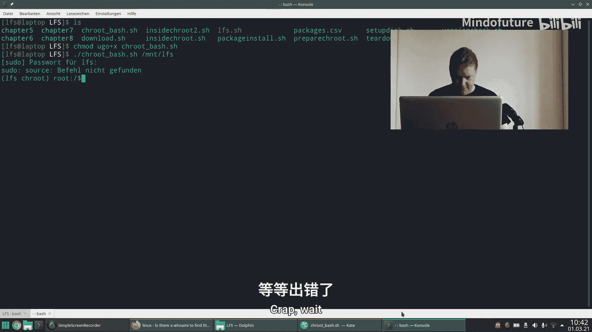

Okay。

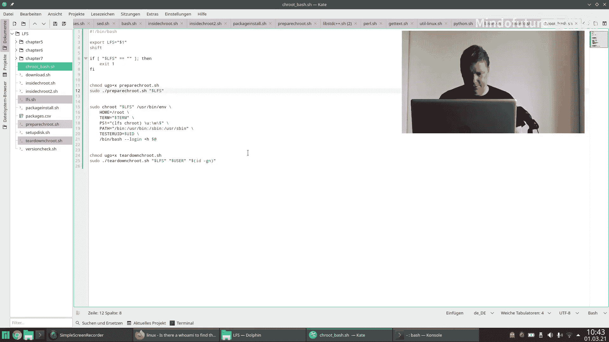

Let's try again。Oh。嗯。😊，Don't know what just happened。

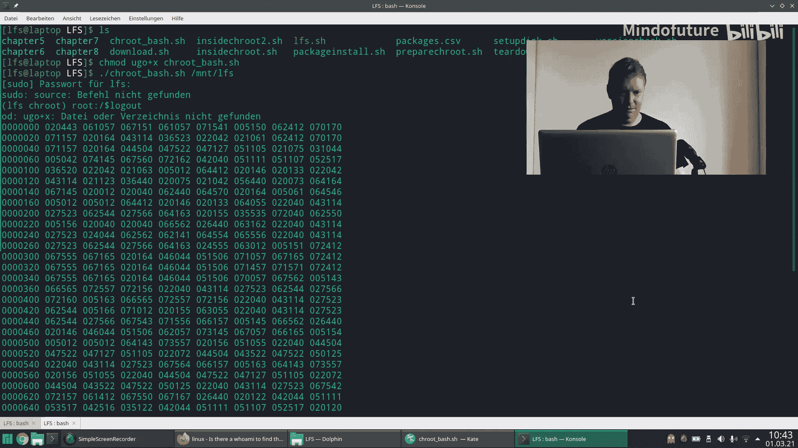

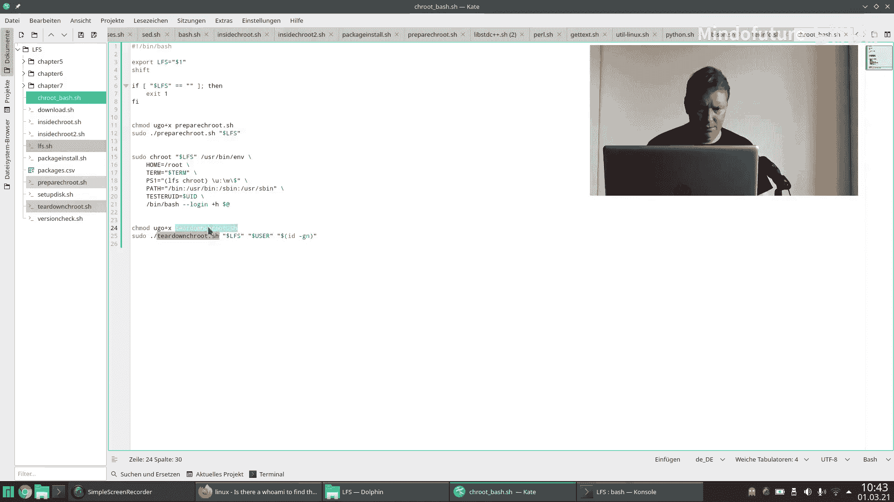

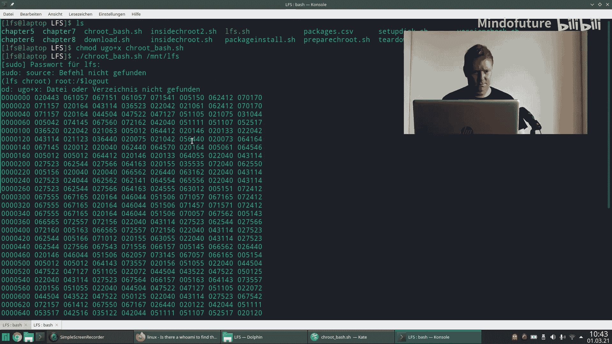

Okay， well。When something goes wrong。Of course。Could have been because。The嗯。

Set up change route hadn't worked。So I don't know it。 It looked like I was。

Inside the change route but the setup up。Change route as age wasn't executed， because。B set。

That zuddo sauce doesn't work。That's why。Invoked a script like this now。嗯。

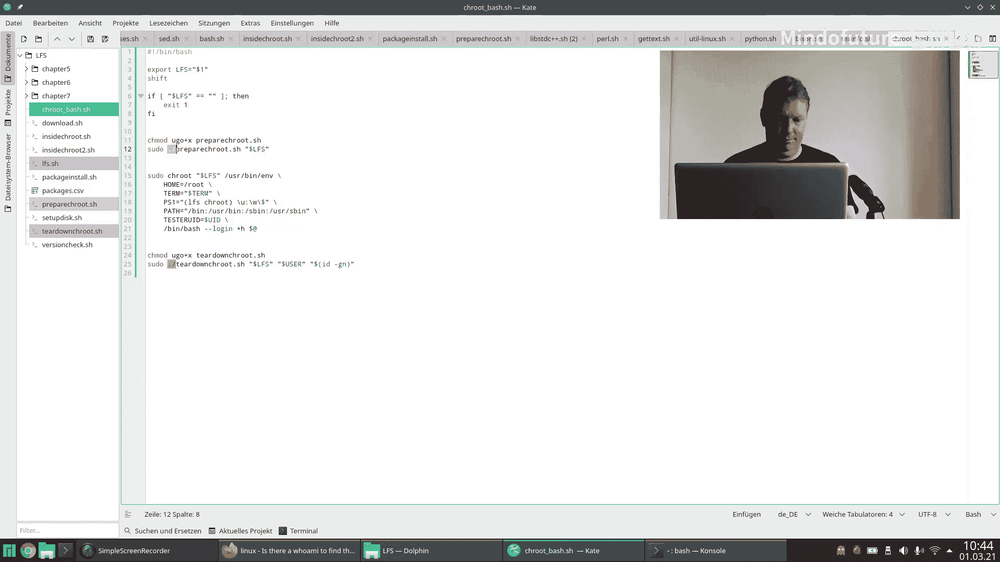

So yeah， this actually looks okay。Right， it。We have deaf console。Apparently， deaf no。Deft of P， T。

 S proxis。Temp Fs。

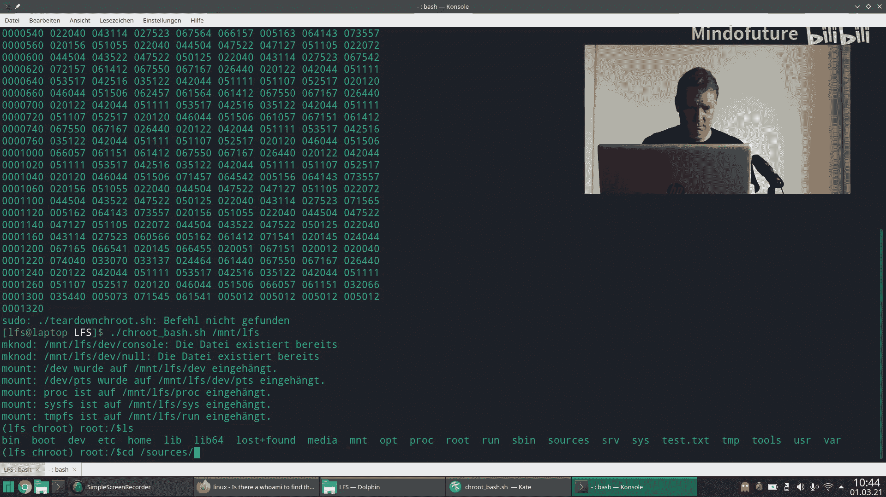

Yeah回。We are now actually moving。Inside the train route environment。就是。I like this。嗯。Let's see。So。

So now I want to run some of these things。Manyual leave from inside the train route and。ある。

Really like that。 We are in that。Change route now。Although one thing is a bit。One thing annoys me。

 I want to。This extra space here。You know， so that。

Typing something doesn't start directly behind the。The dollar signs。Okay。Good， now the。To。

To really build the system。Yeah， we will create these scripts again。Chapter 8。

First of these scripts is the man pages script。Okay。That's a simple script make install。

 that's all we have to do here。Of course， we run this still。With package install S H。

I think we might want， too， said L F。 S equals empty string， also。Because。

If we don't have L of S at all， I think it might confuse。Some scripts。

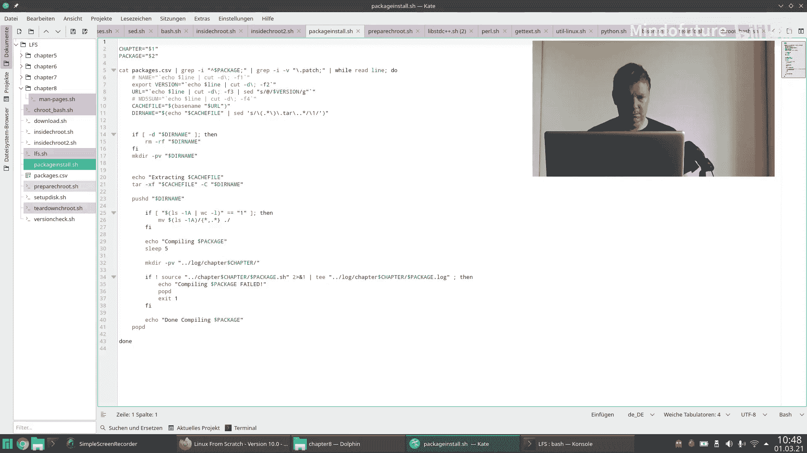

O。Let's try this。😔。

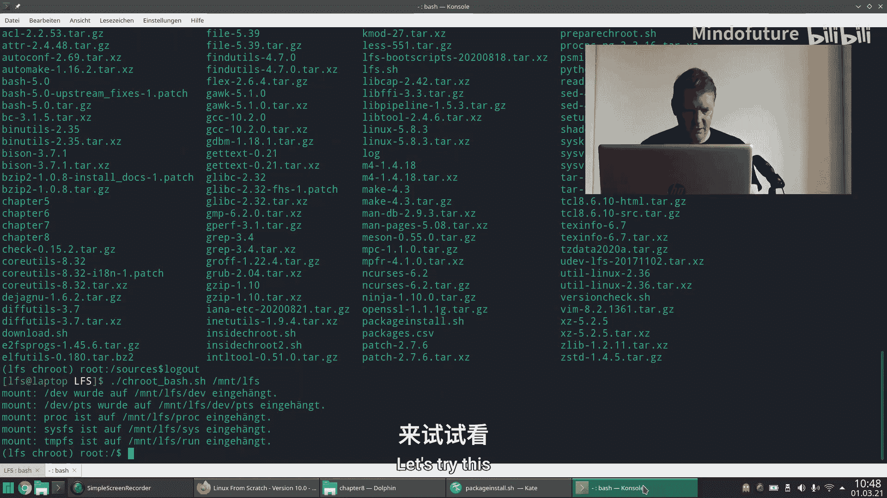

Okay， I've entered the train route environment again， but okay， one thing。嗯。

This is inside my home directory， and。This is running in。M and T LFS。So in the script， we've。

We have this。Thing。This line here that just copies all the scripts。嗯 do the。To the USB key。嗯。

Maybe we should just。Copy that。Okay， so。So， I've now added this line here to。To copy these script。

 including this Chapt 8 script。To the Mount point。Also。

Before entering the train route so that we can update。

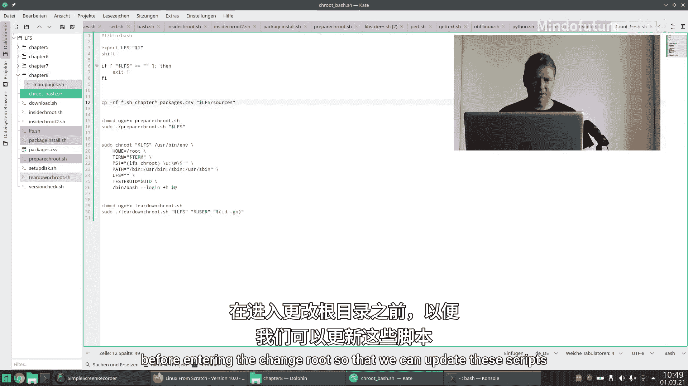

these scripts before。Entering the chain food so I'll log out again。皮。Okay， it's a bit odd。

 It looks like it hasn't。嗯。Removed。Some of these things。

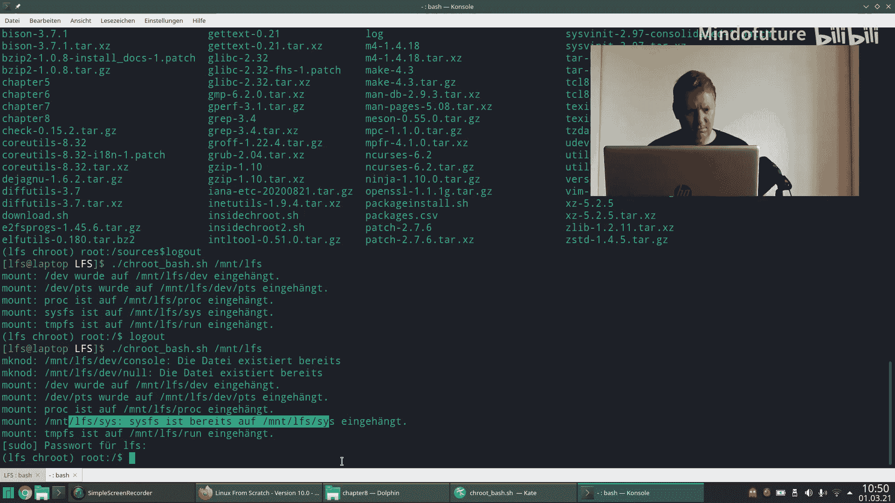

So I'm not sure that this tear down change route has run。

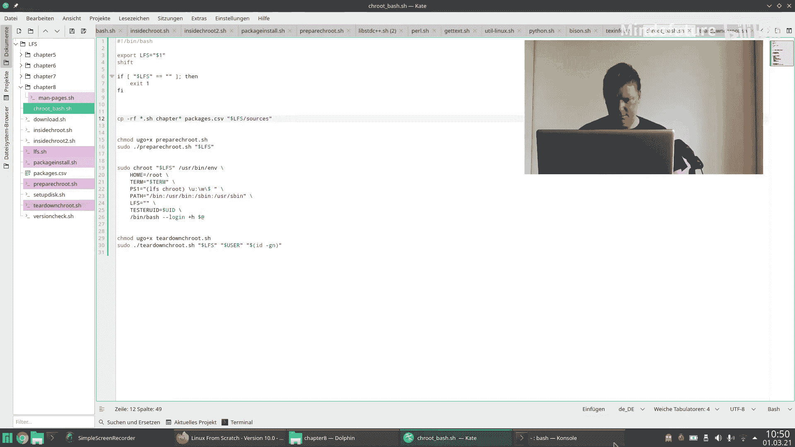

嗯。Okay。Yeah， now we have。Running stuff。Inside the train route。嗯。

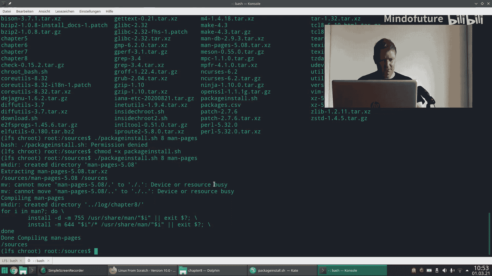

有。So， let's continue with the next。Thing。Man pages， of course， of the package。

Contains the main pages， which are the manuals， the documentation of things。Okay， T C L is。

A programming language。Actually， as far as I know。嗯。It's。Rather， high level programming language。

I'm actually wondering why we would have that。In a Linux from scratch system， because。

Because I think Linux from scratch is a rather an all everything。

I don't really see why you would want something high level in there， but okay。Actually。

One thing that I might want to do from now on is when you make stuff， you can。

Give it a parametermeter dash J。 and then some number， like。8ight。For example。

That defines how many files can be compiled in parallel。 So if you have a quoted call like me。嗯。いる。

Each of these costs can run two processes at the same time。

 So J 8 would be something that you might want to use here。然。

And that should dramatically increase the speed at which you are compiling。Because right now。

 I'm not really utilizing my processor， really， so。Or whatever。So while that's compiling。

 we can look into the next。Package， let's expect。

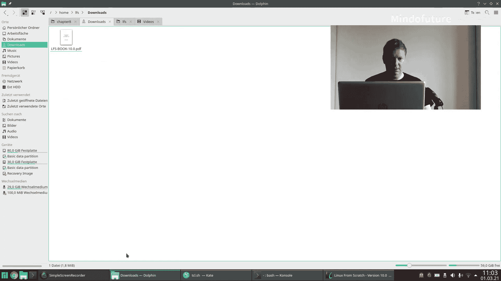

。It might not be the best idea to run auto tests in these。

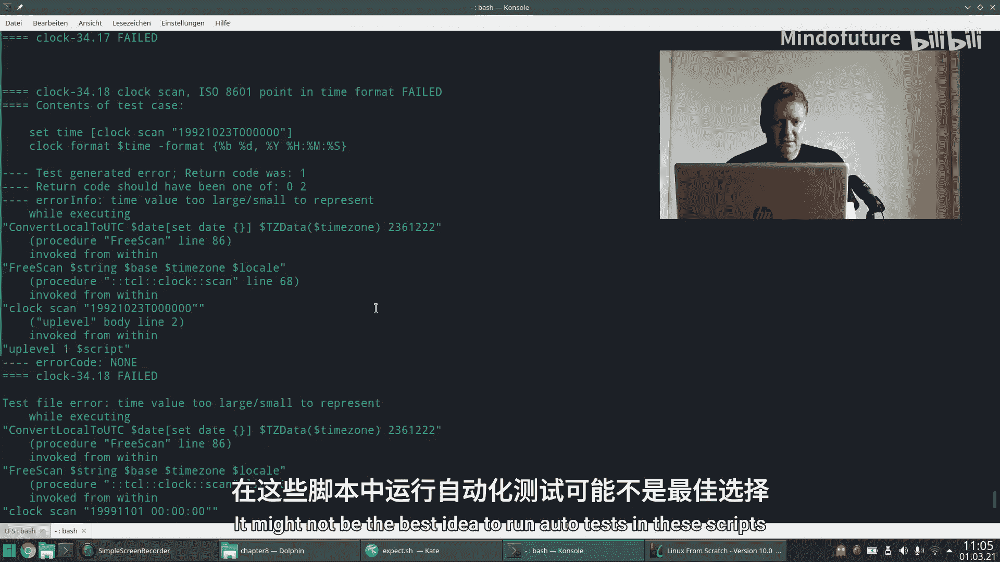

Scrips， you know， I've。Copy this line here， for example， which。Does auto tests。

 but I don't know if they might fail。And that might cause some trouble， but。Well。For now。

 I will just keep using them。Ipoite deja Nu。

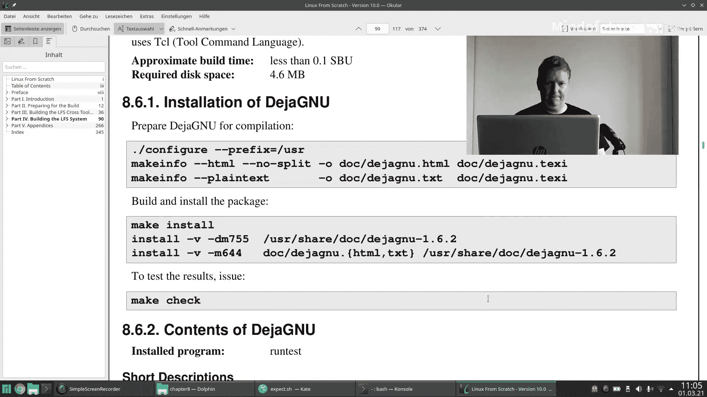

Maybe I should not get too far ahead of myself。This is still running。So。Yeah， at this point。

 I will just make a short break and let this run and。Fast forward。Okay。So， T C， L is done compiling。

Okay。そだ。The scripts are not up to date， so e。Need to log out and back in again。

I don't know what causes this。 I've seen this before that I cannot unmount deaf and deaf P， T， S。

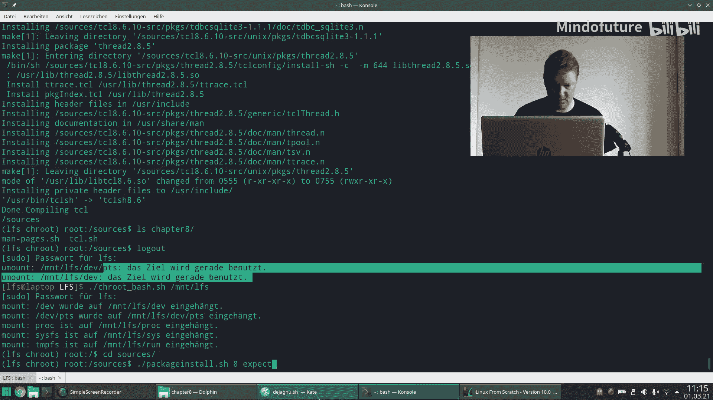

， okay， this time。

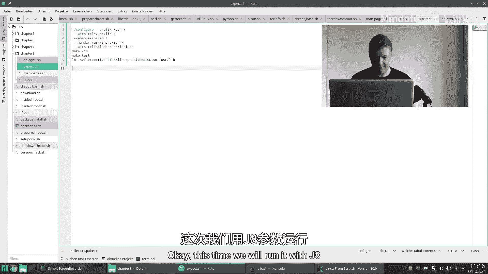

We will run it with J 8， so。Let's see if this speeds things up。Okay， this is an interesting thing。

 The system has no more P T wise。 Ask your system administrator to create more。I think this。Yes。

Expected problem。Okay， we've installed it， okay。Let's see if the next thing works。 I mean。

 it didn't look。Didn't look great， but。It didn't look like it hadn't worked at all。Okay。

Unable to locate eggs。

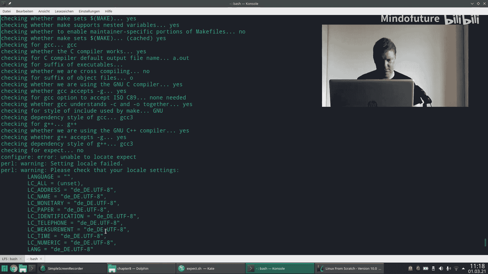

Doesn't look great， like there was an。Errow in the compilation。O。

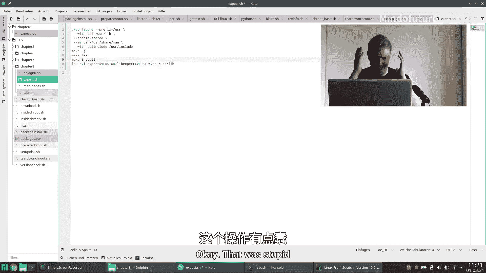

That was。Now， we are running some auto tests。It seems like some of them haven't passed。

That's why we have six arrows here。But again， it's。

The Linux from scratcht project says that some of the auto tests are expected to fail。So。

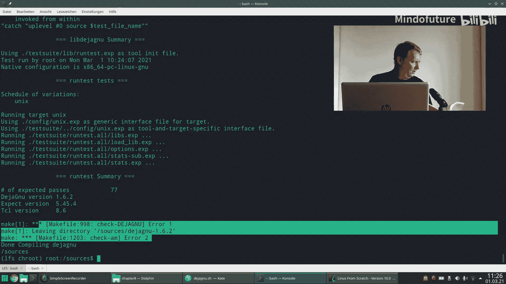

Yeah， I think。I just keep on going， and。See how far we can get。Now， that's。Incredible。

Install Pro here。So we are basically just。Just copying two files， which are just。Really。

 just lists of。I think， part numbers and。Protocols。Okay， so we need to select a time zone。Well。

 I'm in the Berlin time zone， so。I'm not sure if I should select it here so。

Because here it's hard codeed。 and down here， they say。Replace it with， with whatever you want。So。嗯。

Europe， Berlin。 So usersha Z info is where you find that。So。Yes， user share。Zone info。

So these are the zones。And I have the zone。Europe。And here we have the。So in Berlin in there。

 so that's why。Europe， Berlin shut to work， I think。I'm not sure if I should put it here also， but。

Okay， they say here they use here New York because Possex requires a daylight savings time rules to be in accordance with US rules。

Okay。I don't know。 I'll just leave it at。New York， there。

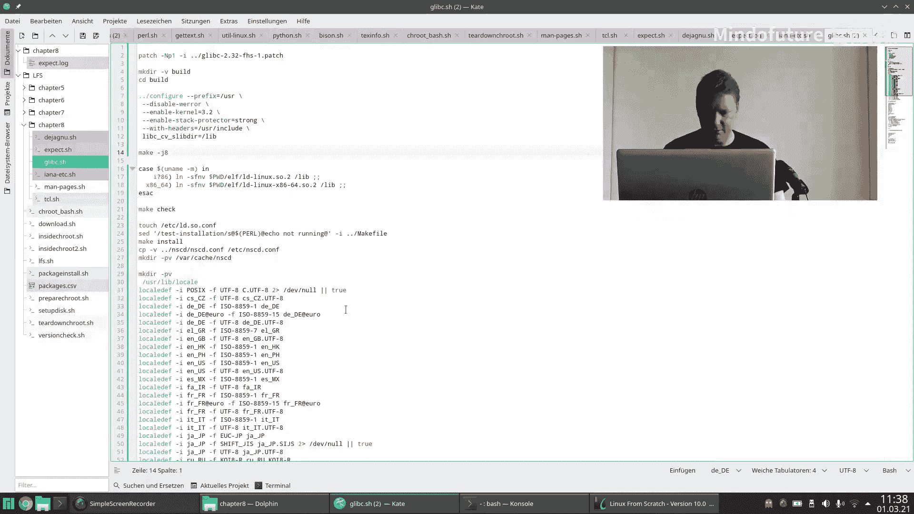

I'm wondering if I。If I could just put a link。To my。Home directory here。

 So I wouldn't always have to。Block out of the chain route and lock back in。

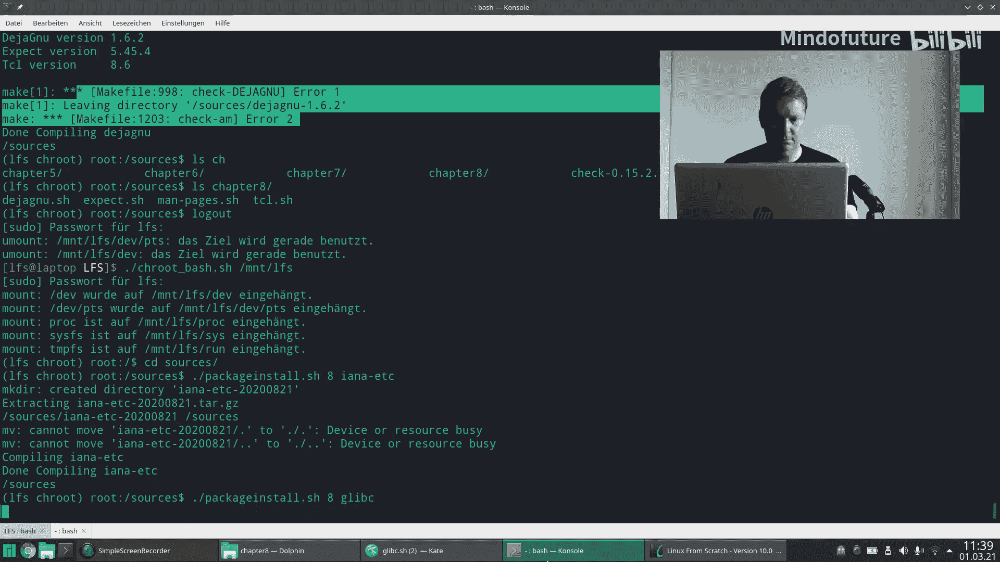

嗯。Okay， where does this still running。I still want。The whole thing to be repeatable， right， so。

I will make yet another inside train route。Because right now， I'm doing stuff manually。

 but I still want this to。I I still want to be able to。Run this。 and。From a script。Actually。

 I think I should just。😔，Do it like this。Yeah， chapterpter 8 is very similar to chapterpt 7。So。

The variable cities these two sources。Okay， which were the things that we've installed so far？

We started with men pages。失敗？T shirt个。Man Pat T C， L， then expect then Deranu。

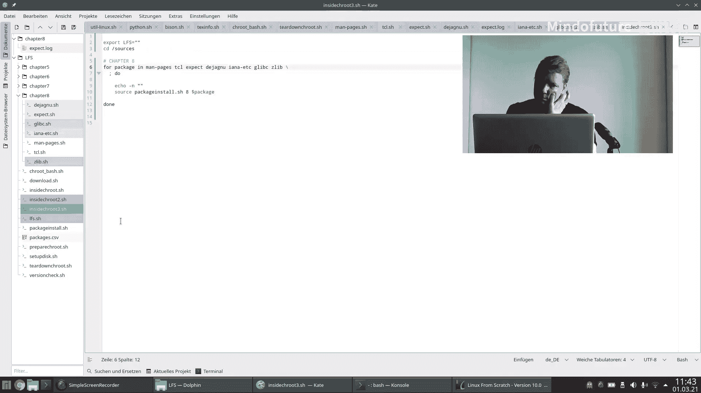

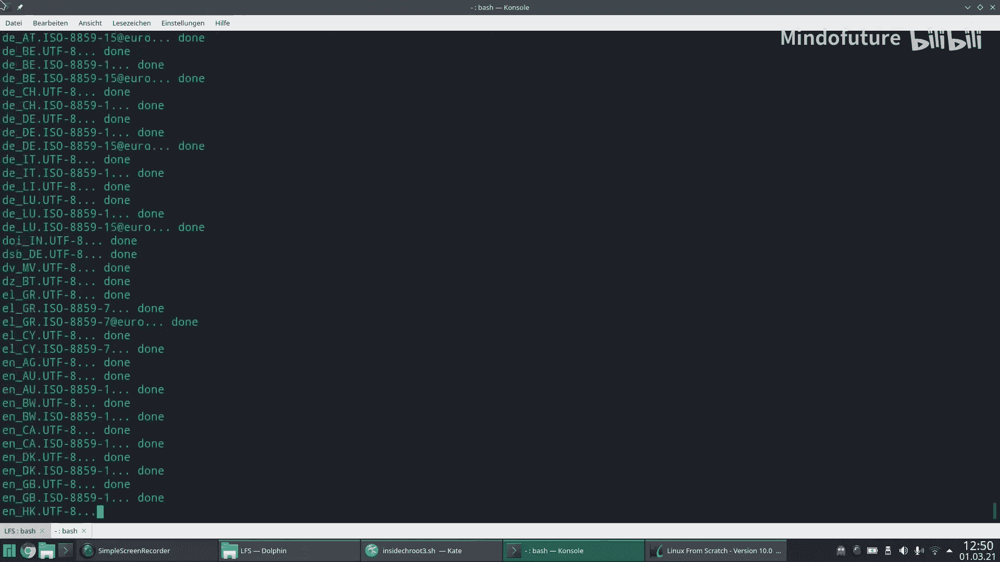

Okay， so I think this video is slow enough as it is already， so I will just end this video here。

Yeah， so。We've done six packages now。 There's a lot more to come。

 I think 81 packages are in chapterpter 8。But yeah， I， I like it so。

Running inside the change route manually is kind of fun。嗯。Yeah， so。T next time。

 when we will continue， maybe。Maybe I won't go into each and every package like that。

 So because I don't want this whole series to。Take forever。And just repeat myself all the time so。So。

 yeah。Just tune the next time。 I will make sure that it won't get too boring。So yeah。

 if you liked this video， like it， share and subscribe and see you next time。By。

