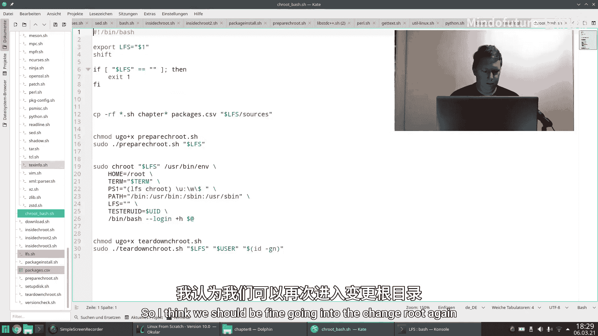
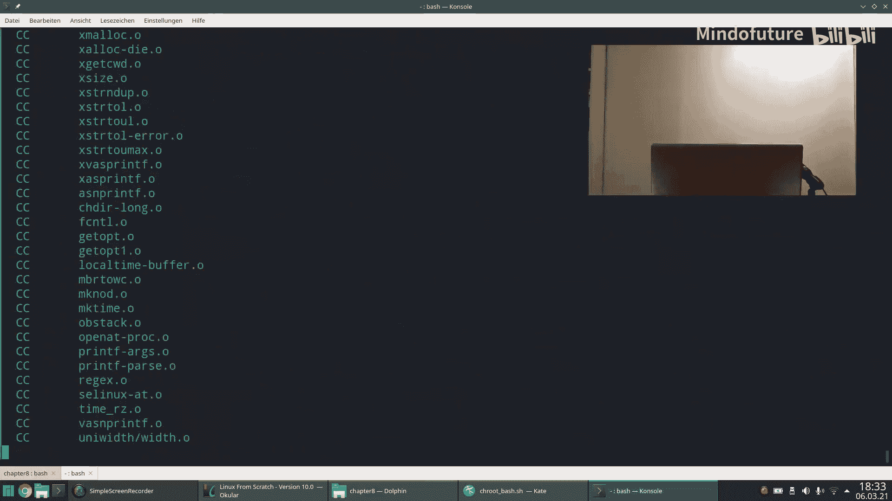
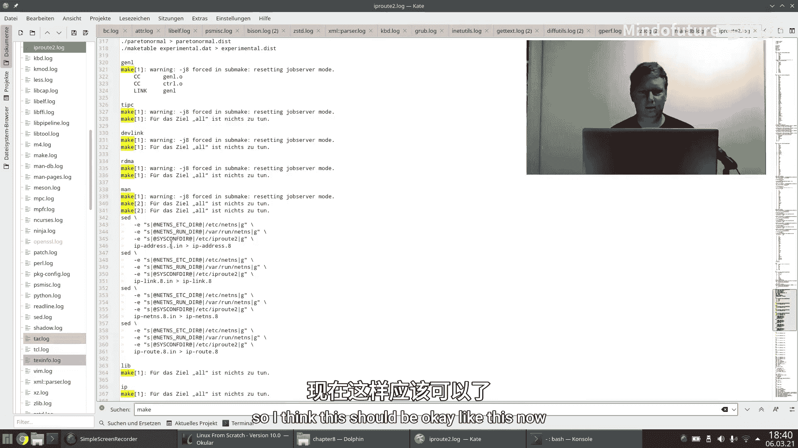

# 从零编写Linux操作系统-｜-Build-A-Linux-From-Scratch-p10-P10_Part_9.5-Corrections--BV1A78EzUEdf_p10-

So not everything ran through， as we expected。For example。

 the compilation of tower just kept running and running and running。

 and at some point I just had to interrupt it。By pressing control C。 And so I already knew that。

There had been problems。And I've gone through the log files， in the meantime。Of course。

 not all of them。You know， if you look at the GCC log file， for example。Look at that down here。 It's。

Almost 500，000 lines of log file。呃。You just cannot read so many lines of log file。

What I usually do is I just go to the end of the log file， and。See if something。

Looks wrong as they are。 So if the whole process。Ended gracefully or not。And。Yeah。

 when I went through these log files， a few of them stood out to me。Where particularly， of course。

Tar， because。Well。T is the one that just kept running and running and running and that I explicitly cancelled。

 so。H。Listing sparse files bigger than2 to the 33 pis。2 to the 33 is。I think8 gig。 And yeah。

 when I checked the USB stick。The build directory of thetg。Tool was actually 10 gig large。

 and the USB stick was almost full， so。I don't know how you can。Come up with the idea to generate。

10 gig of example 5 for an auto test。 but okay， I think。呃。That leaves us no choice， but too。嗯。

But to just disable the auto test So that's let's make check here。

 So we'll just have to skip that and。Hope for the best。But there were a few other programs that。

Stood out to me。So that。De Rau。Down here。And it was error 2。But it's also in the。Auto tests。 No。

 here we have。Lterranu tests。Relatively short。Log file， but yeah， I will just do the same thing。

 just disable the auto test。And then we will see if that helps。可 you。Gnu A。Also。

 end it with an error。嗯。That was another。Test that just kept running and running。 And well。

 it asks for a pseudo terminal。Yeah， this just sounds like it might have really problems when you are running this from a script or I don't know。

 but yeah， again， I will just disable the auto tests。Fk New Arc。Let's make check here again。😔，And。

100 was。Text info。So that starts some make。Process， and。Does a few auto tests， and。

I think I interrupted that also， if I remember correctly。 So， yeah。

 another thing that I would just disable the auto tests。And then， yeah， there's one thing that。嗯。

Might not have stood out to me。So if you are looking at these log files here。嗯。

You might not realize it， but。Look down here。 It says 66 files。And。We were going to。Build。Let's see。

So chapter 8 has two chapters that are not related to。These scripts。And then， I wanted to。

Build everything including VIm that would be number 69 minus the two that were not related to the tools would be 67。

So I wanted to build 67。Packages， but it says here， I only have 66。Loock files。

So I went through all the names and yeah， I've seen that the package IP route is missing。

So what's going on there。嗯。So， we don't have。The log file for I P route。

So let's see if we are even trying to build it。So here's IP route， There are commands in there。

If that script is run， we should get some log file。Okay， I don't have the command anymore， but。

Because I've rebooted in the meantime， but。I had told it to build the package， but it didn't。

 so that。Basically means it must be a problem in the package as CS SV。So here we have I P route，2。

So its。The package is named IP P Ro 2 in here。But the script is only called I P root without the two。

 so。嗯。To fix that。I'll go here。And rename this by P root， too。Okay。And now。I should be able to。

 to rerun these things。And okay， of course， it's， it might not be the best idea to。

To just retry packages from somewhere in between the process， because。Well， if you built。

If you try to build something first and that fails， and then you build something else。

Maybe the configure script is looking for the thing that you tried to build first。

 And if it's not there， maybe it just does something stupid and maybe。嗯。Configures itself wrongly。

 but。I think we should at least try。 I don't want。To start completely over at this point， so。

I want to just try and run it like this。So。Let's see where were we。😔，So， the directory is mounted。

These directories exist。The files are copied in the。In the change route bash script also。So， I think。

We should be fine。Going into the change route again。O。So音。Want to rebuild text info tar。IP root2。

Can奥。And。Da revenue。Okay， let's run this。

Okay， that was quick。I'm not sure if that's a good sign or a bad sign。Oh。

 I've just seen that I've renamed the wrong script。So， this one is。The one in my home directory。And。

This one is the one in the。And there false directory on the stick， but。

The old one that I had renamed。嗯。Wasn't removed。So it was still there with the name IP2。

 So I think that should still have worked。Okay， it doesn't look bad either。

 So I think this should be okay， like this。

啊他。Now。So we have now。Compiled everything， including vim。

And I will stop at this point because I want to make a backup。

 basically save the game at this point because。The next。Packages here。嗯。

They are for the system V in it system， and I just want to branch the video series where in one branch we use system V in it and in the other branch we will be using system D。

Because there are two versions of the Linux from scratchbook and the other one has system D has in system and。

As far as I've looked into them。The two books are identical。Up until this point， including them。

So yeah， chapter 70 in the other book goes in a different direction。

 so that's why I want to make it back up here。Make one。In it system。 And when that's done。

 make videos with the other in it system。 So definitely a very interesting point in the whole Linux from scratch building process。

I've also looked into the chapters down here already。 there's also a lot of interesting stuff。There。

 so the next videos will definitely be very interesting， so absolutely tune in next time。And yeah。

 if you liked this video， like and share and subscribe and see you next time， bye。

