# 从零编写Linux操作系统-｜-Build-A-Linux-From-Scratch-p11-P11_Part_V-10-System-V_Init__Network--BV1A78EzUEdf_p11-

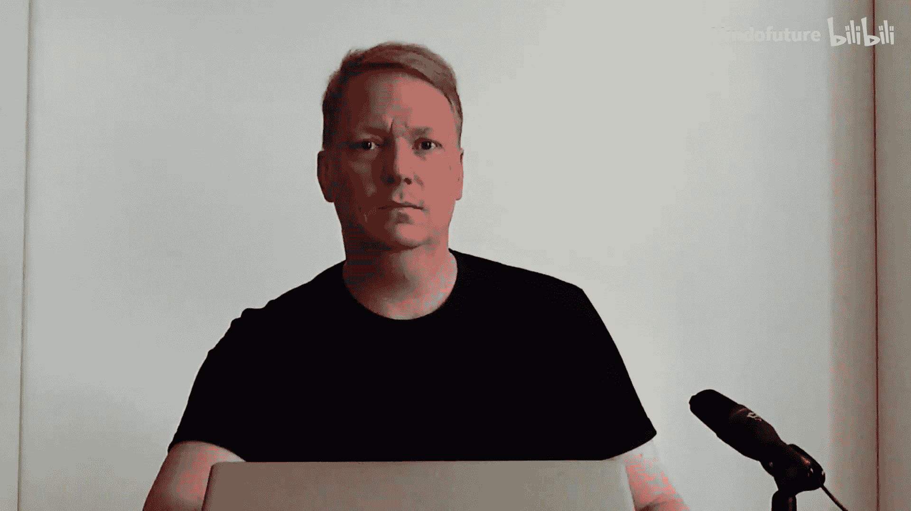

Hello Al， welcome back to this tutorial on  buildinging a Linux from scratch system。

Now we are almost through with chapter 8 and the only things that are left for Cha 8 are the ones that are specific to system V in it。

 and in this branch of this video series we will be using system V in it。So yeah。

 let's just jump right in and。See what we still have to do。 We need to compile E U dev， Pro P S and。

 U Linuxux。He to have Sprox thus Caello D and thus V in it。Then we'll be through ws。Chapter 8。Okay。

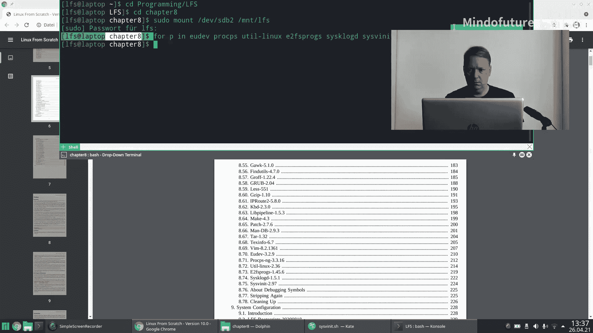

Okay， these are already installed。Yeah， I think we can now。

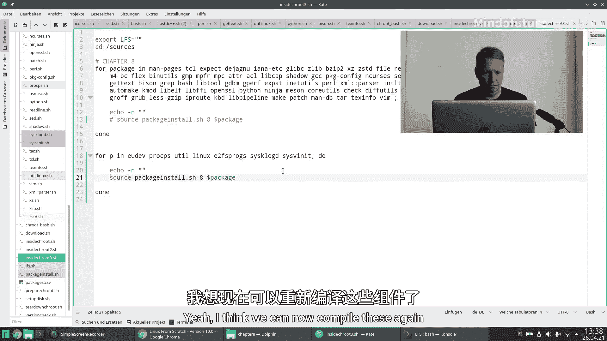

Compile these again。

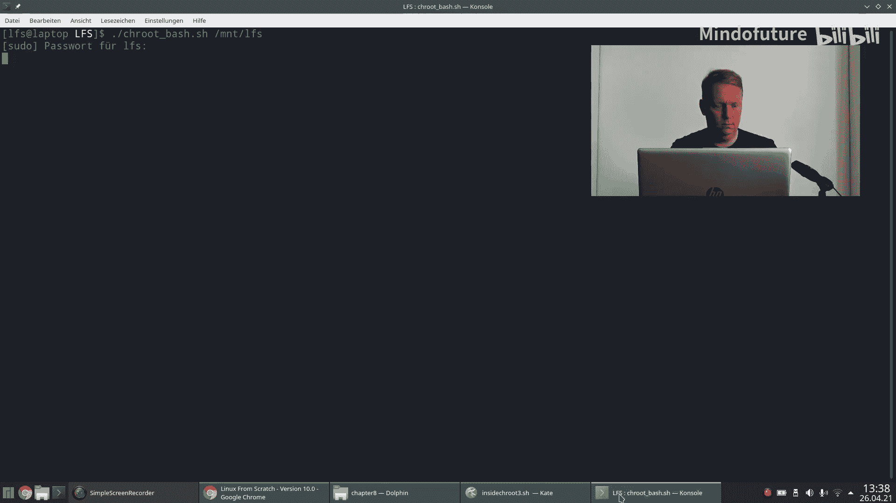

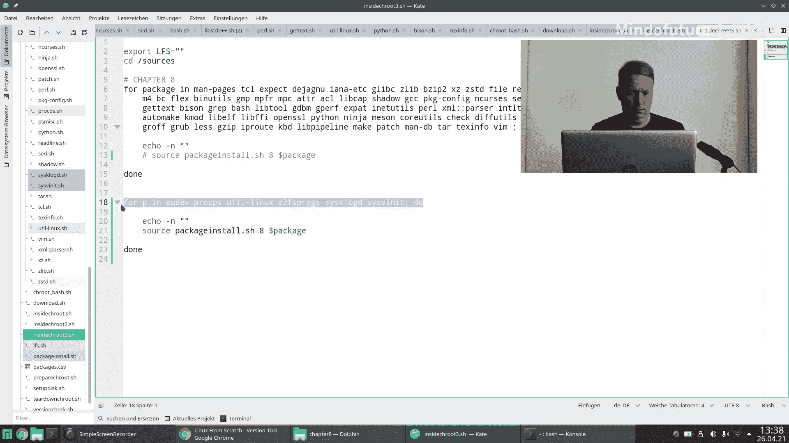

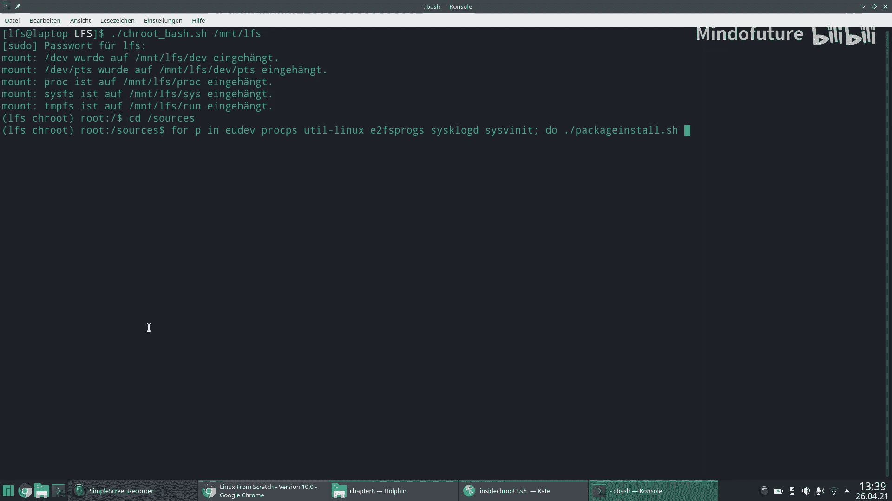

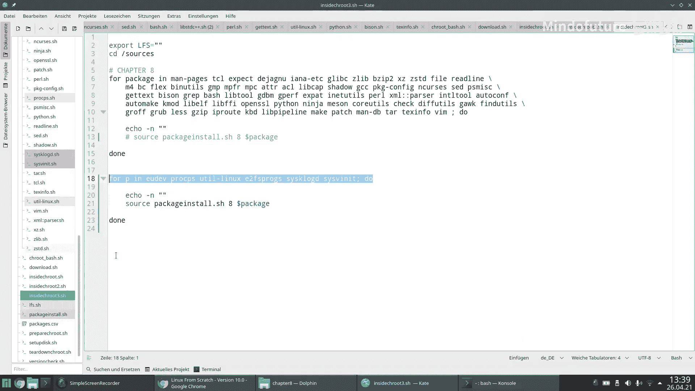

O。

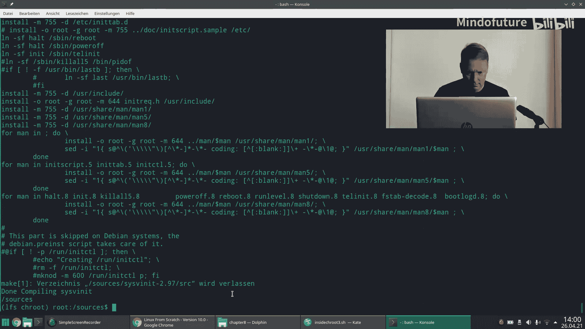

Okay， let's check。Loock files。O little乐快发。😔，Does Caello D looks a bit suspicious。

There are several warnings here， and it's quite short。But， I don't see any。Sevea errors， so。

I don't know。 We might want to keep that in mind。The logfi for S V in it is also quite short。

But I also don't see any errors here。Okay， so let's come to chapter 9。

AndNow we will create yet another。Scrip called。Inight， change route。As age。

 I should really come up with more creative names here then。可以。Now， what do we do in chapterpter 9。

Chapter 9 is about the configuration of system V。And it talks about how system V works。

And a central part of the whole。Booot process using system V are these boot scripts。That I will just。

Yeah， installed。I think that， really， just。Copy some text files and scripts。嗯。

Into the Etsy directory。Ey in it D， probably。And。Yeah。

 I want to talk about these boots scripts in more detail， but in a future video or so。For now。

 we'll just have them extracted。And that's gonna be it。For now。Now，Chapt 9。3。

That's actually a chapterter that I have been stuck on for quite a while， because。Chapter 9。

3 is about U。And that's a quite interesting thing。Because。It explains。How the Deaf directory works？嗯。

So it tells us that， I think。Before kernelonel 2。6， this directory didn't even exist。

 and I've always thought that the de directory was managed by the kernel itself but。Yeah， here。

 I've been told that。The kernelel itself gives us the this directory， and UdF。

Then looks into the ci directory， and。From there， UEF creates the deaf directory。Okay。

I found that quite interesting， but okay。The thing that I was stuck on is。It gives you a few。

Details here on about。How to configure U de So that， for example， the。The different。

Devices always should get the same name in the Deaf directory。And。Yet。

 it's quite complicated what they。Oh。What they discuss here， but。

I just didn't really get what that really means for me because。Well。

 if I install just a regular Linux distribution， then I don't have to write a UDF file， okay？So。Yeah。

 in the end， I just basically decided to ignore that chapter and。Leave everything， as it is。Because。

Yeah。Apparently， the worst thing that can happen is that your devices just get different names in the de directory。

When you re and。I think that's not so bad。So， in。9。4。We have this。

Called to a script that yeah just creates。A set of。Default rules for U de。So I will put that in here。

 too。Okay。Can skip city runss， because。I don't have a seat room here。

And then we can already configure the network so。And configuring the network， yeah。

 that's something that you just do sometimes when you run Linux。Okay。

 so now we will configure the network。嗯。I want it to be available on boot， yes。E T H 0。You know。

 it's the old naming convention。In my home network。I have。1，92，1，68，1，78 numbers。

Prefix 24 means that。The subnet mask is 255， 255，255，0。A normal。Subnet mask。That means that。

When you communicate with devices that have the same first。3 numbers here， then。

We will ask the ARP system to give us a Mac address， and then we will send。

Packets directly there to that mag address。And。For I P addresses outside that range， we will。

Use the ARP system to get the Mac address of the gateway and send our data there。Okay。Let see。

 my current。I P address。This was 30。So I will just use set。In the resolve con。We set our DNS servers。

So， that's my router。It's a ftz box。So normal， I P address for the Fritz box。Setting the host name。

The host file is， yeah。I would say。Something like。The host file is an assignment of。

Yeah host names here to I P addresses。So that for the addresses in here， you don't need to。

Ask DNS server。O。So， now we come to the。In it tap。And I think for me。

 at least this is really the most interesting。Part of the whole project。

Because the whole wood process is。What I'm the most interested in here。So， this init tap。嗯。

You can look at the main page of in tab。嗯。But I have to say， at least the German。

Tranlation of that man page is not very good。So it's。Tells us that the lines。啊。

Values separated with colons。And the first。嗯。Column is just some I D。So。

Something that can be too off。Up to four characters， depending on。Your version of system V in it， so。

You are probably better off limiting this to two characters。And。The second column is the reezous。

And here， run we've talked about run devil in the first video， I think。Your group。Can。

Pass a run level to the。To the colon。Just by having just a naked number。2，3，4。As a parametermeter。

And。Yeah， the colonel will then pass that to。To the init system。Epin in it。

And as been in it will then check， O。This here is for level 0。This here is for run level 2。

This here is for runnda before， and so on。嗯。So。When you go into runnda 4。It runs。E C RRC D in it。

 D RRC and E C RRC D in it， D RRC will then execute the boot scripts that are。Start in， I think。

 Etsy in it D for the different。Run le。And then， here this weight。That's in the main page。嗯。

You can put different things in that column。嗯。For example， you can have。Responwn， which means that。

If this process terminates， then。Just restart the process。

And wait means that it waits for the process to end。嗯。

So this R C will end when all the boot scripts are executed。

 and then all the kernel modules have been loaded。 Everything has been set up。

And then it continues with the next things here。These here are for run level 2，3，4 and5。

And they are restarted when if they terminate。Espen A Getti。Creates， yeah， these。

Different T T wise that you can log into when you are in。A text mode。

I would like to show that with control L， F1， F2， F3。You can switch between them。

 but I don't dare do that right now because I'm afraid that my screen recording software might crash because of it。

Yeah so。You see this is what creates the TTYs。嗯。This line here says。

That when you press control LD leads， then it。Should。Shut down。And for run level 0，1 and 6。

 we have this line here。 You know， the other ones。A Getty which prompts you for a username and password。

Run level  one。Well， strangely， also，0 and 6。嗯。Run as been as you log in， which。Locks you in as rude。

 but you still have to input the root password。嗯。So that's for system maintenance， like。

Like the safe mode and Windows。When you have。Problems with。啊。With hard disks， for example。

 then you might get like， like you have some bad entries in your F S tab then。

Some systems prompt you。 Please enter your。嗯。Your root password for system maintenance。 and then。

That would be done by as you log in。 And then you can edit your F S tab or whatever is broken in your system。

 fix it and。Then you can continue boot。Now， the boot scripts are put in Etsy RD in it D。And then。

 you will have。The director is Etsy， R C D。then sub directories， R C1， R C 2， R C 3。

Do D for the different run levels。And in there， you will have symbolic links to the actual scripts here。

And that's how this R C program decides if your scripts are supposed to start or stop。their services。

So if the， if the simlink。In E C， R C D， R C，3 dot D。Starts with an S， then。

That script will be called with a parameter start。And。嗯。If the name of the sending starts with a K。

Then。That script will be run with parameters stop to。

Tell the script to stop whatever service it manages。Okay， system clock。Okay， you you can。

Configure your system console。Sinceint island in Europe。I think it makes sense to take this one here。

So I have the D， E Latinern 1 key map。As a Euro symbol。I don't care much about the font。嗯。

I've read that。 Uniic code。Turning unic codeat on here， Can。Give you some problems。Okay。

Can I have this file。I see dot sight。Which， I think。Mostly， sets some environment variables。

To the boots。And the profile is。嗯。Yep， I would say a bash script。 that is。

Run every time you start any bash。So here you would， for example， set environment variables。

That you want to have in every。That you want to have every time that you run any bash。

And since I am in Germany， well， D， E。And the square capital D， capital E is the dragon。

Loale and dot U TF8 is the default encoding。Another configuration file for the bash。And Etsy shells。

That's also an interesting file。 It says which。Programs are legal。To。

 to be the default sales for the users。So， if。I don't know if you tried to set bin Python as your default shell。

 then it wouldn't work because。Ben Python is not in this list。

I think that's basically something like another safety feature。

 you know users can change their default shell。 So when they log in。They are allowed to set。

The bash are the bone shell， as their default shell。And， yeah。

Then that shell is always executed when they log in。And， yeah。

Having this list is a little protection。 maybe for， maybe so that people don't accidentally。

 I don't know， set been false as their default shell。

 And then they wouldn't be able to log in any more。Okay。So。That's all for chapterpt9。

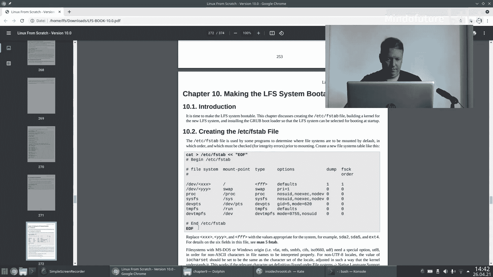

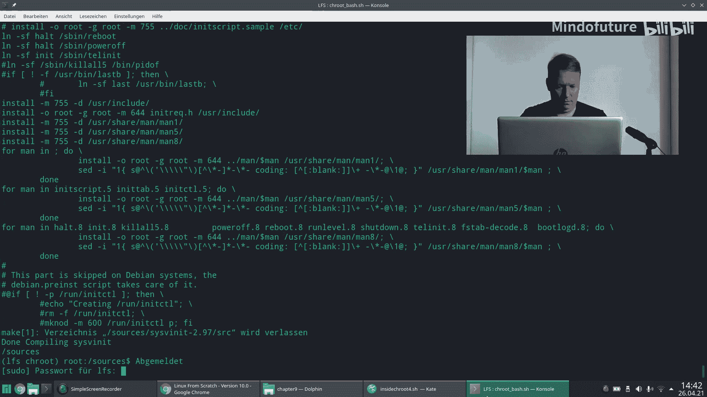

So let's run that new script。These have already been compiled。

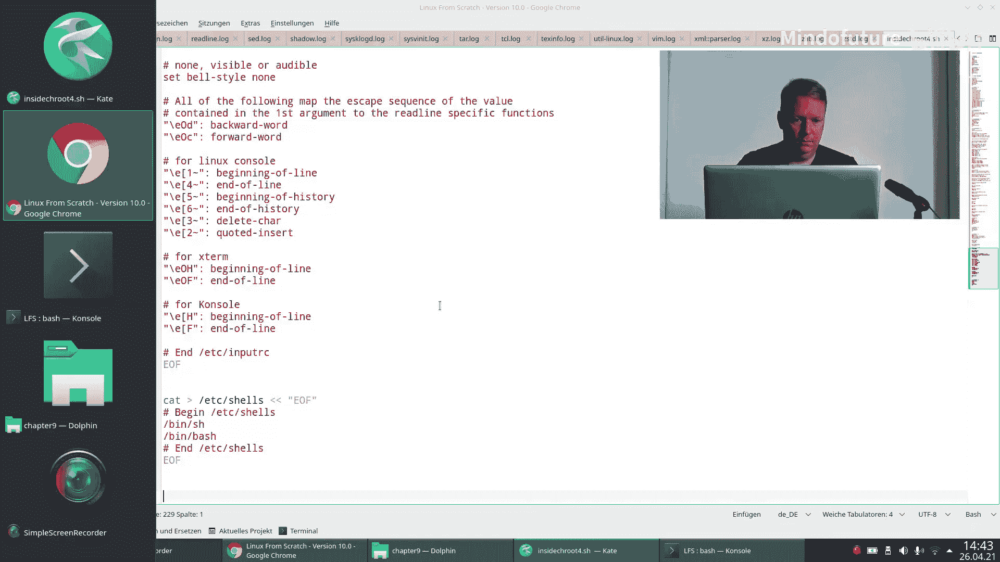

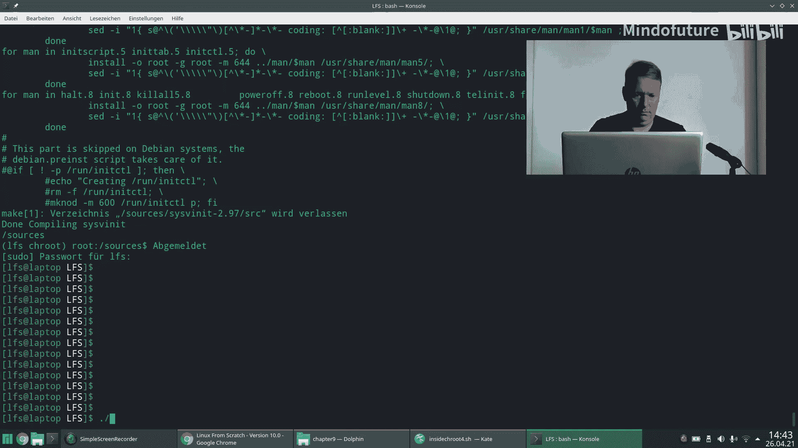

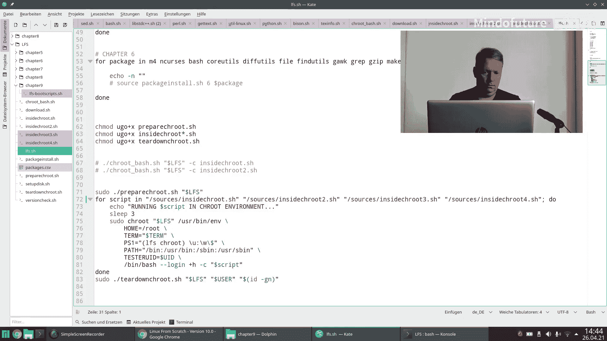

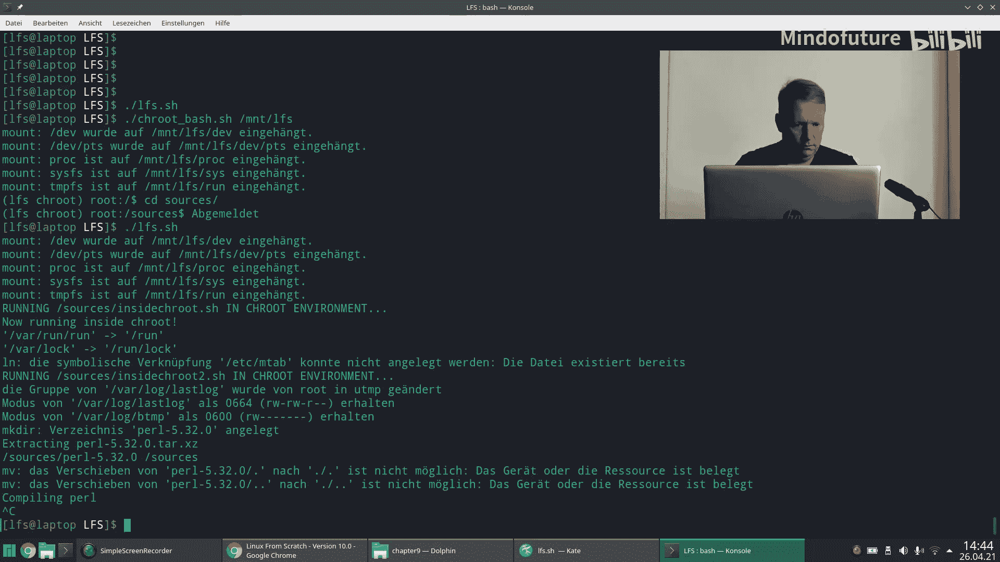

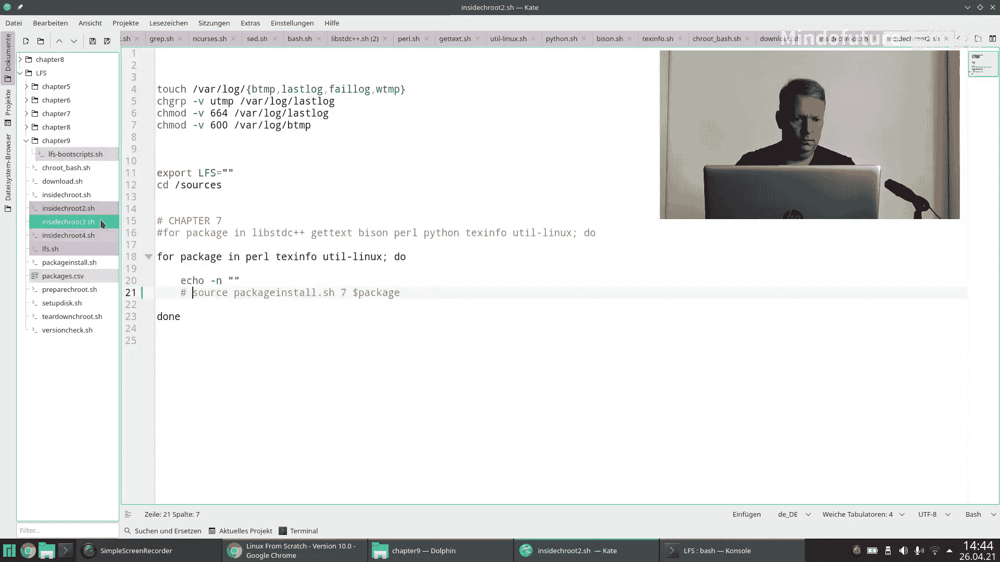

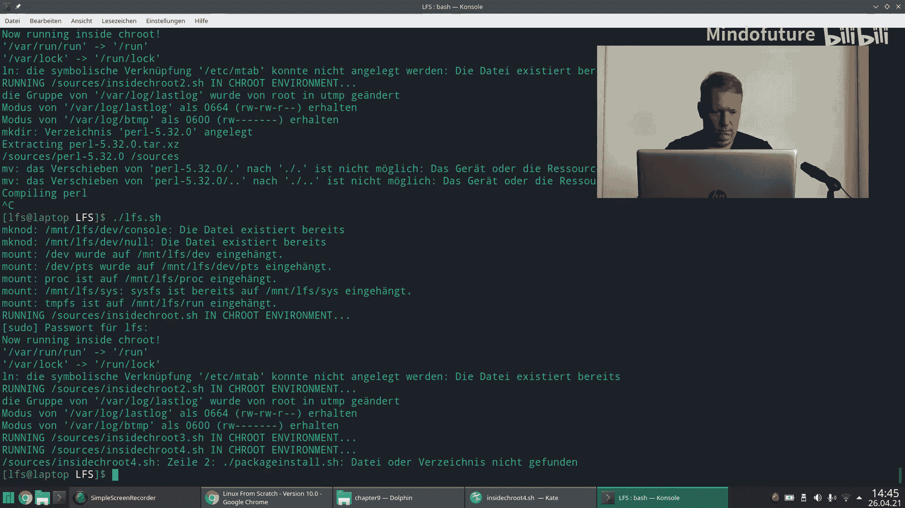

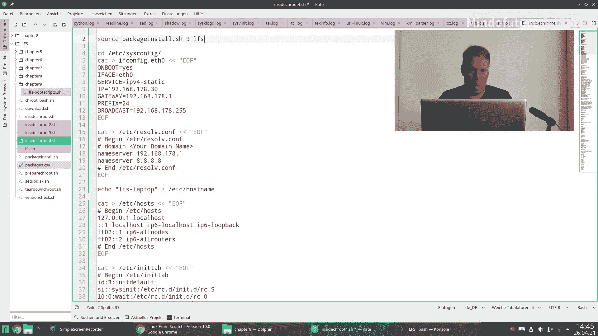

I was complaining that package install isn't found。😔。

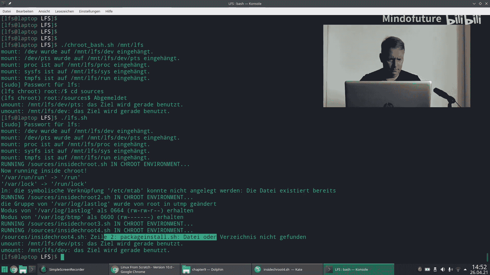

O。I was running in the wrong directory。I don't know why we should。Change directory here。

It can only create problems later。

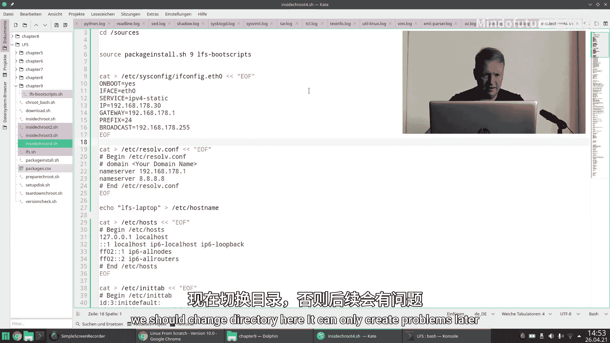

Okay， so this is。These are the boot scripts being。Unpacked。And here， we have the default。

Configuration for。The you death。Tree， I think that。I think we want to change that。

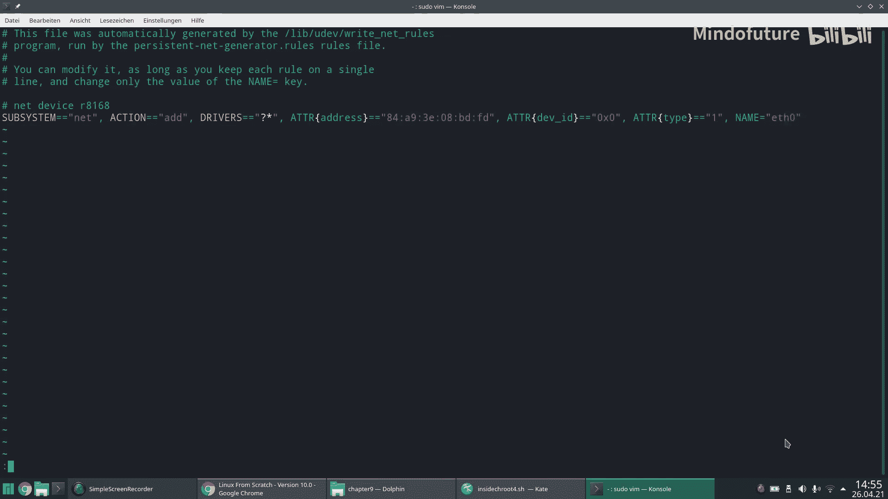

Okay， I think that enough for today we've done a lot today。 we've finished chapter 8。

 we've gone through a lot of these configuration files。And especially the init tab。

 we've discussed the system V in it process in detail。

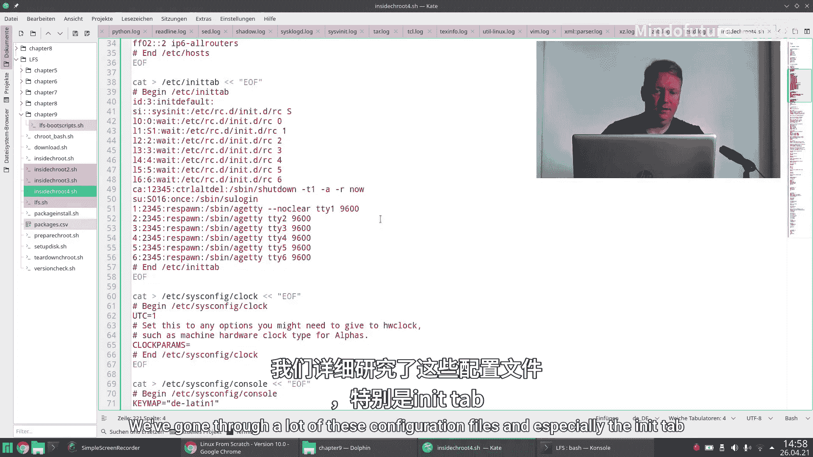

嗯。And yeah， well now。Already through Cha 9， we are now ready for Cha 10。

 where we will compile the kernel， we will install the boot loader。

 and then we will finally boot this system。 I'm really looking forward to that。

 So absolutely don't miss that。 That's gonna to be very interesting。And yeah。

 if you liked this video， like it share， subscribe and see you next time， bye。

