# 从零编写Linux操作系统-｜-Build-A-Linux-From-Scratch-p12-P12_Part_V-11-Kernel_+_Booting_it_up_--BV1A78EzUEdf_p12-

Hello， world， welcome back to this tutorial on building a Linux from scratch system。Now。

 in the last video， we've installed the final packages from chapter 8。

And configured the system in Chapter 9。And now we are at the beginning of chapterpter 10。

 which is the。Finr chapteror。So， Im。Really excited。

 because I'm hopeful that we will get the system running today。Okay。

 so let's see what we need to do now。Okay， so the first thing that。We are supposed to do。Okay， first。

 I need to。Mount USB key， again。This time， I also mount the boot partition。Because， well。

We want to configure it to be bootable。 And yeah， today。

 we will actually need the boot partition for this。We need to create an Etsy file system table of ST。

Of。I'm actually a bit surprised why this is in Chapter 10。

 I think it would make sense in Chapter 9 also， but okay。嗯。Where do I put this。

I think inside to train fruit far is。系。Full enough。是号。I will make another inside train route。Scrt。

Okay， so let's look at this file system table。嗯。We have Prac。Ss。Deef， dev， P， T， S and run。 Yeah。

 basically the same things that we。嗯。That we created when we go inside the change route。So。

 not surprising that we。Also put them in the Etsy file system table。

 which are the file systems that will be mounted at good time。Okay。嗯。So T SDDB 2 is our root device。

 so。That's。That will be mounted at the route directory slash。And that's an x2。System。

Now we don't have a swap partition， so I'm going to comment this out。But。I will put de S D B1。

In here。Good。Now when we have the fire system。😔，Then。The next thing we need is， oh， look at that。

 We finally。Compilile the Linux kernel， so。Just pen。Okay。Just for。R哥。Linux script here。Okay。

 when we have。Uncompressed the Linux。Colonel source coat。

I've talked about this topic in my video series about Linux kernel programming。In the first video。

 I go into the topic of。Compiling the kernel and。I don't want to。Go to into that topic here again。

 So if you want to know more about this。Just watch that video。嗯。Make Mr。 Pro cleans up the directory。

So that you don't get any conflicts with。Possibly previous builts that might have failed。Okay。

 menu config would be a bit。Yeah， I， I don't want to make all the。Configuration selections here。

 So I will just。Take the default configuration by running make de config that gives us up。

Default configuration。But do country file。Okay， make。Will build the kernel。Then we install though。

Mouleles，2。Lip modules。Now， this will copy the。Will copy the kernel。To the boot directory。

I don't know about the system map。This config is our configuration file。 Yeah。

 that's the one we get from de config。 I don't think it's really necessary to store it。In boot。

 but okay。Inst the documentation。😔，That does。Kansas loads。To color modules form。For USB devices。Okay。

Then we也。Install gr on。B。With no。It's no part number。 We installed it at the beginning of the。How。

Of the key， of the USB key。And then， we need。A grip C3。O。In smart X2。嗯。Loads the X2 module into G。

Because yeah。We pull。The kernel from。Then X2 device。嗯。Well， I don't know。Which。

Hard drive number will be assigned， I will leave it at H0 for now。If that's not correct， well。

 we can still go through the gr。Command line。Okay。I've removed this boot here， because。

This boot would only be necessary if our boot drive was also on our route drive， but it isn't。

So this directory here。Is relative to。This hot disk。

And since this hard disk is mounted at slash boot。When slash boot slash kernel name。嗯。

Will be on the route directory of that drive。Okay， and。We need to tell the kernel。Which。

Devic is our root device， it's SDB2。 this might change on a reboot also。嗯。Because we don't have。

UdF rules for this USB key， but。Yeah， I will just set this to SDDB2 for now and。

If that's not correct， then。We can when we can deal with that later anyways。O。One more thing。

This laptop is booted with U A。So， Gr up and。Will cause problems because it will try to install a UFfi and。

We haven't compiled you if you support into this gr installed。 So that's not gonna work， so。

We will need to set this， too， I。3。86。Dash PC。O。So this looks good， So let's。Run this。We might want。

嗯。To replace this death S B。嗯。With our。I love Esk， but。

I'm not sure if that would work so easily at this point。So if I。And Ive asked this。

 you see this stays red， I think。If I do it like this， it would just。Put the dollar LF S disk there。

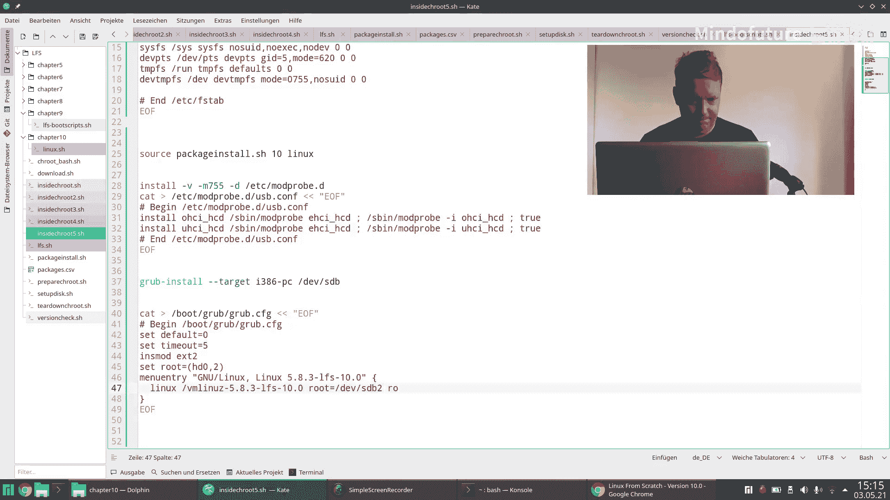

I'll leave it like that， okay。Okay， it's extracting the kind of。The kernel is pretty big。

 this extraction can take a while。Okay。It's compiling。So this will take a while。

I will just let this run and fast forward。O。This ist looking good。This look。

This looks like it has been compiling。Few warnings。Here we install the。

Clonner modules copy the kernel。Confit file system map。When we run。嗯。G up install。

Its also looking good。Okay， I think we are ready to re。So let's try。

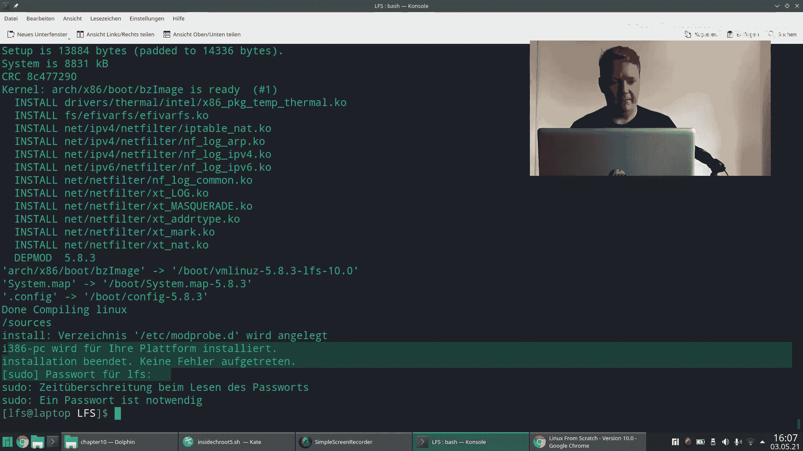

算完了。So， I'm going into the。啊。By yourself setup up。Put menu。Okay， this is odd。So this is my USB key。嗯。

But I'm trying to use the legacy mode to boot， so。Your E would not be the correct。Booot method。

So I would need legacy， but these are both not the USB key。So。嗯。I will select this one here。

 but I don't think this will work because you A is not right here。

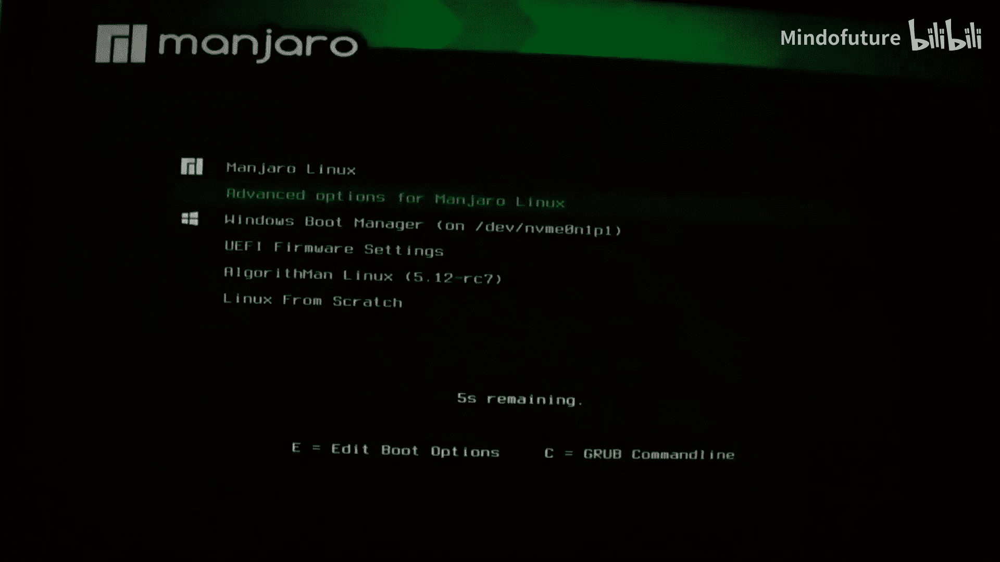

Okay， this is my regular grub， not the gr from the USB key。So apparently。

 it has not booted from the USB key。Okay， so I've done some research and apparently I've made a big mistake right at the beginning because。

YetDoing all this on a USB key was apparently not such a good idea because。To boot from a USB device。

 you must use the UFfi method to boot。And yeah， we haven't compiled you A P into。Our gr， and。Well。

 I tried to fiddle with gr and tried to enable it but。I couldn't get it working， so。Yeah。Now。

 I just cannot boot from this USB key。So I will now take this spare hard drive that I had lying around。

And yeah， I will put this in and then。Copy the the USB key over on that drive。

 and then I will boot from that drive so。Let's do that now。Well。

 I have run into a bit of a problem after I've took this hard drive out of the laptop。嗯。

It refuses to boot because， well， that hard drive contains my home directory。嗯。

So I cannot put my machine right now。And well， because of that， I cannot copy the。

Linuxinux from scratch to the other hard drive。嗯。Yeah。

 what I'm going to do now is I will put this live USB key。With the manjaro system。Into the laptop。

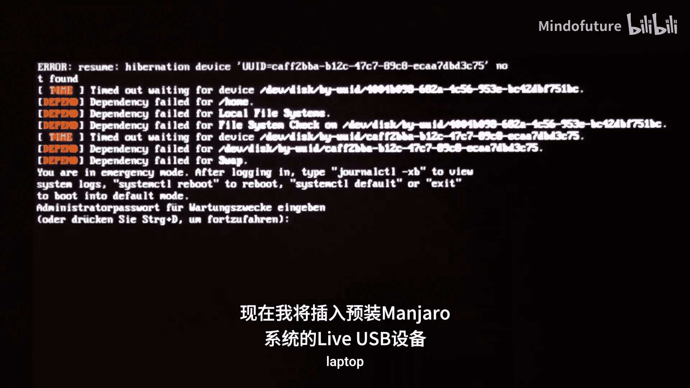

And reboot。

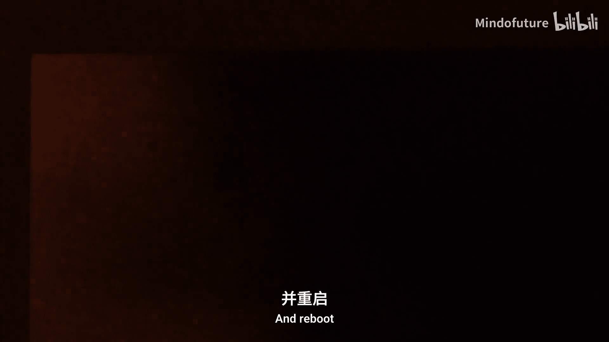

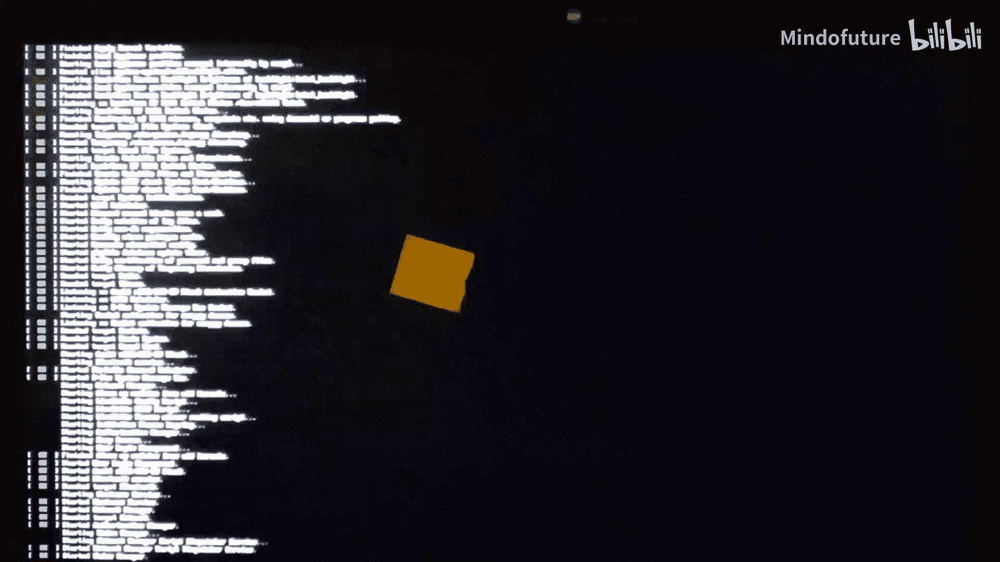

オ。So we had back in business。

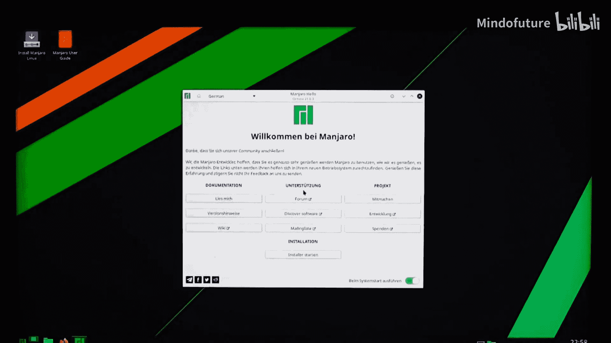

Now， I will plug in。The other USB key wait。Okay。SDP is the Manjaro system。

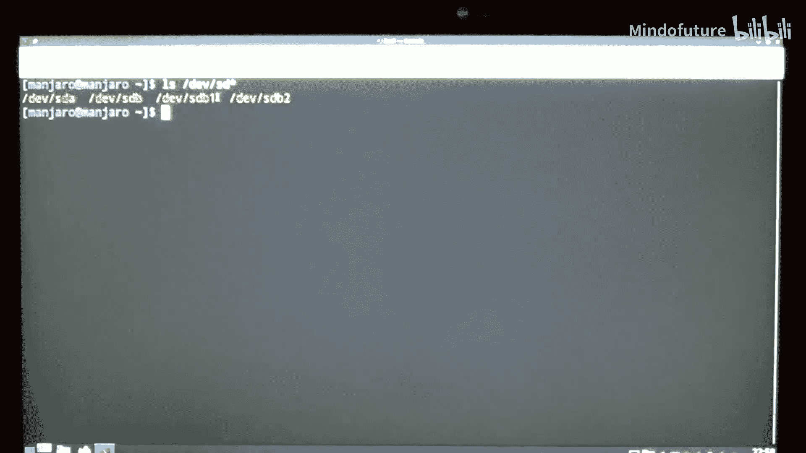

SDA。1 be a hard drive。So， I've plucked。My Linux from scratch。In now。As you can see， S D C。

 S D C 1 and 2。The boot part， the root partition。So。So。Now， I will use the program。弟弟。To copy。De。SD。

否则。The next from scratch， USB key。Ill put file。SDA， the hard drive。B， S equal。128 megaby。

That's above her size。You should always set that to at least4 megabys， also。

So that you don't synchronize all the time， which would be time consuming。Okay。

Now this will take a while。

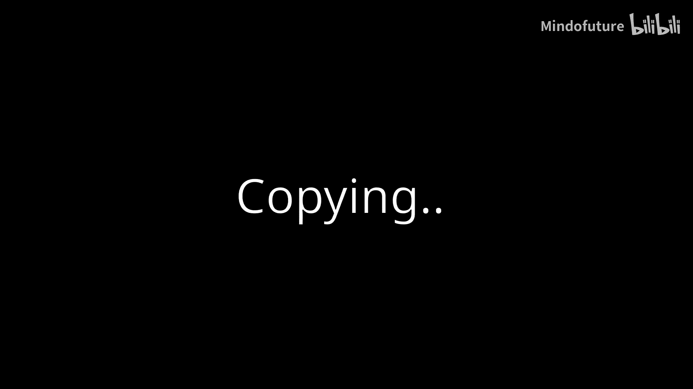

Okay， so we are done copying。The USB key to the hard drive。IJust mount this。Drives。So， I can。

Checkck there。F system table and the G C of3。可以啊。We've changed that to SDA。所。😔，Except。

Or two should not be the correct partition number。Cause remember。

 this needs to be the part of the boot drive。Okay， let's try booting from this。

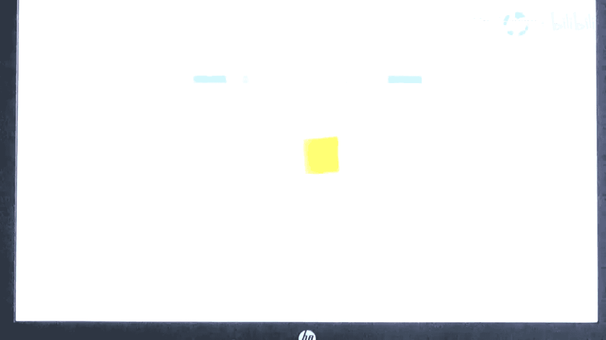

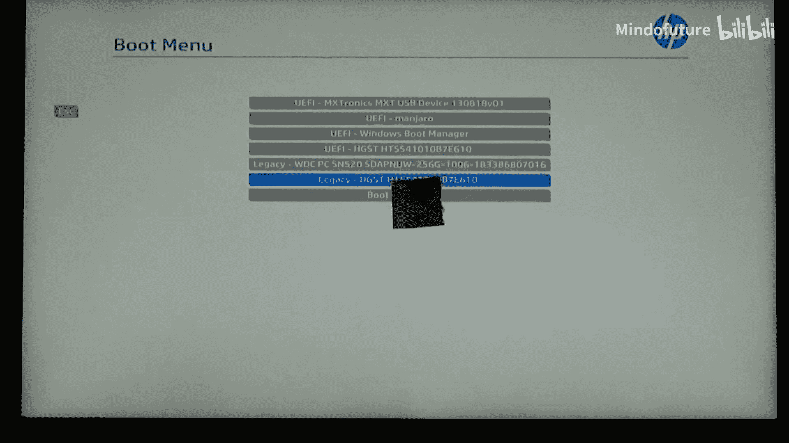

Boo device is not found。 Please install an operating system on your hard disk。For my information。

 visit Hp dot com。Okay， this reference to H P dot com。

Makes me think that this message probably comes from the hardware。So， the main board。

Probably complaints added。Couldn't do something with a hard drive。啊。

So it doesn't look like this is coming from Gr or anything。Okay， I'll plug in。

The manarro stick again。

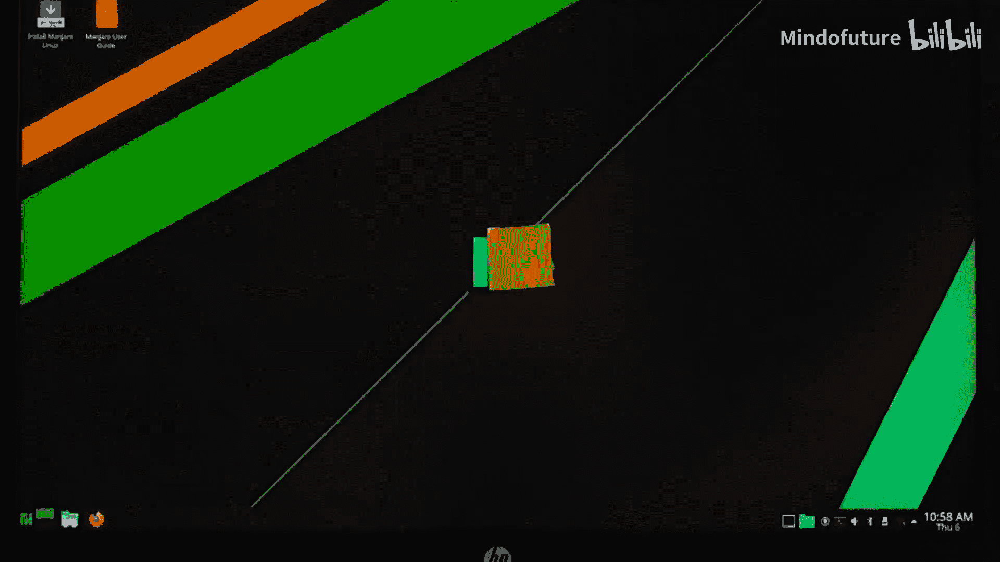

Okay， so since it couldn't even。Start wrap， apparently。

I guess that it must be something really early。In the good process。

So probably is here with a hard drive。So let's check out the hard drive and Fdesk。Print the。

Partition table。SD A S R Bo drive。It doesn't say it's a boot drive。Let's activate。The boat drive。

Okay， write it to the disk。Okay， let's try again。

Okay， this is looking good。We have a group。Yeah， let's try this。Okay， it's asking me for a lock in。

Check it out。 We are locked in。Okay， I can echo。Ping。谷歌第一。Of course。Maybe I should plug it in。

Sas link is up。Look at that。 We are ping in Google。 We are online。Cool。

I've been thinking about this for a couple of days now， and if this hard drive。

Didn't have the bootable flag， and it was cloned from this USB key。 Then logically。

 this USB key shouldn't have the bootable flag either， right？

 And maybe that was the problem why I couldn't boot from it。嗯。

I don't suppose that it will work because in the boot menu。嗯。The hard drive was shown。

 even though it didn't have the boot flag。 You know， that's why we got that。Problem and yeah。

 the USB key wasn't shown， so I don't suppose that it will work， but I will still try it。Okay， let's。

Get the part table。Yeah， that's so。It's not putable， as I expected。 So let activate。

Partition number one。Write the partition table。And yeah， let's reboot now。

I put this little sticker to help the auto focus again。Going to the bio setup。Legacy and electronics。

 I can't believe it that。Youve got to be kidding me。I went through all that trouble。

 and this one flag was all that was necessary。あ。Oh， boy。And theres scrub， I can't believe it。嗯。Okay。

 let's put it。It's booting。I can't believe it's booting。K of panic。 Can you see that。Root device， S。

 D B 2。Unknown block 0，0。Colonnel panic， unable to mount route file system on unknown block 0，0。

I've done some research on this。 And yeah， kernelner panic that says block device 0，0。

 not found means that it couldn't find the。The， the root device and。Yeah， for USB devices。

 that's not so uncommon apparently， because what happens is the kernel says。Hey。

 root device are you there Oh no you aren't well kind a panic and then the device says， yes。

 I'm here， but it's too late。嗯。We are talking about milliseconds here。

 so the kernel just doesn't wait long enough for the device to answer that yes， I'm here。

 So what you can do is you can use the kernel parameter root weight。

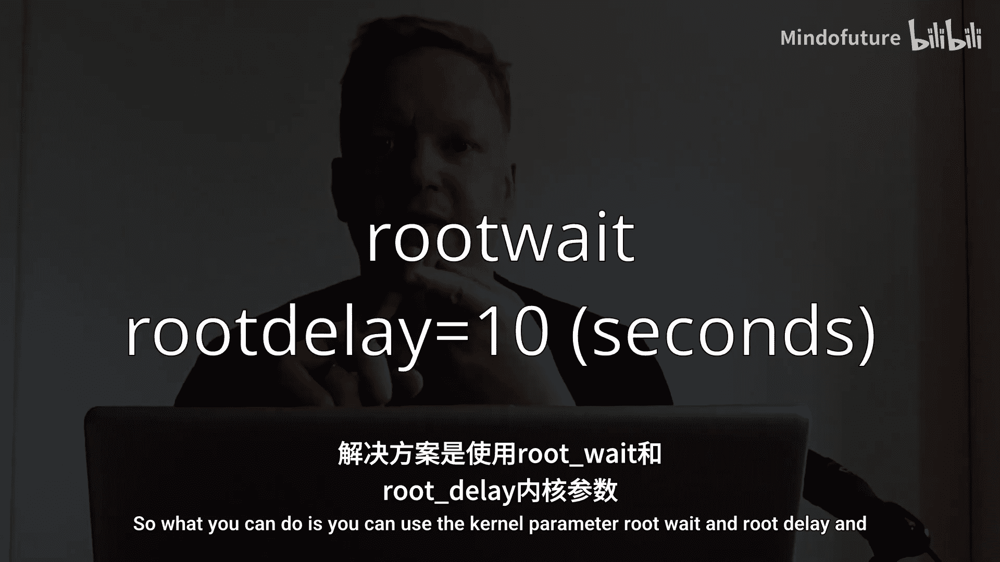

And route delay and set that to whatever10 or so。So let's try again with that。By the way。

 executing startup delay。I've also set that up。For the。

For the firmware are to also wait for the USB key。Let's try again。그。Wait。Or you could also say root。

Delay。Equals 10。Hey， look at that。 We are apparently in the in it。 Yeah， yes， yes， yes， yes。

 There it is。 We have。I lock in。Okay。Great。So， we've also。Manaageged to boot from the USB key now。

So there you have it running Linux system created really from scratch。

 We started with an empty directory and。Yeah， we wrote our scripts and ran them and downloaded all the source codes。

 compiled them and put them all together and。Yeah， now we have a running Linux system。Yeah。

That kind of concludes this series。But that leaves the question， what do we do now。

 Where do we go from here。On Linux from scratcht。t org。

 there's also the section beyond Linux from scratch。

And you can go to download and you can download it as。An entire P file again。

 or you can open it directly in your web browser。This is a list of。

More packages that are relatively popular。And。Yeah， for these packages， again。

Locationations where to download source codes and。Instructions for compiling them。 and yeah。

When you look around here， there's really a lot of these packages， so。

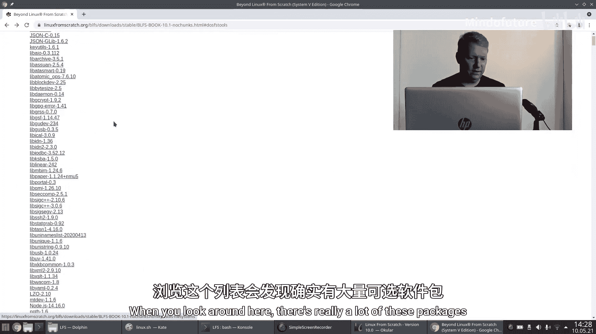

A lot of things that you can do from here。And yeah。

 I think I will make some appendices from some of these packages。

 like I would be very interested in SSH， for example。Or a graphics serve a desktop of environment。

 stuff like that。But yeah， for now， I think for today， this is enough。 So， yeah。

 if you like this video and the series， like it share it subscribe and see you next time。

