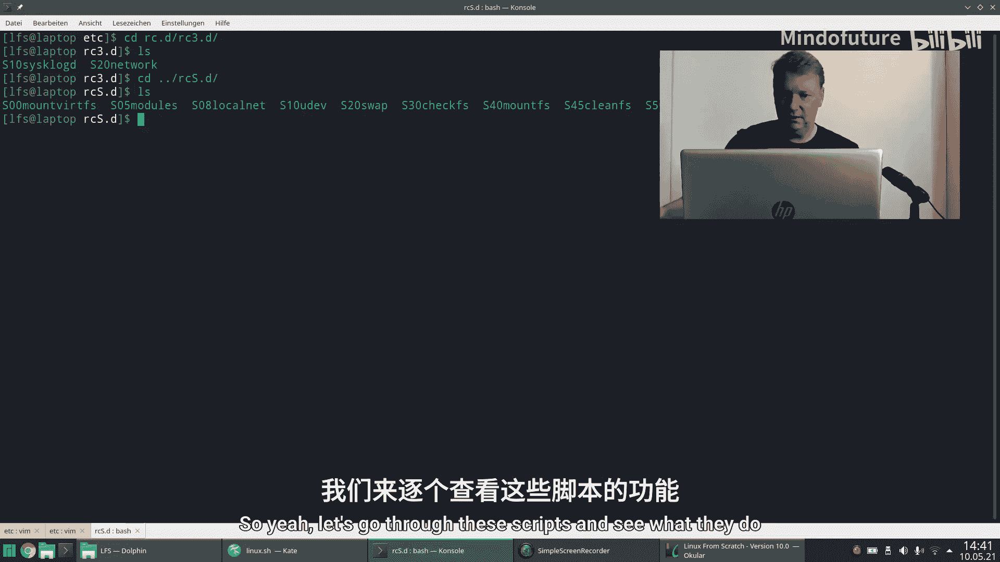
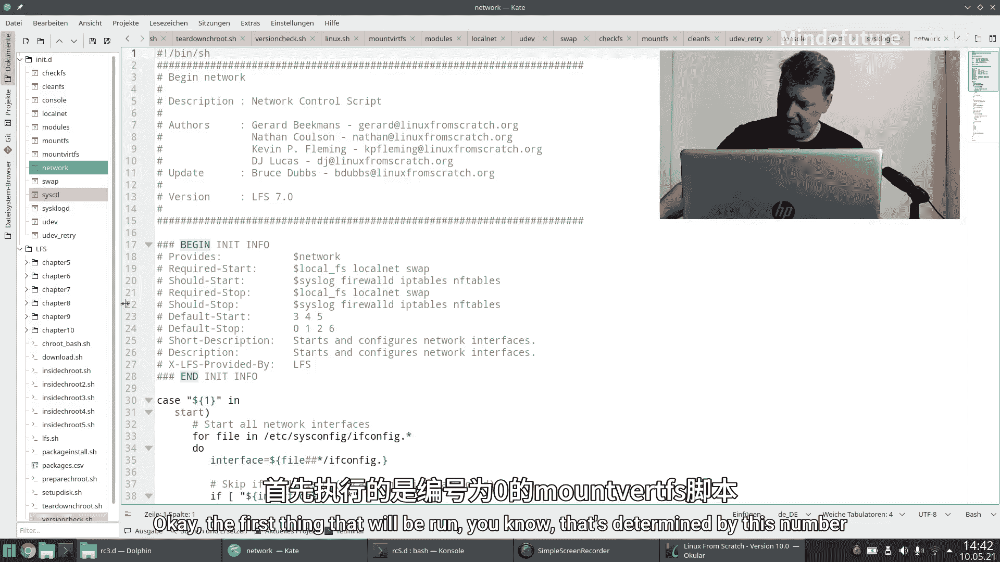
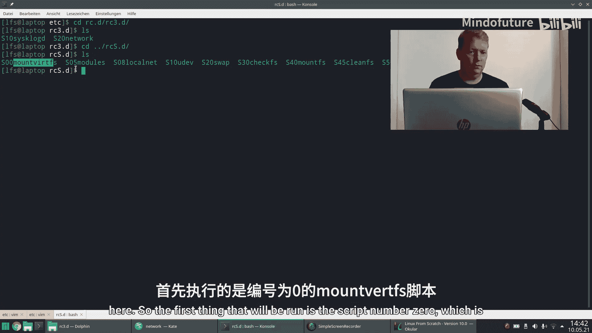
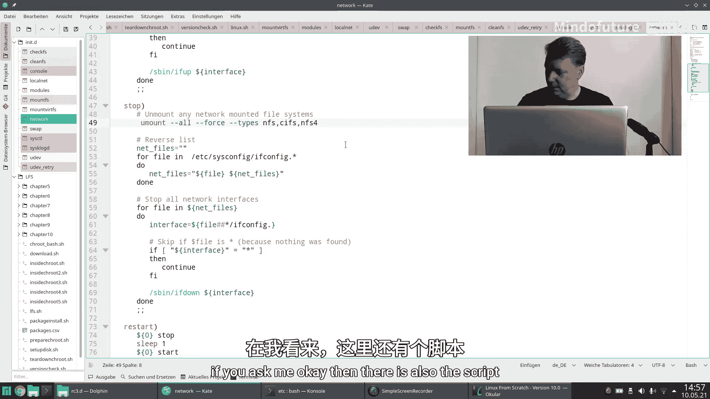
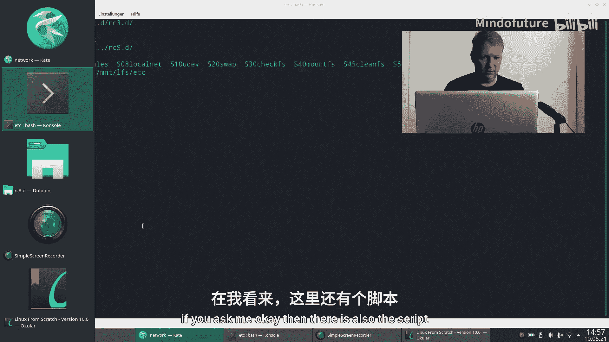
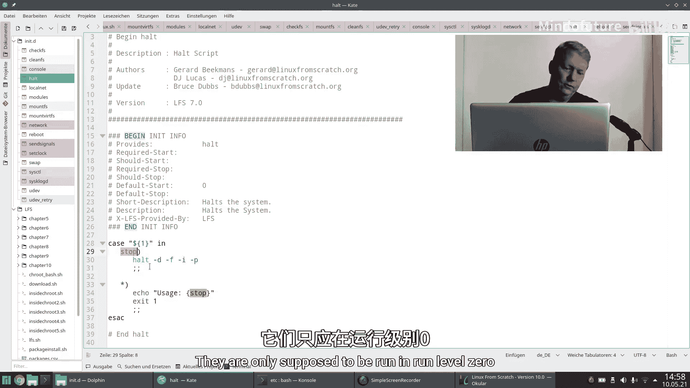
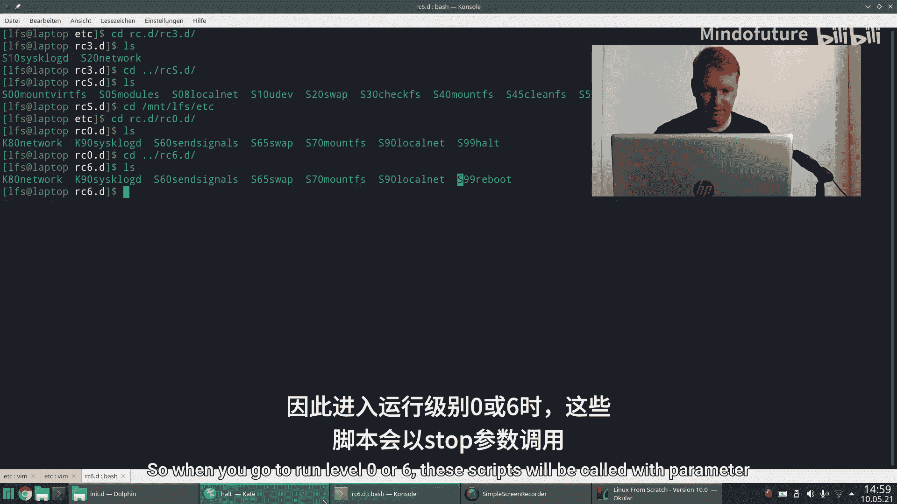
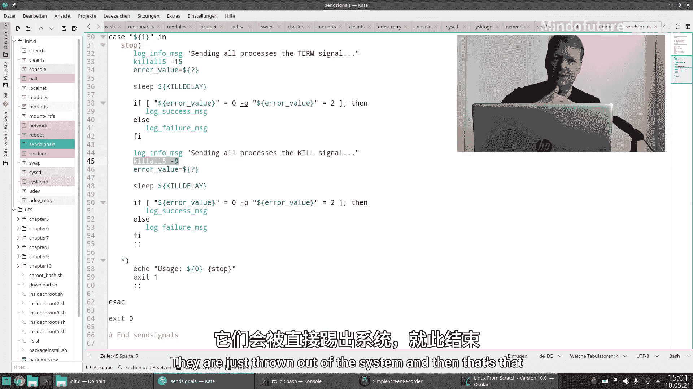

# 从零编写Linux操作系统-｜-Build-A-Linux-From-Scratch-p13-P13_Part_V-12-Bootscripts--BV1A78EzUEdf_p13-

Hello， what， welcome back to this tutorial on  building a Linux from scratch system。Now。

 in the last video， we've already finished our Linux system。So。We've already booted it。

 but I had promised to make a video about the boot scripts。Because yeah add's up。

They are an essential part of the boot process and yeah。

 the boot process is at least for me the most interesting part of this whole series and I wanted really to dissect。

That process， in detail。So。So when we start the computer。

 it the firmware will load the boot loader gr。And。Well Gr will read this Gr CFfG。And okay。

 we only have one menu entry here。In which we tell G to go to the hard drive zero。

And a second partition。嗯。That's actually wrong。We've changed that to one。

And look for this file VM Linux， which is the kernel and load that。

Then it starts that kernel with these parameters where we tell the kernel which hard drive to use as root drive。

And we can give it some other parameters， as well。And then the kernel will just start the program as spin in it。

There is a program， and。Yeah， when you start as spin in it， then。It will。

Read the file etsy in it tab。And。Okay， down here， it creates the。Different lock in sessions。But yeah。

 the more interesting part， at least to me， is up here。嗯。Where。Before you get to log in。

 it sets up the system。 It runs these boot scripts to yet to initialize the hardware and stuff。嗯。

So the default runndez is 3。 So if we。Don't give。A different run level under the。Gup C G。Then。

 it will。Execute。This script here for setting up the hardware。Okay， so。So it runs this script here。

And。Yet， it's not that complicated。What it basically does is it loops here。

And goes through the files in Esy， RD， R C，3， for example， if3 is a run level dot D。

And in that directory， all the scripts that start with a K are being。嗯。Started with the parameter。

 stop。嗯。Where is it？Here。Run the script with perimeter stop。And a bit further down。

Another loop through the scripts in Esy R C D， R C 3D。

And then it takes all the script that start with an S and starts them。Where's the peri start。Okay。

 and everything else is just。嗯。Stuff that for example。

 prevents you from starting a service that is already running。And stuff like that。

But this is a call thing that happens， so。Okay， in R C3 dot D， there isn't much in here。

 We only have this Klock D and network。That's because most of the scripts are actually in RCSD。

And you a script in there， they are for all。Run of it。So yeah， let's go through these scripts。

And see what they do。O。The first thing that will be run。

How。You know， that's determined by this number here。 So the first thing that will be run is。

The script number0， which is Mountville。

Mount Vert。F， S。So let's look into that script。And yeah。

 most of these scripts will just look at their parameter。

 The parameter will usually be start or stop。Then depending on start or stop。

 they will do different things。And the Mount Vert F S。嗯。Basically， mounts。

The Procus and deaf directory。As of shared memory。Run directory。 So all this。

Things that we've also seen in。Video about the change route environment。Okay。

 next thing that will be run is modules。Now， modules。嗯。When you start that script。

What it mainly does is this loop here。Well it。Mud probes the modules that it found in Esy' config modules。

If you've seen my video about kernel modules。I've said that in system V， you can。

Yet change the location from where the in system will。Take its list of modules。 And yeah。

 this is where。You could change that if you wanted， so。

Some distributions would just have Esy modules or Esy R C modules or stuff stuff like that， so。

But okay， that's the modules。It goes through this list， and。Mud probes， the modules in there。Okay。

 local net。Loconnet yeah basically just assigns the。I P address 1，27，0，0，1 to itself。O。Also。

Sas its host name。Which it takes from the file etsy host name。Also， not very difficult here。Okay。

Youd。Starts。UD。And then tells you de to。Create the deaf directory entries for the devices that are already discovered。

 and everything else will be then added by hot plug events， so。

If if the kernel discovers more devices after that。You have hooks into the system of the discovery。

 and will then。嗯。Create the de directory entries。From that hpluck event。Okay， swap。

This is a very simple script。 When you start it， it runs swap on， when you stop it， it runs swap off。

啊。Restar will run itself with stop， and then will start again。That's relatively standard。script。

Check F， S。It runs a file system check。Now， Mount F S。嗯。Already tells you what it does。

 It runs mount。哦。And mount all yet， that。Just says go to the Esy file system table et the FS tab。

And mount everything in there。And when you stop it， it anmounts everything。 So that's not。Surprising。

Clean F S。 Yeah， does a bit of。呃。Tiding up。 So， for example， it deletes。

Everything it finds in the temp directory。哦。I think it also checks the access rights for a few directories。

Nothing fancy。Youd have retry。Yeah， runs Ud another time。Because。嗯。Yeah。

 the discovery of the devices might have some trouble， for example， if。嗯。

If they need something from the route directory from the route drive and the route drive might have might not have been mounted at that point。

You know。You might only have mounted the initial run drive。 And after you def， you do the。Mount F， S。

 which。Mount re。Route directory again， and。嗯。At that point。

 it could switch from the initial ra drive to the。嗯。To the actual hard drive。And yeah。

 now you might have some additional drivers stuff like that， so。That's why。

The discovery of some devices might have failed before。Okay， then the console。

 that's also something that we did explicitly。嗯。It's。The script runs。Load keys。

 So it loads the key map。And it sets the fund for the console。

That's stuff that we've also done manually。Cus control basically just runs source control Q And P。

And that will load the file at see this control con， but we haven't even created that。If we had one。

It would be for。Making some changes to the profile system。嗯。Yeah。

 you can look into the main page for that。Then we have this Cello D。Which is a demon that。

Here receives has a system lock。Not surprisingly， if you look at the name of the script。So。

 that starts the。This Lock D demon， and also has been Klock D demon。And the last thing that we start。

 for level 3。Is network。Which will iterate through the configurations for network devices in at Suus Config。

Interface config。Dot E T， H 0， for example。嗯。And then， it will。

Just call Epen interface up with that interface name。哦。If。You stop the script。

It will run as been interface down with that interface and。Unmountund everything that might。

 That's actually not such a good idea to unmount everything。That uses network file systems because。

You can have multiple。Network interfaces， and。You could have。Mounted some。Some network resource。

That you access through a different。ANetwork interface that might not be controlled by the script。

That's actually not such a good idea if you ask me。

Okay。Then there is also the script。

Se clock。This would。Basically， run。Hardware clock。To configure the clock。Interestingly， enough。

It seems like this script is never run， at least in the default configuration for。Linux from scratch。

But okay， the script is still there。If you want to， you can enable that。

And then we already come to those scripts。Hot。Send signals。And。Reboot。These are。哦。

Its special scripts because they work a bit differently。嗯。Because。They can be started。

 but they just don't do anything when they are started。 They are only supposed to be。

To be run in。And run live at zero。Or run level。6。So， here you would have。Ht or the reboot script。And。

Where for run level 0 and 6。Although although they have an S here。When you go to run level 0 or 6。

 nothing is started。 Everything is called with stock。So。When you go to run level zero or six。

These scripts will be called with parametermeter stop， and。Well， the whole script will then。

Turn the computer off。The reboot script。What reboot the computer。And the sent signals script。

Runs kill order。And。Yeah， once。Only with。Pererometer 15， which is the term signal。

 So it asks all the running processes， please terminate gracefully。And those that don't obey。嗯。

You know， it waits for a while。And。The processes that are then still running。

 so they haven't obeyed to the polite request to please terminate yourself Well they are then terminated。

In an ungraceful way， they are just thrown out of the system。 And then that's that。

And that's all the scripts there are。 So I think we now have a really good understanding of what is going on in the good process。

And yeah that's all I wanted to do in this video。 So if you like this video。

 like a share it subscribe and see you next time。