# 从零编写Linux操作系统-｜-Build-A-Linux-From-Scratch-p15-P15_Part_D-11-Kernel_and_Boot--BV1A78EzUEdf_p15-

Hello world。Welcome back to this tutorial on  building a Linux from Sc system。Now in the last video。

 we have finished Cha8， we've installed system D and some other stuff。And。Yeah。

 then we've configured the network and some system， things like the console。And。Yeah， now。

As you can see here， there isn't much。Left to do。So today we will compile the kernel。嗯。Inst G。

 And hopefully， then we will be able to boot our system。 So I'm excited。 I'm looking forward to that。

 So yeah， let's jump right in。So啊。I will create。One more。Inside， trained route。Scrt。

Still haven't come up with a better naming here。Okay。So。Today we will install。From Cha 10。

 the package， Linux bocur。Okay， but before we do that。We need to create our。At the file system table。

That's not difficult。Here we have to define the root device。It's an X 2 device。

I haven't set up a swap。Drive so。I've turned that off。With this weekend。Also access the boot drive。

Yeah。That's。Chapter 10，2。Then， we already come to。Of the kerneler。Okay。

 we'll start by calling make Mr proper。嗯。Yeah， that's。A command that cleans up。Everything from。

It resets the coat tree。I don't know why you should do that on a freshly unpacked。Directctory， but。

I've had enough problems with。Failed。Linux builds， so I will just do it and。

I'm not going to use make menu confi that I've copied from here。 I will use make def config。

Which uses a default configuration。Because I don't want to bother with。Making order。嗯。Seeleions here。

I have made a video about compiling the Linux kernel， and I go into details a bit more there。

 So if you're interested in that。You can watch that video。With this， we compile the kernel。Then。

 we copy all the。The modules， the drivers and stuff。To thou。Target location。And then， we already。

Install the kernel to its。Location in the good directory。I don't know what its system mapp does。

We do a。Back up of our contract file。That we've created。 I mean， if we do the。Default conflict。

 then it's a bit pointless to make a backup of the conflict file， but okay。Anyhow。

Studing the documentation。O。And。Yeah， this。The neighbors。A few。Drivers for USB devices。嗯。I mean。

 this is in the chapter about the Linux kernel。I don't know。

 I wouldn't think that this should be part of。This script here， but okay。

 since they have it in that chapter， yeah， I will just do it like that。Okay。

 that's already all we need to do for the Linux kernel。And then， we come to the。呃，不load的。

So to install the boot loader， we run grab install。And we will run that on。嗯。De。SDB， which is our。

USB。K。あ。We might want to use this variable， instead。But we are not passing that to the change route。

So， I will just。Leave it hot coatd here。Okay。Then we only need the G Cf3。

The configuration for our group。The default selection will be。Mu entry number 0 bits。

We only have one， so。They start at zero so。This is our default selection。We will wait 10 seconds。嗯。

We will use the X2 module， because。Well， our drives are X2 formatted。At this point。

 this root variable here refers to the root where Gr loads its data from。 So this is a。

The device on which。Grub is supposed to load。The cornera。So， this file here。You know that's。

That's a location where we store the。嗯。The Linux kernel file。Right， so if you remember here。Here。

That's。Where we put the kernel， So that's。The location of the kernel。

But I will remove this boot here， because this location here is。Relative to the。嗯。To the device。

 and if we mount。S D B1。On slash boot。And then put something into slash boot。

It means that relative to the device， it's going to be in the root directory of that device。Okay。

I hope that makes sense。嗯。I'm not sure if it's going to be H0。

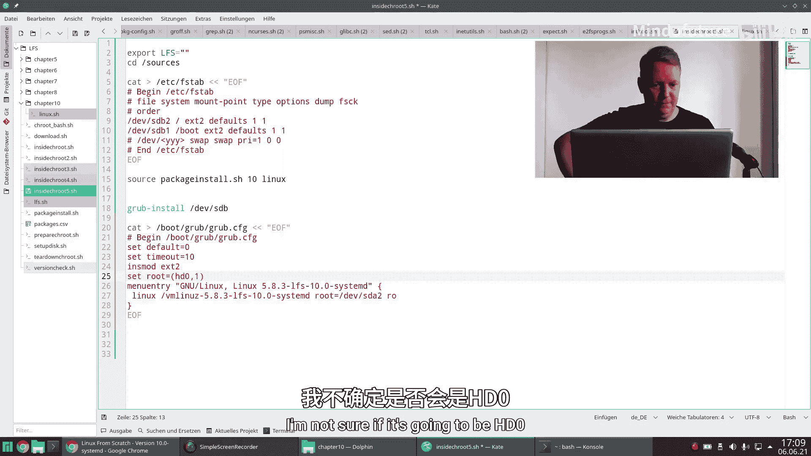

We can test that in the。Gup。嗯。In the gr shell。嗯。But yeah， the route drive was SDB1。

 So that's why I put a one here because yeah， one is the boot drive。

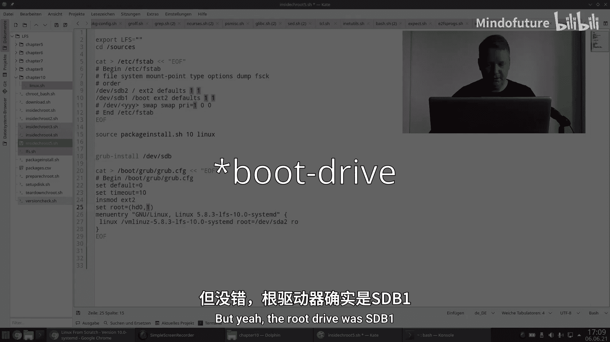

Okay。Then， we need。TefSP2 is the root device。Yeah， that's our Linux from scratch device。Yeah。

 that's where the Linux kernel will then look for。For modules for drivers， for systems settings。

 and so on。Now will'll set that to read write。嗯。Now in the system V branch of this series。

We've already booted the system， and。At this point， we had a problem。Because。

When we are booting from a USB device。It it can be just too slow， so。We boot the color。And then。

 the kernel。嗯。Asks the。Whole hardware of the system。He is there an SB2。And。

Then the kernel just gives up too fast。 It just says， it's there around SDB2。 No， okay。

 then you get a kernel panic because the answer of the device is too slow。Because of that。

 I would put a。Root delay，10 here。And a root weight。Also。Good。This looks。Good。Okay。

 then let us run this。Okay， this time， since we。Copy the kernel to the boot drive。

And we also put the Gr CFfG on the boot drive。We need。To also mount the boot drive。

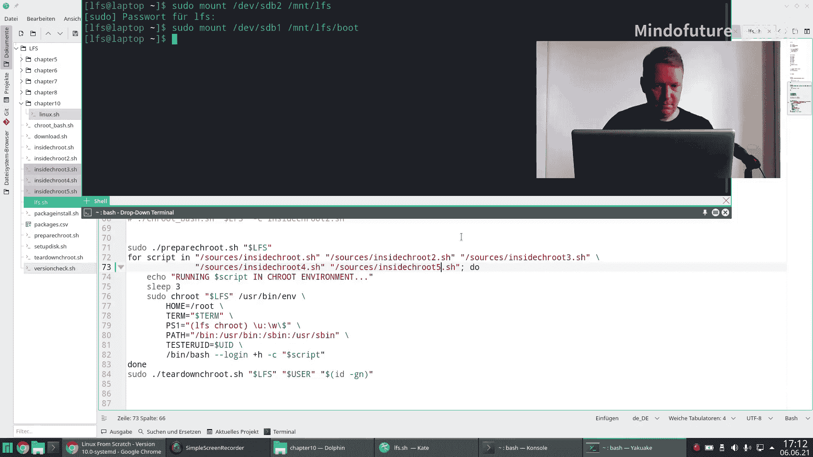

Okay。Okay， this all looks。O， so far。Except。Grew up and arrow。 Yeah， I forgot that。

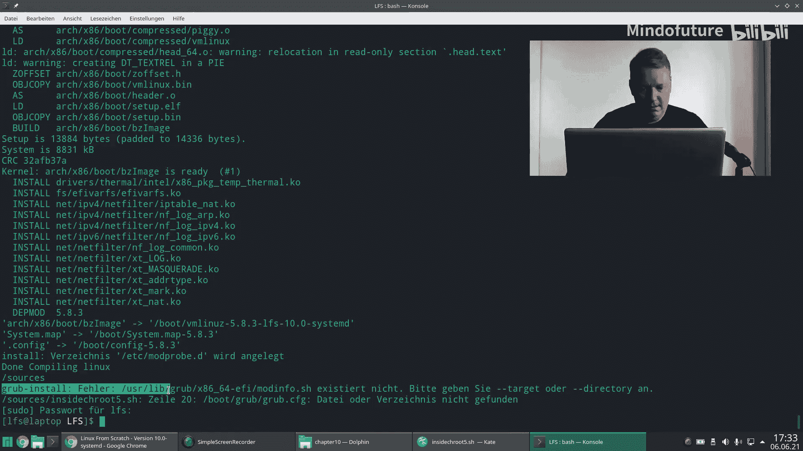

The problem is that this machine was booted using U A。And when a machine is booted， using U Afi。

Then G install also wants to use UA。And。Yeah， we haven't compiled you if you support into it。

 and I have actually tried to do that。Before， but。嗯。I didn't succeed in it， so。

I will just set target equals I 386 dash PC。Without the equal sign。

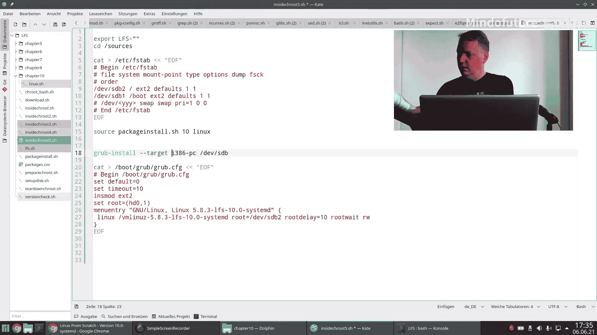

Okay。Lets do that manually。Okay。Okay， one last thing in the system V branch of this video series。

 I've had trouble booting the。The final system， because。For some reason， I don't know why， but。V。

A bootable flag on the boot partition was somehow not there。So， I'm gonna。Print a part table。 Yeah。

 you see here at L in this column， there should be a star。For the bootable flag， and。

Because it was not there。 I had trouble booting it， so。Activate the partition。 Partition 1。

Rightite the part table。Okay， now it should。Work。Print a petition table again。Yeah。

 now it's bootable。Okay， so then we can。Try to boot this。Wait。I'm seeing something。

Gps CfG seems to be missing。哼。

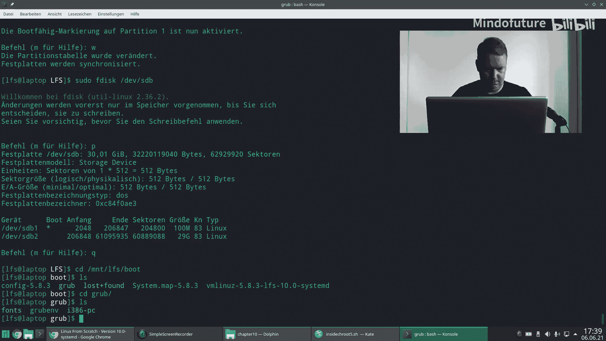

Strange。

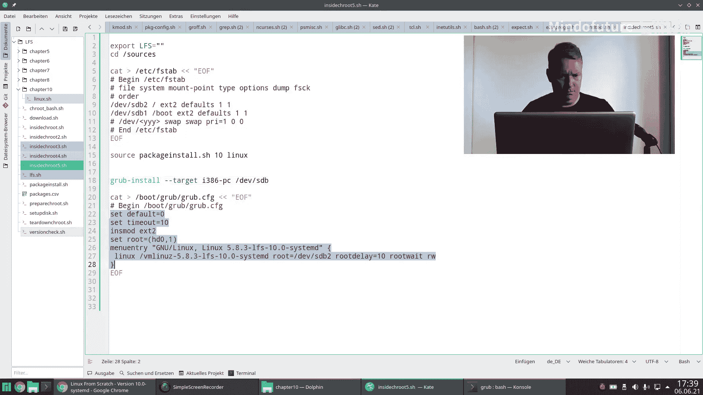

Also I think this should be M does1。Because we've used a Du petitionition table。Okay。

 now let's try to boot it。

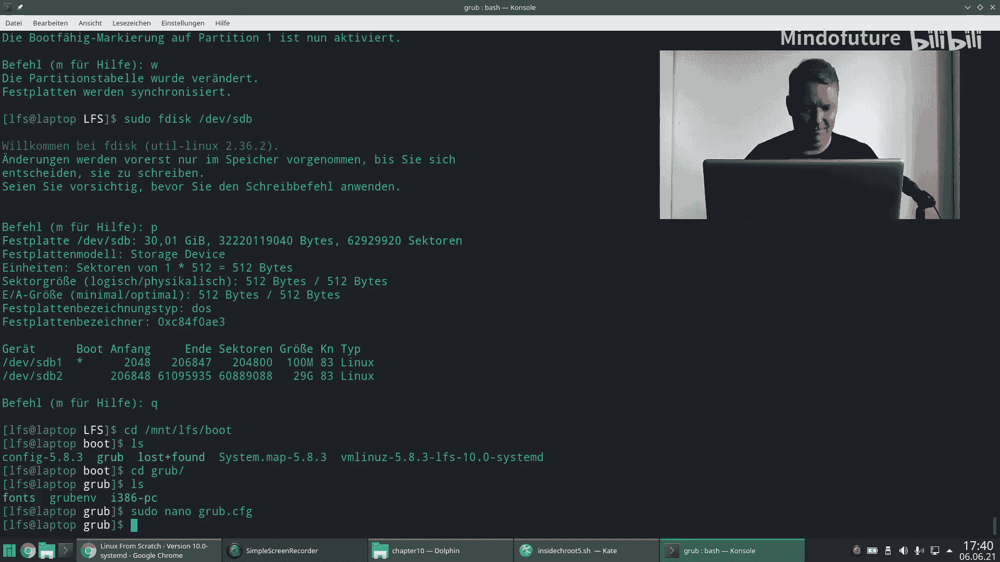

Put this little sticker here again。To help you。Auto focus of the camera。I'm going into the bio。

Where technically， the word bias is wrong。Because today， your A P by As don't provide any。嗯。

Facilities for input and output， so。Yeah， B is actually a wrong term here。

 but it's still customary to call it that， so。Extroics， yes。

Okay， here's our group。Okay。Let's put it。This looks pretty good。So the kernel is apparently booting。

Okay， this looks like an oak。嗯。Network name， resolution。哦。Network time synchronization。

They have heard， but。Do you see that down there， I can look in。I have a bash。I can echo something。

I cannot ping Google， Well， that's not surprising because。

It was complaining here about some network problems， so。Let's see I space A。E though 0。Is downwin。

Yes， let's say。Network。Conttroroller。好。Its0。system D network D is not running。And I typed U， O。

 instead of up。Direct firmware load for R T L。 Nick R T L 8，1，6，8。

 H dash 2 dot F W failed with Aaron-2。Unable to load firm well。Okay。What this was。Okay。

 but what is up with system D network D。System controller。Sysem D net。第一。Faied。Dwn的。Control。Dash X。

 E。K， it system D network D service。Faied to determine user credentials。No such process。

Faied at step userss spawning。Lip system D， system D network， D no such process。Okay。

 so this was at least partially successful。 We were able to boot the system， but。We some。

Trouble with saying。Network。So。这迟一。It's Google phone。This R T L underscore Nick。Slash。题诶。

It's a real tech。Network device，6，8， H。There's two dot F， W。没よ。Download this。

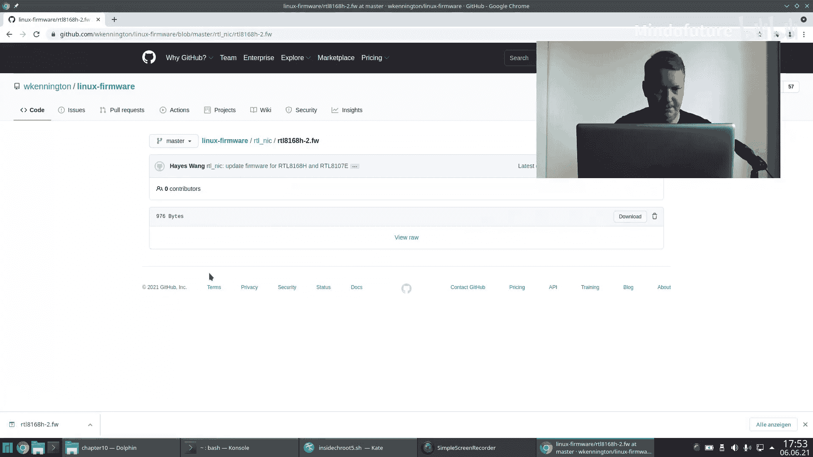

Now， this is a firm web file so。This is a firmware file。Needs to be put in。We need to put this in。

T F， S。累。Fwell。And。Yeah， let's see。We'll also make this directory RTL andonic。

And copy this firmware into that directory also。哦。Okay， let's try again。Can still network problems。

Okay， let's try again。Control。You0。Okay， that's a different problem now。Li is down。

It says here link is up。哦。Could not。😔，Ping Google， because a known host。平。Something。

That doesn't require a name resolution。Network is unretriable。System control start system D。

 network D。Exited with error control。D control。Dash X， E。Okay failed to determine user credentials。

 No such process。And here it says。Main pros has exited。Status，217 slash user。

So I've done some research， and it seems that error message。217 slash user。

Seems to have something to do with。The user as which a service is run， so。嗯。Yeah。

 let's look into that。Okay， so this is a service file for those for the network D service。Okay。

 it says here that it wants to start the service as user system D dash network。嗯。Okay。

 that's a bit problematic。😔。

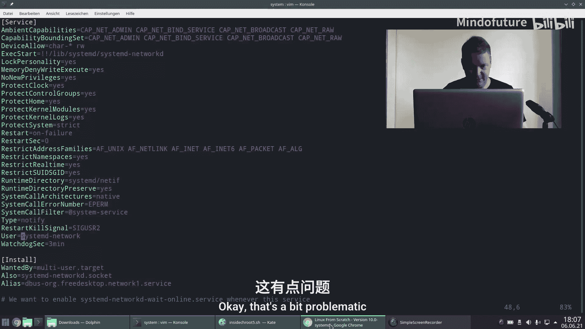

Because I've started this。😔，System with a system V。Linux from scratch Book。 And then after Vm。

 I've switched to the system D。Lux from scratch。I mean。

 system D dash network does not sound like a user that would be。In the user list for。嗯。For system V。

 So let's look at that。Okay， here's the coat。For。Creating the Etsy password。Hai。

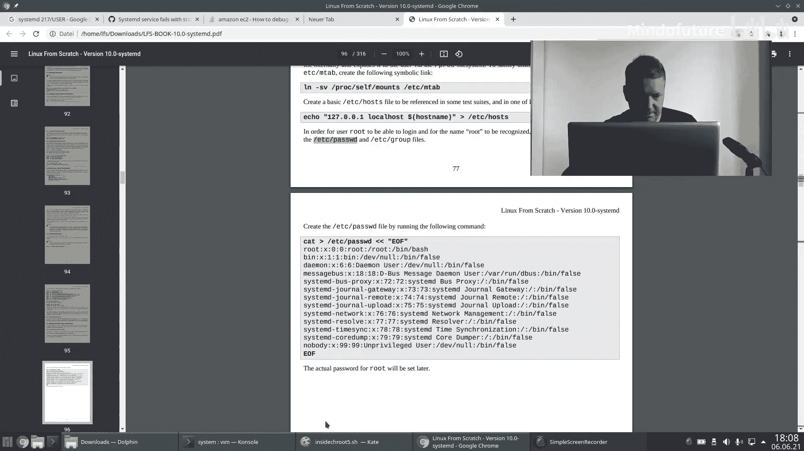

And let's compare that。Okay， that's， yeah， that's a different set of users。

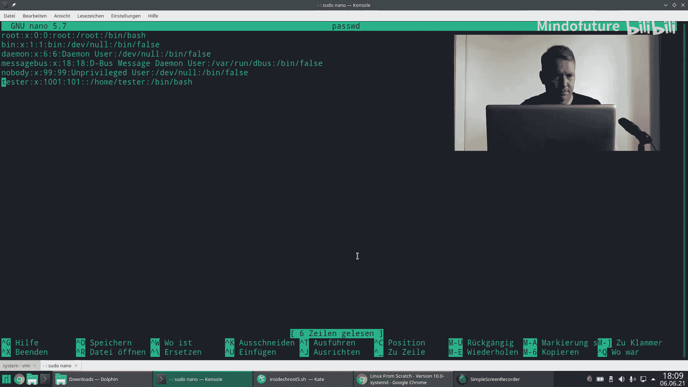

So we have fruit， bin， demon。Message bus。Then nobody and。This tester user。And。All these are missing。

I mean， it makes sense that they wouldn't be in there in the system V。

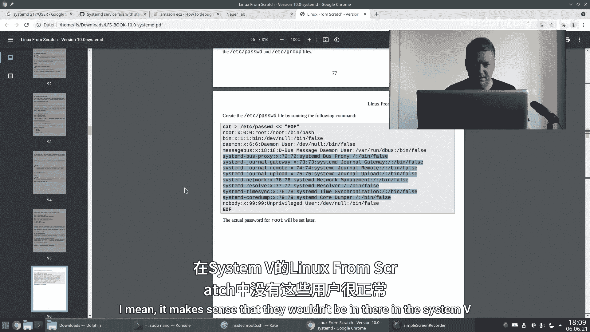

Linux from scratch， but。

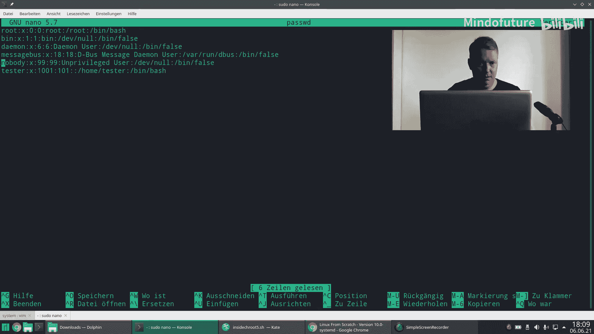

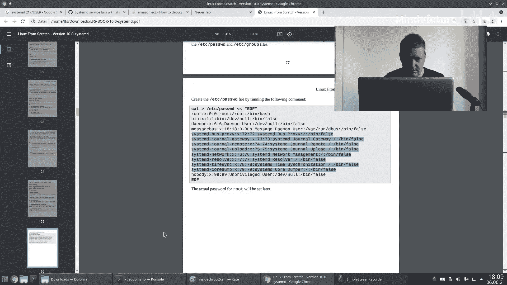

Here， that's the user。That we didn't have。So of course， that makes sense if this user didn't exist。

 then that could， of course， cause problems。嗯。To try to run some service asset user， okay so。嗯。Save。

Except。啊。

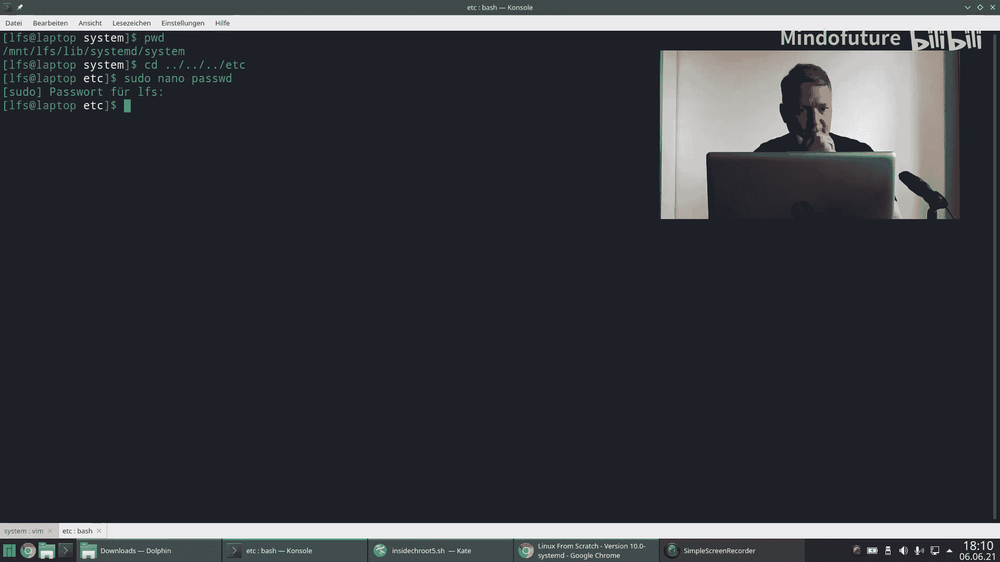

Yeah， let's try again。There was no。Errero message。Yes。Okay， so that was very successful。

We were able to boot the system。嗯。Log in， work with abash， do some network stuff。So yeah。

 this kind of concludes this series。嗯。But yeah， there's more to do。

 If you go to Linux from scratch dot org。There is this point beyond Linux from scratch。

And you can go to download。And there you can go to。 you can download this as P D F， I think。

 somewhere。But。Yeah， here's。Everything in。One HTMLm file。

And here you have this huge list of packages。That。Are quite popular things like。Let's see， SSH。Yeah。

 open message Hs here。And here yeah， for these packages， you have download locations， M5 sums。

And further。Compilation instructions。

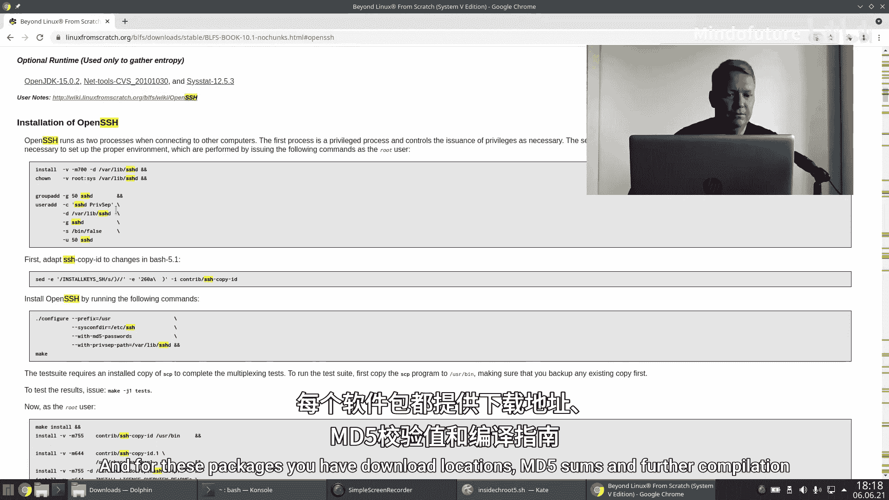

And yeah， I think I will make some appendices for some of these packages like， yeah。

 S H would be very interesting to me because。If you're going in the direction of IoT with something like this。

Well， Io T devices typically don't have a display or anything。

 so they would just sit somewhere and have some network connection。 And yeah。

 then as as age is a very good system to lock onto that device and then you can work on it in a bash and have a。

A nice working environment。 So I think as age is really a good way。

For communicating with Io T devices。But I would also be very interested in the graphics of。

Maybe whhalland， maybe x 11， I don't know。Of course， then when you do that， the next question。

 of course， the。The desktop manager， I personally like KDE。嗯。But Goma is also very popular。 I mean。

 these days there are so many desktop managers。 It's crazy。But yeah， I think there is enough。

To go into after this。 so don't worry。The series will continue， so tune next time。

 if you like this video， like and share and subscribe and see you next time。

