# 从零编写Linux操作系统-｜-Build-A-Linux-From-Scratch-p16-P16_Build_a_minimal_Linux_with_only_Busybox_in_1_hour--BV1A78EzUEdf_p16-

Hello world。 My name is Victor Engelman， and in this video。

 I'm going to show you how to build an extremely minimalistic Linux distribution。

A very small distribution， Its。Only going to be， I think，12 megabytes or so。And。Yeah。

 I've already created a video series on my channel about Linux from scratch and I think that was a。

 I don't remember exactly， I think around 10 hours。But yeah。

 the thing about Linux from Scratcher that it's a complete Linux distribution with networking and C compilers and tool chains and everything。

And yeah， today， we will build a much smaller system that。

It's really only supposed to give you a shell so you can navigate your file system and start programs and such。

And yet to， to achieve that without all this overhead of a tool chain to create all the。

Or the glue us and stuff like that， we will be using busy box。

 so we will actually only build two packages。So that's really， really minimalistic。 And yeah。

 that then we will have。A Linux kernel， on the one hand。 And ya， I mean。

 Linux systems generally require a kernel and a root partition。

 You know where the kernel finds its instructions， what to do on start up and。Y。

 the programs and drivers to load。And。Yeah， so that's what we will have to do。

 We will have to build a kernel and create a root partition。

 but that root partition is mostly only containing busy books。Okay， so yeah， what's a busy box。

 Maybe I should explain that。

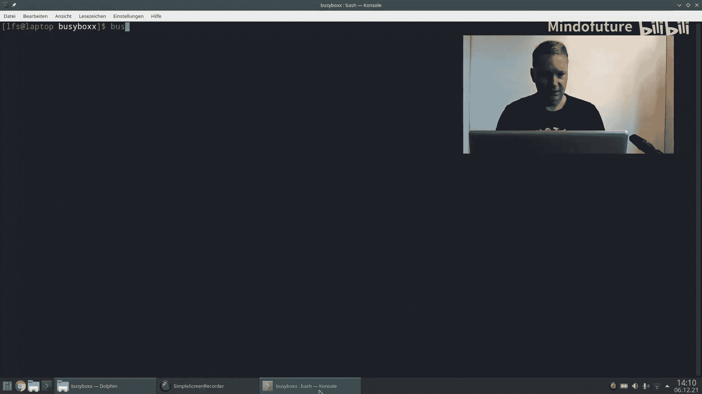

诶。Well， busy box is。Like a little program that can do a lot of stuff like。So。

A program that can take something that's。A normal instruction in a bash script。

 like echocho here and。Yeah， it can execute that。 Okay， so busy box is like a shell， but。Yeah。

 a normal shell would。Would start a separate program called Echo for that， okay。But yeah。

 busy box has all these commands built in。 so you don't have to build all the stuff around these tools。

Okay， so yeah， let's dive right in。I will create two text files。By box X like。You know。

 this typical ending for。嗯。For Linux distributions， everything has to end with an x。And。Some temp。

S H， okay。Because。I want to do this step by step， but in the end， So in this temp file。

 I will always do the next step。But then I will put everything into this busy box SH so that we will in the end。

 have one big script that does all the building in one go， okay。Start with typical tribang。Okay。Now。

 yeah， as I said， we will need a kernel and a root partition and on that route partition。

 we basically just want to have busy box。So what we will need to do is we will need to download。Yeah。

 that's a kernel source code。So we will go to kernelerner dot org。 And here under a protocol H T TP。

 we can browse the。嗯。The P directory。 And in here， we go to Linux。可能。And yeah。

 I will go for a 5 point something。Carent。And here we have a long list of。Currently releases。K 5。

15 dot 6。Seems to be a very recent one。Let see， X E seems to be stronger， compressed than geeey， so。

I was。Copy this link here。Okay。And we need busy books。So we go to busybox。net。Download source。

And here we also have a long list of releases。And。Here。1，34 dot1 is the newest one。

These two here are signatures。This is the one that the T B Z is the one that we need to download。

Okay。Yeah， of course， we can。Pull out this version here。Okay， and put this in a variable。Now。Yeah。

 here， this V 5 point x。 Yeah， this 5 point。 something is the beginning of this kernel version， so。嗯。

So we basically need to extract this。Major version here。And， yeah。That's a typical use case for that。

So。We take the。The leading。Digits。1，2，9 star。And capture that in a capture group。

Followed by something that isn't a number。So if the number would happen to be 10 or so。

 I don't want to capture only the one， I want to capture the full everything until the first character that isn't a number。

 okay。Okay， and then after that。Anything can happen， I don't care。But， I'm taking。呃。Digits。Until。

We encounter as the first non digit here， okay and。What we enforce that。Okay。

 and we met that to the first capture group， so。The stuff that we've captured here。O。Yeah。

 maybe let's try this。To make sure that it works。And you see it indeed， takes the first。Number。Okay。

So this seems to work。 And then we can。Replaces here with。看着。Nature， and now we can， we can just。

Change the version that we want to have up here， and everything else should。Should just work。

Without any further actions on our side。 Okay， so just changing the number up here is then supposed to just build the same system with a different version of the kernel and other。

The busy box， okay？Good。嗯。Now。I will create a。Diirreory SRC and。

We will see a change directory into that so that we download the stuff。Into that directory， okay？

And then， we would unpack the。The archives。Extract fire。And extract。Busy box。Okay， so。

I will group that。So this is a step for the kernel。And down heres of stuff。They folks。Okay。

 so when we unpack this Linux archive， then we will get。A directory called Linux。

 with the kernel version。We can see D into that。Okay， and yeah， when we are in that directory。

We will then need to build the kernel and yeah I've already made a video about building the kernel。

 so I'm not going to go very deep into that here。I'm just going to say make def config。

 so we get the default configuration。And then make with J8。But in case that fails。

 I want to exit the script， okay。But。Let's start by。By doing this。

 downloading the kernel and compiling it， okay。

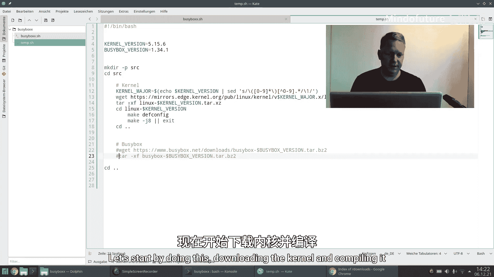

So。

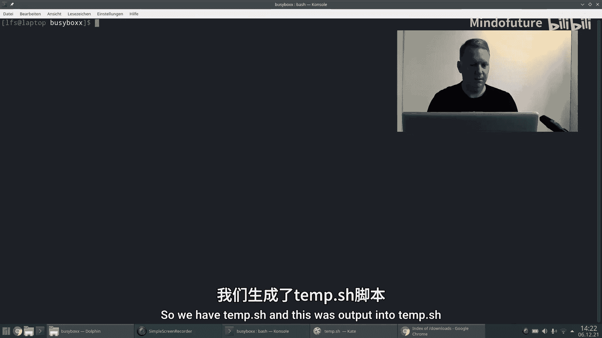

Okay， so we have temp dot Sh， and this was output into temp dot S， right？

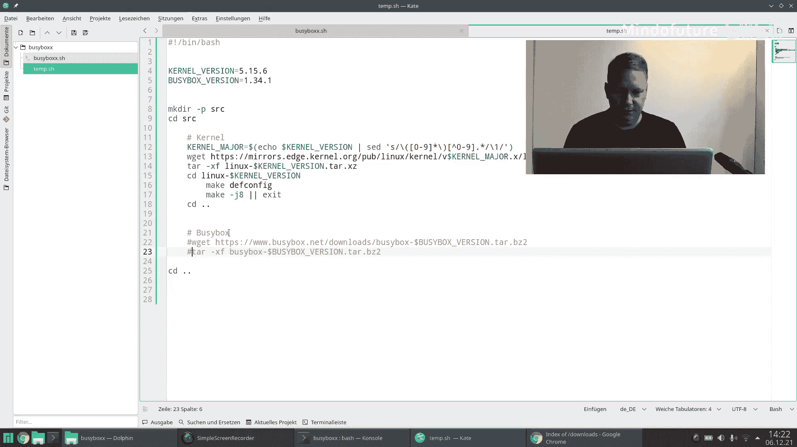

Yeah， let's run this。Okay， we're downloading the kernel source。That's amazingly fast。

I think it's unpeing now。Now， it's creating the default configuration。

And now it's compiling the kernel。 And here， this can take a while。

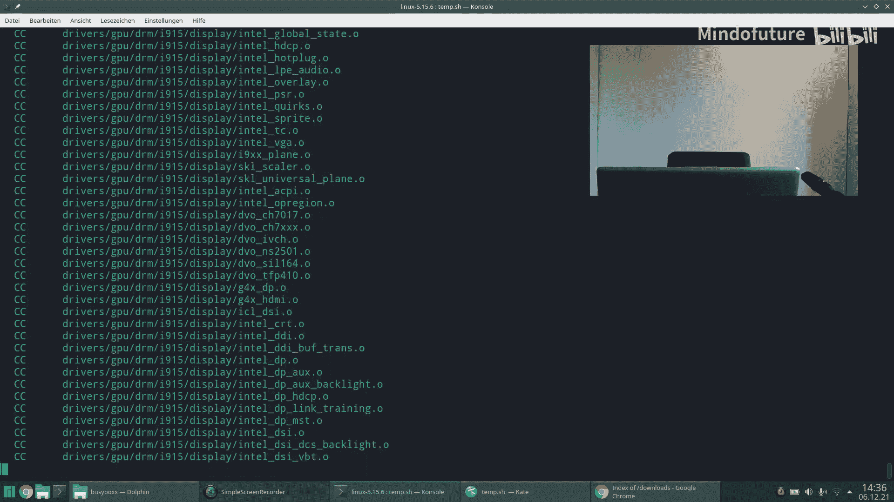

Okay， it's finished building the Linux kernel。And at this point， I will throw。

All the stuff over here。Into the other。Shalll script， because the other kernel is now done。

I would throw that out of this temp。Scrt。And yeah， now let's start。Building busy books。

There you have the same situation when you unpack it。You get a directory with that same name。

And in that directory， you can then build。Busy box。And yeah。

 busyy box has a similar build system as a Linux kernel， so you can just say make def config。Also。

 okay。And yeah， I will execute this now， and then we will。

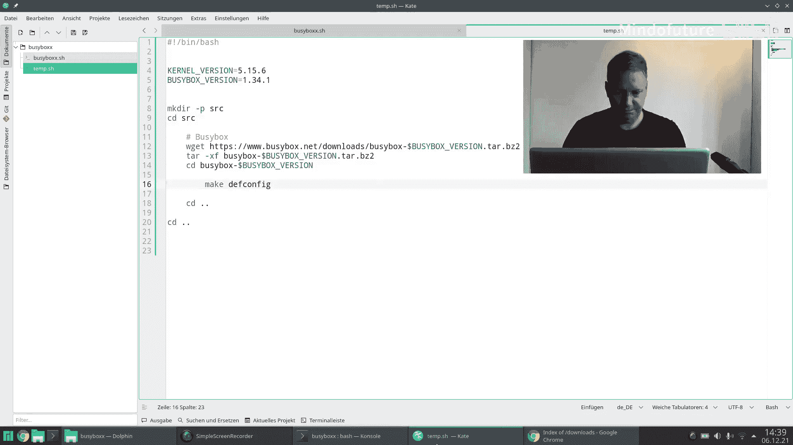

Talk about this somewhat。O。So now it has created this default configuration file。

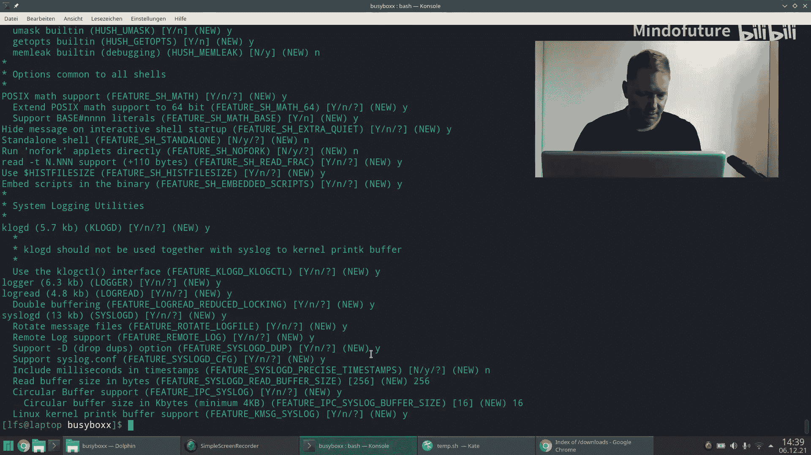

Okay， so now we have this default configuration file， but。

We now need to talk about busy box a bit more。嗯。Because， yeah， of course， we want to build busy box。

But that's not so simple in。In my case here。And since we've already downloaded and extracted the source code。

 I will throw this out here。Okay。嗯。

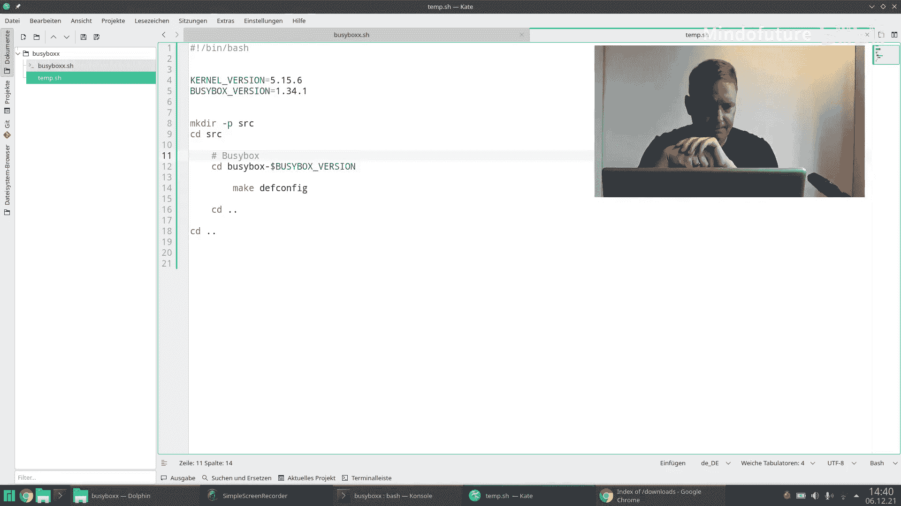

Yeah， now we need to talk about how to build busy books。

Because that's not as straightforward as I would like it to be， at least not on Manjaro， you know。

 I'm running a Manjaro system here。And the problem is that our final system is not going to have。

An LDD， I think。So it's not going to have any facility to load dynamic link libraries， DLLs。

 as they would be called in Windows or shared objects as they are called in the UniX world。嗯。So。

Because of that， we need to tell busy box to create a static build。

 So the library that you would normally have as separate files。And that it would load on runtime。

They need to be put into the executable binary， so that they don't have to be loaded dynamically。

So we will need to do something called a static build and。Yeah， you can。Just like in the。

In a Linux build， you can。嗯。You can also do make menu config。Okay。

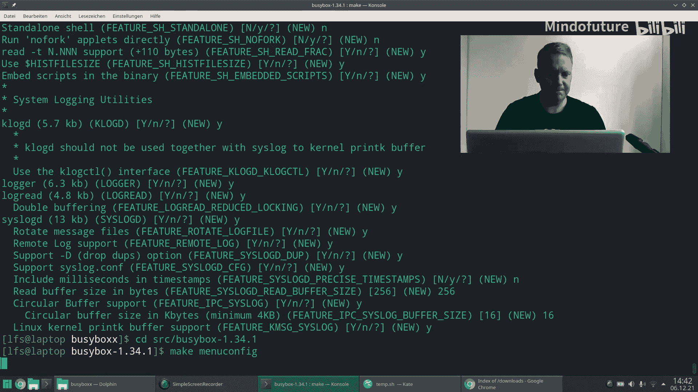

And。Yeah， there's this， you get this menu。 very similar to the。To the Linux menu config。

And here in the settings， a bit further down。You can say built static binary， okay？嗯。But。

I want this to be a script， right， So I want。

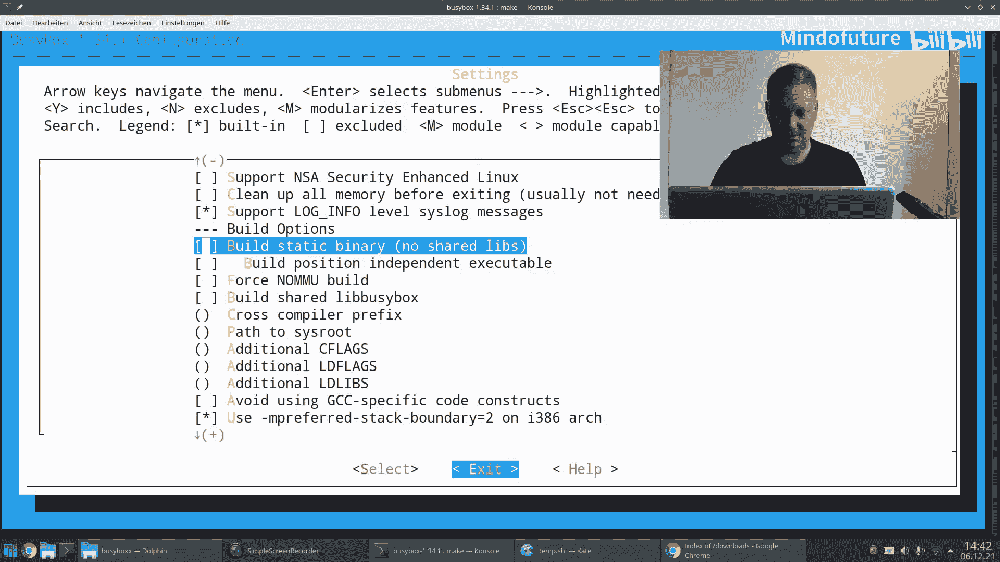

I don't want to go through this graphical menu here。嗯。So what you can do instead is， you can go into。

The file dot config。And in here， you have a setting called。Confit static。Which just not said。And we。

Can set it to。Equates， yes。That would be one way to do it， but that's still manual work。

 And I want this to run through without any。

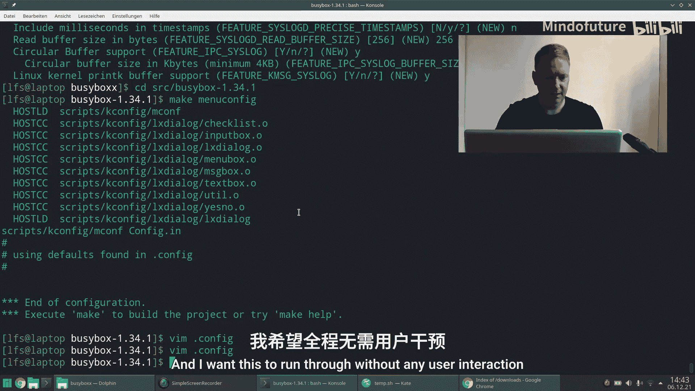

User interaction， so。嗯。What we can do now is， again， with that。Edit the file dot config。And。Replace。

Any line。It contains config static。So we take the entire line。

And replace it with config static equals， yes。Okay。

ButSo this changes the configuration to a static build。

And now we would be able to run make again with J 8。And。If that fails， exit。Okay。

But here we have another problem because， again， this is a Manjaro system。

 and Manjaro is based on Arc Linux。And yeah， I've gone through a lot of online discussions about this topic。

 a lot of people have problems with that。And。Yeah， the。

 the maintenanceers are not very helpful on it。 So they just say， oh， just use mule。And。

It's not really obvious what that means。I spent， I don't know half a day yesterday figuring out how to just use musle here。

So。So what you need to do is。You need to install the packages mu。And kind of。Dash。Heas， dash music。

Okay， I've already installed them。 So nothing is gonna happen here on my machine。 But yeah。

 you need to install these packages。 I think on Deian based systems， this is probably not necessary。

 You know， this。On Deian based systems。 And I don't know， fedora。

I think most other Linux distributions will just succeed in building with make。J 8。

 But the problem on Manjaro systems is that the library lip crypt。

There's just no static version of that。In a default installation of Manjaro， and。

Wasn't really able to build one。Easily。 So this whole approach with music was just simpler， so。

So that's what I then ended up doing。And yeah， now what is mu， Mu is an entirely separate tool chain。

 so。Instead of Gcc， we will now compile with Musle Gcc。Okay。So， that will then。Build our busy box。

Okay。Good。Yeah， we already did this make。

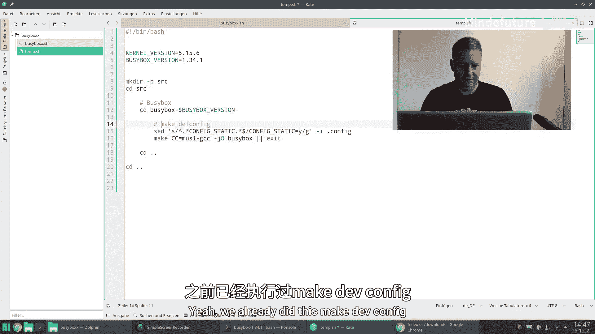

Deaf conflict， so。Go I comment this out now。Yeah， let's run this。

I don't know why it's asking me about static lip Gcc。 I will just say yes， because。As I said。

 we want to build a static build。 and this sounds like it's related。 So I will say yes。

 I don't know why it's asking me this， but。Okay， but now it's。Done building this。And interestingly。

 it's saying here that lip crypt isn't even needed。

 so I really don't know what all the fuss was about， but okay。

I think I see why it's asked me about this。The setting for static lip GCC。

It seems that my that script has also changed this variable， possibly。

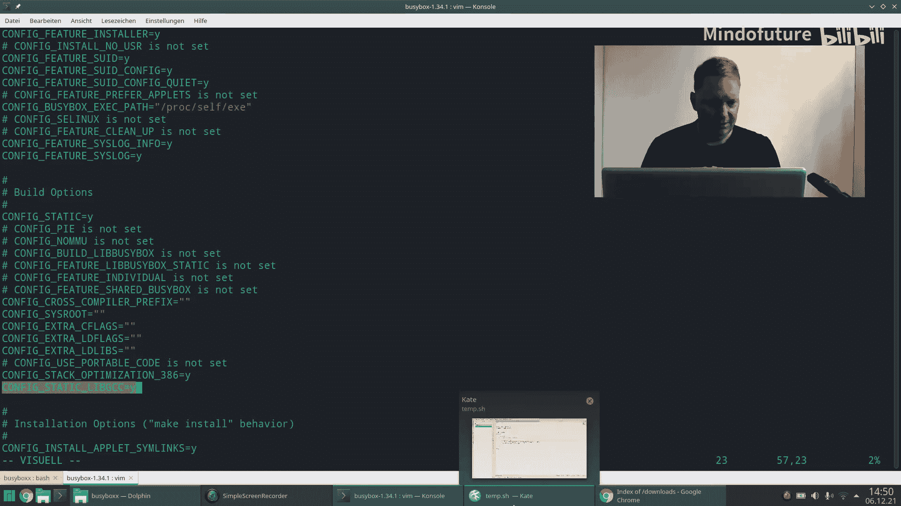

Yeah， maybe say something other than an underscore after that。Okay， so this builds busy box。

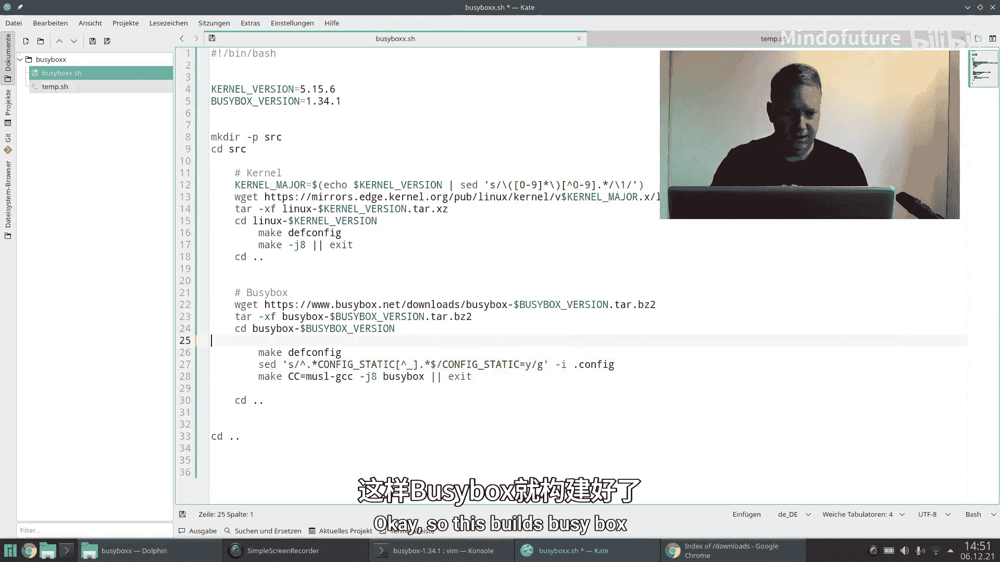

ok。No。

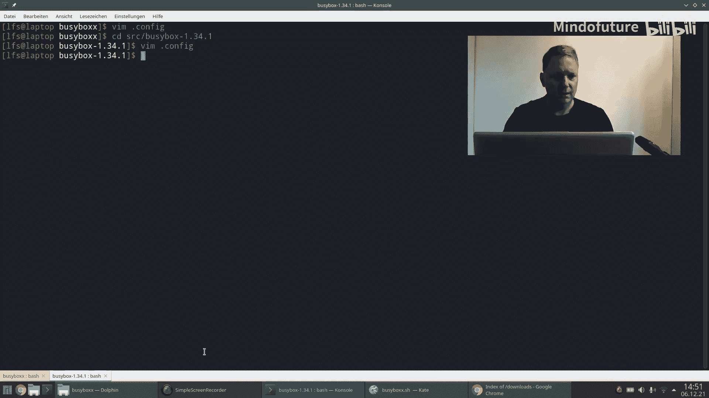

啊。Okay， so now we have built the kernel， we have built a busy box。

 so now let's take these two things and put them together into a running into a working Linux system。

 okay。So。busy box is built。

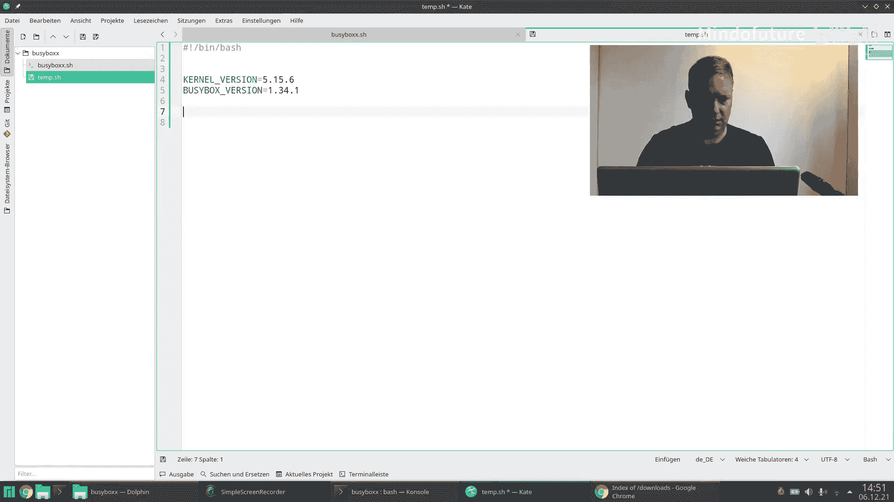

So what we need to do now is we need to pull the the compiled kernel from。The source directory。Okay。

 this is the curtain， and we will copy that。Get into the route directory。

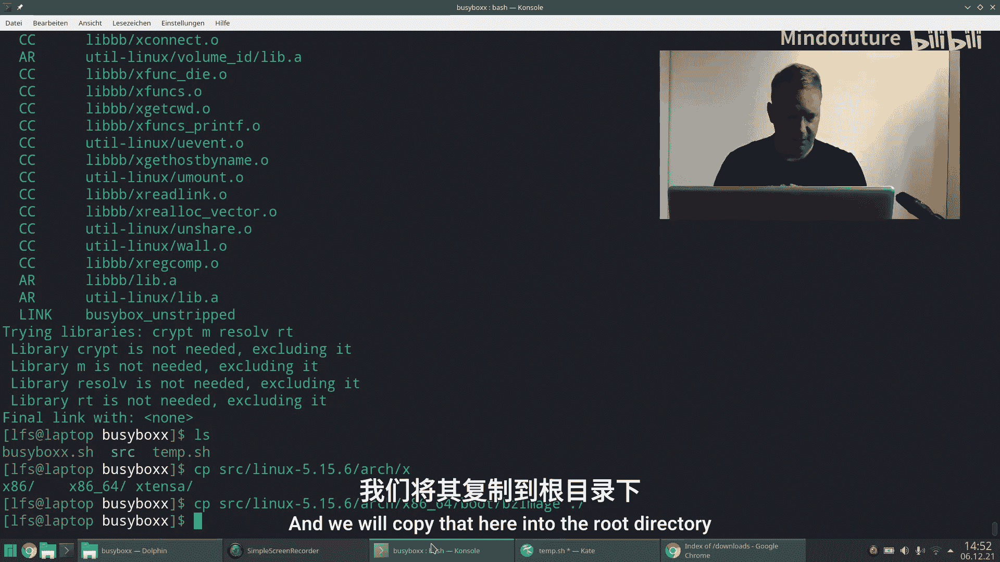

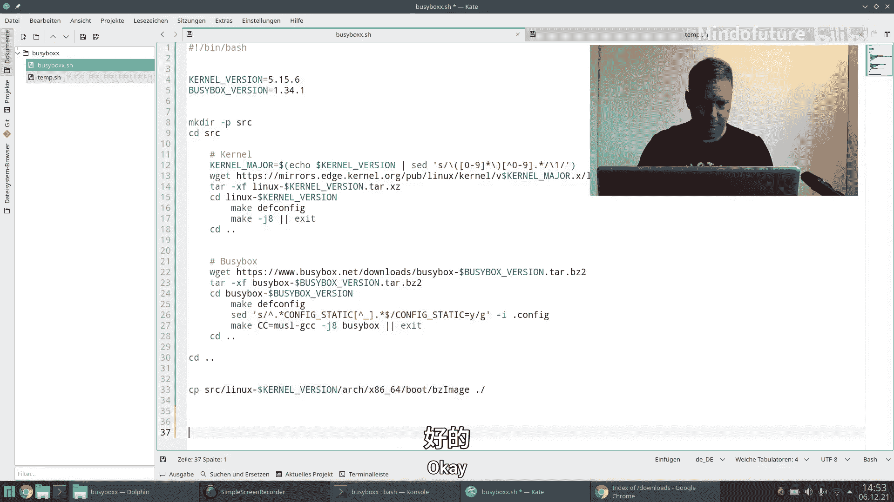

Okay。So now we have kernel here。 and yeah， the other thing that we need， as I said， is root drive。

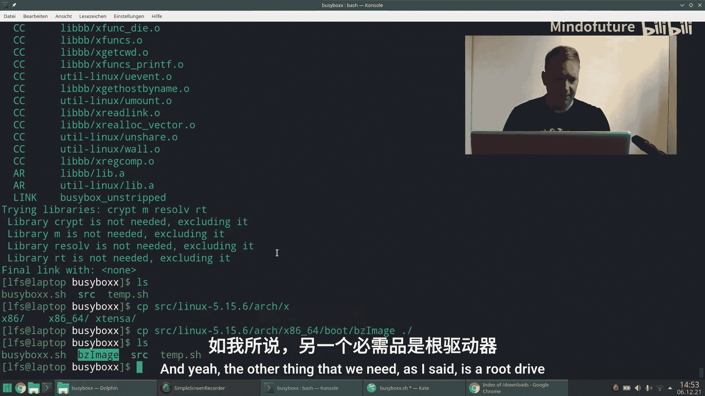

So， and we will do that as a as an initial rum drive。So。What I will do now is create a directory。

In it， R D。Change directory into it and。Yeah， in there。嗯。We will create four directories。

Ben deaf prous。These are really standard directories that you will find in almost all Linux systems。

嗯。Been is where we will put our。Or a busy box binary and do somesymmetric with it。

Yeah that is for the device files， progress for the process files and this is for the。

Interaction with， with a kernel。These are these typical virtual。File systems。

That you will find on almost all Linux systems these days， okay。Good， so we create these directories。

And then move into the directory bin。Okay and now we will build this bin directory。

How do we build that Well， first of all， we will copy busy box here okay？Okay。So， in here。

In the source directory Bu books。There's this program busy box here。

 and that's the compiled binary that we need to take and。We put this now into this。Bin directory。

 okay。So now we have that。嗯。And。

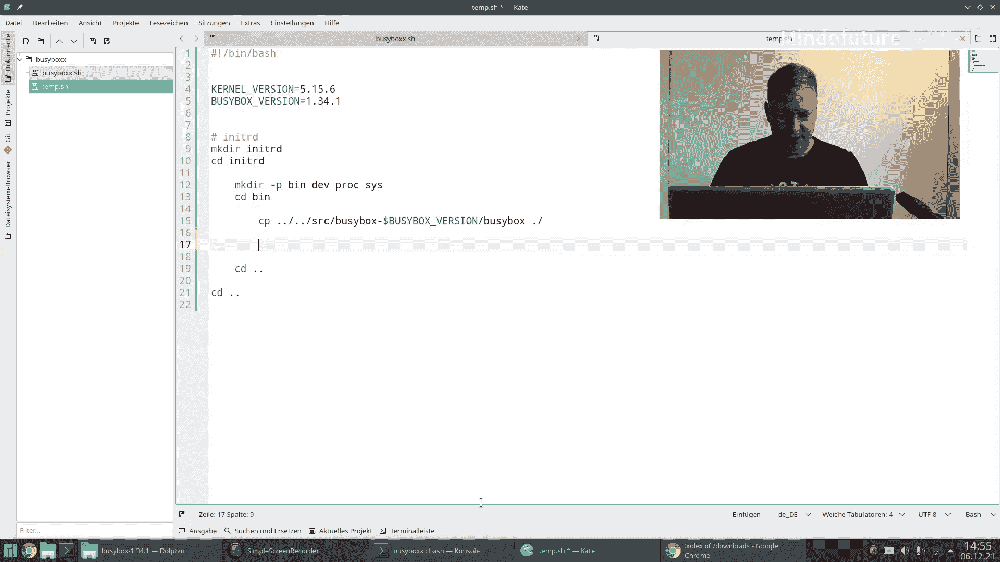

Yeah， one interesting thing that busyy B does。I need to explain that， I think。So as I've shown you。

 busy box can do stuff like。Execute normal。Share comments。Right。But。

Busy box is a bit smarter than that， because。You don't have to pass。嗯。A program name as a parameter。

By box will also examine its ArcV0， which is its own file name。If you renamed Buy box to E。

 for example， it will it would always do echo。And you can use it with。

The symbolic link to in busy box。And yeah， let's call it E。Okay， now we have a。

A program echo here that we can use E。Hello world。And internally， that's bill box， but busy box can。

See， hey， you've renamed me to echo。 So you want me to behave as echo， okay。

So and now we will use that to our advantage。Because as the next thing that Buy box does is。

With busy box dash dash list， it gives you a list of all the things that it can pretend to be。 Okay。

 there's a lot of stuff here。 Okay， you've。I've seen there's Gr Had H P。

Do you theirname a lot of programs that it can pretend to be。And yeah， this is what we will now do。

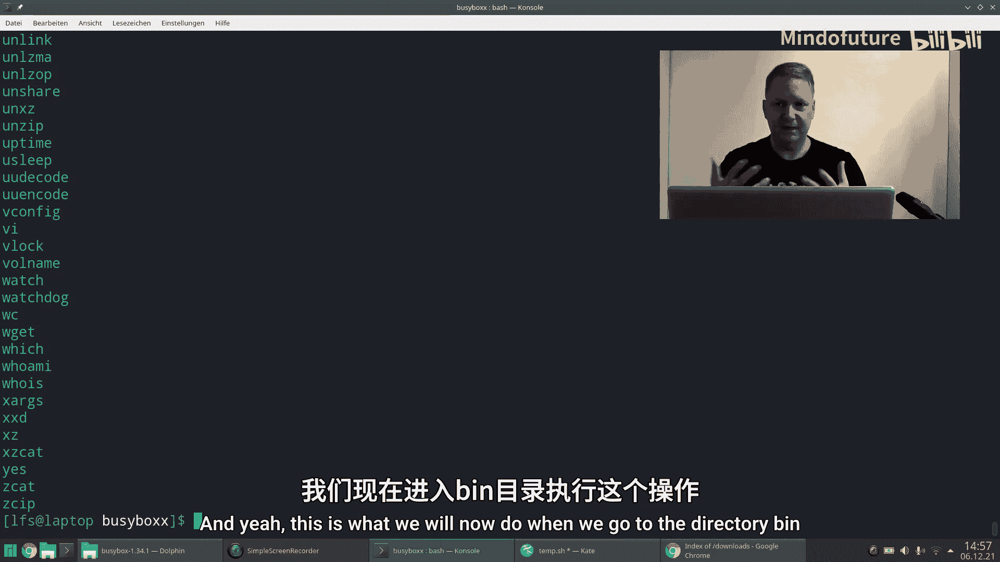

嗯。When we go。To the directory bin。In here。嗯。We run。Busy box， dash， dash list。Okay。嗯。

And then iterate through all these programs that it can pretend to be。Okay。😊，And yeah。

 set these somelink for these programs to busy books。So。L N dash S。Busy box。Fuck， okay。

So at one point， this list will contain， for example， echo。Then prop will be set to E。

 And then we create ase called Echo to pin busy box。 You know， the stuff that。

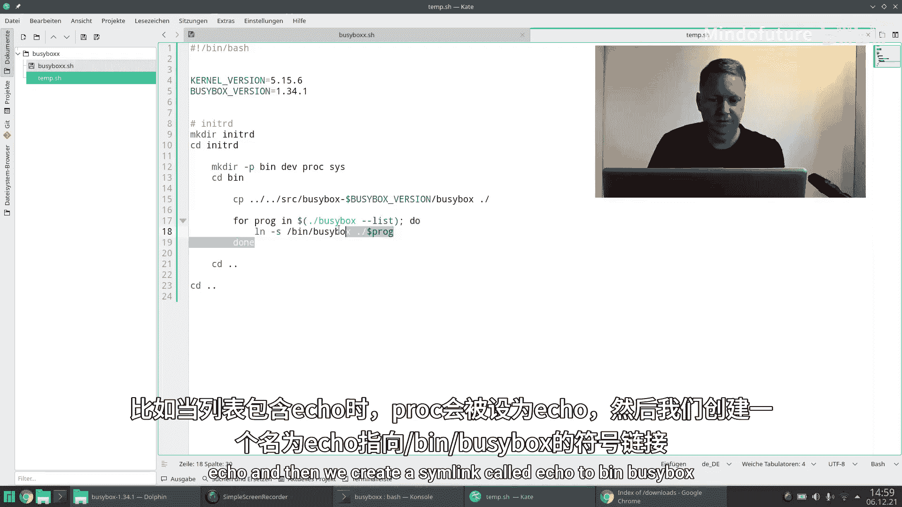

We have just done up here。Yeah。Basically what we did here， right。

 we created the slink called Echo to busyy boxox and this is exactly what we are now what we are doing now here。

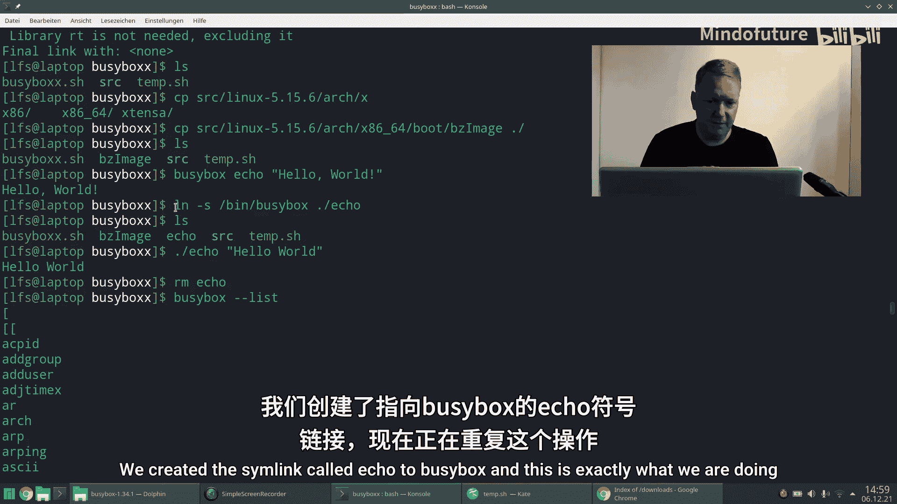

Okay， let's run this。

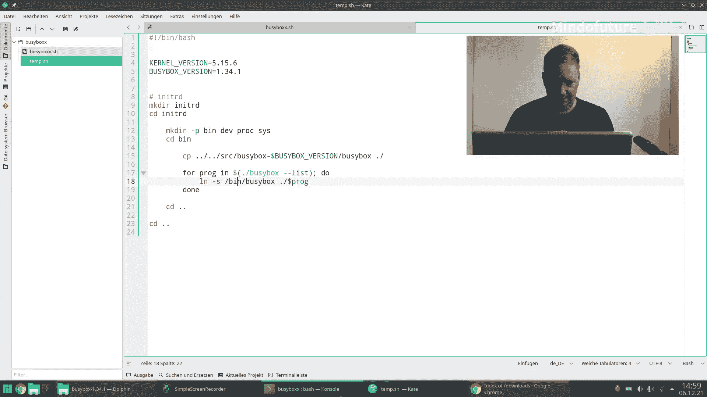

But。Now， if we look into this。In it are the bin。You see， we have now all these programs and。

We could now。Tell them to。And we could now use them as these programs。

 although they are really just some links to busy books。

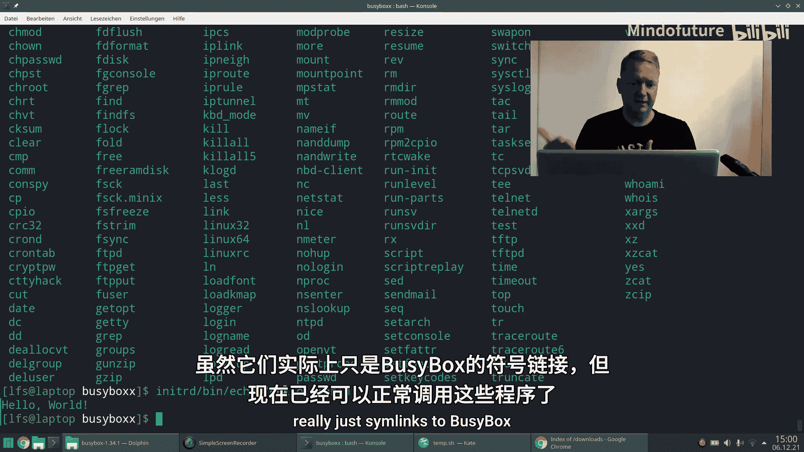

Okay。Now， after we've created this spin directory。嗯。We are almost done。

We still need to tell the kernel what to do on startup and。Yeah。

 we can do that by creating a script called in it， for example。

 there are other legal names that you could use like Epin in it or Linux R C would be legal， but。

I would。Create a file called in it here。Put a sheang in there。And yeah， when we boot。嗯。

What do we need to do， We need to mount。These virtual file systems that we've talked about， you know。

Deaf Prokinus。Okay。Here， we mount says。Then， we mount。Proook。Okay。Yeah， the next line。

 I don't think that's necessary， but it was in the code that I've seen。Sos controller。Dash WT you。

And thought。Print k。嗯。And this sets some settings。Which。Tell the kernel different block levels， okay。

2，4，1，7。I don't care much about that。嗯。Once we've done this， we are basically done booting。So。

We could now do a clear to clear the screen， and then。嗯。Then， run。In S H， so。嗯。At this point。

 we then get a shell。Okay。And yeah， then we can use the share it， and we can。

Then we can print the directory listing， change directories， stuff like that。Yeah。嗯。For my taste。

 we don't really need this clear here。 So I will throw that out， but。Anyhow。Now。

 once we've done that。We need to set。I mean， it's not necessary， I think。

 to give all files the permission 7，7，7。 I mean， that's read， write， execute bits for all users。

Our system doesn't even have users， I think。 So I don't think that really matters。

 but I will do it anyhow。And yeah， once we've done this， we are kind of done。

 so we have all the files that we need。And then we can take all these files by using find on the current directory that finds all files in the directory。

And pass and to CP O。Dash O is for creating a file。With format new C。And write that to the file。

In it， R D dot image。

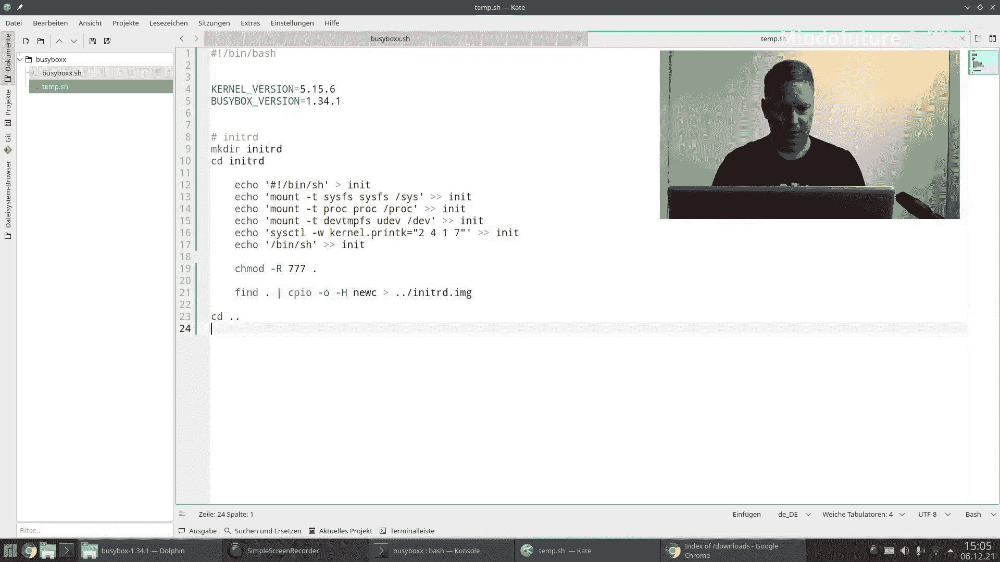

Okay。

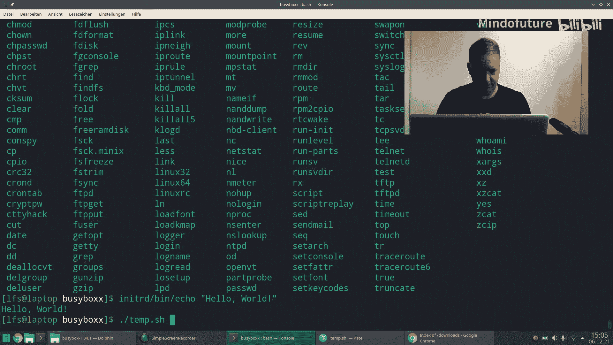

Yeah， this looks good。 This output here with a number of blocks。 That's the output of CPI O and。

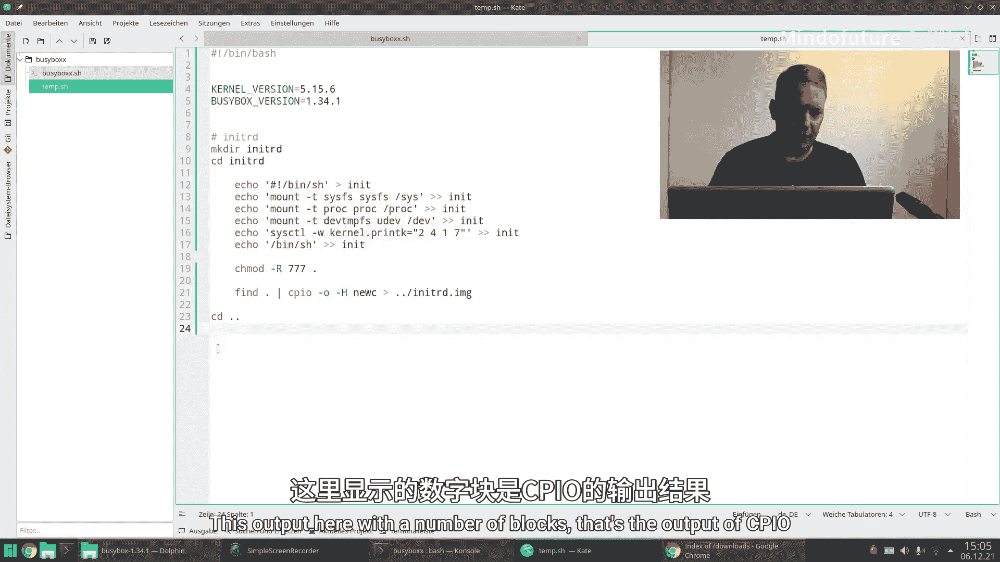

Yeah， if that isn't0 or1 or something like that， it looks as if it has found a lot of things so。

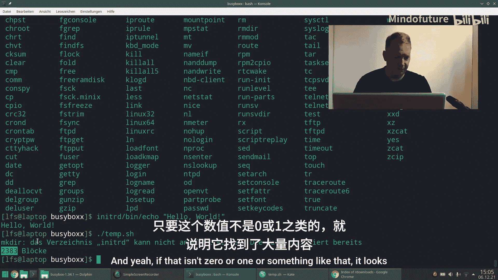

嗯。Mied looked。Like it's。嗯。Like， it should work。We'll move this over here now。

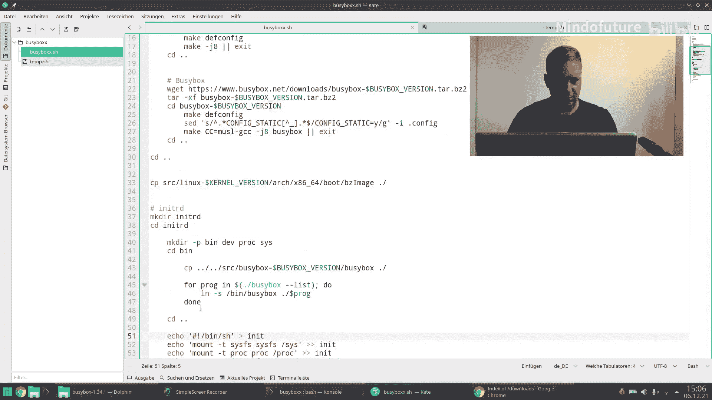

And let's see。 We now have。By image is the kernel。 And in it， R D image is our。

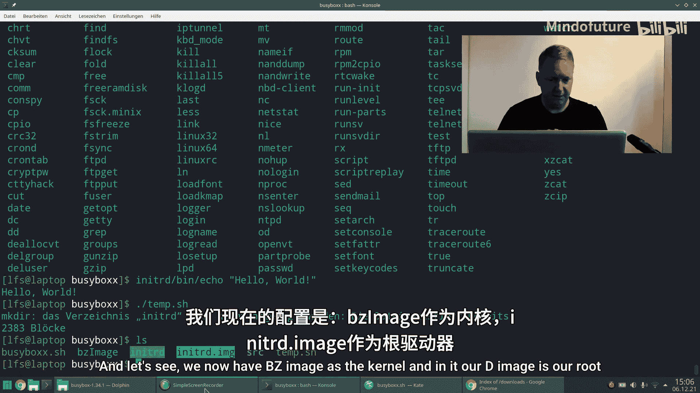

Our route drive。 So what we can do now。Is。We can now run。Q， E， M U the。Virtry machine， Q E M U。

With parameters， dashsh kernel。必须是一。Image and dash in it， R D。In it our D dot image。Okay。

Let's try this。

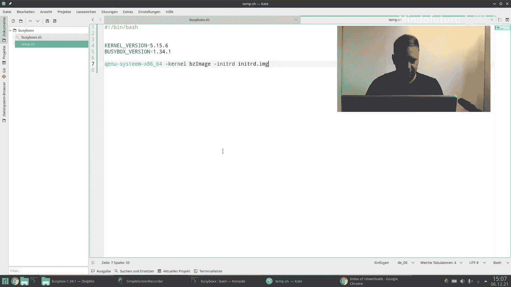

So may do。Typo。And look at that。 It's booting。Okay。So it's a bit complaining here。

 but that's not really bad。 We still can know。Look at the directory listing。Change directory。

 Look at the directory listing。E had a word。Create a text file， food ort T X， T。Ca it to the。

Standard output。Edit it with V。Okay， now I don't know how to exit it。嗯。Anyhow， let's run it again。

One thing that I want to mention。嗯。Is。That。When you press control D or type exit。

So you end this shadow。Limux doesn't expect your main program to end like that， okay。

 so you're getting a kernel panic here because attempted to kill in it yeah。

That's not supposed to happen。 So something that I would do is。

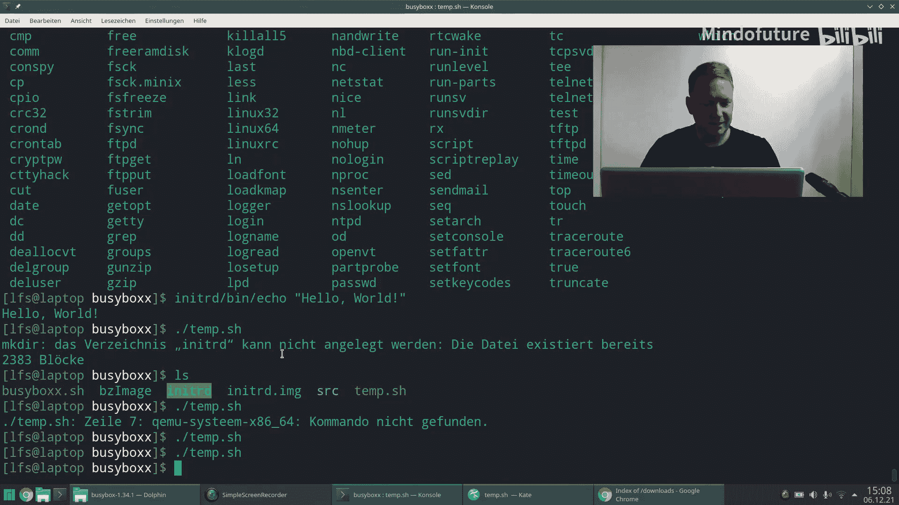

To put another line behind this。Been as age。Power off dash F。Okay。

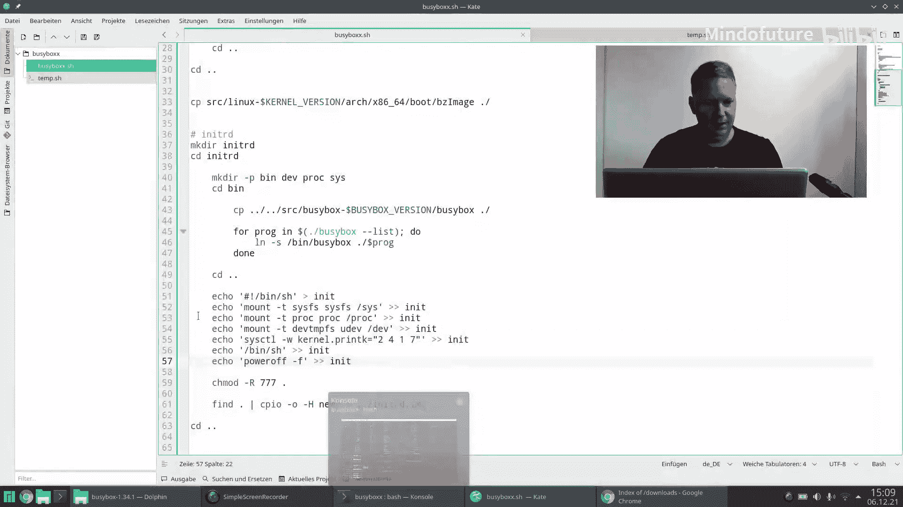

And。Yeah， if you do that， then exiting the shadow will then just terminate the。嗯。嗯。

The whole virtual machine。 Okay， well， if you are running this on actual hardware。

 then it will turn the hardware off。

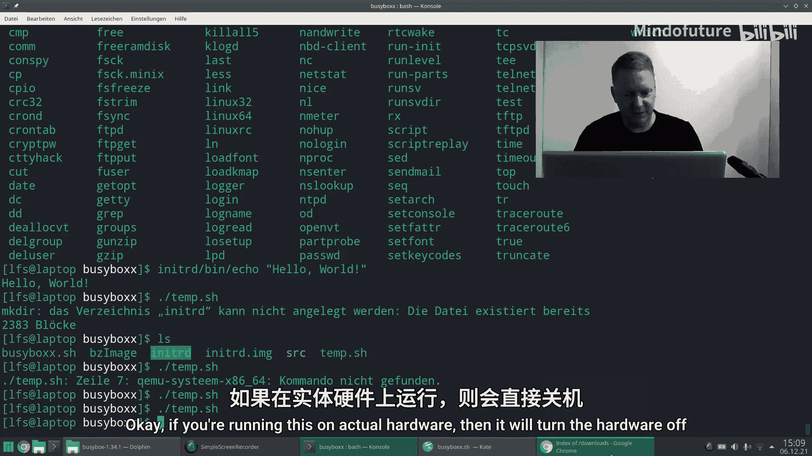

Okay。Good。And yeah， that's basically all that we had to do。 you know。

 we have a running busy box based system now and。I find that really awesome。 It's so little work。

 I mean， look at how little。Coode this is it's 63 lines and a lot of empty lines in between。

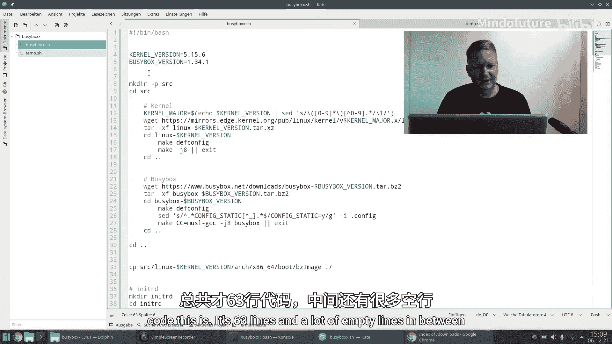

And it's creating something that at least looks and feels like a Linux system。

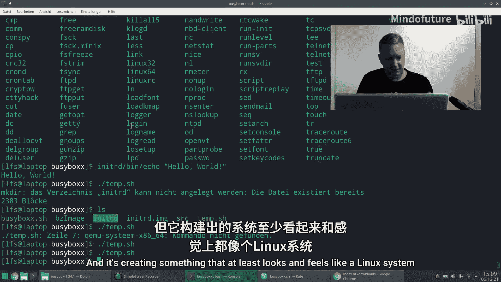

Okay， I will put that at the end also。One more thing that I want to mention is。

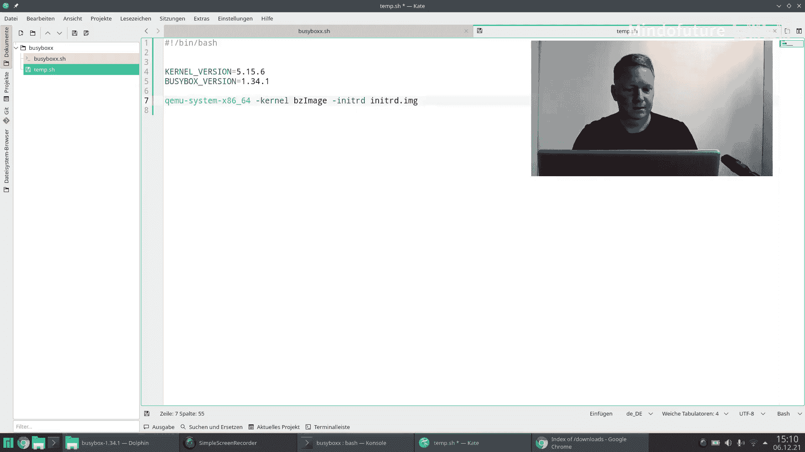

When you run Q， M， you like that。You know， you get this QEU window。嗯。But yeah。

 maybe you don't like that。

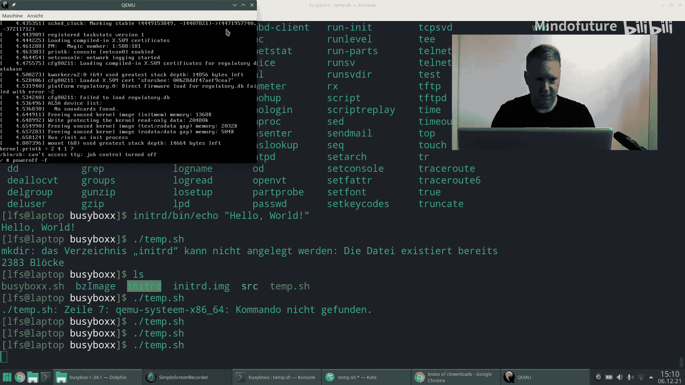

Okay， what you can do instead is you can say no graphic。Then you don't get this window。But yeah。

 if you don't get this window， how do you know what the kernel is doing？嗯。And yeah。

 what you can do is you can tell the kernel through。A command line switch。That you wanted to use。

The serial interface as console。And。Yeah， the serial interface is taken by Q E M U and it's。嗯。

It communicates with standard in and standard out。 So if you do it like this。

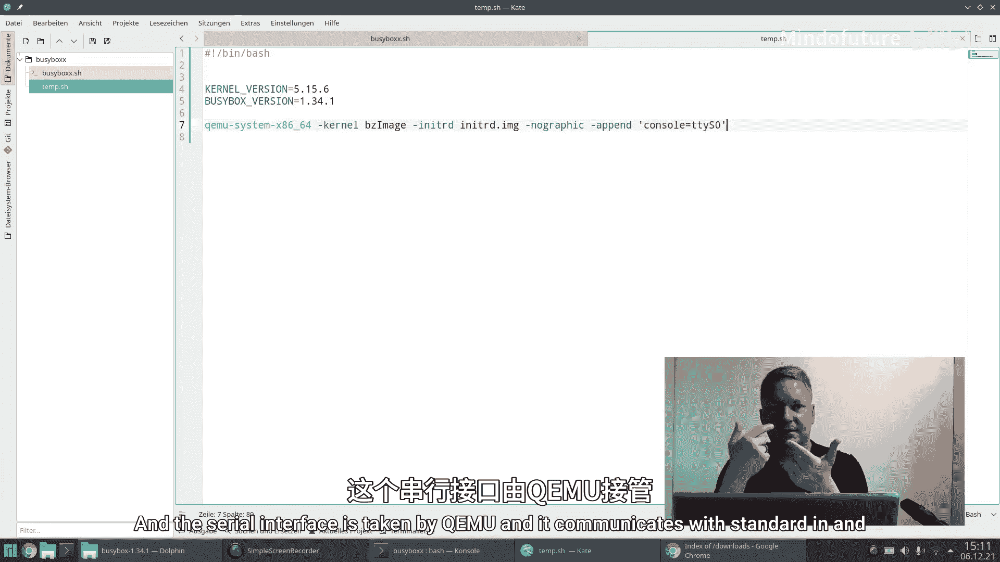

Hello。You don't get the window。 You see everything in your terminal directly。 Okay， here。

 as you can see， this was all the stuff that you've seen。In the window before。 And now here。

 B S age is a bit complaining。 But， but yeah， here。

 you now have been deaf proc root and so and the in it。Program。And yeah， all the stuff that。

We did before。You know， so yeah， that's。I think that's pretty cool。Let me show you one more time。

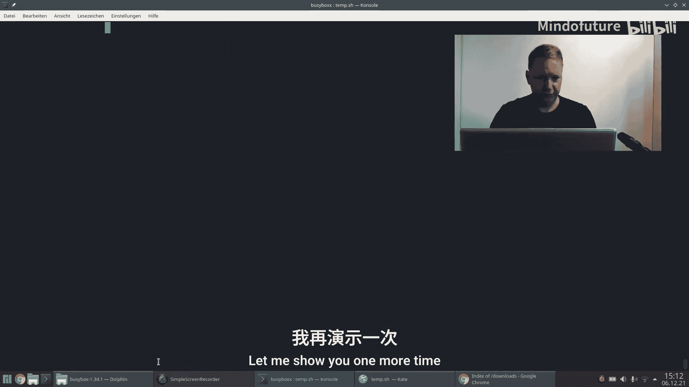

When you。Run this， and。You know， I haven't updated the in it RD， so。

This line isn't in this init file。

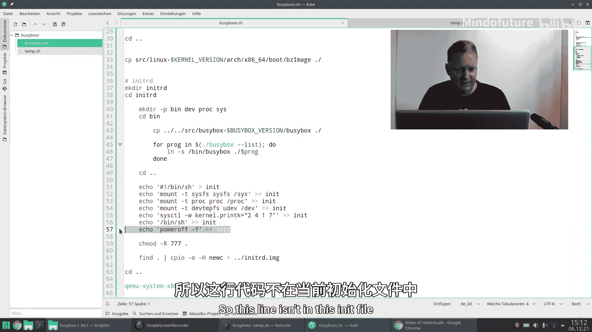

Okay， so if I end this shell now， I get the kernel panic again。 And yeah， now this。

 this shell window is now stuck。嗯。And to make it unstuck。I would just。Kill oil Q， E M。

 U dash system dash X 86，64 bam。And you see now it's gone。 And yes， this is how you can unfreeze。呃。

You are。Your Q M U， when it's running directly on your shell and it's。

Run into a kernel panic or something。 Okay， yeah， whatever。I think this is really cool。

 And I like this a lot。 I think it gives you an even better insight into。😊。

How Linux works and how Linux systems in general work。 So yeah， if you liked this video。

 like a share it， subscribe and see you next time。