# LLVM入门教程-•-中英-p02-P02-Installing-LLVM--BV1HtRUYnEji_p2-

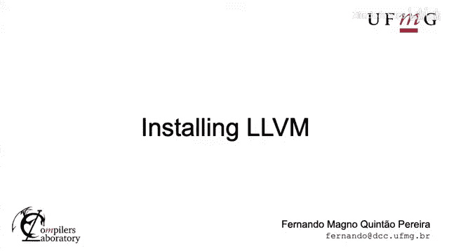

Hi， I'm Fernando from UFMG， and today we continue talking about Olvienna。

This time we will see how to install it and how to use some of the tools that come within the ODM distribution。

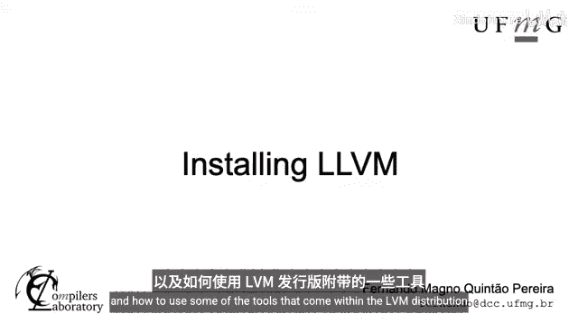

About installing all theM in your local system， there are several ways to do it。

Here we will look into two approaches。First。We must decide if you want to install just the binary distribution or the source code。

Instaling the binary version of OPM is much faster for we do not have to download its source code and compile it locally。

That we also take less space in your hard drive if that's a constraint to you。However。

 if you install the source code and compile it， you can later change it， for instance。

You can even distribute it as long as you ab by the license。Which， by the way， is Apache version 2。

 that's say very permissive kind of license。So let's first take a look into how we can install the binary distribution。

In NoX， for instance， you can use Bw to install the most up to date distribution of all of theM that's available in the B hub。

That will install VN with all the dependencies。

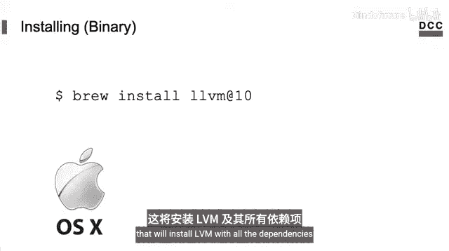

And in Linux， you can use app to get like in this page。

And you can even install the campaigning tools like clang and several projects that are distributed with all of them。

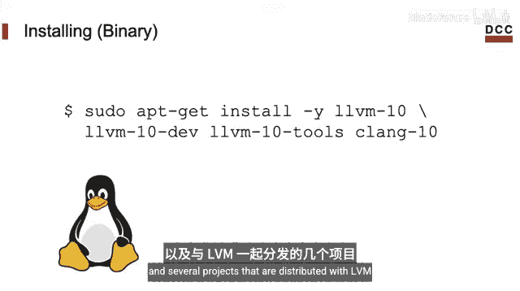

The other way to have LVM is to install it from source。

In this case， we must download its source code and then compile it。

This will be the option adopted in this course， and if you can。

 you should prefer it as it gives you the entire source code of LVM which we can peruse at will。

To install all VM from source， we need to perform two steps， download it， and then compile it。

Usually these are two simple steps， yet there will be a few comments that we need to type in。

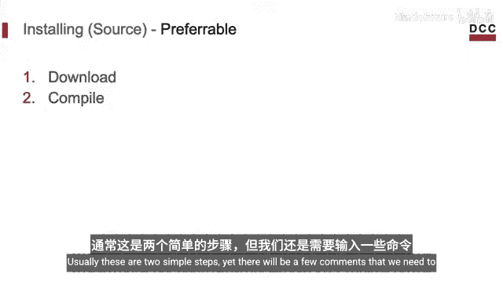

First， to download OVM， we get it from the main OVM Gi repository with this command。

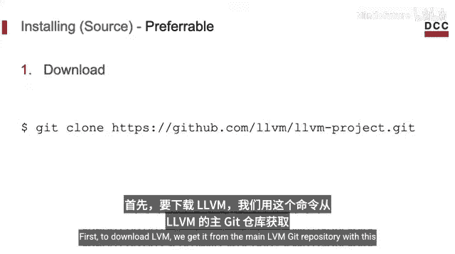

Now to compile it， we must first decide on a good location to install the binaries that we shall produce。

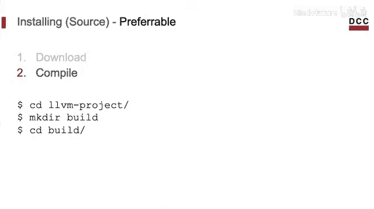

But be aware， usually that takes a lot of space in this case I shall compile LVM into a directory calledBuild。

 which I put inside LVM dash project with the folder where it was downloaded。

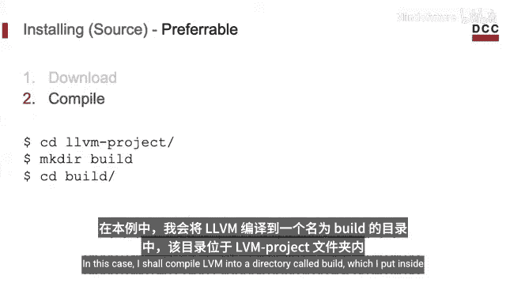

Today， OVM uses CMake to manage the built process， CMake requires a special file called CMakes。txd。

This file is in the allM folder， which is one level down our build directory。

So that's why we need to specify this path when we type this in command。

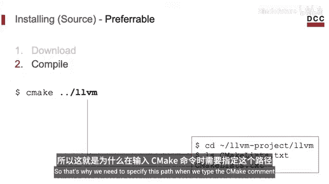

And we can pass many more options to see make， for instance。

 here and specifying that I want to build all of VM using a make file。

 another option would be to use Ninja or X code， for instance。

We need to specify where we are building all of the envelope。For instance， in my case。

 I doolium in this folder that's both facing in the figure。

Another our option that I like is using shared libraries instead of having aesthetic static build that usually saves quite a lot of space in the hard to disk。

And finally， you should enable plank， this option will build plank2 with plank you can for instance。

 develop plugins for C as we will see later in this course。

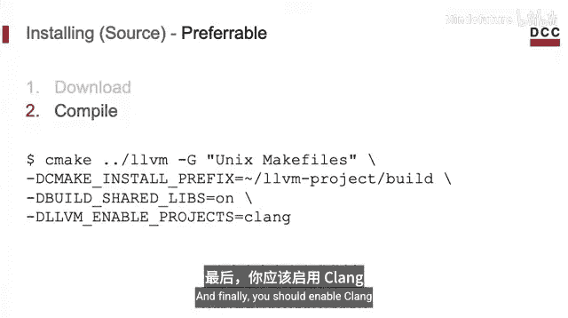

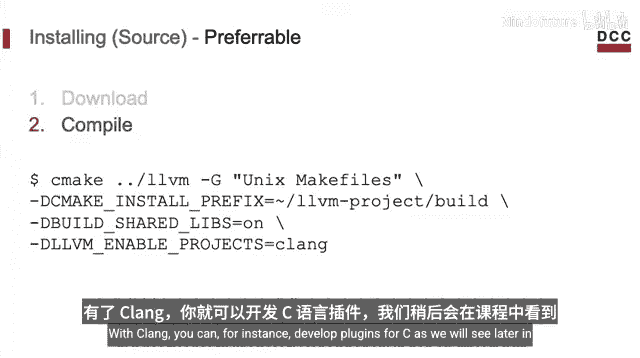

Anyways， these are the options that I have used to set up the building system of ODM in an XA6 machine running a bundletu。

Probably that will be good to you。But if you prefer， you can use the gold plugin。

The main advantage of this plugin。

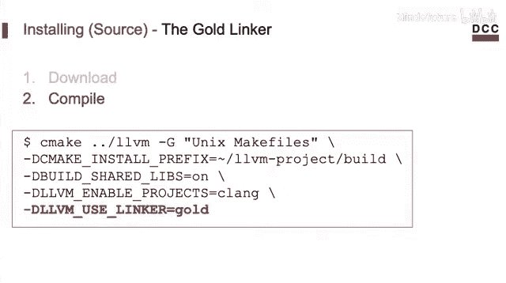

Is that it enables link time optimizations。If you want to know more about the gold linker and link time optimizations。

 please check the official documentation at all of themM。

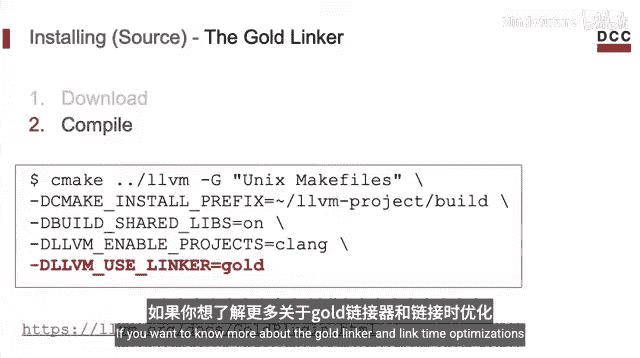

In， but notes that this is an optional step。Anyways。

 once you have created the right make file with CMake， you can build all theM by typing make。

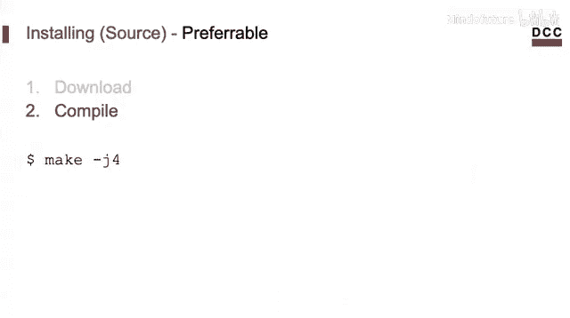

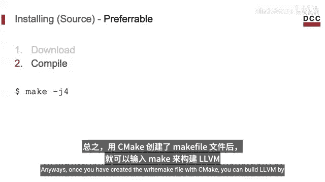

Note that here and using this option to parallellyze the building processing for processors。

 compile LVN takes quite some time and having multiple cores comes handy in this case。

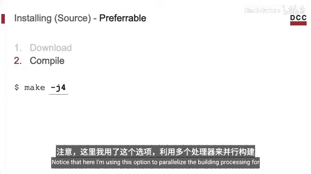

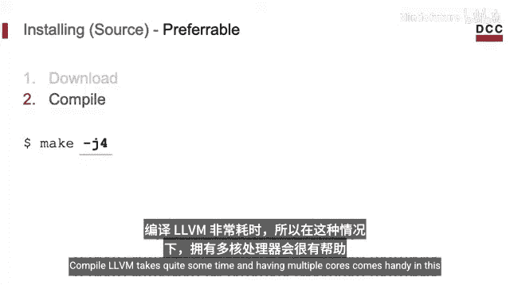

After you are done compiling LVM， you will see that you now have access to many different tools。

To see them， go to this folder called Ben。 that has been produced in your build directory。

 Then just type S。😊。

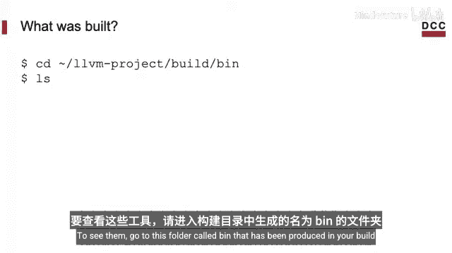

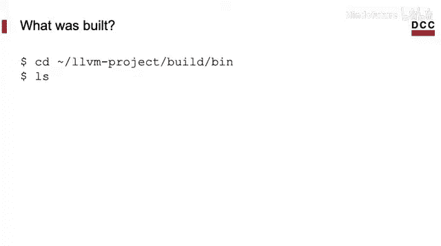

These are the tools that I have in my system at the time I've prepared this class in the rest of this course。

We shall take a look into some of these tools， but don't worry。

 we will not be using all of them I Phil。And that concludes our or of the installation process In the next class。

 we shall be talking about how to run some of these tools that we have just seen。

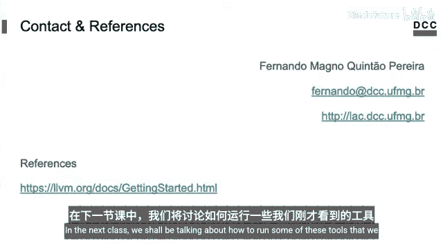

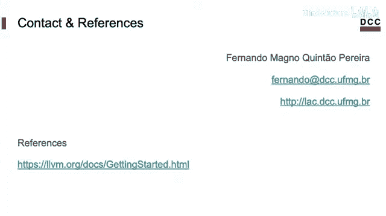