# LLVM入门教程-•-中英-p03-P03-Running-the-LLVM-Tools--BV1HtRUYnEji_p3-

Yeah。

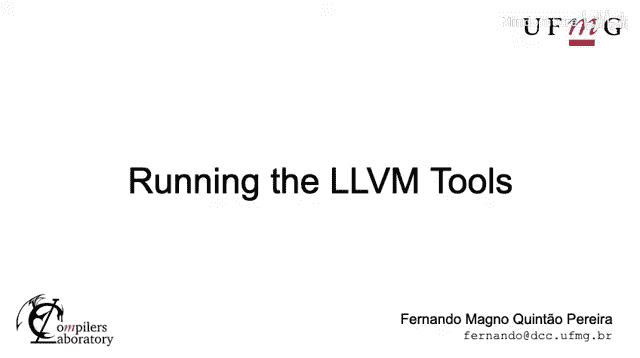

Hi， I'm Fernando Therado from UF Igen。And today we will take a look into some tools that come in the AlBM distribution。

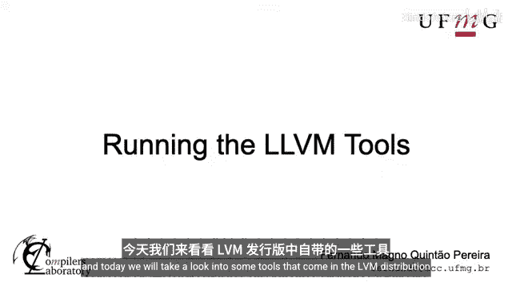

We had seen in the previous class that LVMs a number of things。For instance。

 it's a framework on top of which people can develop compilers in runtime environments for programming languages。

But it's also a collection of standalone tools。Which people can use right away without having to code anything。

We had seen in the last class that when we built LVM from source。

 we obtained binary versions of several tools。Here's the list of those tools that are many。

 and we will not look into all of them， of course。Rather， in this class。

 we will talk about three of these tools。They are playing， OPT and LC。

We had seen that a compiler is formed by three parts。 Do you remember which parts？

We have a front end， a middle end， and a back end。

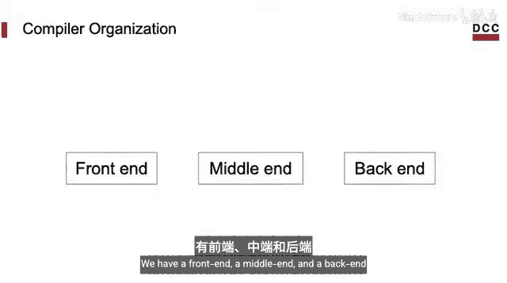

And these three tools occupy each one， one of these is lots。Cang is the C front end。

 it takes a file written in C and produces a file written in the LVMIR。OPT or opt， if you prefer。

 is the middle end and it can transform LL files。Usually to optimize them that is to make them better。

But OPT can transform programs with several other purposes like removing vulnerabilities。

 instrumenting for profiling， or reducing the size of the binaries。And then we have L C。

As the back end， it produces code for different machine architectures。 Today day。

 we will look into each one of these tools。

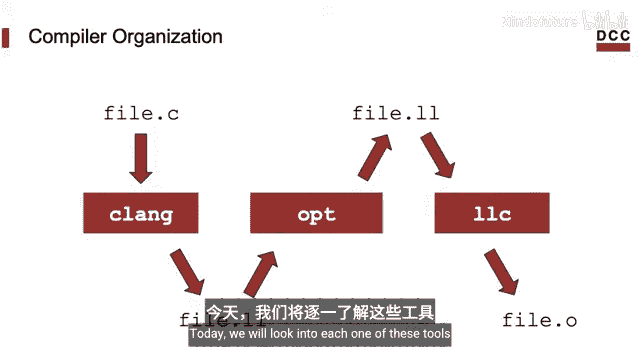

Let's start with clang。Clinks the C front end， that means that it parse the C files。

Its most common usage is to transform a C file into a program in OlVMIR， however。

 we can use Kang to analyze C files too that will be the subject of another class in dis course。

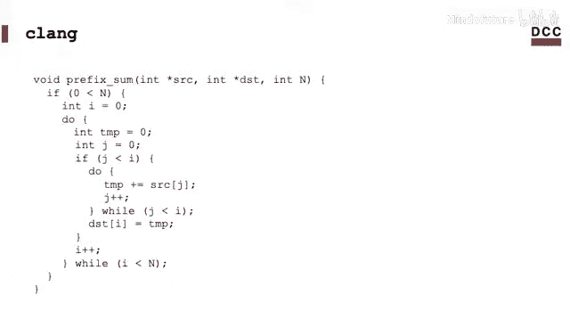

As an example， let's see how we could transform this program into the all of MIR。

 this program implements an algorithm called prefixM in a rather inefficient way。

 but the semantics of this algorithm is a material for our course， we just need the code。

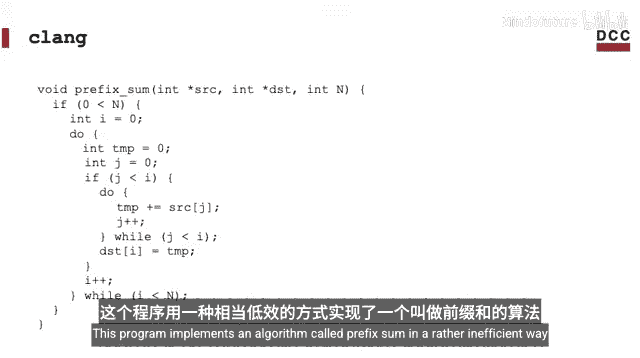

We can convert this program to the LVMIR with this comment。And you will see we are producing。

A new file， it's conveniently called file。t LL， but this name is optional。 We can specify in a name。

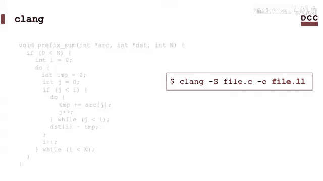

That's why we used this flag minus O。 It let us specify the name of the output produced by Kang。

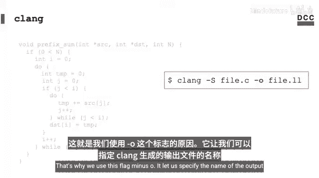

This other flag minus s indicates that we are using plan to produce a file in assembly in this case。

 we are producing a file in assembly of x86 for that architecture that we are running OEM theM right now。

We can try to visualize the program that we have just produced。

 this is a text file that you can print or edit using any text editor。So this is a file in XA6 as。

 as I had said before， you can see the XA6 registers like EX and RDI， for instance。

If you want to produce inside a file in the lium IR， you can pass the clang。This flag minus emit LVM。

Don't worry about understanding what is the I R。 We will talk more about it later in this course For now。

 just imagine that this is another kind of assembly format with instructions， variables， function。

 names and such。

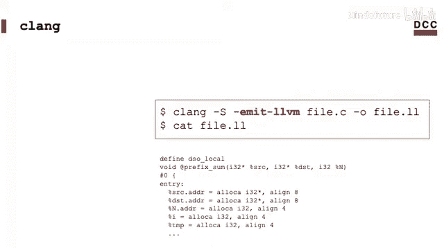

Something important to notice is that Kang is a front end for LVM。

 meaning that it takes a program in source format and produces the LVM IR， however。

 many more front ends for LVM exist。

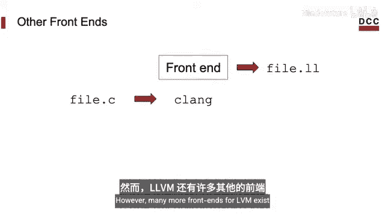

For instance， for RE， we had RE C， which converts RE programs into the Ol MIR。

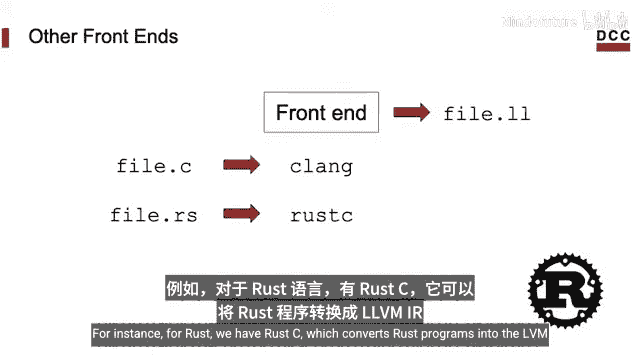

We have also the Julia Rapo， which also uses an Lium front end to convert Julia programs into the Lovium IR。

Or we have the Sw front end that works for the Sw programming language。

 we have many different front ends for LVM the main advantage of this design is that by converting a program to the Ol of MIR we get all the benefits from the LVM framework。

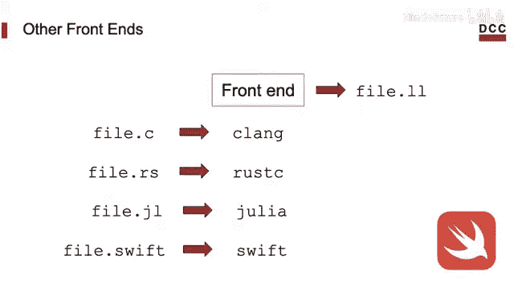

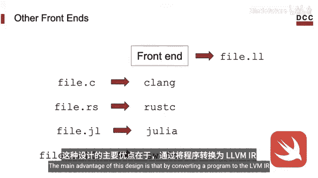

In particular， we get all the support from the Alian middleow ends。

With all its analysis and optimizations。In our case。

 the middle end is presented by a tool called OPT。For instance。

 here we are using OPT to convert the O assifier into a format called DOT。

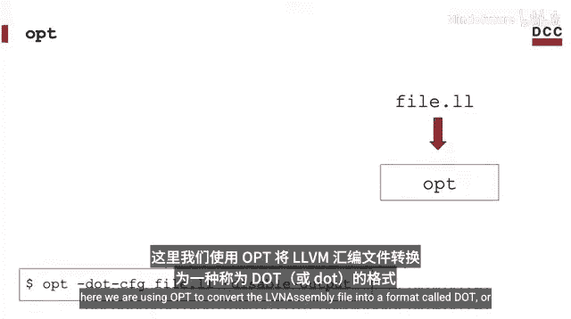

Or dots， if you prefer。Dot is a format to represent graphs。

 You can visualize these graphs using different tools， for instance， in the Webex。

 you can use graph Z to visualize dot files。

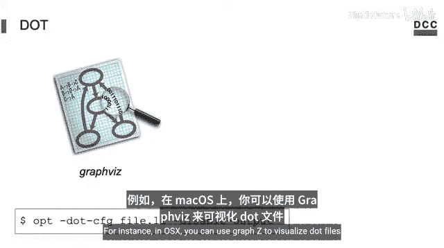

As an example， this is a graph that we obtain for this program。Don't worry about。

 understand what this graph represents。 We will have another class to discuss more about OR。

 as I had already mentioned。And then we go understand why this program's come for flow graph。

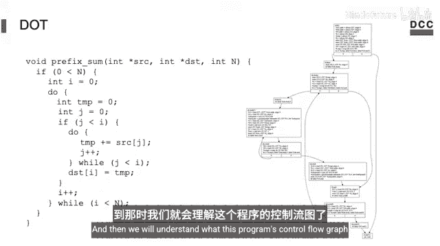

For now， it suffice us to understand that this graph represents a data structure that the compiler uses to analyze and optimize the program。

 This data structure shows all the instructions that form the program and all the possible sequences of instructions that can be executed。

 but that's something for later。

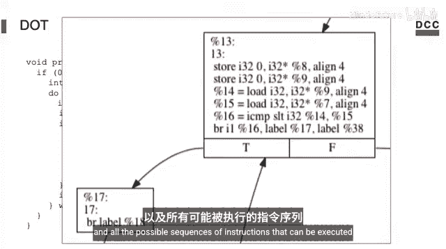

Anyways， this data structure or a representation of it。Will be the what we forward to our back end。

 the back end， the part of the compiler that produces machine code。In our case。

 the backend is called LLC。 This tool will map a program in the old MIR into something。

That belongs to the target' architecture。All of theM has many back ends。

 each one target a different architecture， Im listing a few here， but there are many more。

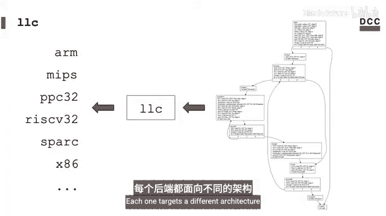

To see which architectures are available in your distribution， simply type LC minus minus version。

I bet we will see a rather long list of targets。If you want to produce an assembly file for any of those targets。

 just specify it using this flag minus in arc。For instance。

 here we are producing an assemblyse file in the X86 format。

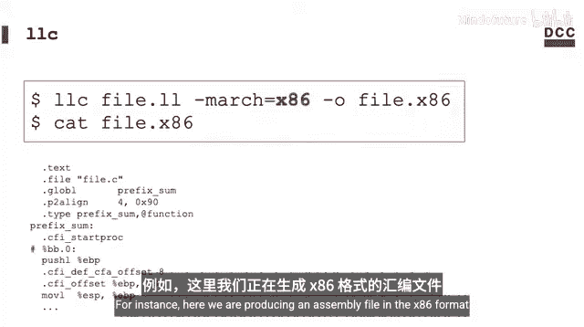

But we could have used any other format， for instance， here we are producing an arm file。

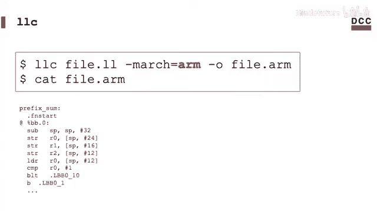

And that closes our overview of the three main LVM tools that we shall be using along this course。

 playing LPT and LC。 In the next class， we will talk a bit about the LVM in immediate representation。

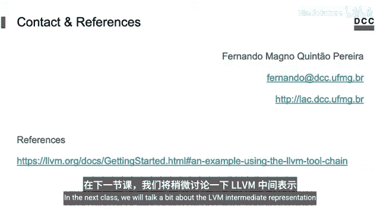