# LLVM入门教程-•-中英-p04-P04-The-LLVM-Intermediate-Representation--BV1HtRUYnEji_p4-

Hi， I'm Fernando Perreer from UFMG， and today we will talk about the LVM immediately representation。

We call this kind of low level program language A theMR。

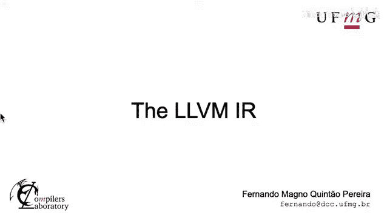

We have already seen that a compiler is formed by three modules。

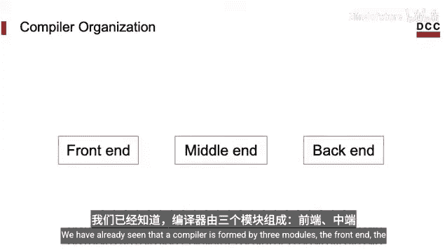

The front end， the middle end， and the back end。In the previous class we saw that a possible front end for LVM is playingk。

 the middle end is represented by a tool called OPT and the back ends represented by a tool called LLC。

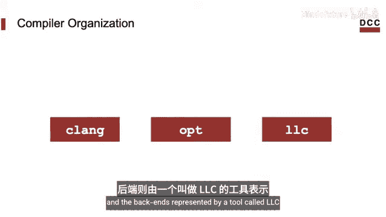

The middle end operates in programs written in the LV meet immediate representation。Typically。

 when this intermediate representation is given in assembly。Which is in a readable ASI format。

 we added the extension the below to the files。

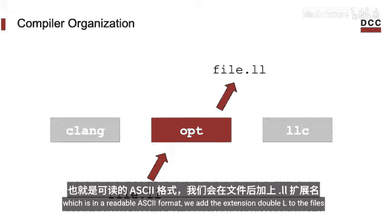

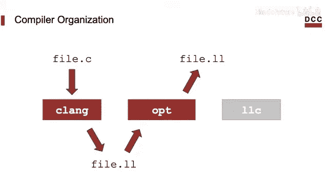

Notice that these files， the AL files are translated from some high level programming language。

 such as C， for instance。And they can be translated to some target architecture using some backend。

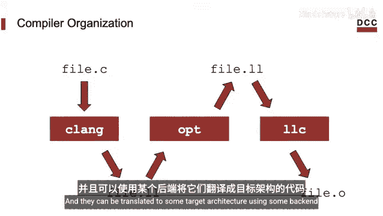

Anyways， much of the charm and elegance of allan comes from its intermediate representation。

 but what is this programming language desire I are。

 how does it look like and what can we do with it， That's the subject of this class。First of all。

 the intermediate representation is a programming language that means that we can write programs on it。

The IR was mostly meant to be generated automatically by a compiler。

 but nothing really hinders us from writing programs directly in the IR。

But because it was meant to be generated by a compiler， it's low level。

 so the IR looks pretty much like an assembly program。

Which we can analyze using tools in the OEMVM infrastructure。

And even more important that we can optimize using all of the emes。

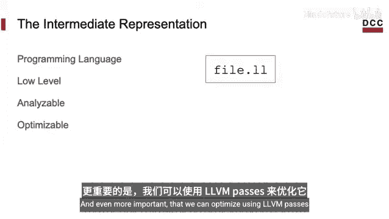

Let's take a look into an example， I will show you a program and we check how it looks like in the LLVM intermediate representation。

This program has been taken from a presentation written by Gennati Peymenco which is readily available on the internet。

 the presentation itself talks about many other things besides the oldMIR， so I highly recommend it。

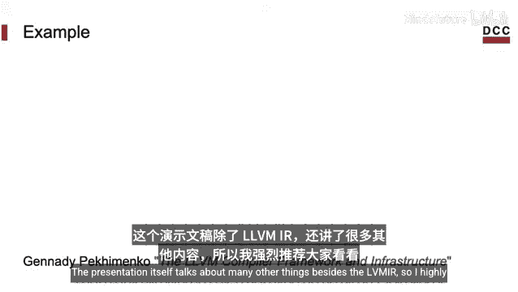

Anyways， Gennati's program consists of a function that receives an argument through a pointer and updates that meial location。

And to make things more complete， here's the codes that invokes the function。

To generate the equivalent program in the IR format， we can use this command line。

 which we had already seen in the last class。Notice that our example is stored in a file called co。c。

 and we are producing a file called co。 doubleL。We use the minus S flag to indicate that we want to produce an assembly file。

 otherwise we would produce a binary program， and we use a VM to indicate that we can that we want this assembling the all VM intermediate representation。

 otherwise we would have as of the target architecture in this case that would be X86。

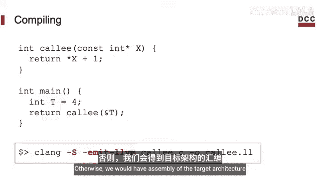

Let's take a look into the IR file then let me first just reduce the size of the source code so that everything fits in the finger。

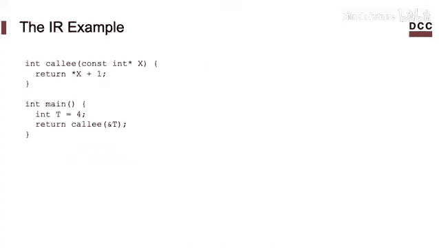

You will see that the IR file is somehow large compared to the original program。

That's natural because we have a lower level of representation of the same program。

And mind that we are not even showing the entire thing the rest of the FOi will omit to focus on its most interesting part。

Note that we have two functions in the IR file， that's because we have two functions in the source file。

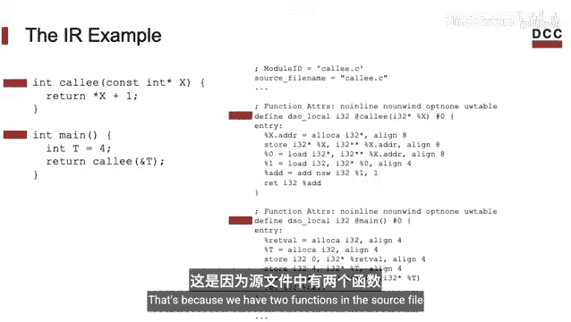

Let's take a look into the code that Alvium produces for dysfunction， for instance。Here it is。

There are a number of things to notice here。First， the program is in the same format that means that the function is formed by a linear sequence of instructions。

 each instruction has an op code， the app codes， the name of the operation that instruction runs as an example。

 this program uses six instructions and five different op codes。

Another thing that's interesting to notice， the LVMIR is typed that means that the values that the program manipulates have types。

In this example， we have three different types。We have integers of 32 bits like the return of the function。

 we have pointers to integers of 32 bits like the type of variable x， the argument of function co。

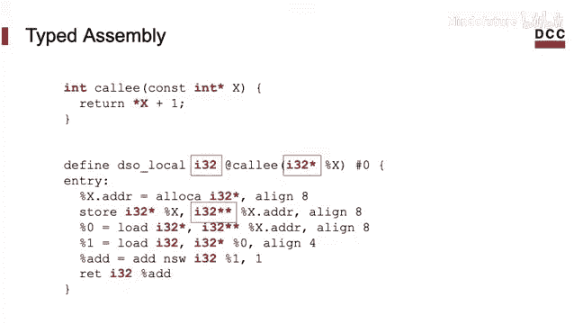

And we have pointers to pointers， in this case， pointers to pointers appear as auxiliary variables that the compiler needs to implement the program。

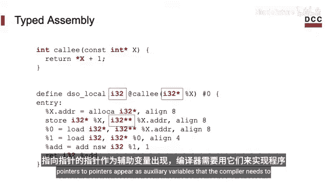

Notice that we can optimize the IR， for instance， we might want to move variables from memory into registers to do it。

 we can use the OPT test calledM to rank。

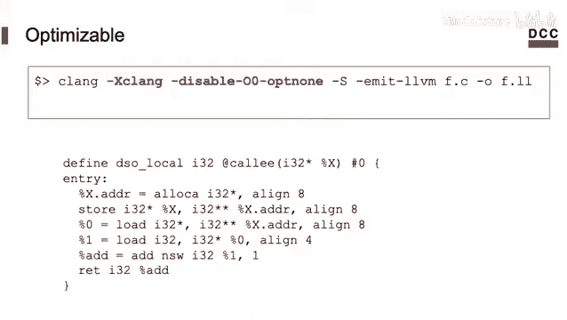

But to do it， we need to indicate to clang via the X clang argument that the IR will be further transformed by OPT。

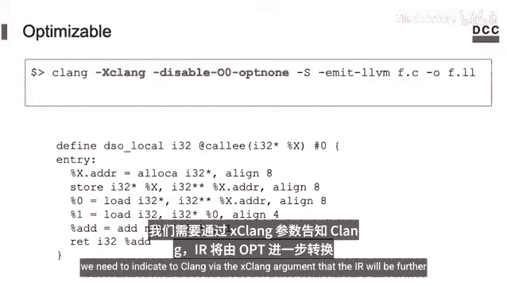

If you don't use this flag， then LVM will add the OPT nu qualifier to the functions in the IR and that will prevent the program from being optimized。

Anyways， after disabling this marker， the Opitinon qualifier， you can optimize the function。

 so in this case we are using an optimization called main2 rack。

 can you imagine by thinking about its name what this optimization does？Basically。

 optimization we will be moving variables that are stack allocated to registers。

 we can see that our targets function contains variables in this stack。

Because we see instructions that operate a memory like a localA store and load。

A lo mostly means that we are loating on this spec。

And here's our optimize function knows that look of variables are now in registers。

 these are not architecture registers。But render virtual registers。

 values that can be placed in physical registers once machine code is generated。

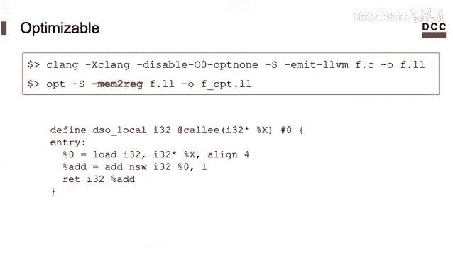

These variables have names that start with this percent sign like percent0 and percent at。

 for instance。

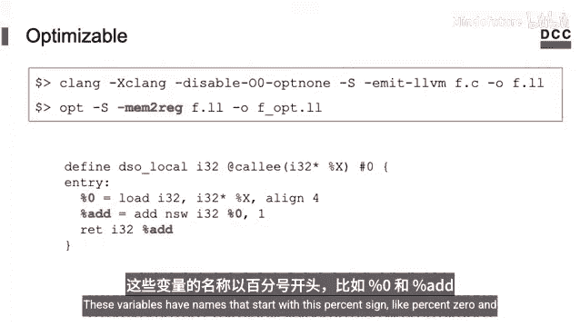

In addition to using OVM to manipulate the IR， we can program it directly。

 it's just a text file anyways。

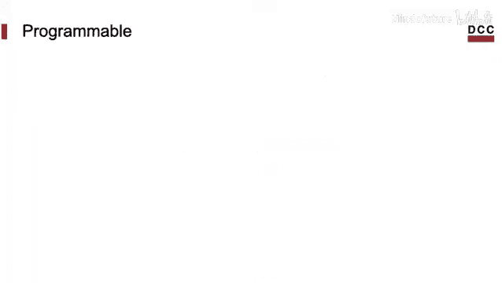

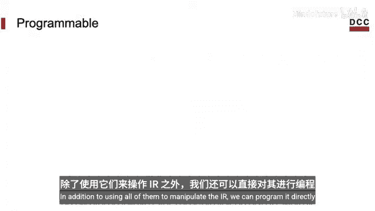

So we can add it。

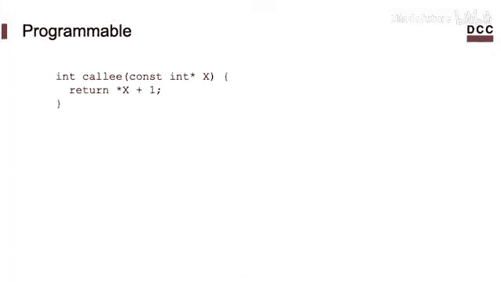

Imagine， for instance， that we want to change this function。

Instead of passing the argument through a pointer， we want to pass the value directly。

We could of course， write the program in C and then use all of them to generate the optimized version。

But we can also simply change the IR editing its text file。

And that's the equivalent code that we have， as you see。

 it's just a matter of writing the function ourselves。😊，Of course。

 we need also to change the code that invokes our optimized function。

We will not be passing an address anymore， but just the value itself。

And that's how the entire program looks like after we hands optimize it。

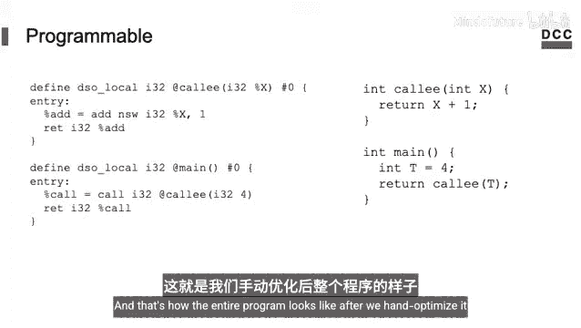

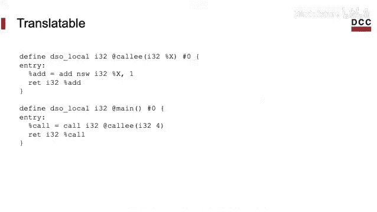

We can forward to forum's program to order representations。For instance。

 let's assume that this program with all the information that not all of the MIR file requires is called callptt。

doL。

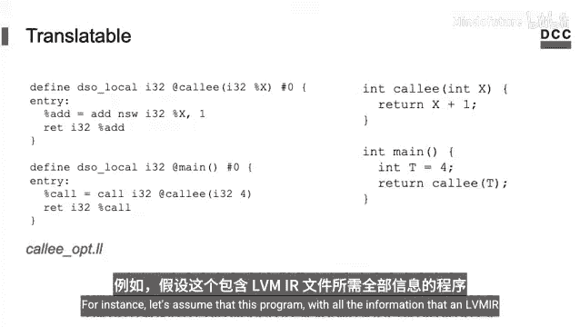

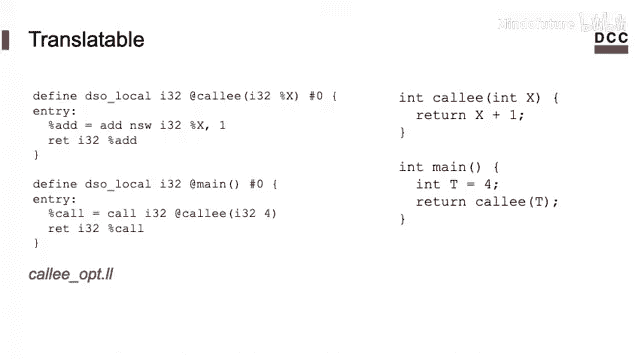

We can compile it to LVMB codes using allVMS AllVMB codes are the binary representation of programs in the LVMIR。

Then we can translate the beat code to assembly sampling of X86， for instance， using OC。

 which is a letter two that's part of the OVN infrastructure。

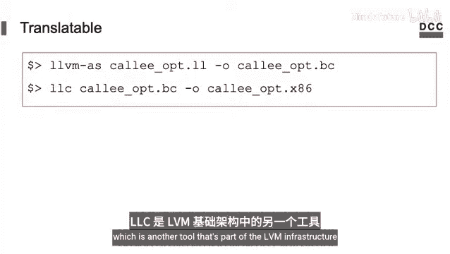

And we can use the Linux asemler AS to translate x6 into binary code that's architecture dependent。

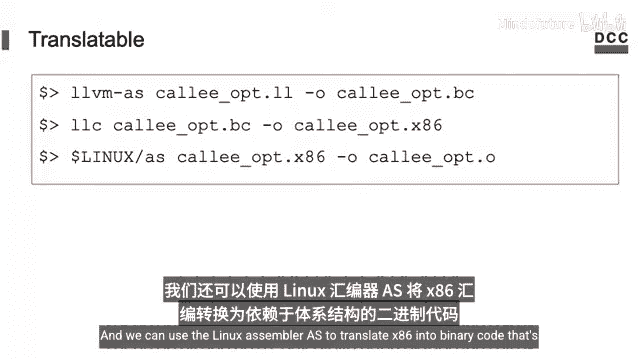

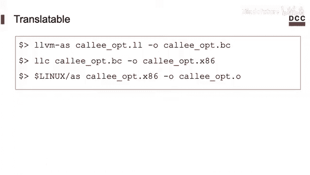

And so we end up with four different representations of the same program。

Two of them are in binary format。And the other two are written in ASI so you can read these files。

We don't any。Problem， but minded that these four representations。

 they have the same semantics they represent the same program。

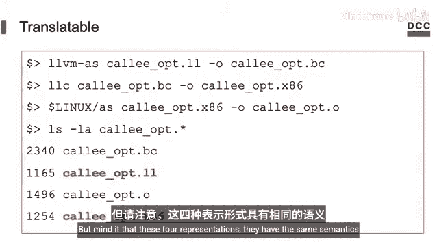

And that closes our presentation， it was rather brief though。

 much more information about the OMIR is available in the language manual that you can see in the reference。

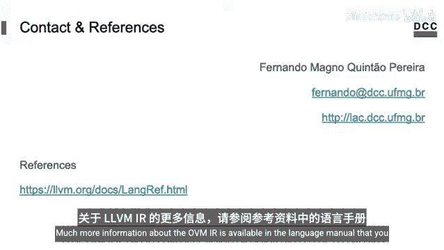

And also， I recommend a YouTube tutorial by Philip devedo and Vince Bridges to those who want to dive deeper into the IR。

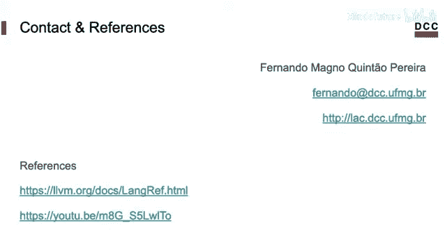

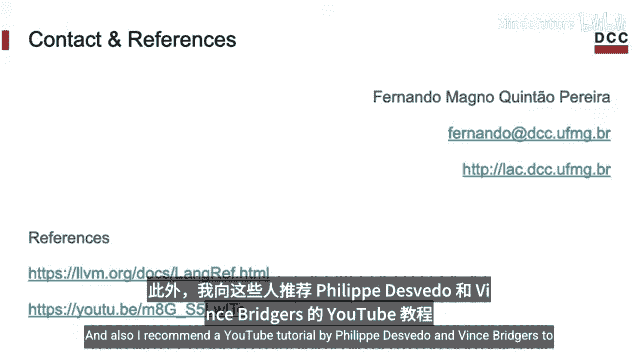

Finally， I thank Regja Sos and Johannes Doof for reviewing this presentation。

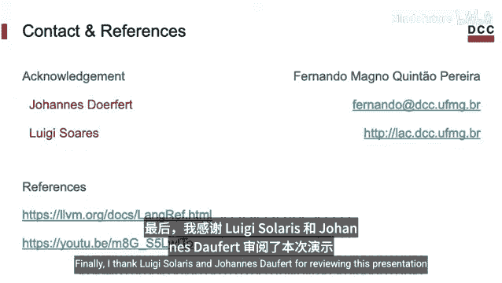