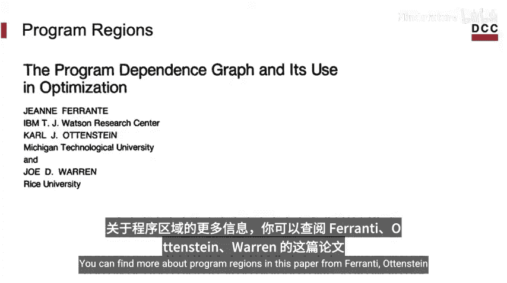
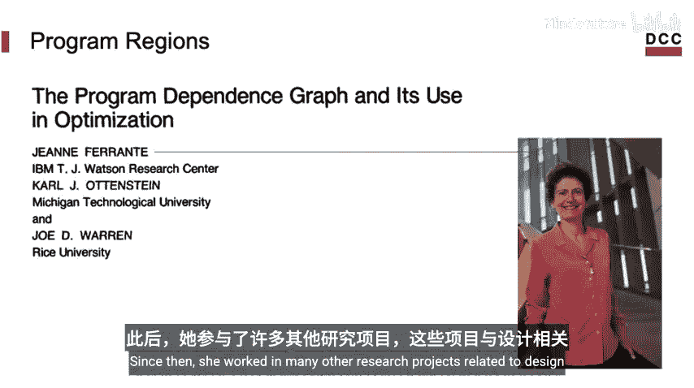
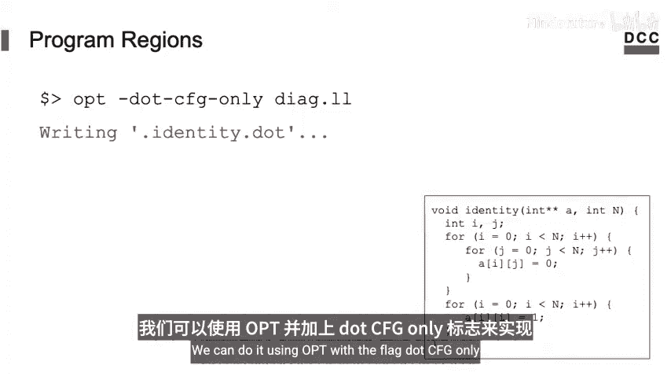
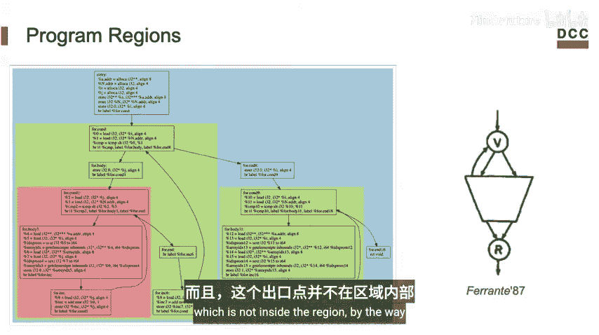
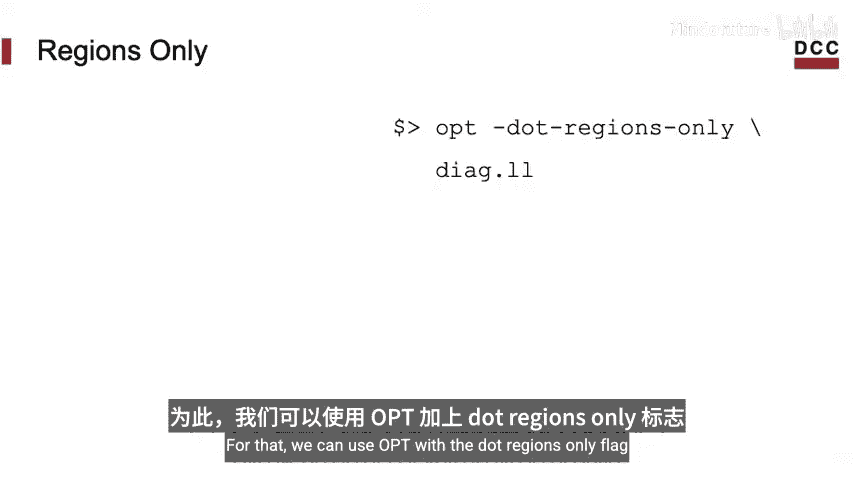
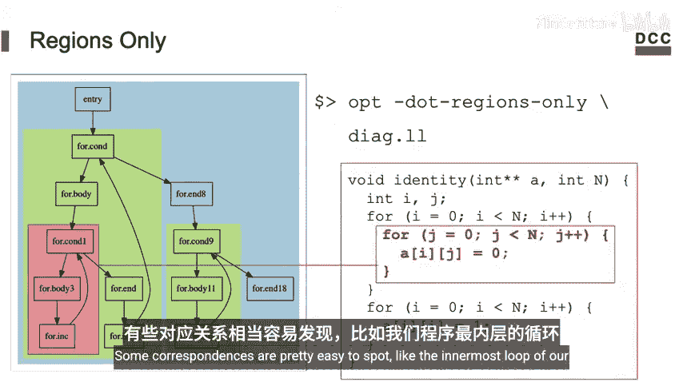
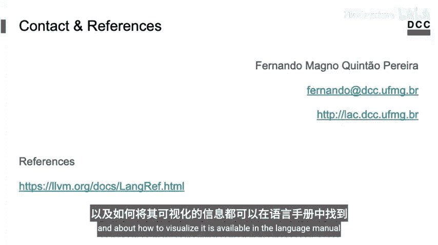

# LLVM入门教程-•-中英-p05-P05-Program-Visualization-using-LLVM--BV1HtRUYnEji_p5-

Hi， I'm Fernando Berera from UFMG and today we will take a look into different ways to visualize programs using the LVM compilation infrastructure。

2。Visualize programs， we shall use the OVM optimizer OPT。

That's a tool that comes together with the OVM distribution。Some people call it opt。

 I shall stick to O P。 T。 That's up to you。We have already seen that a compiler is formed by three modules。

 the front end， the middle end， and the back end， a PTt corresponds to what we call the middle end。

And as you may remember， if you watched the last class。

 OPT takes a file into the L of VMR format and produces a new file also in the L of the MIR。

 the L of MIR or intermediate representation is a programming language that represents the programs that L of VM manipulates。

OPT is a command line tool that means that we can brand it in a shell。

You can find where OPT is by looking into the B folder of URL VM build。

There will be many more tools in that folder to remember our first class。

 OPT will be one of those tools。If you want to know which version of it you have。

 you can run OT with the version flag。In my case， that's what I get。

Notice that I have a debug build with assertions that means that I can easily use the allDP to debug passes that run on OPT。

 for instance， the kind of built that you have depend on how you've compiled all of theM in my distribution。

 a debug build was a default。Anyways， how can we use OPT and what can we do with it？

One thing that we can use OPT4 is to visualize programs。We can also use OPT to analyze code。

 for instance， we might want to know which kind of instructions the pointer contains or how many loops or how many pointers a program have。

We might want to know if the program contains vulnerabilities to attacks like SQL injections。

 and we might want to know lots of other things about the program。And finally。

 we can use OPT to transform the program。There are different kinds of transformations that we might want to run。

 for instance， we might want to insert instrumentation in a program to find something about its execution。

We might also want to optimize the program OPT already contains lots of optimizations and in this course we shall look into some。

We shall start dis course showing how we can use OPT to visualize code， though。

 that's very useful if you want to know more about that code。

OPT represents programs in the thought format， DOT， that's a format to represent graphs in general。

 actually。So let's take a look into different ways to see this program don't worry about what it does。

 we just want the code。Assuming that the program is called Dag。c。

 we first need to use Kang to put it into the LVM intermediate format。We can use this comment。

 which we have already seen in previous classes。And then we can use the dot CFfG flag of OPT to generate a file in a dot format。

This command creates a file called dot I。The dot in front of the file naming indicates that the file is not visible。

But the file is there， that's actually a text file。

 you can take a look into its content using the CA command in Linux。

And if you want to transform this file into something that you can visualize。

 you can use the dot command， which you can install in Linux。

This is the program in the allVMR format， this representation has a name actually。

It's called a control flow graph。The vergees of the graph are called base blocks。

They represent sequences of instructions that always execute together。The edges， in turn。

 represent possible paths in the program。And if we zoom in the graph。

 you will see that the basic blocks are formed by multiple instructions。

 these instructions are in the all the immediate representation。

There are many programs that we can use to visualize do files。

We had used the dot tool to visualize them。You can easily install this command line tool in Linux。

 it's part of the Gr Z package。But in truth， there are many。

 really many programs that you can use to visualize that files。

 so you can try the one that suits you better。Anyways， coming back to LVN。

 there are many other formats that we can use to visualize a program， for instance。

 if you want to see only the vertices and edges of the control for graph without instructions。

 it's also possible。You can replace the dot CFfG flag with the dot CFfG only flag。

And then you can see the vergees and edges of the CFG。

 this format helps to understand the structure of the program， for instance。

 in this case we can see recycles in the program。Each one corresponds to a different loop。

Let's now try a different visualization， we shall see how the basic blocks in the program can be grouped into regions。

 these regions are subgraphs of the CFPG that have only one entry point and that go to only one exit point。

You can find more about program regions in this paper from Frantte Ettenstein Warren。

Jen Ferrantti actually has done a lot of good stuff in the field of compilers。

 this work for instance about program Depend Grs is from 1987 since then she worked in any other research projects related to design and implementation of compilers。

Anyways， let's visualize the single entry single exit regions of our example program。

We can do it using OPT with the flag dots yetG only。

。Our example has four regions， they are nested on each other。

 the three inner regions represent loops。You can check that every region has just one entry point。

 IM， one based block that gives access to it， and it's only possible to leave the region through a single exit point。

 which is not inside the region， by the way。

It's easier to see the structural relations between program regions and source codes if you visualize the regions without instructions。

For that， we can use OPT with the dot regions's only flag。

That's the image that we are obtaining in this case。As an exercise， if you want。

 you can stop the view and try to find some correspondence between the regions and the CFG and the blocks of source code in the program。

Some correspondences are pretty easy to spot like the innermost loop of our program。

To compute program regions we use a data structure called Dominator tree。

 we can visualize Dominator trees as well。I will not explain what's say dominator tree。

 but if you want， you can take a look into some basic code optimization course。

 I will leaving a link down in the presentation for that。For instance。

 that's the remainderminator tree of our example program。You can produce this dot file。

 adding the flag minus dot dom to OPT OPT will write the text representation of the graph in a file that starts with the prefix D meaning dominator 3。

And if you want to see only the basic blocks organized in the dominator tree。

 you can specify that as well to do it， use the dot dom only flag。

That's the representation that we obtain。As an exercise。

 you might guess what's the meaning of the luminator tree is you compare it with the control flow graph。

A path from A to B in thenominator 3 means that any execution of the program will have to cross a to arrive at B。

And there are other ways to visualize programs， other formats， I mean。

 you can find them out using OPTs helper。In my LVM distribution， which is version 11。

 that's the relation of program visualization representations that I have。

We had already seen most of them。The post dominator tree is the inverse of the deminator tree。

 and do not show it in this course。But if you want to know more about post eminator trees。

 I can recommend a nice online class about this data structure。But before I finish this course。

 I will show you the core graph。The core graph is a graph whose vertices denote functions and whose edges show relations between colorss and colons。

For instance， let's take a look into this program。You can produce the program call graphra using the dot call graph flag。

For this program， that's what you would obtain。We see， for instance。

 that function main cause function fact。We say that function main is the color and function fact is the call。

And if you want to check the program in a different format， you can， for instance。

 make factor or recursive。 and then you will see that the call graph has changed。

 And now fact has this loopline。And that closes our presentation。It was rather brief。

 but much more information about all of MIR and about how to visualize it is available in the language manual。

 thank you。

