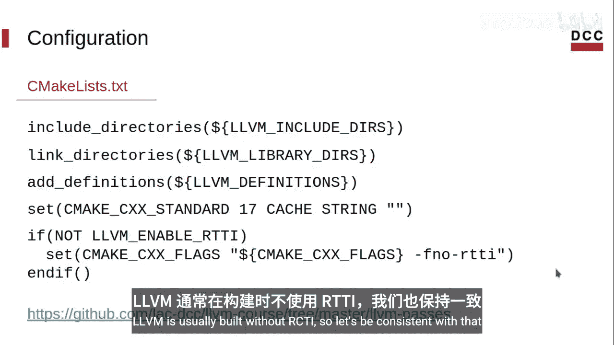
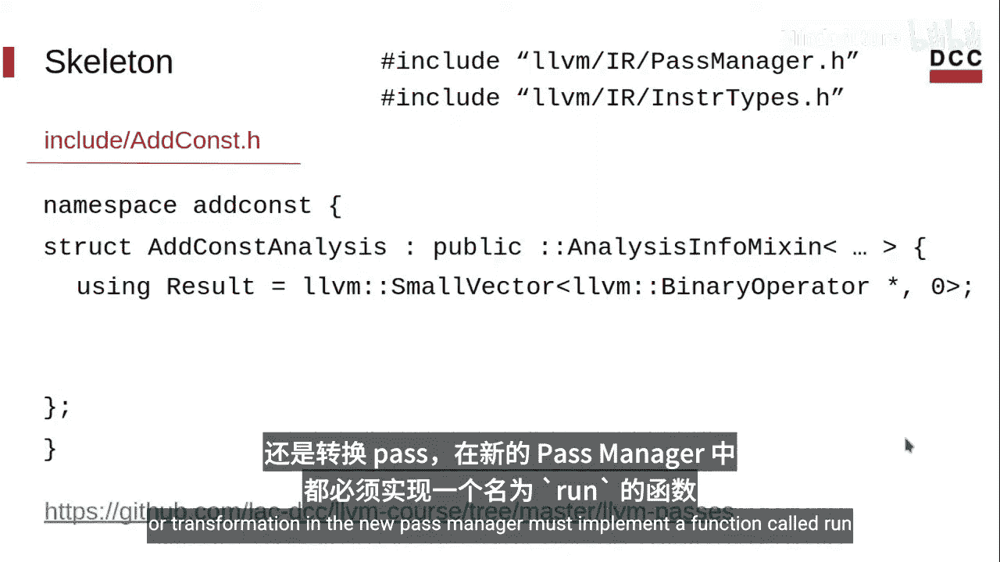
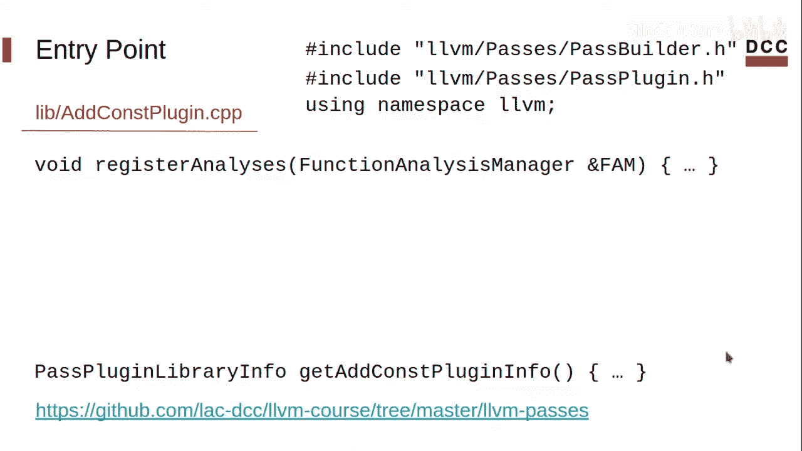
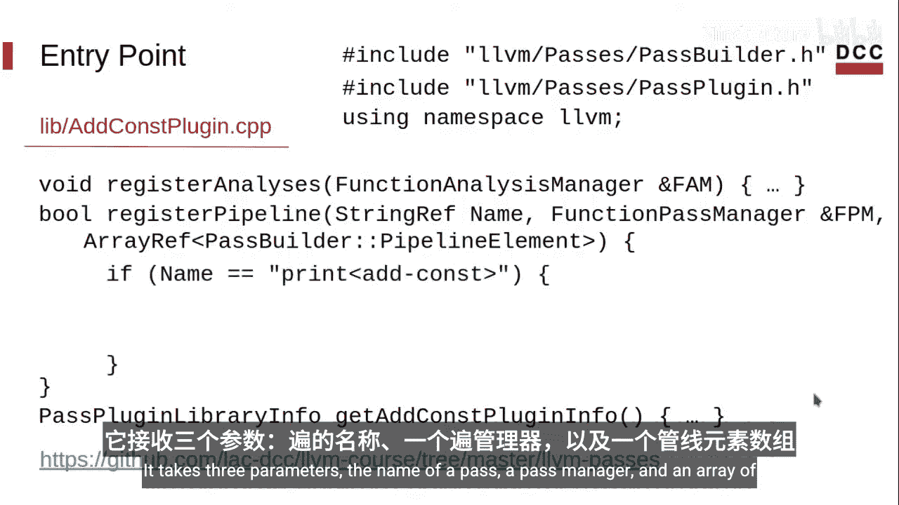
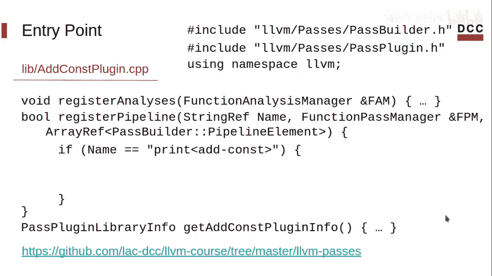
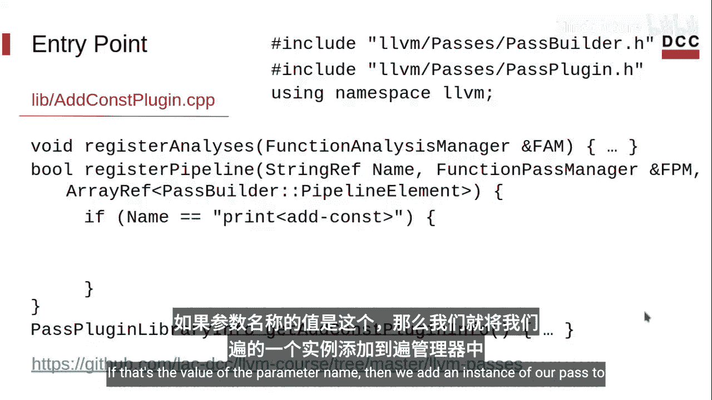
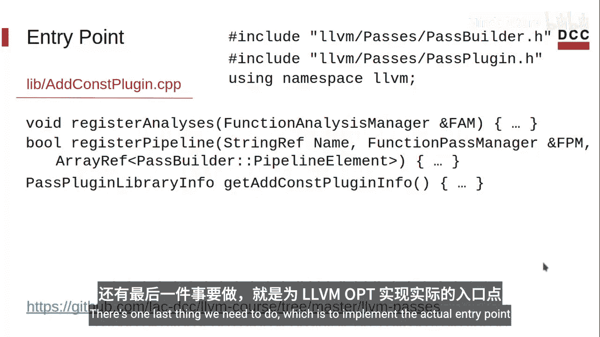
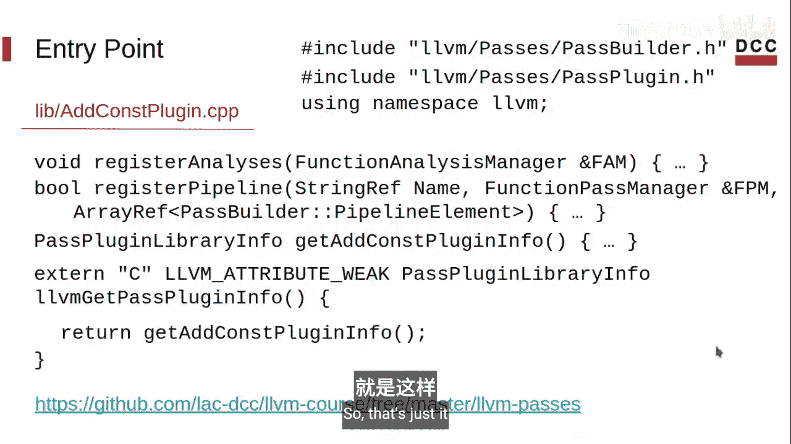
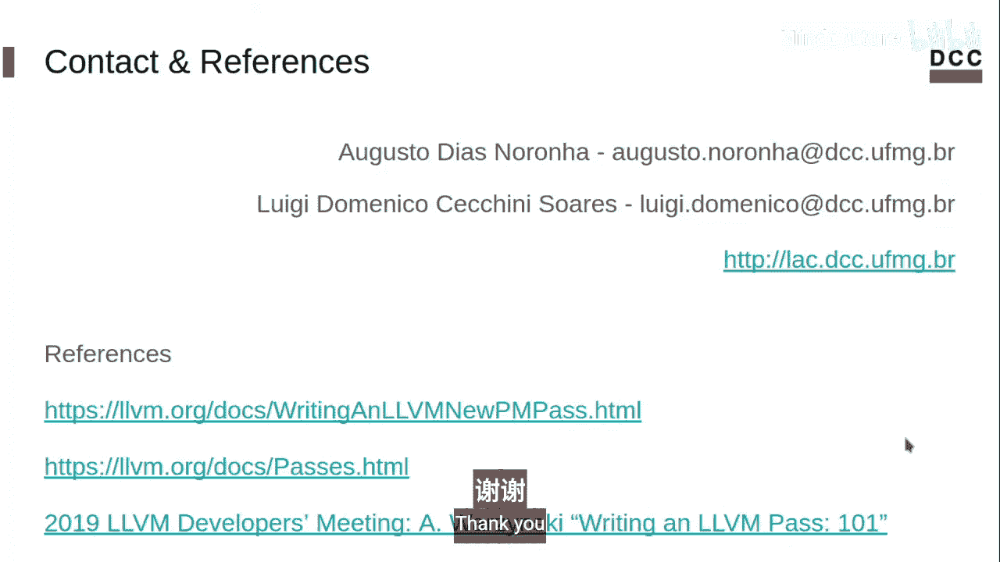

# LLVM入门教程-•-中英-p07-P07-Writing-an-LLVM-Analysis-(part-1)--BV1HtRUYnEji_p7-

Hi there， I'm Luigia Domenico， and I'm currently pursuing a master's degree at UFMG where I do research compilers。

In the previous video， Augustus introduced 11 pees。

 talking about a difference between analysis and transformations and presented a few examples of existing pe。

Now I will show you how to write your own analysis。 This video is divided into two parts。

 In this first one， we will see our project structure。

 We create the header file with the analysis decoration。And it demands an entry points for blogging。

In a second， we implement and test our analysis。This analysis will be quite simple。

 Suppose we have a function that performs some additions。 First we have one plus 2 then 3 plus4。

The results will be stored at A and B， and finally we have A plus B， for instance。

Not that the first two instructions are what we shall call thereby as constant on instructions。

 which means that all of the operas are constants， in this case they are integers。

We can evaluate constant on additionions at compile time。

 we will do this later on when seeing how to write an allowM transformation for an hour。

 our analysis will collect all constant on additions inside the function。

Let's start by looking at our product stretch first， when need to choose between two options。

 we can work inside the 11 sourcetry In this case， the approach is exactly the same as for any past that array exists and is well covered in the 1 documentation。

 but you may also choose to work outside the 1 sourcetry in case the variables choose want to build your own separate tool。

 for instance。In this course， we shall adopt the second option for later on。

 we'll build our own2 using the LLVM command Learn Library。

We will use aI to compile our project because we need a SAmic file。

 well have an enclosed folder for our higher files。Similarly。

 well have a loop folder for our source files。And inside is link folder。

 we also have another semi file。And that you used to create our library。And finally。

 we have a beautiful folder to start their libraries and bind to introduce it。

The star code is publicly available on Gitthub。 You can check it whenever you want to。

So let's start with the main file， I'll focus on the essential parts， but again。

 you can check the entire code on Gitthub。We start by defining this and make minimum required version。

 then we define our approach， which will be same which will be named at cost。

Next we the final verbal L of M installeder that shop points to where LL M is installed。

 this will be better to semiga by common line and this variable will be used to get the pathF to the LL VM semi configuration file so that find package can locate。

Then we include the L of M header and library paths。Next， we set the C+ version that will be used。

You can also define the compiler flag that you want。L of M is usually built with total RI。

 so let's be consistent with that。

Finally， we set the output pair for the library files that will be produced。

And include our Lib directory。Okay now let's move to the S file side delivery folder。

 it's much simple than the previous one， we just need to set the source files of our library and make the included directory visible so we can use our header。

Currently， all of them has two press managers， a legacy and a new one。

The recommendation for the new pass manager is not that much extensive yet， but it's getting better。

Since the new press manager is a feature of L VM， which I go with it。

The implementation of the new pest measure used some clear design patterns and items。

They don't really need to know them not to write a pass， but you find cits in the LLM documentation。

 so here are two of them you might want to take a look。

Curiously recurringcur template pattern or CRTP and a mixing pattern。

You can start by checking for instance in Wikipedia。Let's tell by different name， please。

Our L analysis is a strict or a class with analysis info for mixing as the basic class。

Here we can easily spot the two design patterns being used。

Let me omit some stuff here just to save space。Next。

 we need to define what our analysis will return in our case， there will be a list of instructions。

Here I'm using a small vector， which is an beauty in that structure。

 all of them has nice between text structures， we can check the documentation really about it。

In our case， we'll collect add instructions， which are binary apparatus。Every path。

 either analysis transformation in the new Pass manager must implement a functional code when that takes two parameters。

The type of disturb parameters vary depending on the scope the path will be working on。 In our case。

 we will be working with functions， So the type of the first parameter is function and of the second is function analysis manager。

 which is what we use request the result of any analysis we need。Finally。

 an analysis must also have an analysis key which provides an address to identify that particular analysis based。

In addition to the analysis， we'll also define a pretty simple transformation pass。

The other thing that is best will you do is to request and print the result of an mainly to the bug purpose。

We shall see an nice example of a transformation pass later on this course。

A transformationformation pass must also have a method run that receives true parameters。

 just like an analysis。The only difference is the return type。

 a transformation pest always return a set of preserved analysis。

 In our case all the analysis will be preserved since we don't want to be transforming anything at all。

And let's also define a private field that will be used as the output stream and a constructor that initializes that output stream。

So thats the skeleton of our header file， now we will implement the entry point for ourLLM OPT plugin。

First， we use the all of them and namespace in place。

M a function that returns some informations about her。

And the information are the L plugging version or plug name。

The L of M version and the handler that shall his registerster are passes properly。First。

 we register our analysis so that it can be requested by Npa。

Then you register a printer pass so it can be used with OPT。Both methods take outback functions。

 so let's define them。To register an analysis， we need an analysis manager。

 in our case a functional analysis manager， we use it to register an instance of our add constant analysis。

We also need to implement the callback for registering or plugging into the LLM OPT pipeline。

 it takes three parameters， the name of a pass， a pass manager。

 and an array of pipeline elements which won't be used very now。

We reference our printer pass as print at。If that's the value of the parente name。

 then we add anistus of our past the pest manager and return to。

True， recall that our printer takes a output stream。We are using Earth in this case。

 which is an a ammbine autotopus stream。Else， return false because there's not orpas。

There is one last thing we need to do， which is to implement the actual entry point for 11 OPT。

 That's pretty simple for re use or get Addcom blink plugin info to return the info of playing。

 so that just it。

And that is for now， we have the skeletal for a pest as well as the entry point for the alum OPT2。

In next video， we will finish the implementation of the analysis and see how it works on an example to there。

 feel free to send any comments or questions you have。Thank you。

