# LLVM入门教程-•-中英-p08-P08-Writing-an-LLVM-Analysis-(part-2)--BV1HtRUYnEji_p8-

Hi there。 I'm Louis Domeno from UFMG In the previous video。

 we discussed the project structure of of our analysis and we saw how to implement the inventory point for a LO M OPT plugging。

In this video， we will finish the implementation of the analysis and run it on an example to check the result we got。

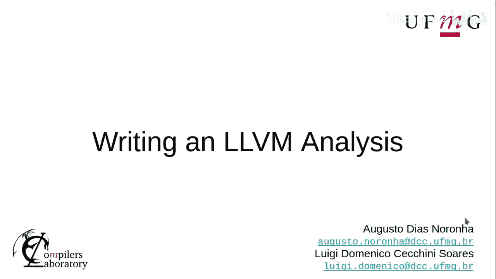

First， a brief recap。Our analysis which voice of function。

 collecting additionals that only use constant integers。

This will be used later on the course to evaluate these instructions at compile time。

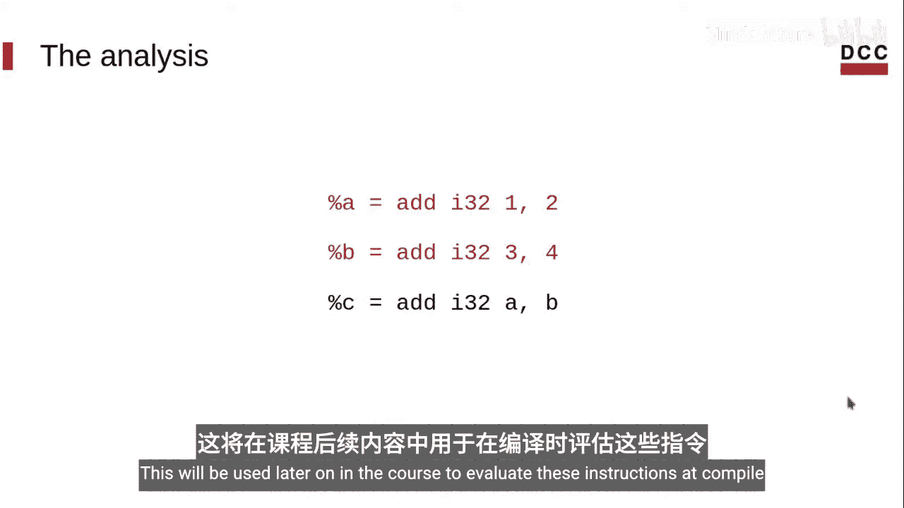

This is the structure of her product right now。We have already seen head the file。

The add cons plugin file， which contains the entry point for a plugin。

As well as the configuration files that we need to compile the product。

Now we'll dive into the implementation of our analysis。First。

 include our header and wrap the code inside our previously defined naming space。

Let's also use the LLVM name spacing just for simplicitylist。

The first thing to do to is to initialize the Aliki。Note that the value here actually doesn't matter。

 since y is used by aloium is the address of the key。Then we need to implement our wrong method。

 I omitted the types just to save some space here。

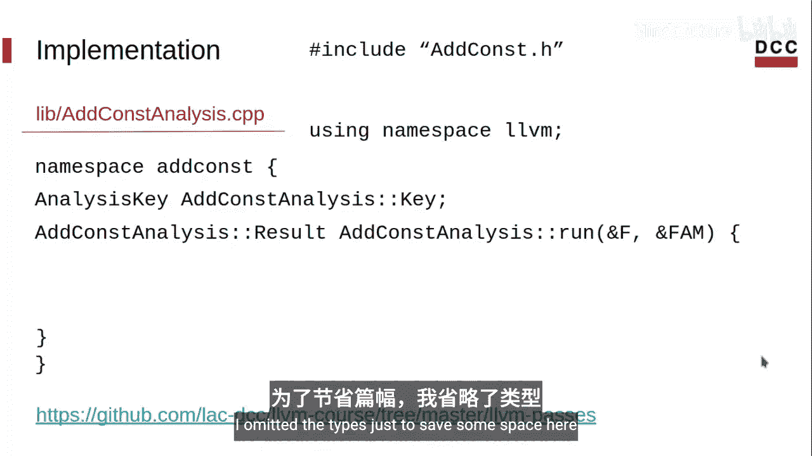

We begin by declaring the vector that shall be filled with the collective instructions and returned as result of our analysis。

Then we loop to the basic box of F。Each basic book is composedd by instructions。

 which is what we need to expect。First。Let's check if this instruction I is even in error operator。

If it isn't， we move to the next situation。Then we need to verify if it's an addition。

We do that by inspecting is itopic code。Third。We need to check if the opens of I are our constant enters for that。

 we'll use a function called is constant inch only that we shall define in a minute。

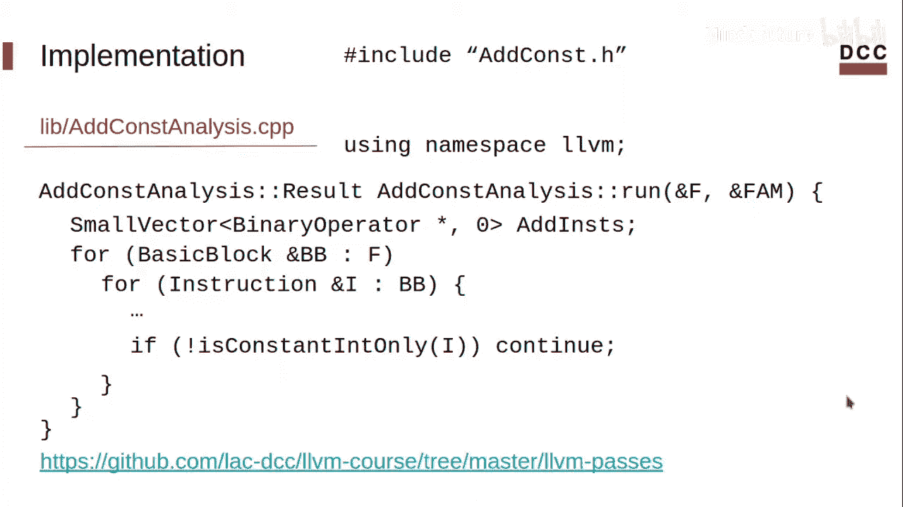

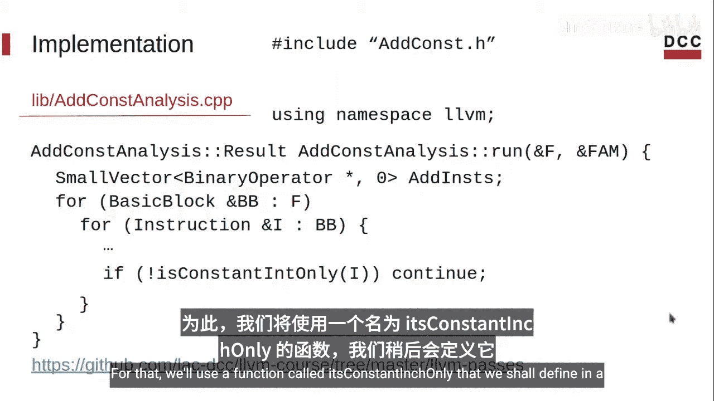

Finally， now we know that I is an addition with constant opera。

 so just add it to the list of collecting instructions， casting it to a binary operator。

And that's it。 Now we just return the collect instructionss， and we are done。

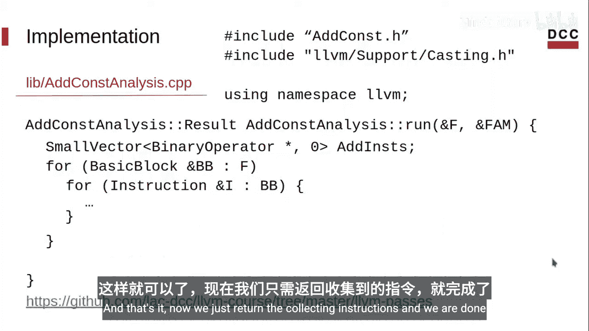

Okay， now we need to implement that is constant only function。It's quite simple。

 it takes an instruction I， then loop the open of I and check if they are of the type constant int。

If all of them are constants， we return true， else we return false。

The only thing left is to implement our printer so we can check the result of our analysis on some example。

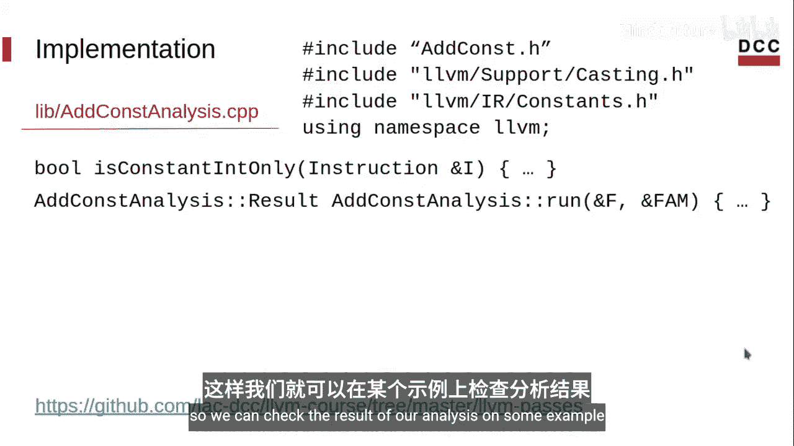

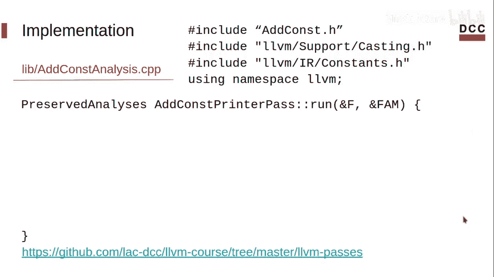

First， your look request the result of for analysis and for that we use the Fun analysis manager。

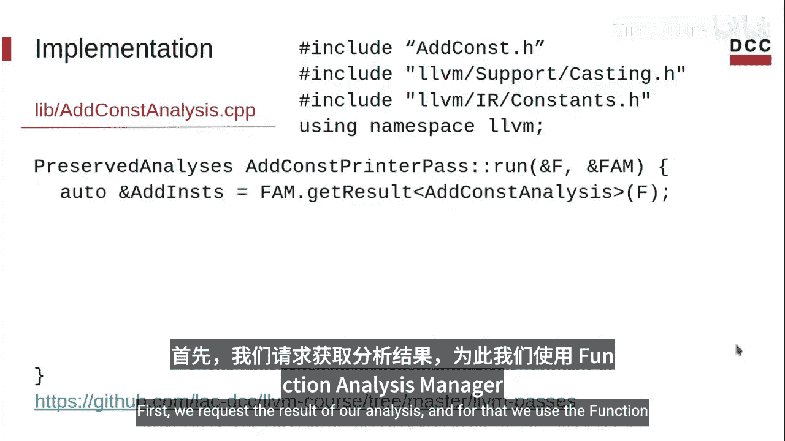

嗯。Now， let's print the name of our function before printing the another result。Here。

 O is the outputted stream that we pass to the pest construct。

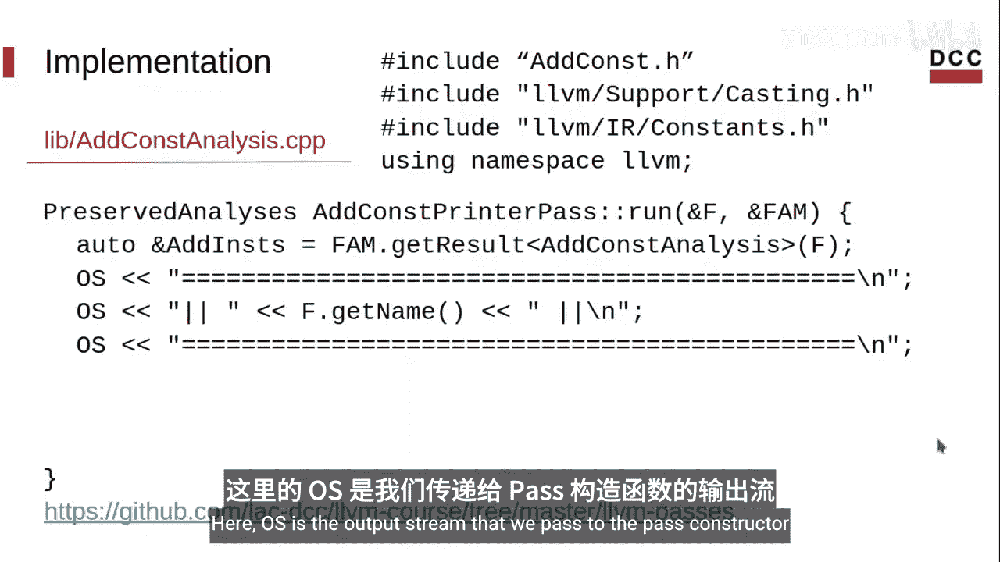

Then we reverse the list of instructions returned by our analysis and print them。

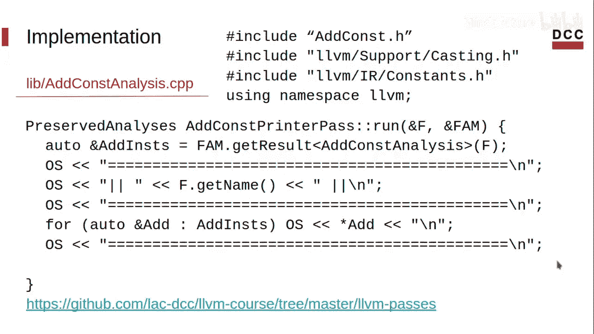

And finally， we return a set of analysis preserve， which in our case are all of them。

We are done with the implementation Now let's see how to compile our product First things first。

 make sure you are at the root of the product。In my case， this is the path to the product。Now。

 if you recall the last video， we have defined it in this make file a variable to hold the location where L of M is installed。

 so let's get it。Using CMake， we compile the project Pass in the path to LLM by command line。

The but files will be stored at the folder， name it But。

You can use any beauty system you want in my case I'm using Ninja but you can use UniX big files for instance。

 Finally what's left is to run your Bea2 and compile the project。First， move to the Bea folder。

 then use the make with the Bea flag to compile the product。

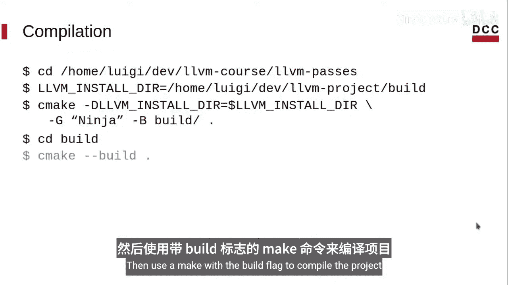

Before running our pass， let's take a look into the example file that we are going to use。So back。

 move back to the product route， create a folder called examplesles and create a new file full dot LL In it。

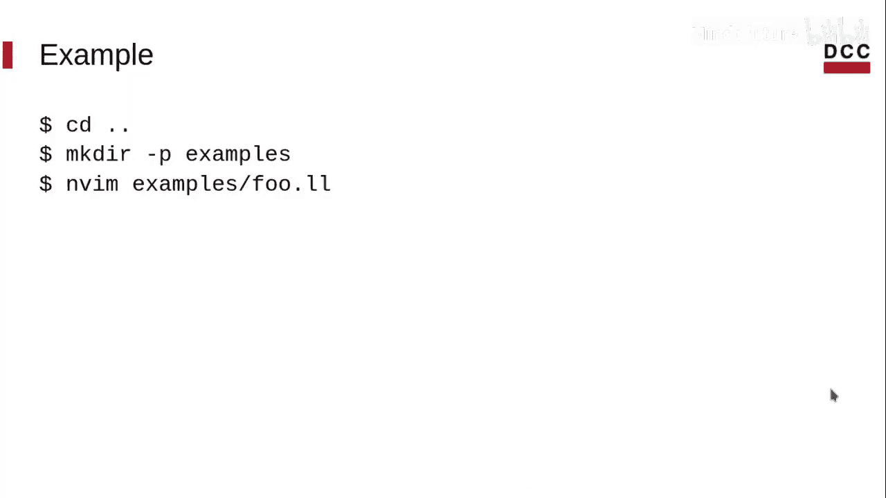

First， let's define a function called P that will take two interiors and also return an in。

Then let's create two additions that are constant only。Next。

Let's add a couple of other additions just to ensure that our analysis will correctly select only the first two。

And lastly， just return their final result。Now， let's test it。First， let's get the L of M O P T2。

Then we need to load the Lib file that we have generated into OPT。We say to O。

 P T that we want to run the best called print。Anle brackets at cost。Which is our printed。

 as we defined it before。Let's disable O Pio but just to suppress a few warnings。And finally。

 we are going to run our path onto the example file bio， which is create。And there it is。

We successfully collected their distractions that only operate on constant interiortegers。

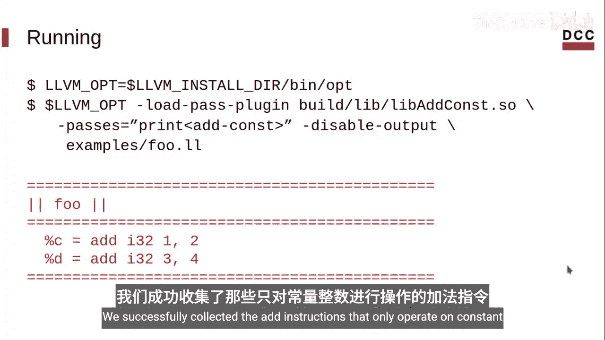

So that did for now， in these two videos， we saw how to implement an analysis on top of LLVM。

Using the new pass manager。In next video， we will see how to implement a transformation pass that will make use of the analysis we have just created。

Till there， feel free to send any comments or questions。 Thank you。

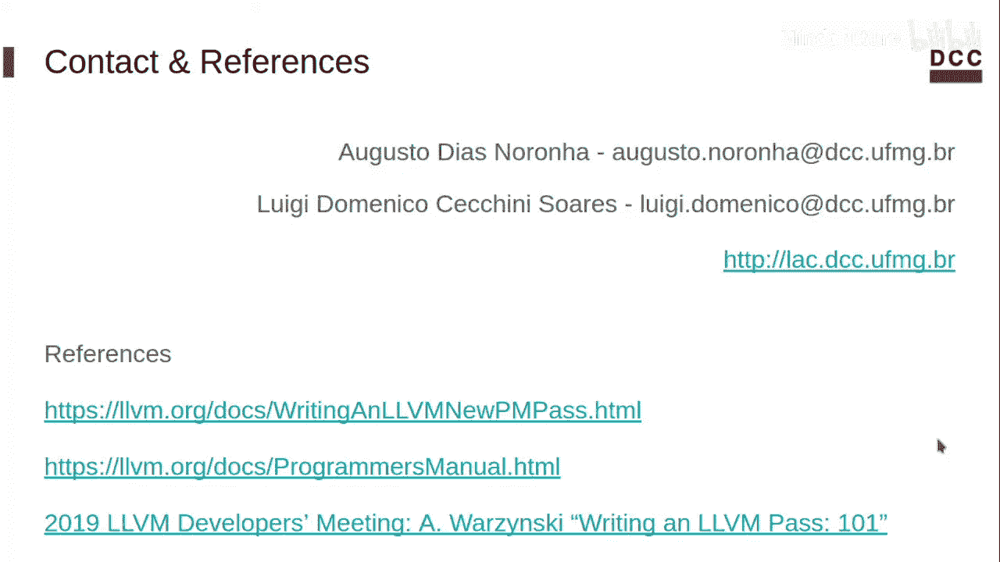