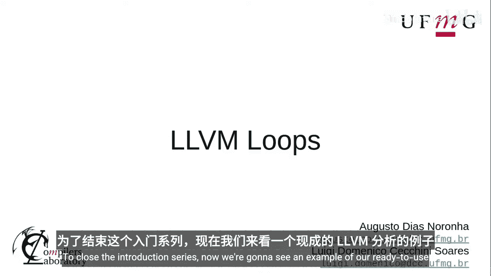
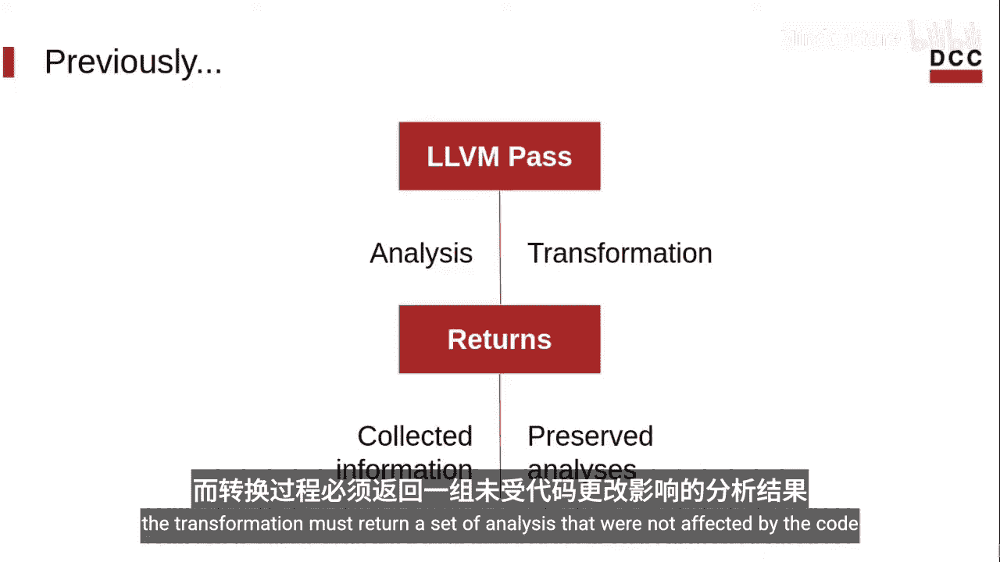
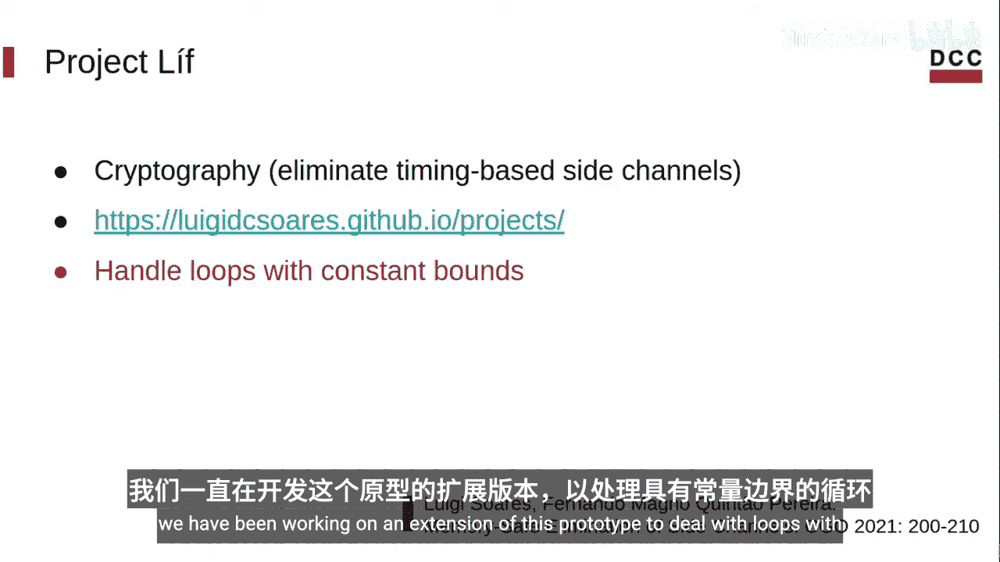
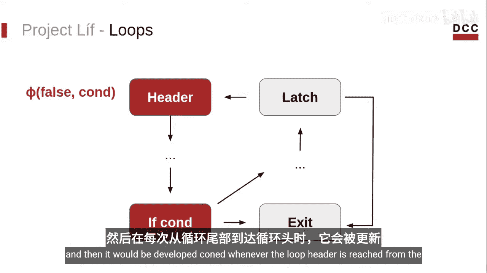
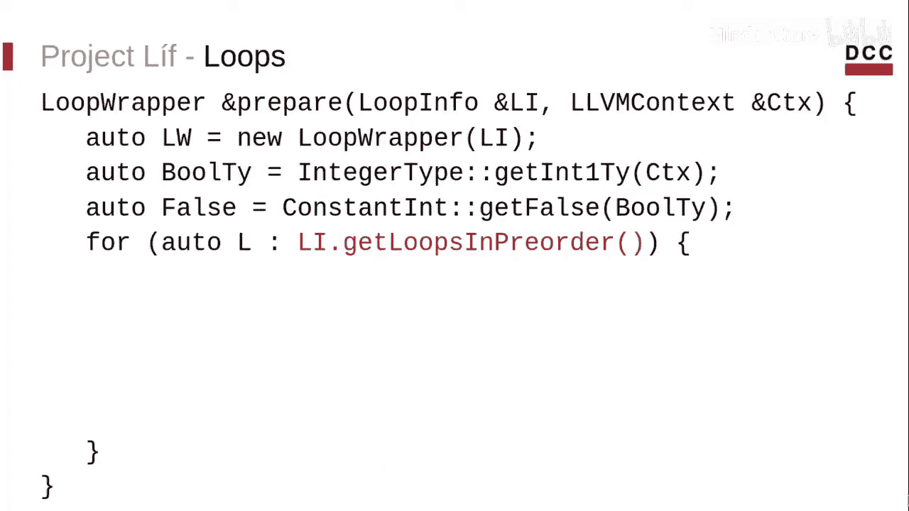
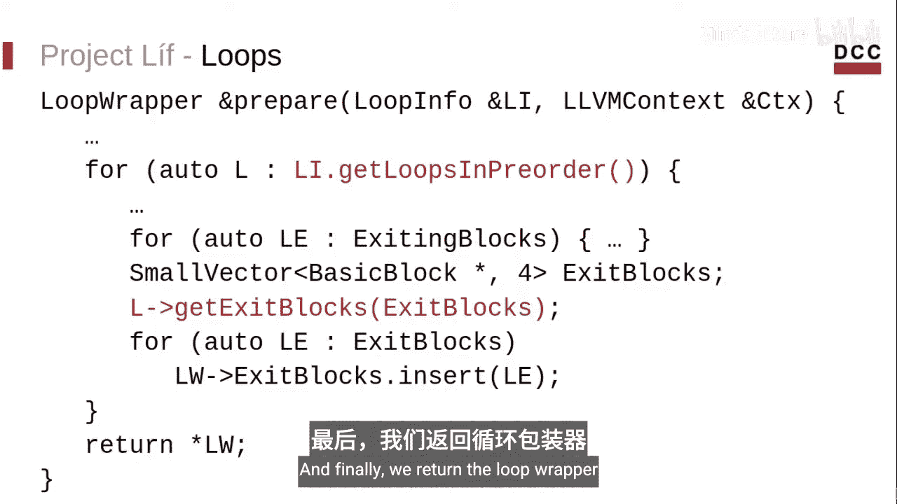
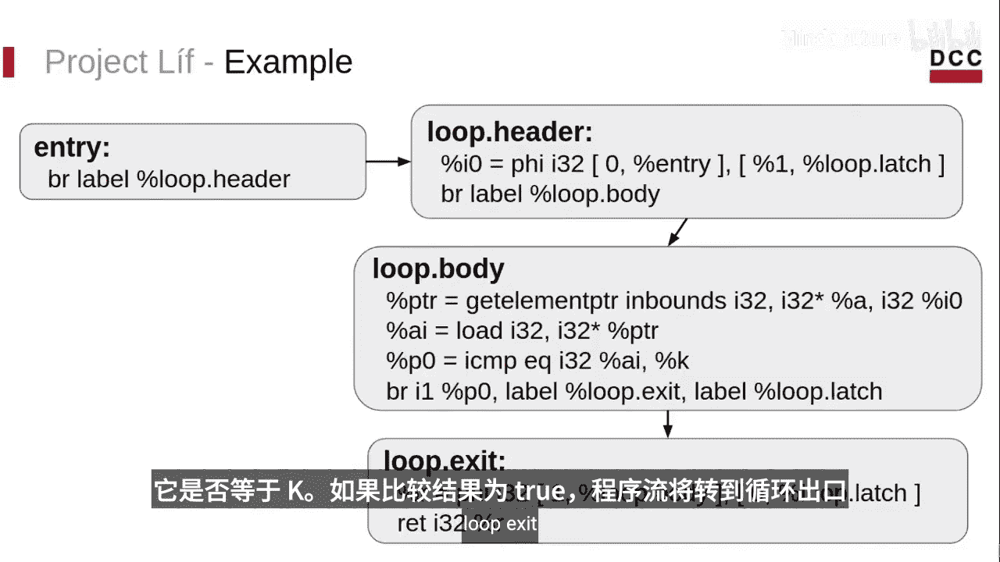
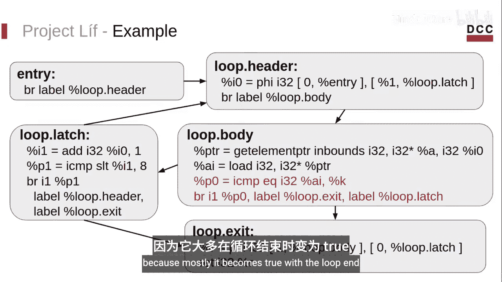
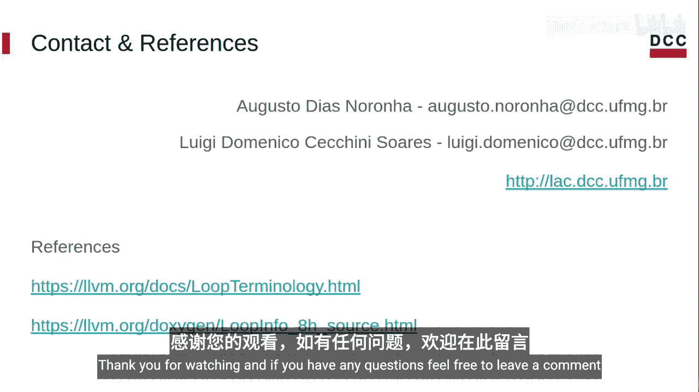

# LLVM入门教程-•-中英-p11-P11-LLVM-Loops--BV1HtRUYnEji_p11-

Hi there I'm Lu Domeno from UFMG In the previous videos， we talked a bit about relevant passes。

 what they are， how to use and how to write them。So to close the introduction series。

 now we're again a single example of our ready to use a V analysis。

We already know that the yellow Midowand is formed by passes。

And the spacees can be either analysis of transformations。

And even though this church of another transformation is quite similar。There are some differences。

 for instance， on transformations can modify the code。The results are also different。

While the returns to collect information， the transformation was between a set of analyses that were not affected by the code changes。

All of them has a already to use analysis best called looppin analysis。

This loop analysis returned this church called the Lopi Mufo。Which stores all loops of a function。

 and once to have access to the loops。We can get lot of use of information。Such as the loop header。

 the loop edge reaches a block with a back edge to loop to the loop header。Exitisting blocks。

 which are the blocks with edge outside the loop。Exit blocks。

 which are the targets of the exc blocks and much more。

I'm going to show you a piece of code from a product that I've been working on。

 which uses some information related to loops。But first。

 let me give a brief context about this product。Laf is an acronyium for a low la Zran。

The meaning of iszorons here is related to the running time of a pra。

We say that our program is its actions if it always executes the operationss。

 regardless of the input it takes。And if it always perform the same memory axis in the same order。

Which givers are running time that does not depend on the input。

This constant prop is especially important for cryptographic implementations。

 which must be free of site channels。Site channels are vulnerabilities that can be explored by an adversary to obtain sensitive information。

If you want to know more about this project， check out on my web page。

 I'm also leaving the links in the description。诶。You can read our paper members explanationation on S channels。

 which was published at CGO 2021。At the time you published this paper。

 our prototype could not handle loops at all。 Instead， we required every loop to be enrolled。

But since then， we have been working on an extension of this prototype to dual loops with constant bounds。

 and this is where the piece of code I'm going to show you today is about。

They go of the function that I'm about to show you is to sort of pre loops so we can handle them later on。

Suppose we have a loop of a header and a body performing some computations inside the body that is a conditionary statement。

Which exits the loop in case it's true or else move to the second part， second part of the by。

Then there is a loop condition at the end of the loop with a back edge and an edge to the exit to block。

 and we want to eliminate this conditioning statement inside the loop。

Because we need to guarantee that the loop will will always perform the same number of iterations。

But for that， we need to add a few function in the loophead to keep track of whether the condition statement was triggered or not。

This is what the function that I'm about to show is mainly about。In addition。

 it will also collect have information to be used at later。

Few functions are present in the SSA form and they are used to join variables。In this case。

 the result of the P function will be false， the first time the program reaches a little head。

 and then it will be the developed cons。Whenever the loop head is Richard from the looplash。

The function is called preparepa， it takes a loop info and a context and returns the loop wrap。

This loop wrapper is a custom structure。That we will start a loop painful。

 as well as some additional data。And as I said， lupinfo is a result of the lu Panals。Hence。

 somewhere in the code base， we must have something like this where we require the result of lupin。

So first let's initialize the loop wrap， then we define some constants that will be used to insert those field functions。

These are the type of Dffi function in the initial value。

Now we're going to reverse all the loops and for that， we're going to use the loop info。

Then we get a loop header and the loop latch， we assume that the latch is unique and thus the loop H。

 the loop has a single bagage。This is mainly， for simplicityit。

There is an algorithm pest that guarantees that it is called loop Simplified。

We also assume that the loop is in rotated form， which can be achieved by running the loop rotate pass。

A rotd loop is basically a loop in the do while style with the condition at the end。

We start the lip edge for further users。 Next we get the exiting blocks。

And the position in the loop header where we're going to insert those three functions。

 and then we visit each exit team block except for the loop edge。

 since once its conditional statement comes through， the loop ends。

We get the existing block termimminator， which is a conditional statement。

Then we get a conditional value。And we create a few function。

And then we reverse the predeces of the loophead to fill the few with the correct incoming values。

We also saved a function in our loop rapid structure。Then we got the exit blocks。

 which have their blocks outside the loop and save them as well， and finally we return the loop rep。

So this is how our code looks like。As you see， the entire prepared function is not very big。

 it is span2 N9 lines of code。Anyways， you can get， can get it in。There post started。

 I'm going to leave that the link in the description of the video。So to illustrate。

 consider the following function。It takes an array A and then enter K and tras the array A。

 trying to search for this entire K。It this translates to the following a m image8 representation。

 the entry block with a jump to the loop header。There's a powder which gets the cr value of the loop in the traverable。

And the loop body which loads the value from array A at position I and checks if it is equal to k。

If the comparison are it through， the crs flow to the loop exit and returns one。

Otherwise， the problem moves to the loop edge where the induction variable is updated and the loop condition is evaluated。

We have true conditioning statements in this loop。I want need the little bud。And the other， the lula。

But there's no need to consider this one because most of it comes true with the at。

Hence， we shall add just one fee function at the loop header。

Which is related to the conditional statement in the lookway。It is initialized as false。

 because once it becomes becomes true， it means that the loop handed a here。So to summarize。

 we use it the loop analysis to get a loop pin， which gives us access to every loop inside a function。

 including nest ones。And once we have access to every single loop。

 we could get all sort of informations like the loop header and ledge。

The exit and exiting blocks and other stuff， like if it result is in rotated form and。More？

So the goal of this last video was to show you that all of thems already shipped with a lot of useful stuff that are ready to be used。

This video closes the introduction series。And the links。

 the Gicha rep post star and the paper are in the description of the video。Thank you for watching。

 And if you have any questions， feel free to leave a comment here。

