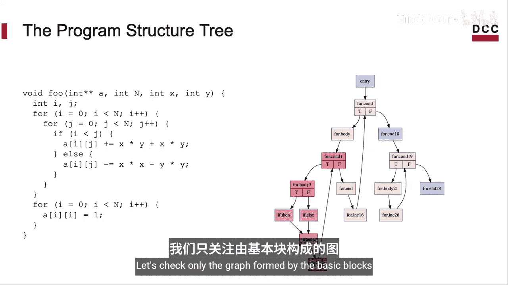
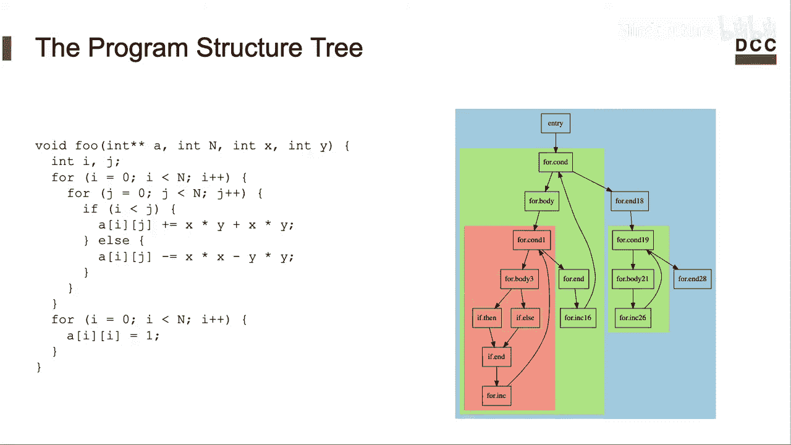
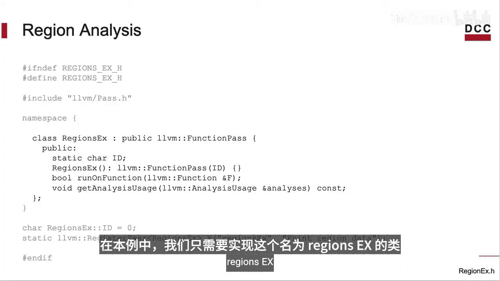
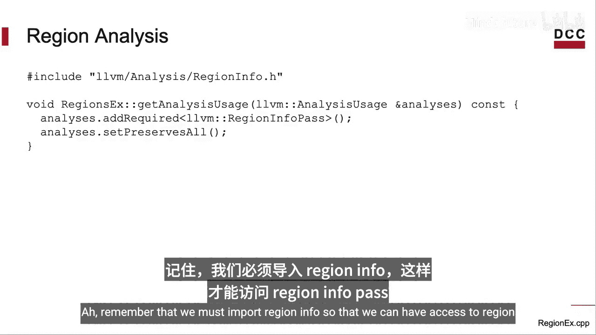
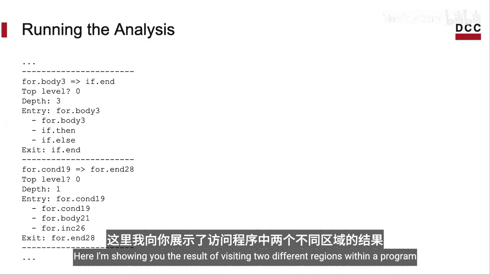
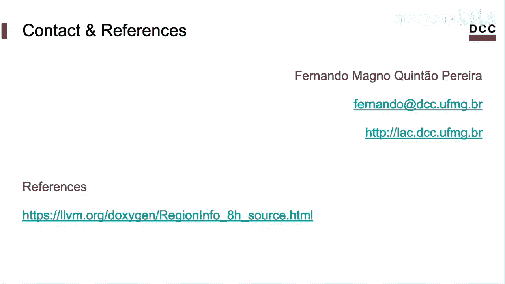

# LLVM入门教程-•-中英-p12-P12-Region-Analysis--BV1HtRUYnEji_p12-

Hi， I'm Fernando Bereer。Im a professor in the Department of Computer Science at the Federal University of Milar Rightise in Brazil。

And I do research on compilers。Today， I will tell you about a particular static analysis that L of them performs。

That's called region analysis。This analysis groups the basic blocks that compose the program into what are called single entry single exit regions。

So， for instance， if this graph is the controlflow graph of a program。

 then we can identify multiple regions like that with a single entry node and a single exit node。😊。

First of all， we have the region that encompasses the whole CG。

It's easy to say that this region has a single entry node， which the entry of the function。

 It also has a single exit node， which the exit of the function。😊。

And then we have sub regionsions within that region， for instance， here。

 I have a sub regionion with the loop in the left side。

And sub regionsgions can have other subgions themselves。 regionsions are nested within each other。

These are the non trivialvial single entry single exit regions of this example。

Let's call them C regions for short。 The other C regions that I have not shown are trivial for they contain only one basic block。

 I mean， only one node。As an exercise， if you want to， you can check that each CZ region is indeed C。

 I mean， it contains one。Single entry。 and one single exit。

That works even for the regions that contain cycles within。

I will not be showing what we can do with regions。 the goal of this class is just to show how to invoke an alvian pass。

Nevertheless， grouping basic blocks in regions is useful for many things like automatic parallelization。

Or fast， as I say， construction。Or computing control dependencies that helps to build program's license。

 We can use programs license to extract functions from within functions， for instance。

Something very cool about control dependence is that we can use these notions to detect time related side channels in programs。

😊，If you want to know how to use C regions to detect side channels， I recommend paper。

 which contains implementation built on top of L V M。Anyways。

 LVM gives us a data structure that groups the easy regions into a tree。

 This tree is called the program， structure tree。😊。

The algorithm to compute the program structure 3 is available in a paper from 1994。

Just to illustrate what Ol of M gives you， consider this program。

 What the program does is not important。 We can only care about its structure。

Here's the CFG of the program。And we don't really care much about instructions within each basic block。

 let's check only the graph formed by the basic blocks。

L V M will group the basic blocks into nested see regions。 You can see the regions on the right side。

😊。

This grouping of blocks into regions is formed by something called the region analysis。

Let's implement a past walk over the regions that Alvinium gives us。

That's the header file of our analysis。 The whole header file， I mean。It's not very big。

 I will be using the legacy pass manager， by the way。

All that we need for this example is to implement this class， which I've called regions E X。

 It contains only a handful of methods。

We will have to implement two of these methods， which are run and function and get analysis usage。

Let's the start of the latter。 Wait simpler。Here it is get analysis usage。

 The method itself has only two lines。The first line explains to LVM that we will be using region analysis。

 this analysis is made available to us by the class region info pass。

The other line is there just to say that we are preserving all the information collected by all of them thus far。

 I mean， our path will not transform the code in any way。

Remember that we must import region info so that we can have access to region info Pass。

 We can do this in the CPP file。😊。

Now， let's get back into our header file。 It remains to be implemented the random function method for this analysis。

 All that we want to do is to print out information about each region that constitutes the function。

Here is the implementation of our random on function method。 It contains four lines。 Don't worry。

 we will go over all of them。First of all， we get a reference to the region info class。

 That's what the first line is doing。😊，Then we get a pointer to the tree of regions。

 We do this by capturing a reference to the root of the tree of regions。

 we use the gett top level region method from region info to do it。

Then we will need to visit these regions。 We will visit them recursively， like we traverse a tree。😊。

Here' is the visit， the method。It's also rather small。 Let's go over its part。First。

 it prints information about the region。 I will show this method。 Pri log later on。

Noteice that after we process the region I， after we print region info。

 we will traverse the children regions。 In other words。

 we iterate through the list of children in the region invoking visit recursively over all these children。

😊，But let's get back into print log。 This method prints information about the region。

 as I had said before。Here's the implementation that I wrote。

 The goal of this implementation is just to show you different parts of the LVM API to manipulate regions。

Kows that each region has a name。We can also check if the region is outermost。

 Im here to say if the region is not contained within any other region。

We can also check the NA level of a region。That's how far from the root region is any given region。

The top level region has that0， by the way。We could read the entry based block of the region Here。

 I am reading the entry based block in printing its string name。Next。

 I am iter over every base block that constitutes the current region that we are visiting。

 I am just printing the name of this base blocks， by the way。😊。

And then I'm printing the exit of the region。Norice that not every region has an exit block。

Some don't， like the outermost region of a function does not have an exit block。

And that's why we need to check if the exits are available。Oh。

 remember to import the interfaces that we require to write this method。

 namely region iterator and L theM implementation of the output stream。

This analysis is thus implemented onto two files， a header file and a CPP implementation file。

Anyways， once the analysis is ready and compiled， we can evoke it。You will need to prepare a by file。

 It will invoke then Alexander this file， So let me compile a program here with Kang to produce a dot double L file。

Then just to make the byte code more palatable， let me add five functions to it and rename the variables。

And that's how we invoke the past that we've just created onto the newly produced by coal file。😊。

This part of the common line， locates the library。Of my pass， I've called this past regions E X。

Not sure you remember， but we had this line into our header file。

 This line registers the pass with this command line flag Reg Z X。Oh。

 remember to pass the full path to the library where the path is stored in the command line。Anyways。

 we've shown before how to compile all of imp passes。

And that's the output of our region analysis Here。 I am showing you the result of visiting two different regions within a program。

😊。

I guess you can relate to the different command that we have used in the print log method with the output that we are getting。

Like， heres the name of the two regions that we have visited。And here is the list of basic blocks。

Anyways， I will add it up to you to stop the video and check what each method on the right side is producing on the output on the left side。

If you get stuck， you can write me with questions。Also。

 you can take a look into the implementation of region analysis。 I'm putting a link right here。

 and that's it。 Thank you。

