# LLVM入门教程-•-中英-p13-P13-What-is-LLVM-Metadata--BV1HtRUYnEji_p13-

Hi。I am Joselle Wesley from UFMG， and today I introduce you the LLVN metadata Mechanist。

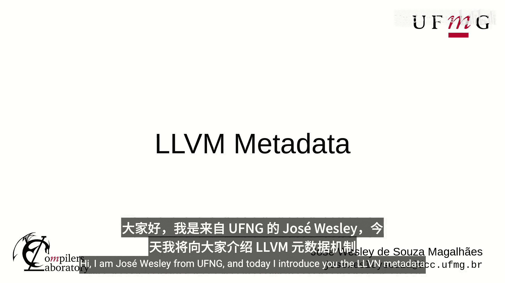

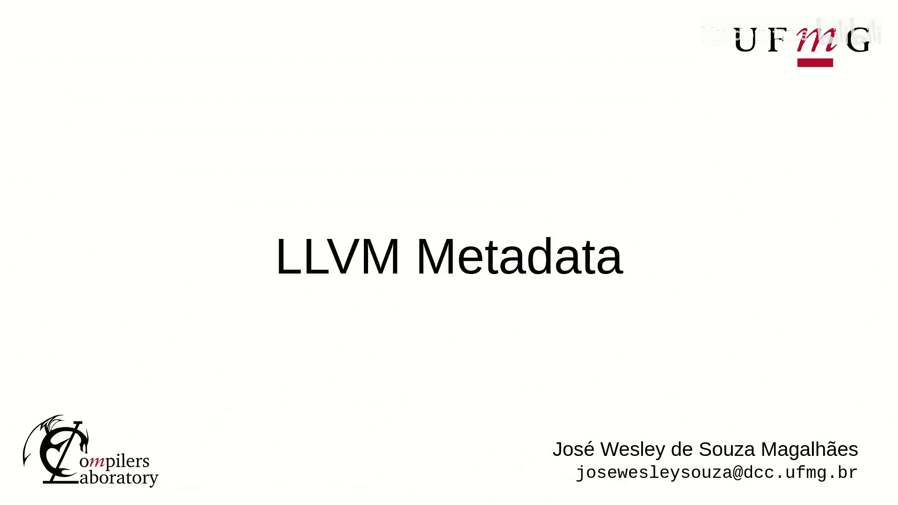

We will see the definition， the format， and some main types of this metadata。

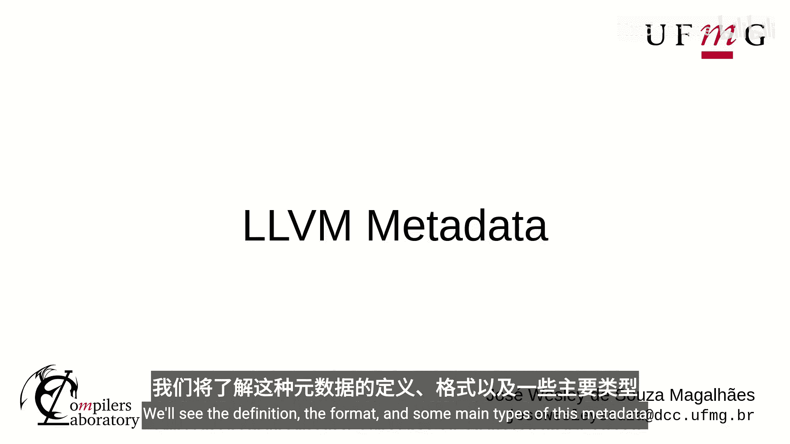

LLVN provides the metadata to store information about a program。

 such information can be consumed by optimizers and co generators。

The main client is the burger information。But it's not the only one metadata can also be used by different program analysis and transformations。

For example， the type ba alias analysis for C and use metadata。

Because it must relies on the type season of the source code language， not in the IR type system。

And why use metadata？With metadata it is possible to store information of the program and keep such information as the program goes through transformations。

It is possible also to developbug programs。And refer to the source code when the source codes it's long gone。

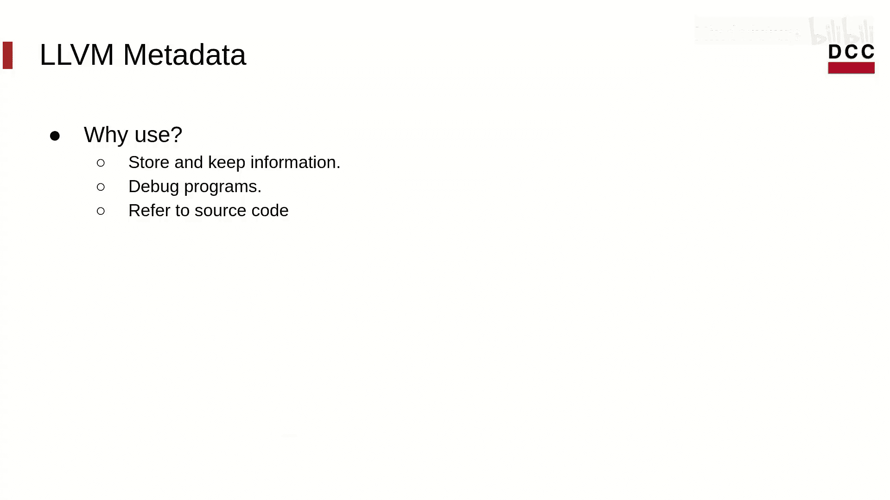

But in this course， we will focus on how to use metadata to developbu programs。

And how we emit metadata。We need to add the G flag when compiling a program。

To emit metadata to thebu purposes。This flag tells the compiler to tag the generation of the IR with source code debug information。

This metadata will be translated to platforms specific thebu information by code Ems。

There are different kinds and levels of the bug information generation in Kk。

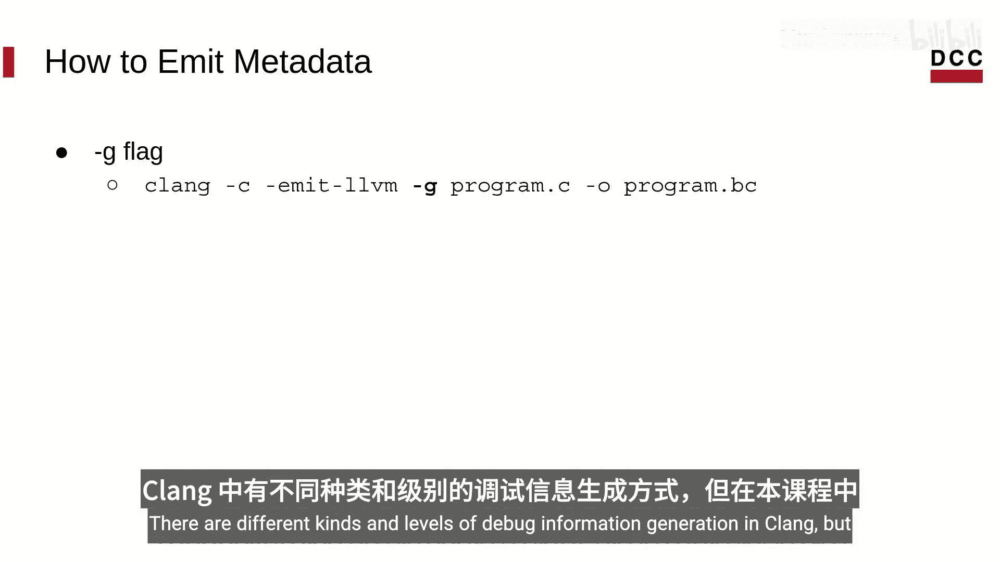

But for this course， just minus G will be enough。It emits full debu information by default full。

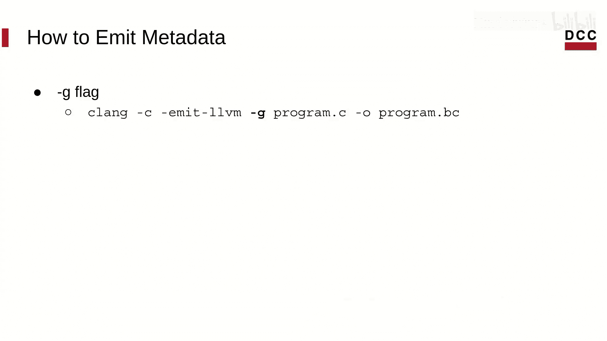

Here we have an example of a function after it has been translated to the LVMIR。And in red font。

 we have the metadata associated with this function。As the ellipses points indicate。

 the metadata appears at the end of the IR file。

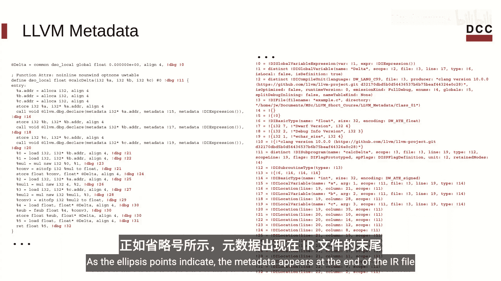

The metadata can be attached to containers of the IR， such as G of variabless。Instructions。

And functions。Meraadata is attached。To the end of the containers。

All metadata starts with an exclamation mark and they have indexes。 For example。

 the metadata attached to the function called delta has index 11。

One can use this index to retrieve a specific metadata。

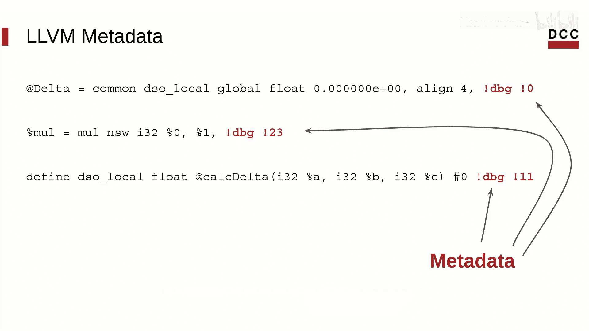

Essentially， there are three types of metadata， the metadata strings， the metadata nodes。

 and the name it metadata。Meedate strings can store lit strings。It can contain any character。

It is always a string surrounded by double coats。For example。

 this metadata string is there to show what is the current version of dwarf。

We have also the metadata nodes。These nodes are like tus of metadata。

 they represent a more accurate description of source code objects。

Notes have opera and we can easily access them。Which allow users to traverse the metadata。

This opera can be metate strings。

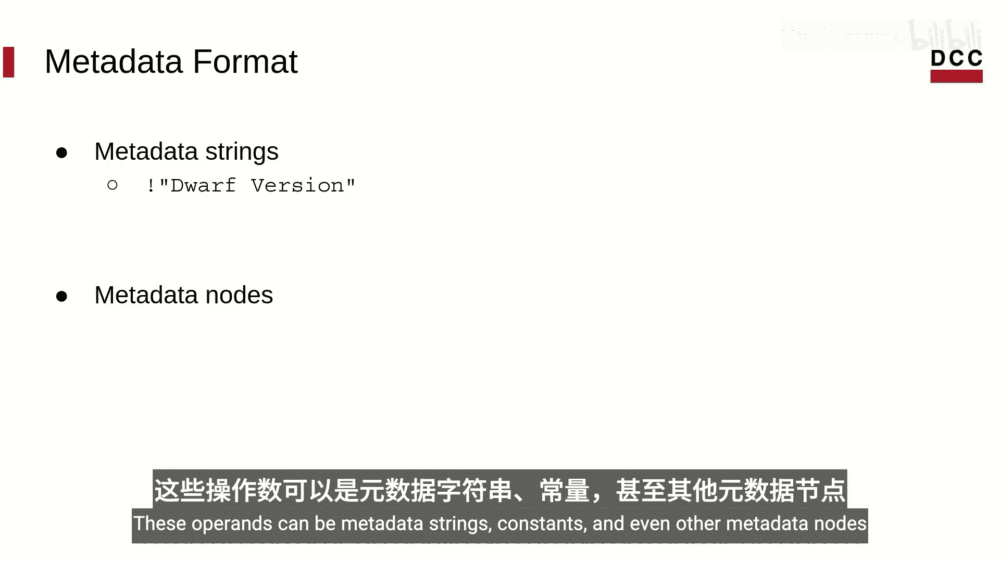

Consts and even other mereadata nodes。

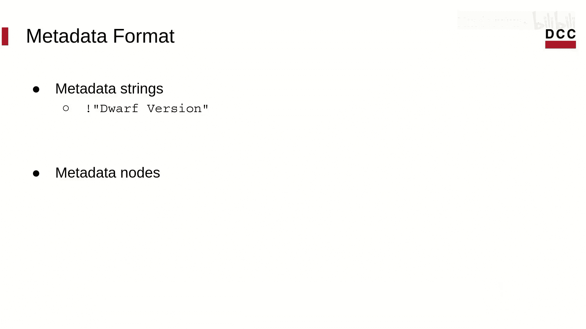

For example， this node describes a local variable called A C。Just by looking at the node。

 we can see that the variable is a parameter and its decoration is in the line 11 of the source code。

But this is not the only information we can get from this node。By itating its opera。

 we can access other metadata nodes。Using Opera34， we can retrieve the scope of the variable。

 which is function Men。

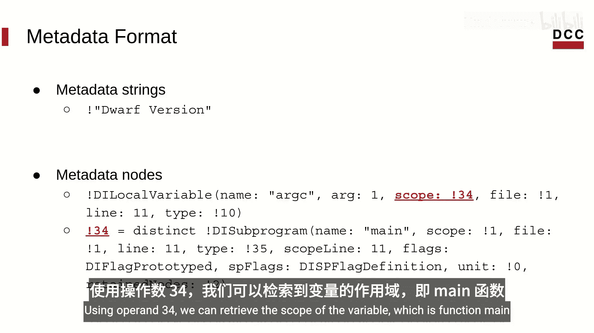

We can also get the source file code。And the type of the variable， as you can see。

 all this information is stored in other metadata nodes。

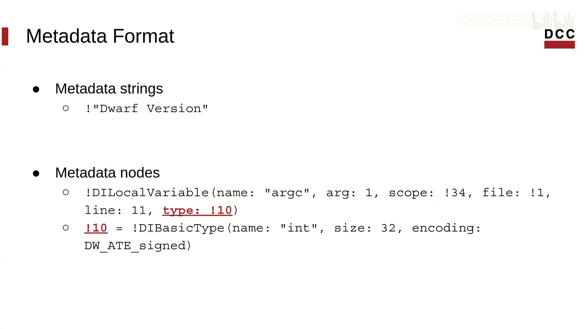

Throughout the course， we shall go into more detail about the main types of metadata nodes。Finally。

 that exists the name it metadata， which is a collection of metadata nodes。

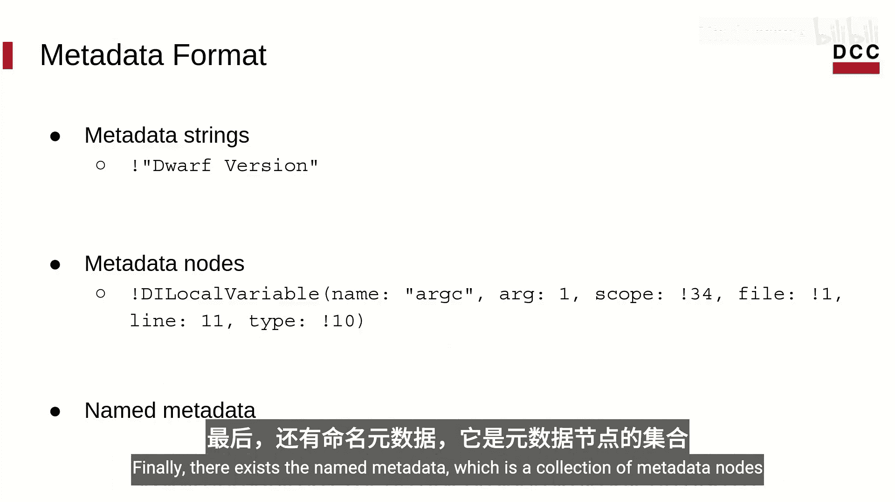

In the example， name is a name it meate。It can be looked up in the module symbol table。

Named metadata are represented as a string with the metadata prefix that is exclamation mark。

It's important to know that metadata is not an LVM value。And metadata doesn't have a type。

But metadata can be used as aation。Sorry， user arguments。To a function call， for example。

 the debug in is of LVM。However， when。Referenced by a function call。

 we are not using metadata where we are using the metadata type。

Let's take a look into some of the main specialized node。

Specialized nodes are straight related to source code objects。

The DI compile unit represents a compile unit using this node one can access information such as the global of variables。

 the macros， and the imports of the program。The DI file node represents the source file。

We have the nodes which describe scopes like lexco blocks， local scopes。

 and subprograms that describe functions。We have the nodes that describe variables like local and global variables。

And we have the node which describe types like the basic type。Like inch。

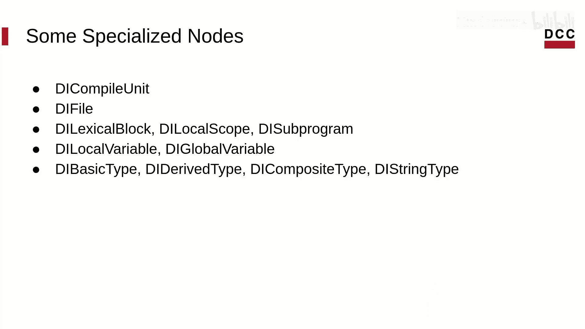

Floating pointers and Bos， derived types like pointers and stroke members。

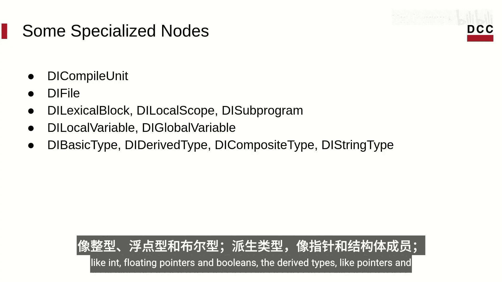

They compose types like arrays， structures and unions。

 and their string types to represent lital strings。

So that was our introduction to the LLVM metadata。 We had learned a bit of what it is in the next class。

 we shall see how to access the metadata and retrieve information from it。

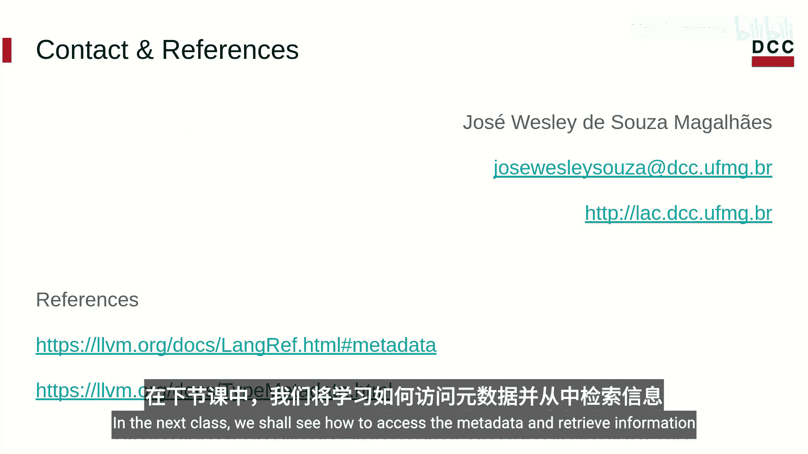

Should there， you feel free to write me with questions and comments。

You can find the reference links below in the description。

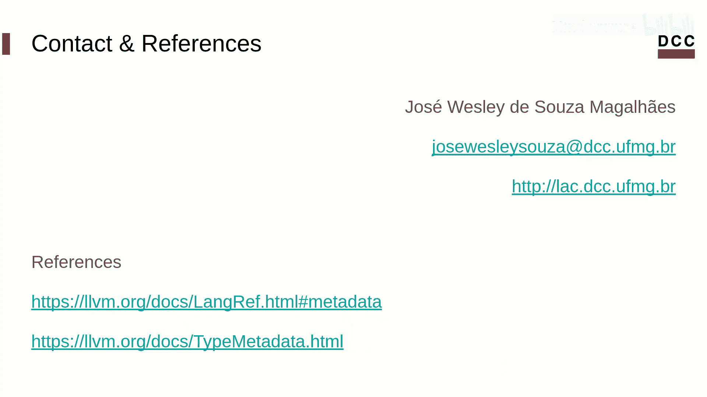