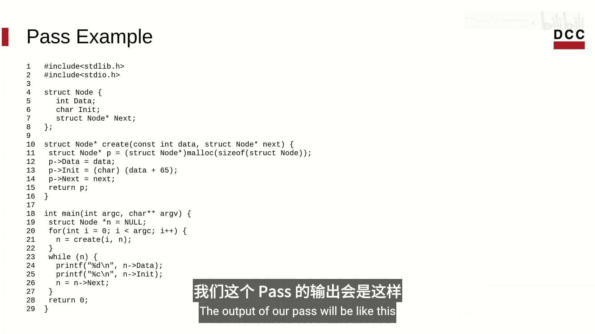
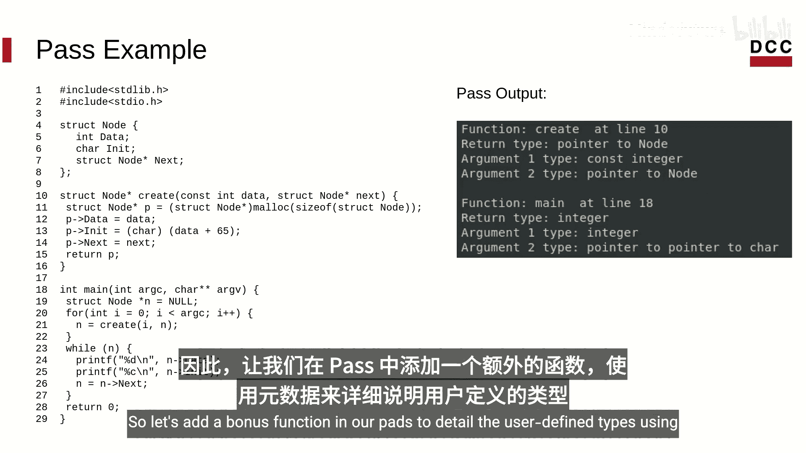
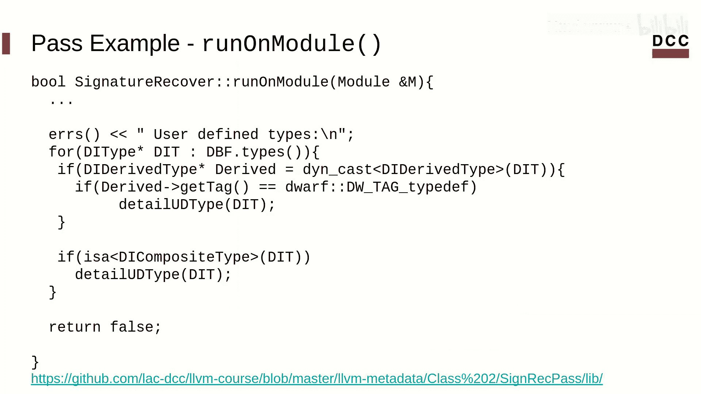
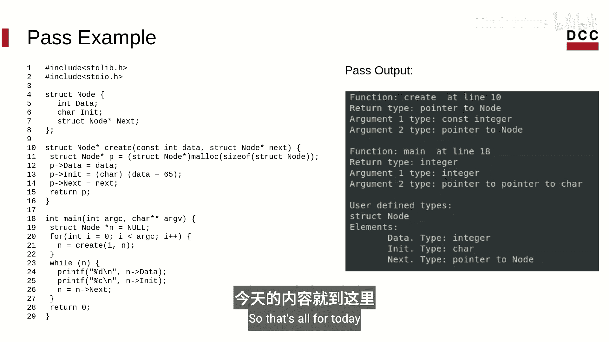
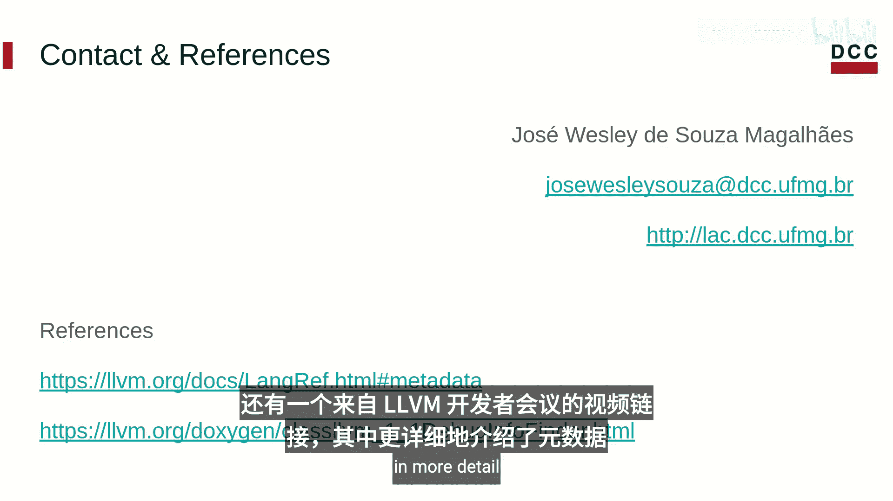

# LLVM入门教程-•-中英-p14-P14-Recovering-Source-Information--BV1HtRUYnEji_p14-

Hi， I am Roselle Wesley from UFMG， and today I'll talk about how to use the Lium metadata to retrieve some information about the source code of a program。

In the last class， we've learned。What metadata is。We've learned why it's useful。

And some of the main types。Now let's get our hands dirty and see how to use metadata in an LVM pass。

Some components of DIR provide methods to get metadata attached to these components。

Let's take a look into an instruction。An instruction provides among others methods to assess metadata by its index or by its name。

For example， this add instruction has the metadata with index 20。

We can access such metadata using the index。20 or using the name， DBG。

Both will give us the same return， which is a source code location。Similarly。

 other components provide such methods。For example， global variables。

Functions also have the method to get its attached subpro。All of these methods return metadata nodes。

As we are focusing on using metadata to debug purposes， let's talk about the debug In Finder class。

It's an LVM utility that finds all the debu information in a module。

The bug info finder keeps iters for。All the compile units。All the soup programs。

All the global variable expressions。All the types and scopes。So once you process an NVM module。

 all those informations can be assessed in your path。Let's now butge。

An LVM pass that will reconstruct the signature of functions using metadata。Our best。

Would be a module pass。If you have any questions about the structure of a PE project in LVM。

 watch our classes about writing an LVM pest。Our project here is called Sign Re。

The title of the slides shows the function in which the code is defined。

Together the debug information of the module， we will use the debugging for Finder。 As I said。

 first of all， we need to process the module。Once the processing is done。

 we can iterate over the So programs and analyze each one individually。

An alternative approach for Get every sub program is by aerrating DIR functions and get each Sub program individually。

Notice that both manners are equivalent。Now let's take some information about the S program we can in a straightforward way get the name。

And the declaration line of the program， we also can get the type of the subpro。

This type is a Suby routine type。Pay attention to the ellipses， they mean that this code continues。

The subroouting type class contains an array with types that compose a signature of a function。

We can iterate this array to assess each type。The first position of the array is the return type of the function。

If the element in the first position is no。That means a function with no return type。

 avoyage function。The other elements are the types of the arguments of the function。In the sequence。

 our P will analyze the type of each arguments plus the return if that's the case。

If the function returns some value。N ity that we are dealing with a debug type， not an IR type。

 as we saw last class。A debug basic type represents primitive types of the language。In this case。

 we define a function to get a string containing the name of the type for printing it。

Such function is based on the dwarf tag to identify each type。I won't show the entire function here。

 but all the basic debug types are treated。You can check the complete implementation in the link in the description。

Back into our previous function， we also need to handle thebug derivative rivet types。

 the rivet types represents qua types such as pointers or reference。In that case。

 we handle three of the most common derivative types。Pointers， cons modifiers and reference。

Then we call the same analyze debug type function recursively， but this time passing the type。

Which is based to the derivative type as an argument。Finally， we handle composite types。

 Comp types represents types。Types that are composedd by other types， like structures or unions。

We deal with those two plus array types。Once again。

 we are basing on the Dwarf tag to identify which composer type this node represents。

Taking this program example， which inserts elements in a linked list and then print them。

The output of our path will be like this。

We can see the reports， a function called Cate at line 10， that returns a type node。

The argument 1 is a constant integer， and the second is a pointer to a variable of type node。

And a function main at line 18 that returns the linkteger。

And the argument 1 has type integer and argument2 has type pointer to pointer to chair。

We can see that there is a user defined type called node in this program。

 but the output doesn't give us more information about this type。

So let's add a bonus function in our pads。To detail the user define types using metadata。

We identify debu types paste it on the Dwarf tag as before。When we find a composite type。

 we can detail each one of its elements， that is the types that composes it。In this case。

 each type is a derivative type that represents a fuge in a composite type。

We can get the name of the field and analyze its type using the function that we already defined it。

We also deal with the type de keyword to redefine types。In our main method。

 we use the debug info Finder to assess every type found in the module。

 and if we find a user defined type， we can now detail it。

Now， the output also brings information about user defined types。Making the output more complete。

So that so for today， we had learned how to use metadata in an LVMP and how to retrieve some information about the source code program。

In the next class， we shall see how to track a variable across optimized code， across optimized IR。

 So there you feel free to write me with questions and comments。You can find the reference and links。

In the description， together with a link to the past implementation that we use in this video。

There is also a link to a video from LLVM's Developers meeting that cover metadata in more detail。

