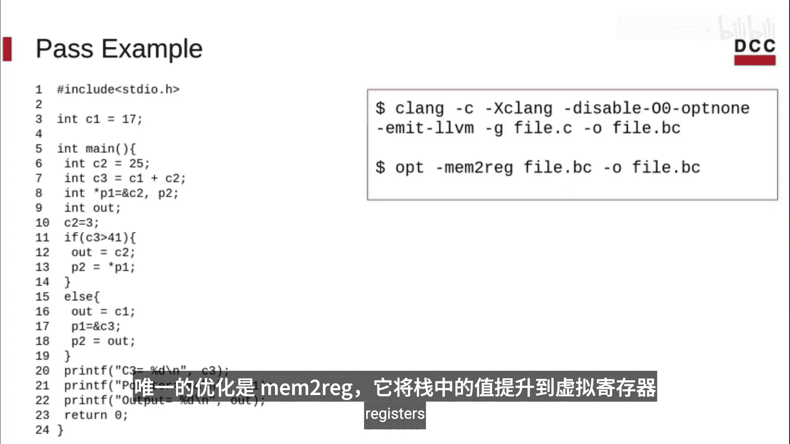
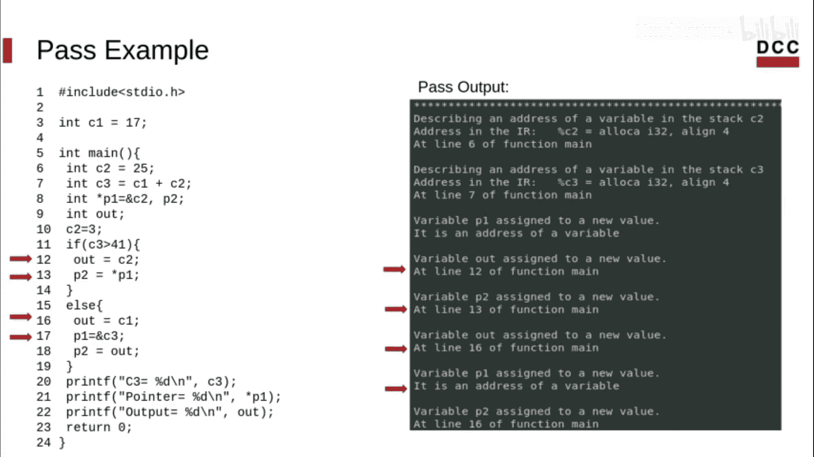
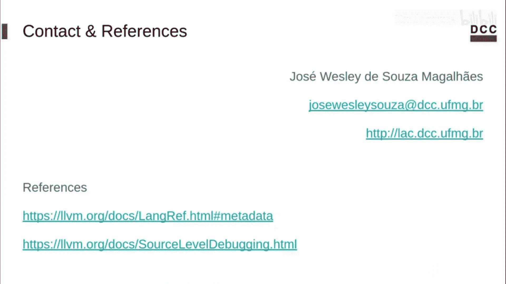

# LLVM入门教程-•-中英-p15-P15-Tracking-Variables-in-LLVM-IR--BV1HtRUYnEji_p15-

Hi， I am Jos Wesley from UFMG， and today I'll show you how to use metadata as thebu information to track variables across the IR programs。

As we saw in previous classes， debu information is the main client of LM metadata。

Metadata is a mechanism of LVM to store some information about a program and keep this information as the program goes through transformations。

LVM provides debu information as an approach to help developers to identify how elements from the ASD map to LVM code。

It keeps information usually stripped away during the compilation process。

The debu information must only serve its purposes。In other words。

It should have little impact in the rest of the compiler。No transformations。

 analysis or cogens should need to be modified because of the bug information。Also。

Thevo information does not need to know anything about the semantics of the source level language since LVM is designed to support different languages。

Bvis。It should work with any language， not putting any restrictions depending on the source code language。

Also， it needs to be compatible with traditional machine code level burgers like GB。

LLVM used so many intrinsic functions to track variables through code optimization and generation。

These intrinsics are prefix with Alvan dot DBG， and they use metadata as arguments。Here。

 we shall focus on2。The LVM debug declare and the LVM debug value。

The LVM debug declare intrinsic described the address of a local variable。

The first argument is the address of the variable itself。The second is a DI local variable。

 and the third one is a DI expression describing how the reference LvN variable relates to the source language variable。

This is an example of the bug declare describing the address of variable C2。

Notice that the debugging intrinsic also has metadata attached。DBG 15， in this case。

It is important to note that there can be only one call to the bug declare per local variable that the bug declare in26 are straight related with the all instructions。

The LvN debug value provides information about。When a user source variable is set to a new value。

The first argument is the new value。That this case is rapid as metadata。

The second argument is that the Iloc variable containing a description of the variable。

And the third argument is also a DI expression。Notice that an LVM debug value describes the value。

There is been assigned to a source variable， not its address。In this example。

 the variable described by metta 31 is being assigned to a new value。Percent 3。

Let's show an example of LVM pass code that handles those interests and prints some information about the assignments of variables。

无忧。We will iterate over every instruction of a function。

 and we build an assignment trace based on debu Inter6。In this function。

 we first get the variable associated with the interest。

 then we need to identify if we are dealing with a debug declare or a debug value interest。

This can be done using the ease address of variable method。

Which is true for the bug declare and false for the bug values。So for the bug declares。

 we can get the address。That did these interesting describes and print it。

We can also get the line in which that variable was declared to do that。

 we can use the metadata attached to debug interest。In this case， this metadata is a debug location。

Then continually， we now handle a debug value interesting。

We don't deal with fine nodes because they don't have a stretch corresponding in the source code。But。

We will check if a variable is a constant value， and we can check if the variable is being assigned to the new value。

In a similar way， we can check if the new value is on the final value or it's an address of a variable。

Finally， if we have an value that is computed by another instruction。

 we can get information about the corresponding source line。In the the source code。

 using the same approach。As previouslyous discussed it。

 getting the metadata text to it and printing the line。Then we finish with our functions。

To illustrate how our analysis work， let's use this program example。

We compiled with the debug flag and the only optimization is meant to Reg that promotes values in the stack of virtual registers。

Notice that the two variables remain on the stack， C 2 and C 3。And we print this information。

 including the declaration line。Pause the video to take a better look at the output。

We can also retrieve the information that tells us that P1 is assigned to an address of a variable since P1 is a pointer。

And that way， we are able to show this information for every assignment in this program。

So that software for today we had learned how to track variables in the LVM Intermedia representation using the bug information and in the next class we shall see how to add your custom metadata to there you feel free to write me with questions and comments and you can find the reference and links to the best implementation in the description。

There is also a link to a video from LVM Develop meeting that talks deeply about debugging in general use in LLVM。

 Thank you for watching。

