# LLVM入门教程-•-中英-p16-P16-TBAA-Metadata--BV1HtRUYnEji_p16-

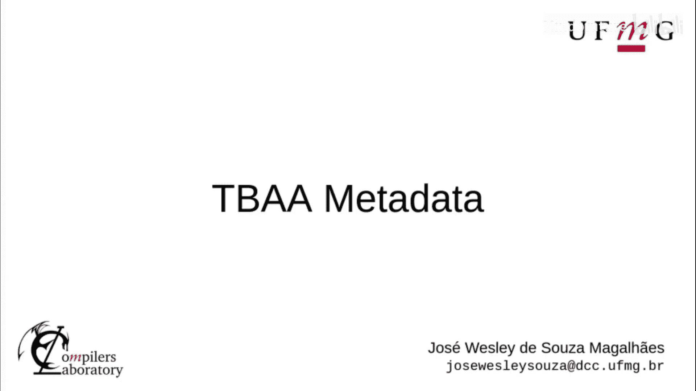

Hi， I am Joselle Wesley from UFMG。And today I talk about the TBBAA metadata。

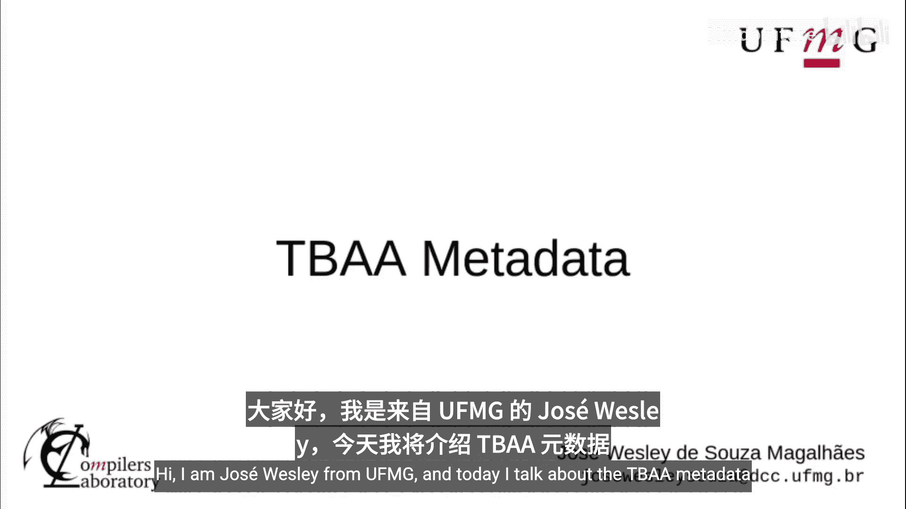

LLVMIR has its own type system， which is different from the type system of the source language of a program。

Besides that， memory doesn't have a type。And this makes the LVM type system not purple for type basic alias analysis。

 which is what TBBAA stands for。Given that， LLVM uses the metadata mechanism to store information regarding the type system of a higher level language。

By using this， one is able to implement the AS routes from C or C++。

 as well as implementingCustom analysis that depend on the program language type system。

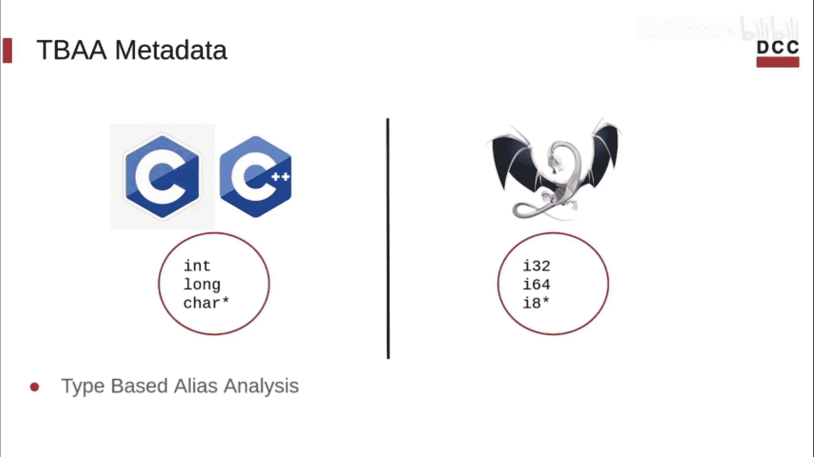

In this class， we shall see the two main parts of the TBBAA system。The semantics。

 which describe the SS flags and type descriptors and the representation。

We should explain how those information are encode code as metadata nodes。

Tap descriptors express the high level language type system。

There are the scholaral descriptors that describe types that do not contain other types。

Each scholar type has a par， which must be also a scholar type in the TBBA system。

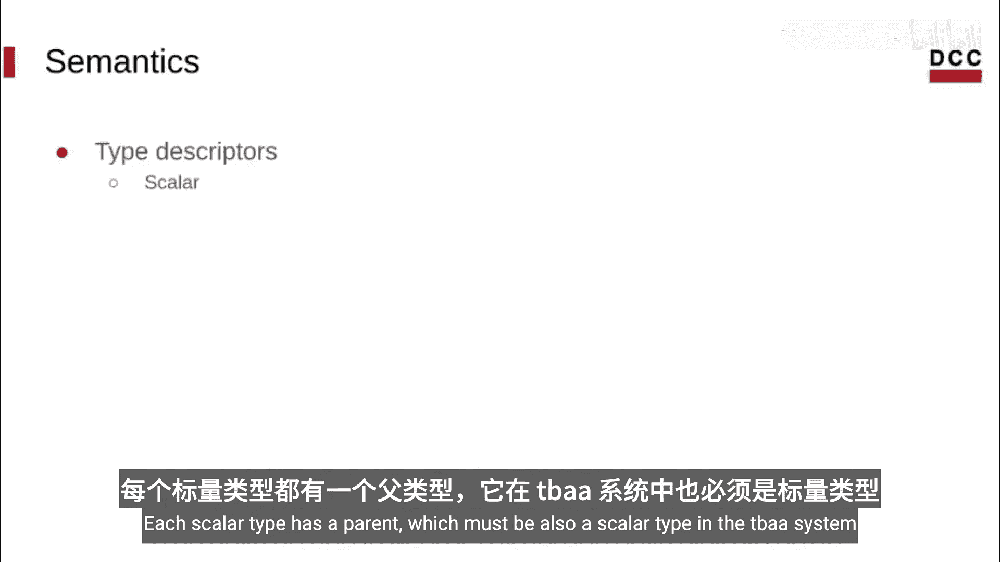

Thepar relation forms a tree in the TBBAA system。Which we call the type descriptor graph。

There are also thestruct descriptors。That denote types that contain a sequence of other type descriptors。

Together if they're offsets。Let's take an example and see how the TBBAA graph looks like。

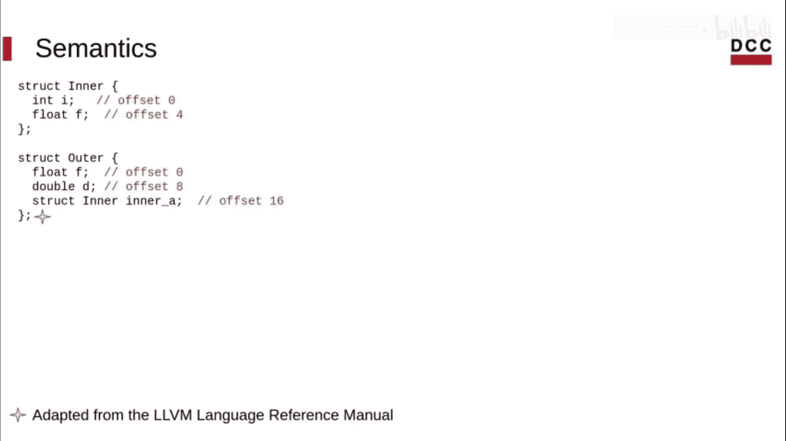

Each nodes。In the TVAA graph is a descriptor for one different type in the source code。

There exists the root node。Some nodes can be under different root nodes。

 but in that case the As relationship between them is unknown， and LVM assumes that they may infer。

All we will discuss here is valid for nodes under the same route。

There is a note for the chair type because in C NC++ cha can be used to access an arbitraryrbit type。

Then we have the node of the types containing in the program。

Notice that every descriptor has an immediate parent。For example。

 the parent of inch is char and the immediate parent of inner structure is inch。

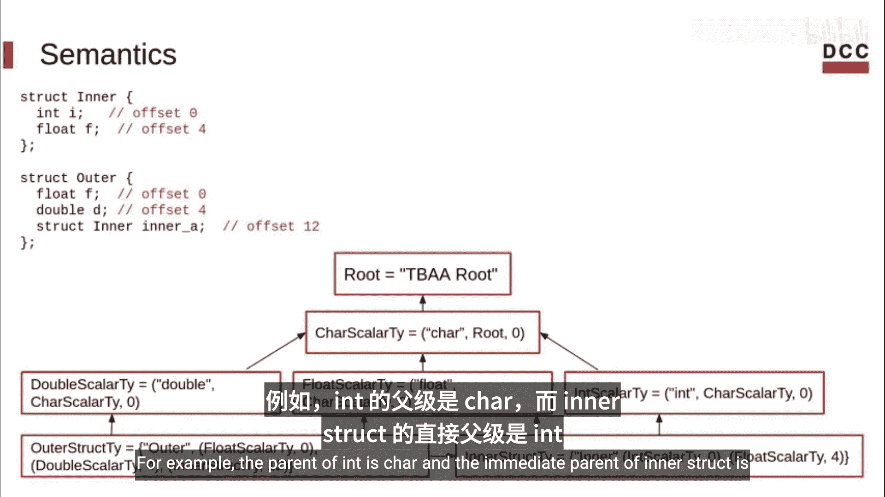

na tag is the metadata attached to load and store instructions。

They describe the location being assessed in terms of the type system of the high level language。

AnA tag is the metadata attached to loads and store instructions。

 they describe the location being assessed in terms of the type system of the high level language。

It consists of a base type， an na type， and an offset。As a stack can describe two things。One。

 if base type is astruct type， the tag describes the memory axis of a value of type X type contained in the stroke of type base type at the offset offset。

And two， if base type is a scholar type， the offset must be0 and the base type and the access type must be the same since you are accessing your un scholar。

Continuing with our example in function F， we can see four different as and its corresponding tags。

For example， the first tag tells us that we are accessing a member of type float within a variable of type outer strict at the offset zero。

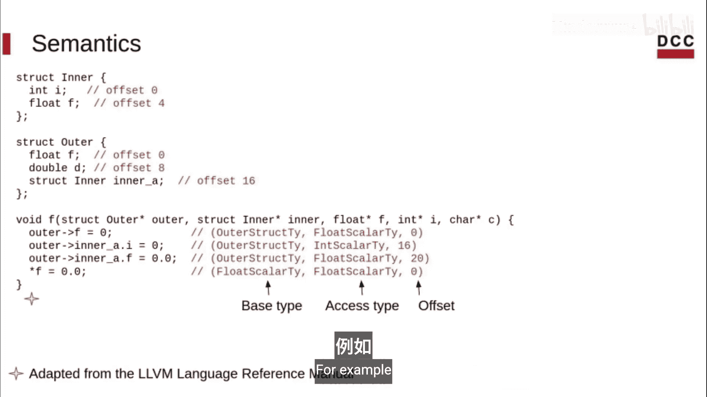

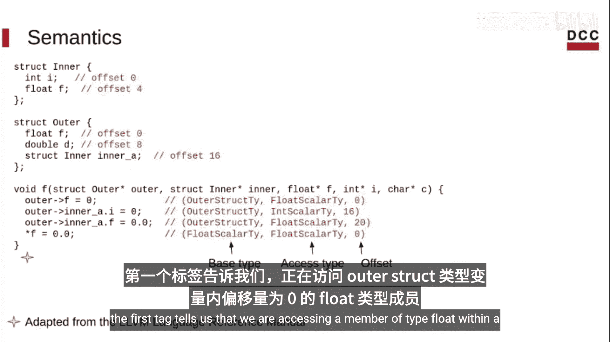

The last axis is to a scholar type， thus the base and axis type are the same and the offset must be0。

As I said earlier， all the TBBA assistant is encoded as Meadaate。Therefore。

 the components we just saw are represented as metadata nodes in the IR。

The TBBAA root node is a node with either zero opera or one single opera。

 which must be a metadata string。Sallar type descriptors are represented as a node with two opera。

The first is metada string， the notes in the name of thestruct type。

 and the second is a node which points to the parent of the descriptor。

Which is either another scholar type or the TBBA root。

Sallar type descriptors can have an optional third argument。

 but it must be the constant integralteger0。Strs type descriptors are nodes with an odd number of opera that is greater than one The first opera is a meta that string the node in the name of the structure type。

After that， thestruct tap descriptors have a sequences of an outturning metadeotege and a constant in representing the member and the offset being assessed。

Finally， the assets tags are represented as nodes with either three or four opera。

 the first opera is a node pointing to the representing base type。

 the second is a node pointing to the representing assets type。

The third opera is a constant inch that states the offsetet of that axis。If a4 field is present。

 it must be a constant in value at 0 or 1。If it's one。

 then the assets tag state that the location being assessed is constant according to the concept of constant memory for Alias analysis。

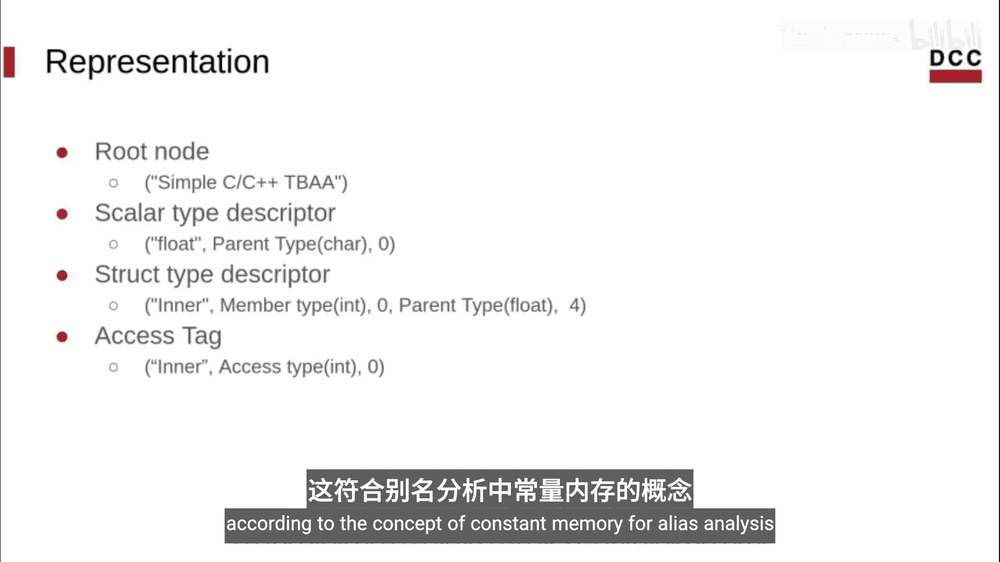

We can access the TBBAA metadata in the IR through the Access flag。As said before。

 access tags are attached to load and store instructions。

The following code gives us access to the metadata nodes and its component。

We get it using the name TBAA。

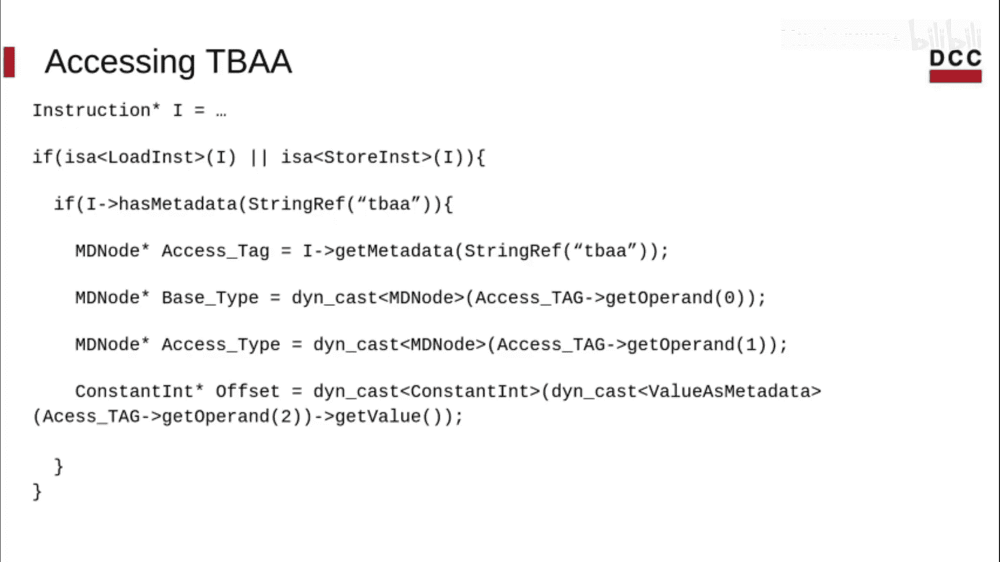

Then we can iterate over the whole TBBAA3 by itating the opera of the metadata nodes as we see in previous classes。

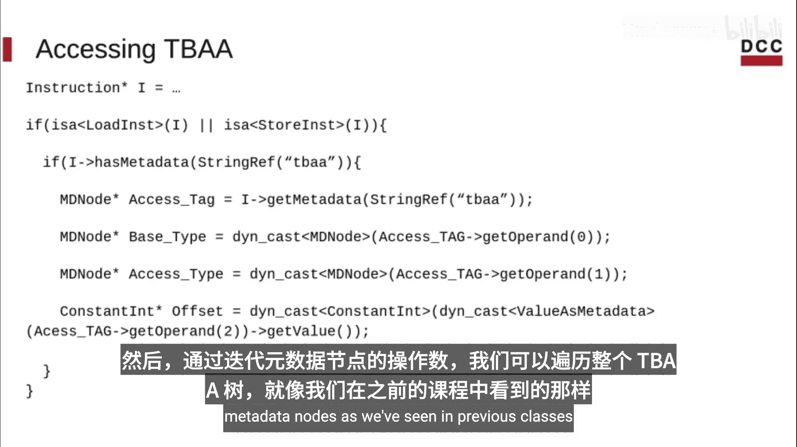

Back to our example， let's see how the TBBA metadata looks like in the IR。

In order to tellCLk to generate TVA metadata， we must enable optimizations。

 so we shall comply it with minus01。

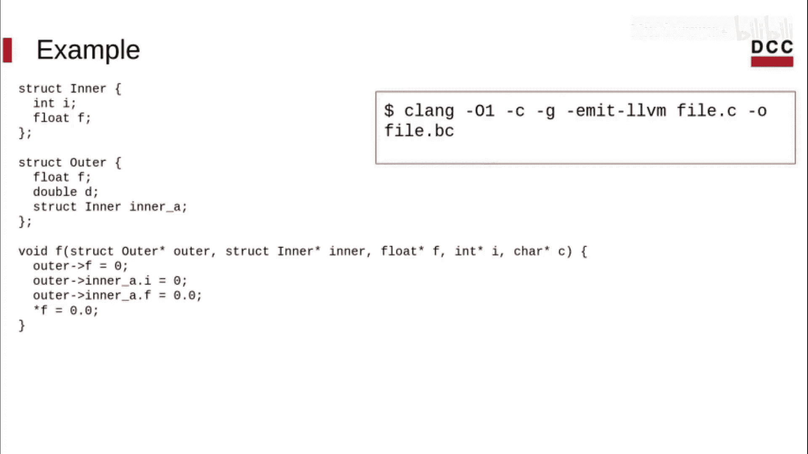

We shall omit some of the IR here and focus on the parts that is relevant for our purposes。

As you can see， every assignment in function F has a corresponding store in the IR。

And all the store instructions have TBBAA metadata detected。

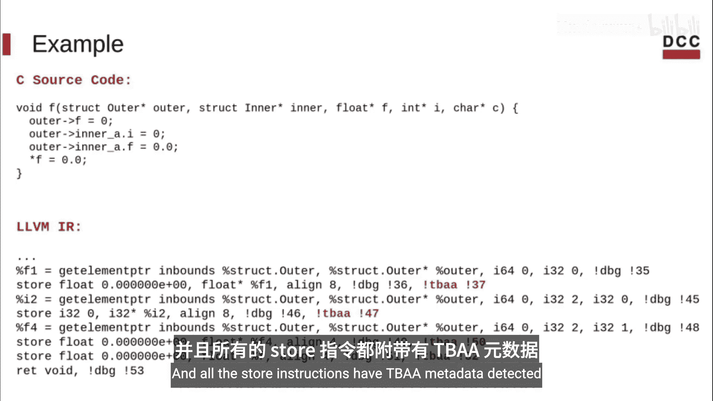

And here we can see all the TBA metada in this module forming the graph that we saw。For example。

 for this store structure。Note 47 says that this is an assignment。

Not 38 describes the type of the variable and not 44 describes the type of the strict fe being assigned。

From node 38， we know that the type outer is composed by a float at offset 0。

 a double by node 42 at offset 8 and a structure inner by node 43 at offset 16。

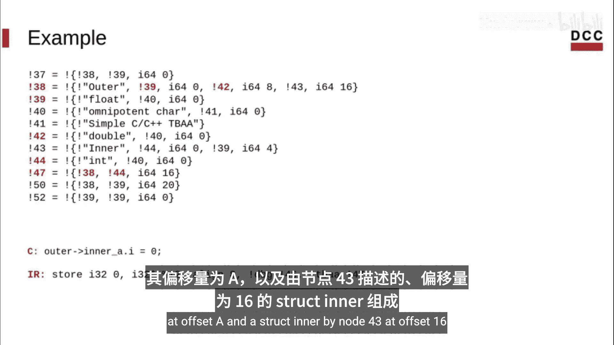

So that was today's class， we saw what TBBAA metadata is， how is compounded and how to get in the IR。

You feel free to write me with questions and comments。

 you can find the reference and links below in the description。

There is also a link to a video from the LLVM Developers Conference if you want to know more about TBBAA in general in LVM。

Thanks for watching。

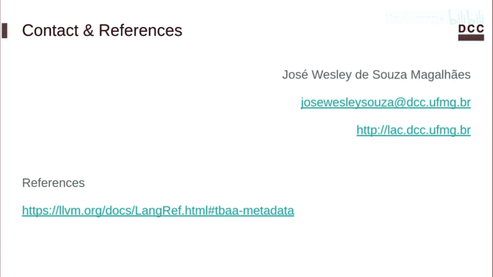