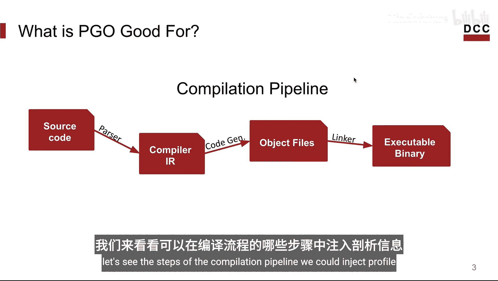
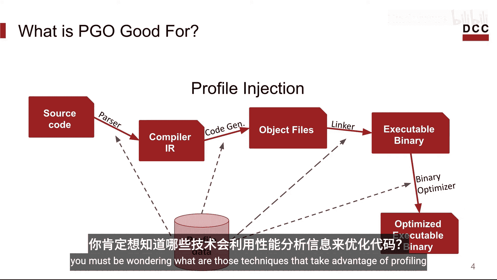
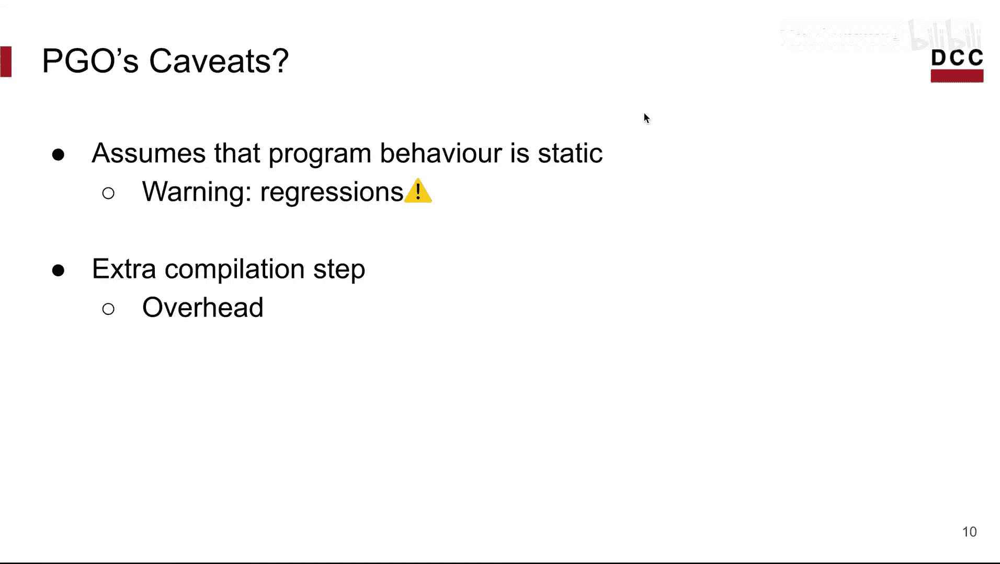
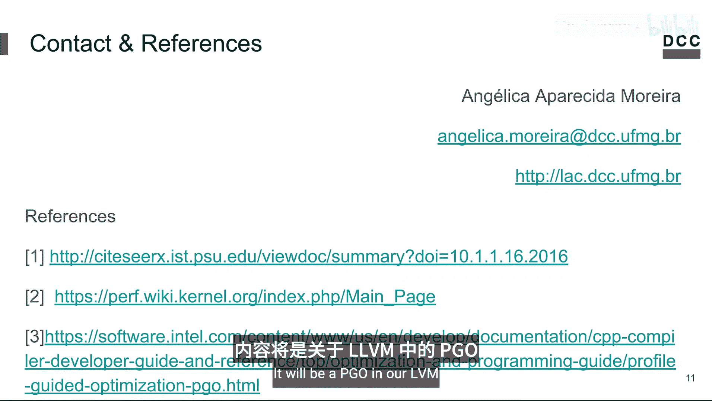

# LLVM入门教程-•-中英-p17-P17-Profile-Guided-Optimization---Part-1--BV1HtRUYnEji_p17-

Hi guys， my name is Angelicamarra and I'm a graduate student researcher at the Comps laboratory and in today's class you're going to learn some basic concepts of profile guided optimization so let's dive into it shall we。

Profile guided optimization is also known by its aronomy PGO。

And PGO is a compiler optimization technique that collects the program behavior in order to use this collected information as feedback for the compiler。

Thus， the compiler can make better choices about how to optimize。

The idea behind PG is to run an application while profiling it to collect a sample of the behavior of that application。

 then come back and recompile it with the profiler as a feedback so the compiler can make better choices about how to optimize the program。

Guys， keep in mind that PG is also known by other names like。FD， feedback driven optimization。

PBO profile basic optimization and many others， but the names I'm sharing you with you are the most common names。

So guys， before I give you examples of optimizations techniques that could take advantage of graph information。

 I want to remind of the compilation pipeline。So the compilation process of a typical compiler works as follows。

 we start with the source code of the program and then the parser also called as the compiler's front end parses the input source code and eventually transforms it into an intermediate representation and this intermediate representation is understood by the other phases of the compiler。

And then the compiler optimize this code and output all project files in binary form。And finally。

 the linker links these object files together with external libraries and outputs and executable binary。

啊。Now that you know the compilation pipeline， let's see the steps of the compilation pipeline we could inject profile well we could inject profile in the parcel step in the cogen in the linker and also after we have the executable binary。

 but in this case we would not use the compiler， but we would use a binary Op tool。

Toge with the profile， and then we would guide a bunch of optimizations and then we would have an optimized executed binary。

But at this point， you must be wondering what are those techniques that takes advantage of profile information to optimize the code。

Well， the most known is basic block placement， also known as basic block layout。

 where the co generator can lay out the basic block priorizing the ones more frequently executed。

This improves restriction cash behavior and also diminish the overhead from branches。😊。

We also have the inlining also known as functioning lining。

 where the inliner can priorize functions which are colored more often。

We have the identification of hot code also known as hot and code code Partitioning where the compiler can separate the address space between the hot code。

 the par code which runs more often and the code code this can reduce the size of the working set and reduce the page faults we also have the sp placement technique where the register locator can place a spills in sporically executed code and many more this and other optimizations can provide significant performance benefit like increase of speed up and decrease of memory footprint。

But what is in the profile well it could have a lot of things and the one that most people start to collect is information about the control flow。

 this information in general is execution counts， however it could also be things like branch mis predictionctionions。

 branch misses and anymore more。One can also collect profile information associated to different program structures。

 for example， we can collect execution counts for a specific basic block or only an I from into that base block。

And to do this， we could take advantage of the controlflow graph edges。

We could also collect information about an entire function。

And its execution count and also take advantage of the call graph and collect information about call graph edges and the depends between functions。

But keep in mind that the information collected will depend only on what is the end goal of the optimization being performed。

There are basically two main types of profile information the most used is dynamic profiling where we collect profile information during the program's execution techniques in this category include instrumentation where we inject additional code into the program to keep tracking of information to trace the program's behavior and sampling usually perform with tools such as the Linux kernelop。

We' collect information from other counters by sampling a subset of programs instructions。

And the other type is the aesthetic profiling which collects information about the province during the compilation pipeline in attempt to predict its runtime behavior based on its structural features in this category there are also two main techniques。

 the heuristic basic ones， which uses rules to perform predictions， simple rules。

And the machine learning based at onces， which use more advanced search techniques based on learning from previously acquired knowledge However。

 there is always a cat right and in this case is no different PG is based on the assumption that you can predict the behavior of a program while in some cases。

That might be true。 It's not true for every program here for their instance。

 where it may be great performances that。For example。

 if the program's behavior is very input sensitive。

 optimizing for one set of inputs may make the application slower when running for another set of inputs。

 thus when using PGO one must be very careful to think about training the optimizations by collecting profiles that are representative of all the different execution paths that your program typically takes Another cat。

 although usually less significant is that depending on how you apply PGO。

 it may involve additional steps in one's building process and these additional steps might affect deployment cycles significantly and sometimes may add overhead。

Thank you guys for sticking with me I hope you have enjoyed this class and any doubt you can send me an mail and I hope you will watch the second part of this class it will be PGO in our LVM。

😊。

See you there， Bye bye。