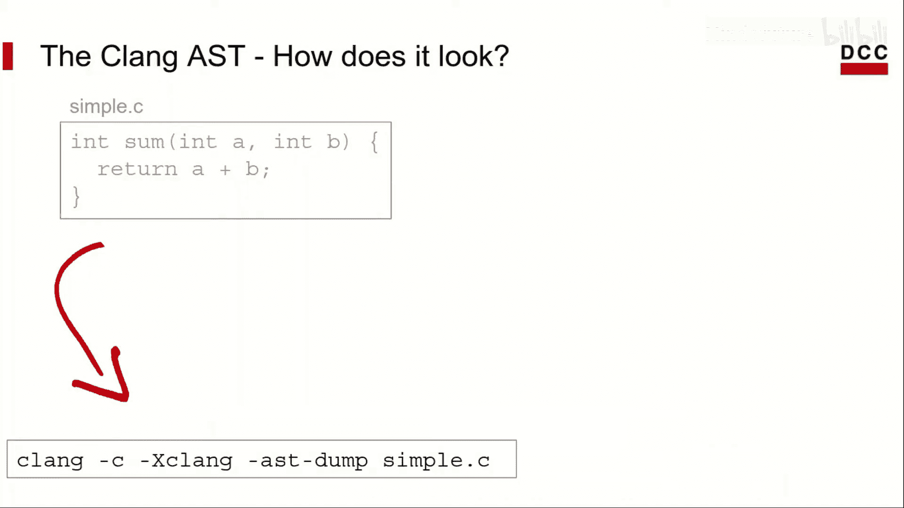
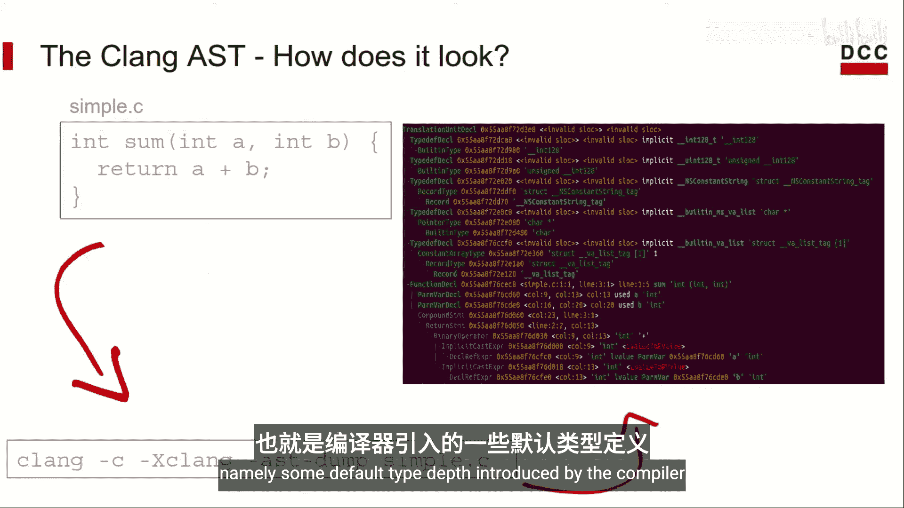
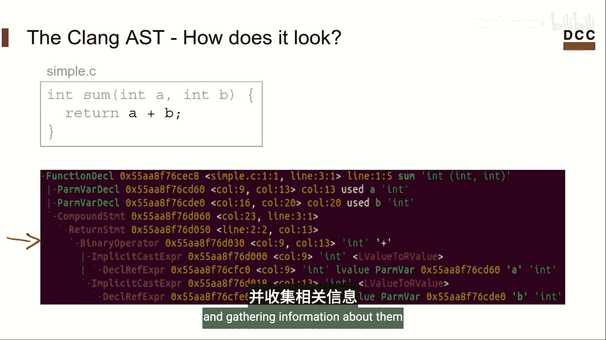
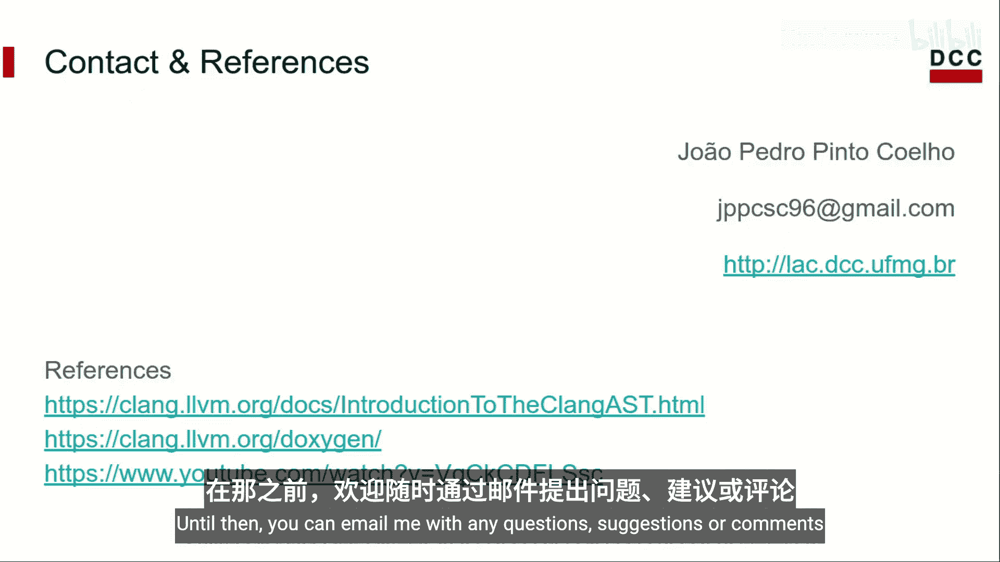

# LLVM入门教程-•-中英-p18-P18-Introduction-to-Clang--BV1HtRUYnEji_p18-

Hi， Im Ron Quau， I'm a student at UFMG and I am currently developing a project at the Compr's lab using the Cla Library。

😊，In this course， I'll show you how to use this library to build our own tools。

 more specifically click plugins。Today， I will introduce the Lang AST。

 I will assume you have already built LLVM and Kang as this will be covered in other videos from the series。

 but feel free to write me if you're having trouble with the setup。As you probably already know。

 Kang is the sea language front end of the LLVM infrastructure。

 Its main goal is to generate LLVMIR code from C source code。So what is the clean AST。

A SD stands for abstract syntax tree。 It is a data structure used to represent the source code in a tree format。

 In general， it is much easier from the point of view of a compiler to understand and work with the program as a tree than as raw text。

 And the good news is that clang through its libraries makes the structures available to us。😊。

So what does this ASST look like， Let's take a look at an expression。

Suppose we want to represent this expression as a tree。 What is the first thing we must compute。

Thiss multiplication on the right。 So let's start by building a tree for this part alone。

We might build the tree for it like this。We have the operation we want to perform on top in our case multiplication。

And from the operation， we have two branches representing the operators，1 and 4。

This whole thing evaluates4。Now， let's bring in the sum on the left of the expression。Here it is。

 again， the operation sum is on the top node and the operators branch off of it。 In this case。

 the operators are the two on the left and the result of our multiplication on the right。😊。

And the answer as expected， is 42。Let's now take a look at this very simple function written in C。

 it simply returns a sum of two vintagegers and it' saved in a file called simple dot C。

We can use the convention shown here to generate a textual representation of the AST for our function。

This is the output。 noticeice， however， that there is some noise around what actually represents our sum function。

 namely some default type death introduced by the compiler。 Let's focus on the actual function。

This is what actually represents our function in the AST。

The root of our function is a note called function be。

 This is how claim represents a function declaration。

 and it holds information such as the name of the function， its return tied。

 the types of its parameters， and even where it is in the actual text。😊。

Notice also that everything that makes up this function is kept as a child of the function that go load。

😊，Its peri can be found as those palm varnale notess at the top。In right below them。

 there is a compound statement。These represent groups of statements。 In general。

 you can think of them as the statements that go within the curly braces and conditional statements。

 loops and functions。In our case， it represents the body of our function。

 which only contains a return statement。Go in a bit deeper。

 there is a binary operator node that represents the expression A plus B。If you'd like。

 you can have a closer look at the rest of the tree and try to get a few for it is in the cold。

It's important that we familiarize ourselves with this format because as we'll see。

 when we write our plugins， we will be traversing the notes of an ASD and gathering information about them。

Now that we've seen what the AST looks like， let's discuss how it is organized。First of all。

 claim does not implement a single base class。What this means is。

 we cannot have a single method that is able to traverse any type of node in our tree。Instead。

 there were three core classes。They are deco， which represents declarations in our code。

 We've seen a couple of these already in our example， function deco and Par of our deco。There are。

 of course， many other kinds of declarations in sea。

 such as variable declarations or stroke declarations。

 and there are corresponding echo classes for each of them。😊，Next， we come to statements。

As you might have guessed， these represent statements in our code。We've already seen， for instance。

 the compound statement from the sound function。This one was quite obvious of。

 this is many art because it has a six SMT。However， we've seen me less half of his example as well。

The binary operator note， you might expect this node to inherit from an expression class。

 and it does。 However， expressions inherit from statements。

 So the core class this note inherits from is actually a statement。😊，Finally， there are types。

 we didn't explicitly see any nodes in our example， which represent a type object。However。

 type information did appear。We've seen， for instance。

 that the parameters of our function had a type in。Using the cl libraries。

 we will be able to extract a type object from notes such as these。

These are some examples of type classes used to represent integers and pointers。

 pretty straightforward。😊，These are just a few examples of classes that belong to each core class。

 but as you might imagine， there are many more。I encourage you to write a couple of C programs itself and have a look at the ESD claim bills for them。

This will help you to familiarize with some of the vast library that composes claim。Today。

 we had our first look at the claim as a library。The main reference used for this video was the official claim documentation。

 When you're exploring the E ST and find something new。

 that's where you can go to obtain more information about。😊，In the next video。

 I'll talk about the interfaces we can use to build our tools。Until then。

 you can email me with any questions， suggestions or comments。

Thank you。😊。