# LLVM入门教程-•-中英-p20-P20-Clang-Plugins-Boilerplate--BV1HtRUYnEji_p20-

Hi， I'm Ron Qua， I'm anothergra student at UFMG and Im currently developing a project at the Comprss lab using the Kang Library。

😊，In the previous video， I showed some of the interfaces we can use to build tools with clang as a library。

😊，Today， I will show you how to build a minimal claim plugin。

 explain what is the boilt plate you need to set up to be able to build your tool over it。

So what are the things you need to implement to get a claim plugin up and run it？Well。

 as we've seen in the previous video， claim plugins runfed actions over code。

Fronted actionss are interfaces that allow us to write the code that we want and have claim executed as part of the compilation process。

😊，It's our entry point when writing claim tools with lip tool and enclaimed plugins。For plugins。

 there is a more specific interface which inherits from front end action called plugin AST action。

 which is the one we'll cover。Plangging ASC action is a specific kind of front in action。

We will write our action class inheriting from plug ASC action。When we run our plugin。

 C will process the code and generate an EST object。

 it will then pass this EST object to our action class。

 and this is where the plugin we write begins its execution。As we are write in an ASD action。

 we need to provide it with an AST consumer。

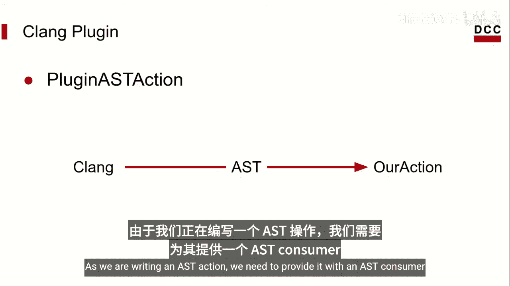

As we'll see， the consumer gives us some ways to access the ASSD object。

There is one code handle top level dec code。This one allows us to access the entries in the ASC for top level declarations。

 that is any declaration that is in the outermost scope in the program file。

This method will be called when the compiler processes each top level declaration。

There are also other interfaces such as Handlo Translation Unit。

 which gives us access to the entity in the ASST， which represents an entire C program file。

This is called after the compiler is done't process in the ASC for the whole file。

 this is the one we'll use for our example today。There is also a pattern of visiting the nodes in AST。

 which we accomplish by implementing AST visitors。Finally， all thats left will be to register a。

This will allow us to load our plugin from a shared library at runtime with Kang。😊。

So let's start with the implementation。The Pum will build today is very simple。

 We want to be able to print the AST for every function declaration in a program。😊。

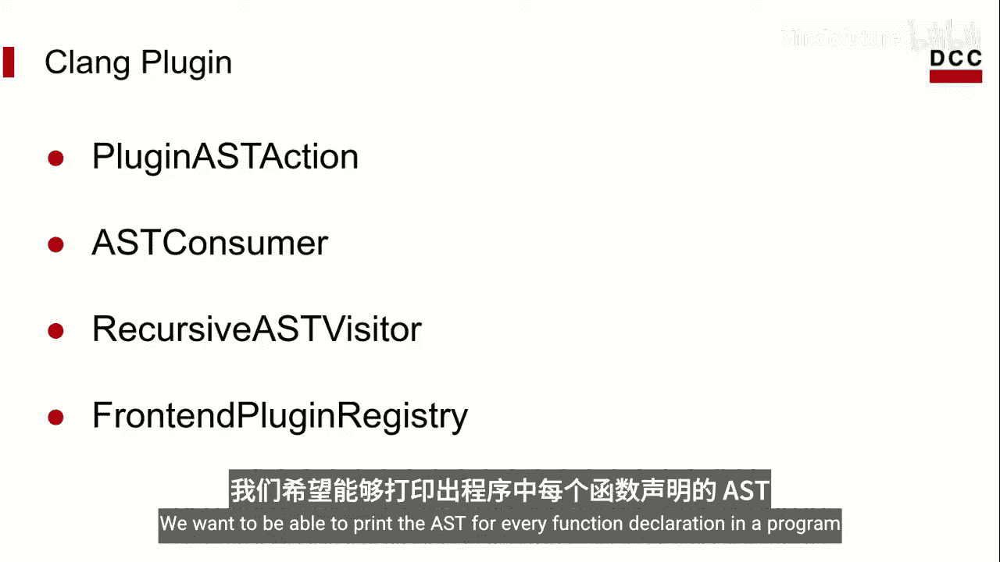

First， we'll look into the plugin AS action。Our plugingon will be called hello。

 so our action class will be called hellello action。Its main purpose is to implement this method。

 create ASC consumer， which returns an instance of a low consumer， which we'll implement in a minute。

But before that， we need to talk about parse parks。This is， according to the official claim doc。

 the main difference between plugging AT action and ir regular front indexs。

 the ability to handle command line arguments。We won't use this for our example。

 but when you need to incorporate command line options into your tool， you will likely be using this。

Even though we're not parsseing any arguments， parse Arrgs is a pure virtual method inherited by hello action。

 so we need to define it here， otherwise we won't be able to compile our plugin。

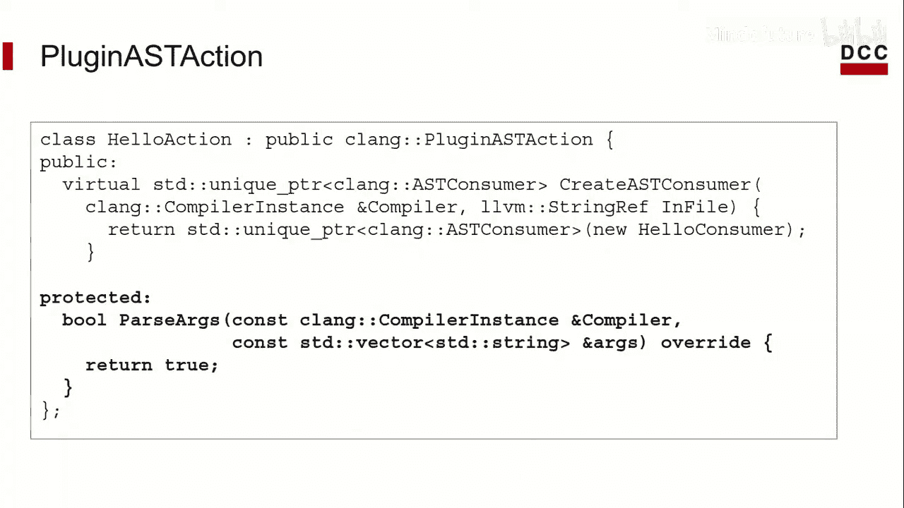

If you decide to use command line arguments， you can find them in this parameter here， As。

 so keep that in mind。Next， we need to implement this Ho consumer here， so let's do it。

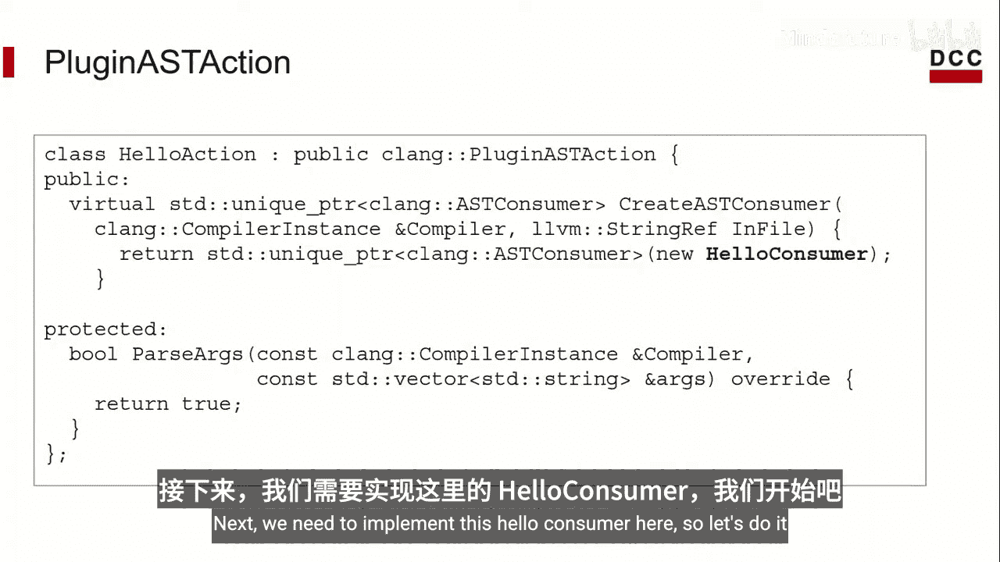

Again， our plugin is called Hello。 So let's name the consumer Ho consumer。

It has an instance of hello visitor defined within it。 Don't worry。

 we'll get Hello visitor in due time。 Itll be the star of this episode， but so far。

 re laying the basis upon which it will work its magic。😊。

This handle translation unit is how we get access to the AsT。

 If you remember from earlier in the video， I said Hand translation unit is called when the compiler is done processing the whole program file。

 given it this AT context object。😊。

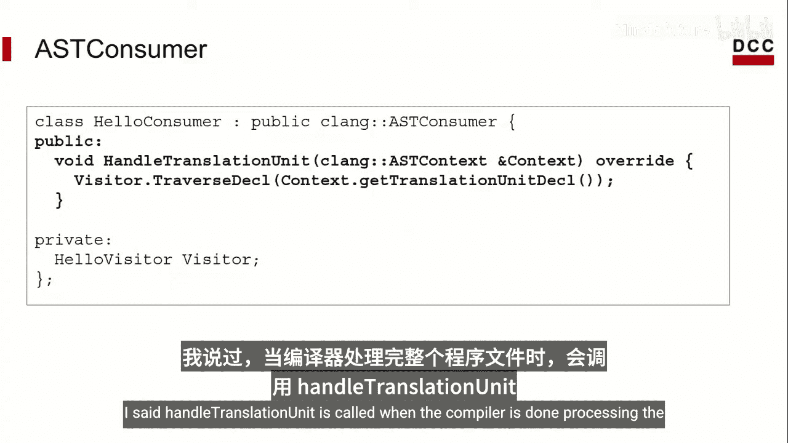

It contains the information gathered in the ASD of our program。

We then give it to our visitor object so that we can well visit the AST。Finally。

 let's implement our visitor。

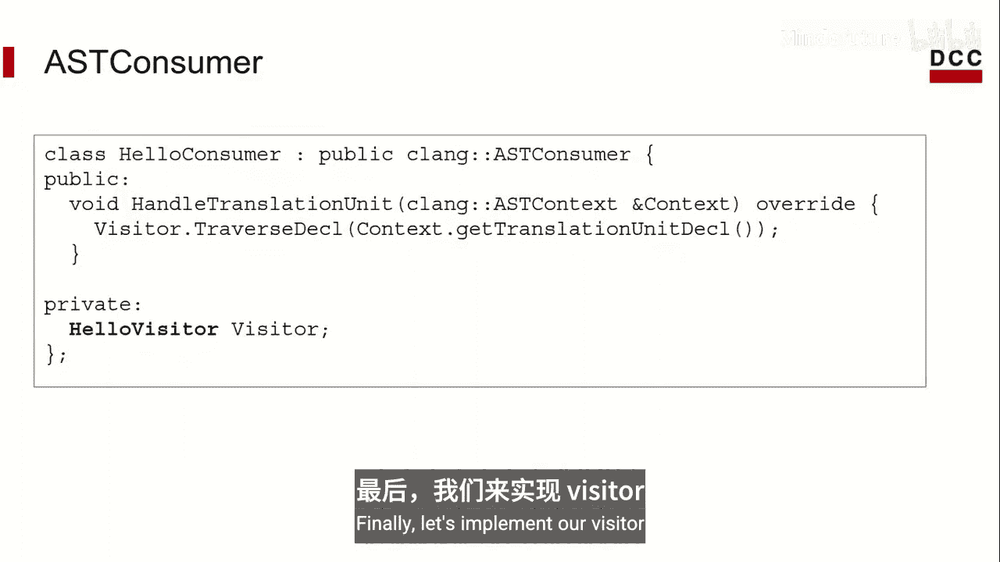

A quick side note， the visitor class we're about to implement follows the visitor pattern。

 You can read more about it in this book， design Paterns by the gain of four。

 It is one of the behavioral patterns they describe。

 It is useful when you have a structure of objects upon which you want to be able to perform various actions。

😊，This is exactly what we want。 We have the ET， and we want to do many things using its node。

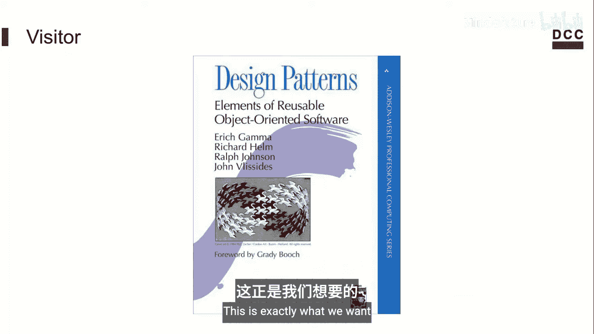

One way we can use this class is by implementing the visit methods it exposes to us。

 so let's take a look at a few of these。😊，We could， for instance。

 define the visit function echo function。On the AST claim built。

 there are many nodes which represent functions。For each of these。

 the method this function dec will be called and we'll be able to use this node however we want。

 Notice that the method receives a function declaration under there。😊。

This is the AT node that was referring to。We proceed to call this dumbt function。

All this does is print the ASC representation of our object。

We'll see it in action at the end of the video。We get it the same for parameter declarations that is the parameters of our functions。

There is even a visitor for Decations。 This one will visit every declaration in your program。😊。

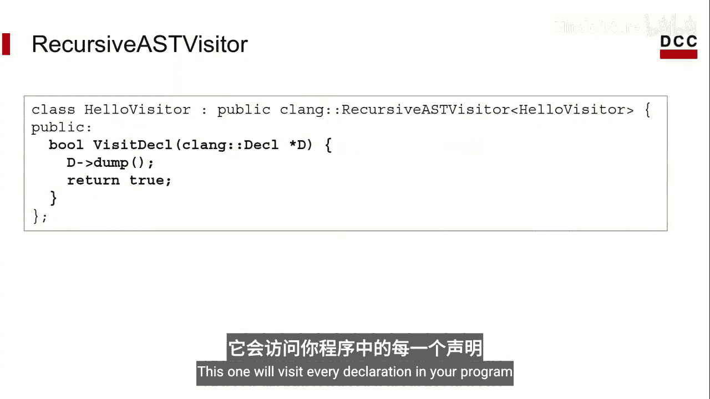

After writing the visit， all that's left is to register to in the blogging。

Here we add our action class Hello A to the registry。Then we name it hello。

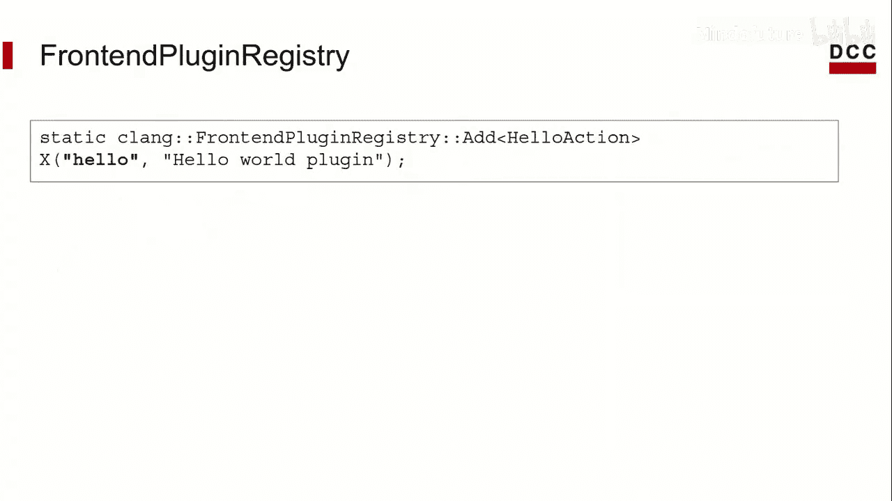

This is the name we use when we need to tell claim which plugin we want it to run for us。

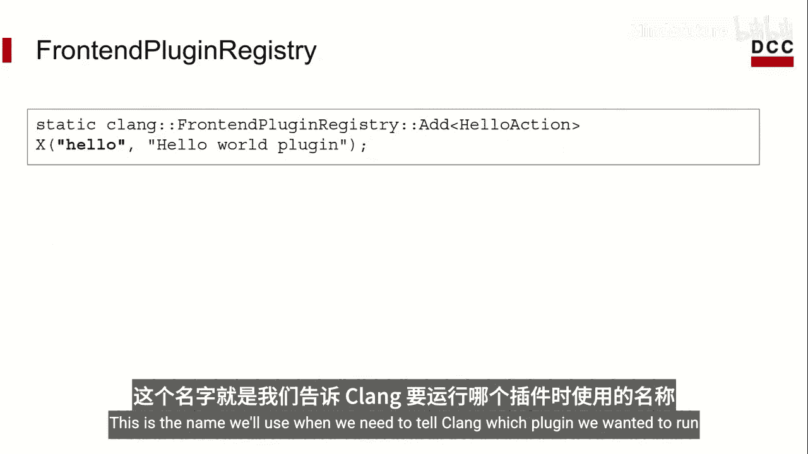

And we gave it a brief description。This is all we need to run a basic link plugin。

You will then compile this into a shared library such as libhello。s O。

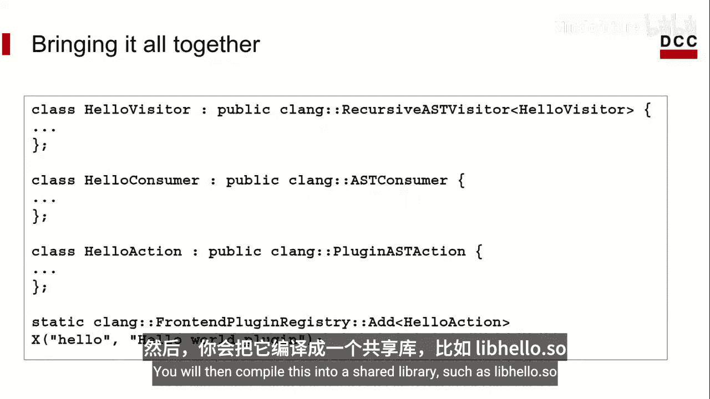

We would then run this invocation to similar plugin。Here。

 we'load all the plugins in our Lib Hello library and passing them to K's CC1 process。😊。

The C1 flag indicates that we only want to run the front end of the compiler。Here。

 we're telling it we want to run the plugin with've named Ho。

And we want to run it over this example that C program。As always。

 let's take a sample program to see how this would work。

The example that C file has just one function， sum of type n。

If we have implemented the visit function dec method， we will get this output。😊。

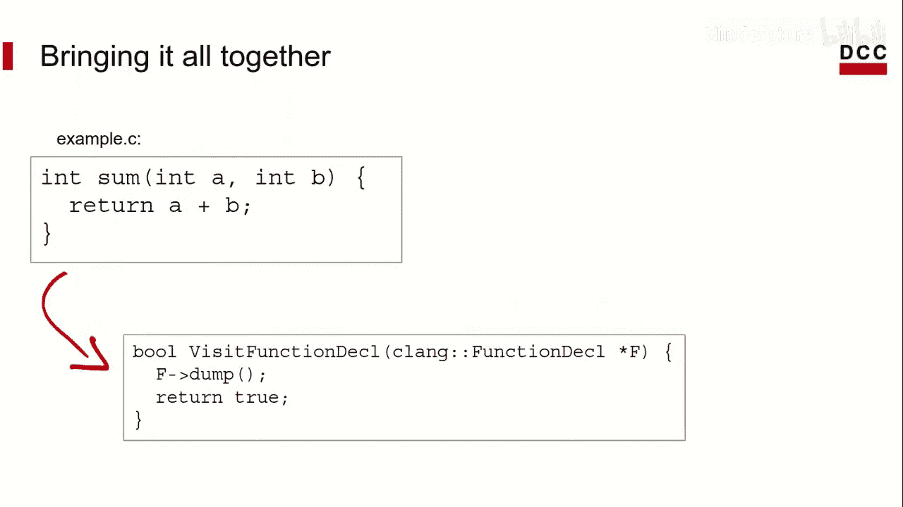

If you go back to our first video， you'll see this is just like the ESD dumps it've made back then。

 And now you can do it using your own code。😊。

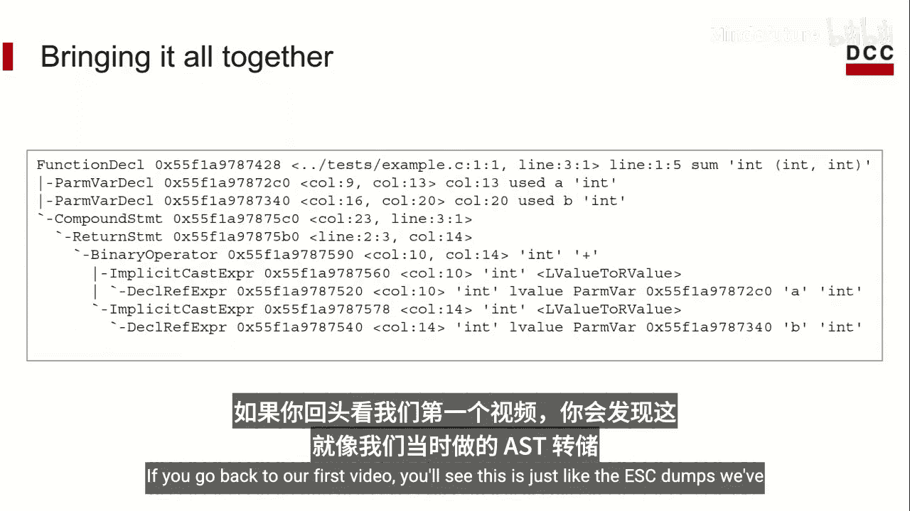

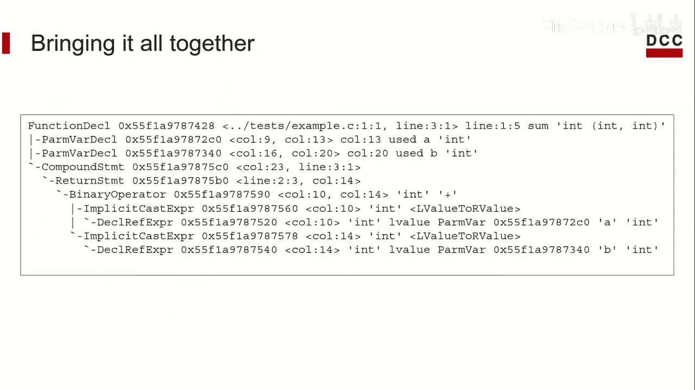

Similarly， if we were to run this using visit Palm varnacle， we would get this output。

Notice that each line represents one of the parameters of our function。😊。

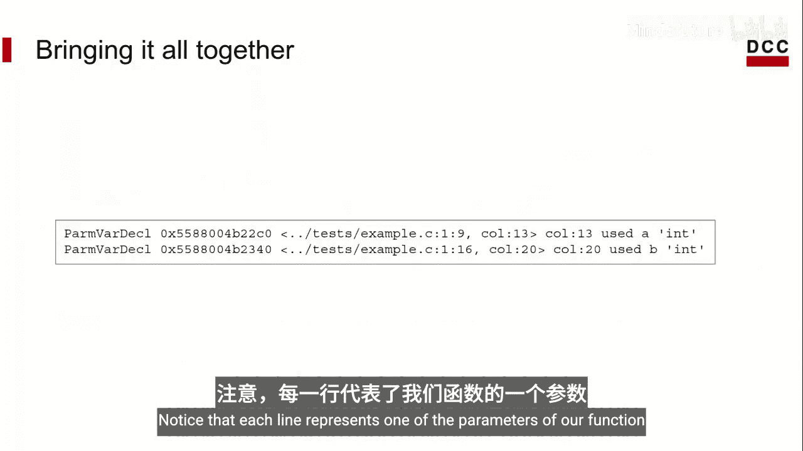

Today， we saw how to write all the boiler platelate we need to write our fl， first claim plugin。

In the next video， we'll try to build something a little more interesting using what we've learned so far。

Remember that the code that we have seen today is publicly available in the courses repository。

Feel free to play with it。If you have questions， you can email me。 Also。

 suggestions and comments are very welcome。 Thank you。😊。

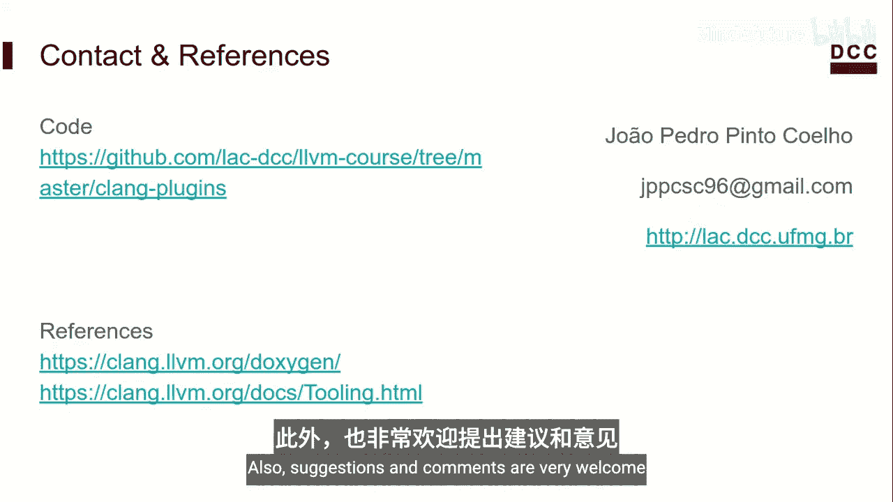