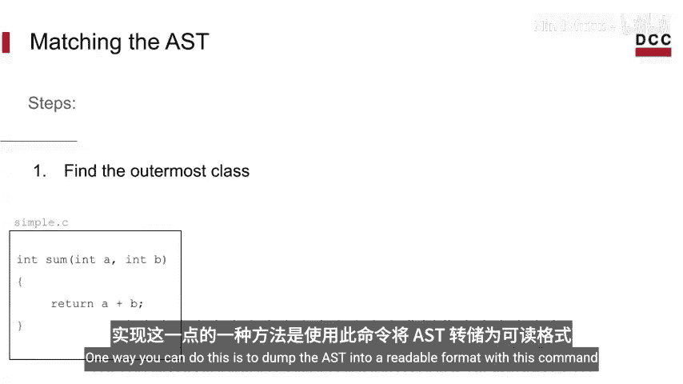
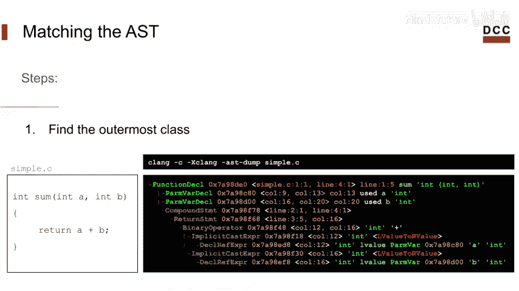
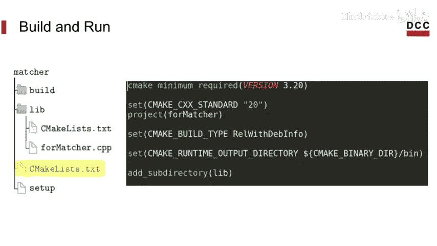
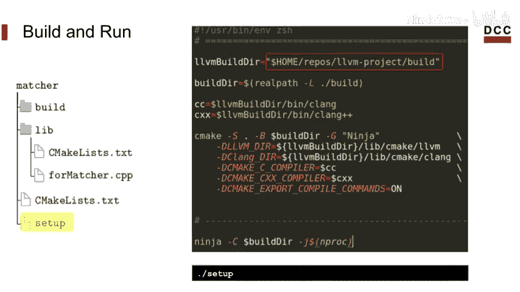
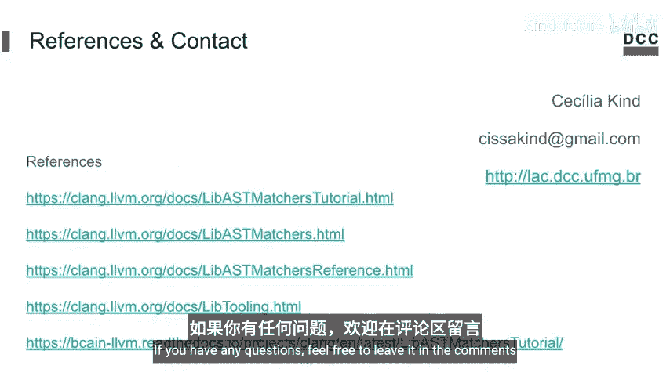

# LLVM入门教程-•-中英-p21-P21-AST-Matchers--BV1HtRUYnEji_p21-

Hi， I'm C。In this video， I'm going to talk about ASD measures and show how to make use of it with lip tooling。

If you don't know anything about cling A SD Valipto。

 there are some other videos in display play list that will cover the basics we need。So first。

 let's recap a few things to learn about the King SD。ASC stands for abstract syntax tree。

 and it's a data structure that is used to represent source skull in a tree format like the one we have here on the right。

This makes it easier for the compiler to understand and to work with the program instead of its front text。

 such as the one on the left。 claim make these structures available to us。

And as it was mentioned in the previous video， one way that we can traverse the ESD is with the recursive AST visitor。

But Cl introduced another interesting way of exploring the ASD。

 the AST Metro library that gives us a simple and concise way to describe and matchsh specific patterns in the AST。

😊，In this example taken from the AST match feature documentation。

 let's say you want to match four loop that has an initializer。

 and the initializer has a single declaration and this declaration is a variable declaration in the variable is initialized as the integer0。

😊，And then you can see that this pattern would match your first four， but not the second one。

 since the less condition does not apply to the second floor。So basically。

 this library gives you domain specific language that allows you to extract information at the ESD level。

 such as source locations， attributes， types and more。

In conventional is by building a tree of mattress and using inner mattress to make your match more specific。

In this example， we are only interested in a case in which the variable is initialized to zero。Well。

 let's say I'm not that specific， and now I'll accept any integer。

 but I still w to know what number the variable is initialized to。

You can extract this information from the tree using this bind method and give it a label that will allow it to retrieve the note later when a match is found。

Well see how this is done in a bit。When you writing your match。

 you can try to follow these five steps。 The first one is to find the outermost class in the AST that you want to match。

 So when you write in your match， you need to understand how the ASD for what you want to match looks like。

 One great tip is to write some code that you want to match and see how it looks like in the ET。

Only way you can do this is to dump the ASD into a readable format with this command that will hopefully make it easier for you to create your match since now you can see the notess and their positions relative to each other in a tree。

😊。

The second tip， and this is the most important of the mo is to look at the AST match reference。

 there are numerous metrics that can help you match notess and narrow down attributes on a tree。

In the documentation， they list three different categories of metrics， node mattress。

 narrowing metrics， and traversal metrics。First， we have the node Mat。

 node Mat will match a specific type of an A st node。

So there are the central nodes of metric expressions。

 It will tell you the type of node that is expected。

Every match expression will start with a node match。

 They are the only ones that support the bind call that binds the node to the given string and allows it to retrieve later。

 Here a few examples of node matches Next， we have the narrowing matches。

 Nry matches match attribute attributes on A T notes。

 That means that they are used to refined notes restricting the set of nodes of the specific type that needs to be matched。

Here， if fill like samples。Finally， we have the traversa Mat。

 Mat that allow traversa between A S T notess， which means they define a relationship to other nodes that must be reachable from the current node。

Altroversal matters take note matters as their arguments。

 since they treat the relationship between these notes。

It is easier to visualize it in our previous sample。So we have the node mattress。

 which like I mentioned， is the one that starts the metro。

Then we only have one narrow metric that is telling us that the variable that has been initialized must be equal to 0。

😊，And finally， the trao matrix give you that ability to traverse from no to known。

After studying the A SD， you want a match and checking the official documentation。

The third step is to create your automatic expression and verify that it works as expected。Next。

 you should look for what the next senior know you wanna match is， and then repeat until you're done。

Since there was another video showing how to make a click plugin， this time。

 you're going to copy our example using lip toolin。

 a library that enables the creation of a standalone tool and gives us full control over the ASD。

Starting with our tool， these are the libraries we need。

We also need this line here to apply a custom category to all main line options。No。

 we can add our me。 I'm using the one from our previous sample。Next， we give them a training name。

 and we can choose to buy one or more notes if you w to retrieve them later。In this case。

 I'm choosing to buy the v deco node， and then will allow me to get the name of the variable that is declared when I get a match。

The bind call allows us to define an identifier。 In this case， I call it init bar。

 which will map to the node we match and let us recover them later and our match call back。

And that brings the star match go back， which is paired up with our match。

 We will tell us the action to perform when a match is found。😊，So in the Atme find the right note。

 the corresponding magical back will be evoked with a match to result。In our match Quebec。

 which Im calling match printer。 I'm going to override the virtual function run and receive the match result and determine what to do when I get a match with that corresponding identifier。

 In this case， I'm just printing the variableable name。😊，Now， going to our main。

 We have already defined our match and a magical back， which is the printer。

 But we still need to add a few things。First， we need to write a star metric with a match finder object。

 Then run it with a cllink tool。First， we create our match findr。

 and then we need to register our me。One observation is this option that we are setting to ignore a less spellelding source。

 The default mode of operation of A S D mattress， which is called as this。

Can visit node that are not spelled on the source tree， So they are not obvious to match。

Making choose to ignore A S not China not spelling source using this mold。

 Ma it easier to create your match。Finally， we need to run a mattress from a cl tool。

In order to run it， we need the common options for structure to pricese arguments and to create a compilation database。

We use gett compilations and get source path lists to retrieve the compilation database and a list of input file paths。

Once we have that， we can create a cl tool around our front induction over some code。

And now you are ready to test it。I'm going to build the tool with Cic using Nin as a generator。

 I won't go over the details， but I'll show you how everything is set up。Inside the lip folder。

 I have the format you find we created。And then we need to add a ceic loose file。

The first line built where to find clang in its libraries。

 The fourth line that seem make we want an executable for our source file。Finally。

 we want to link the clean tooling library to our binary。😊，In our route。

 we have another Cic list that will tackling the minimum Cic version。

 the C plus standard used in this project， the name of our project。

 Ne type and ready to put our executeecutable until C make to read the Cic list inside the lid directory。

Finally， we have our setup。

The hotel See make where to look for Kang and L L V M。 and you will generate the Ninja file。

And the last time， we start the build process。This is the only part they need to change。

 and you should add a pad to your L L V M view directory。

Once we run the script， our binary should be inside a bin directory inside beam。Now。

 you can just past your file and run it and that's it。 If you have any questions。

 feel free to leave it in a comments。😊。

