# LLVM入门教程-•-中英-p23-P23-The-LLVM-Test-Suite---Part-2--BV1HtRUYnEji_p23-

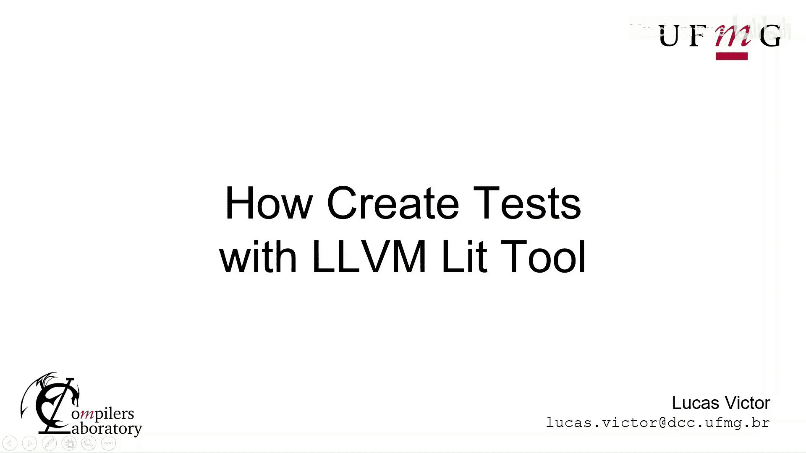

Hi guys， my name is Lucas and continuing your videos of how to use the LLVM test Searcher in this video。

 we will learn how to create our own tests using the LLVM integrated tester to or Li。

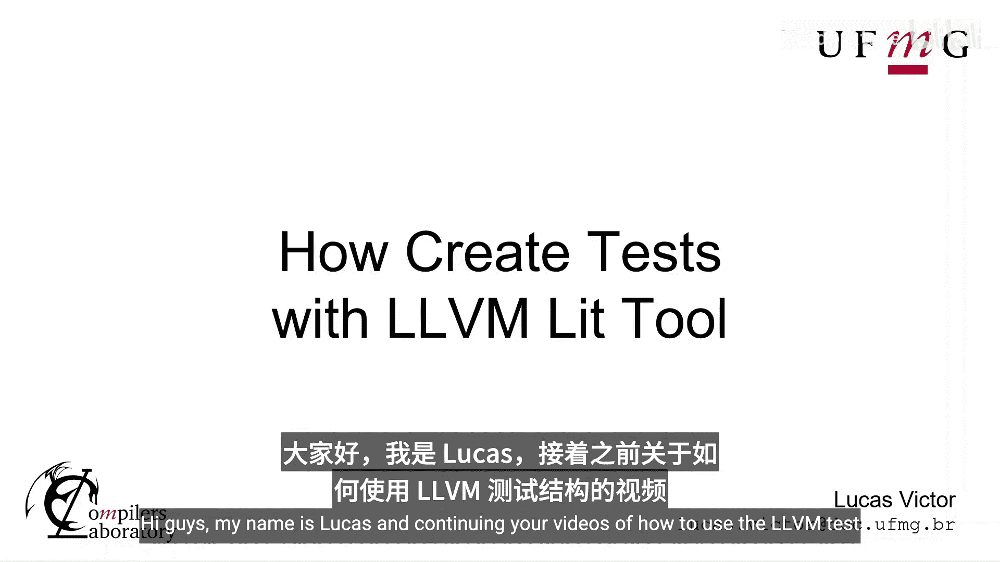

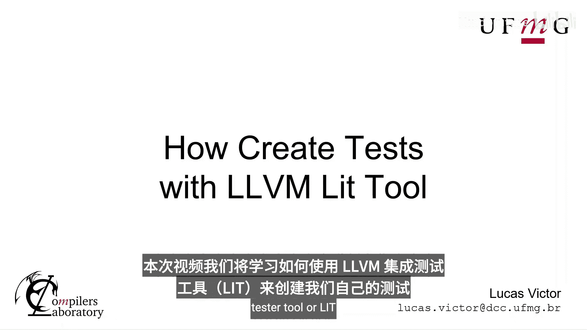

So L is the LLVM test route。As we see in the previous video。

 it is responsible for run to run all the tests present in the LLVM compiler files。

 but it's a simple brighton script， which allows us to work with these。

With G2 with use script outside the AVN3。

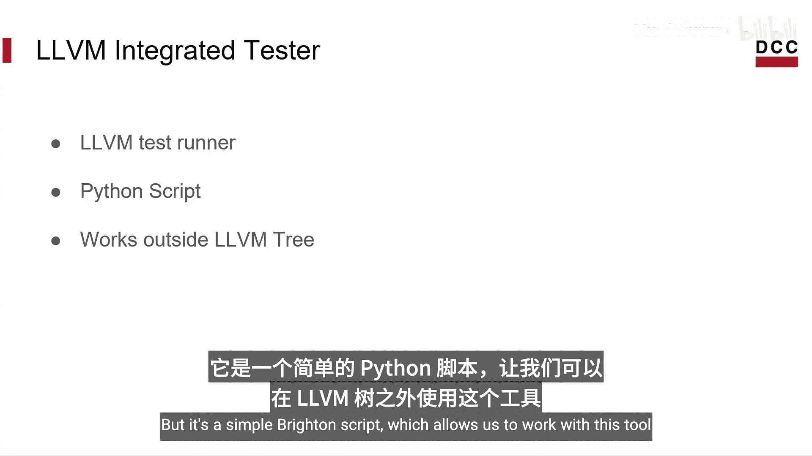

We can install it without the Aium compiler， for example， using the PIP。

And why should we use a test runner， why should we use a test structure for our programs or for lot of projects？

If you are using the AM the church worked so if you。Creating tools for the LL VM U testing and。

The main test running for OVM compiler is delete lit， so in this case you need to yield it。

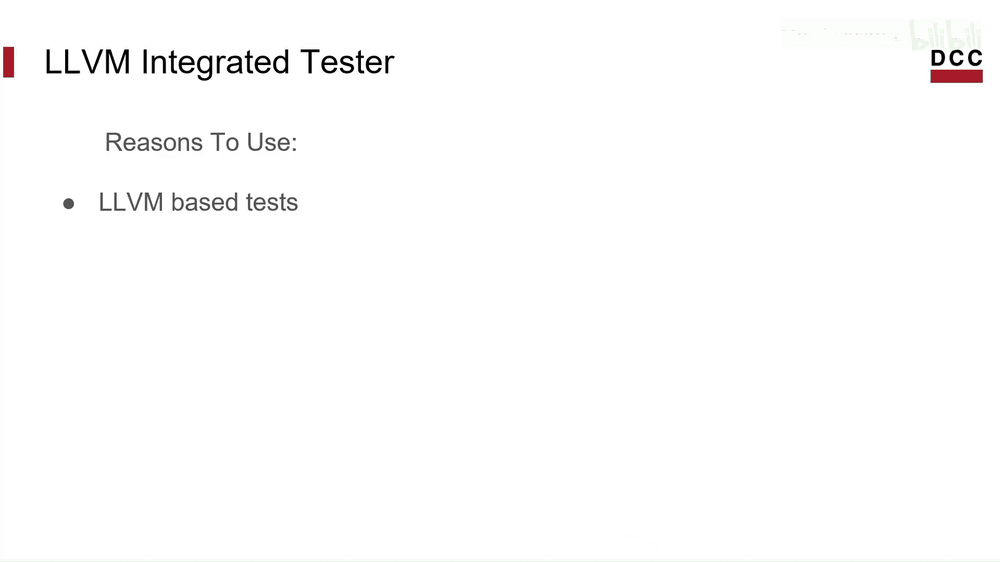

But outside the LLM structure， Li provide some interesting features。

 one of these features is the test Discover。

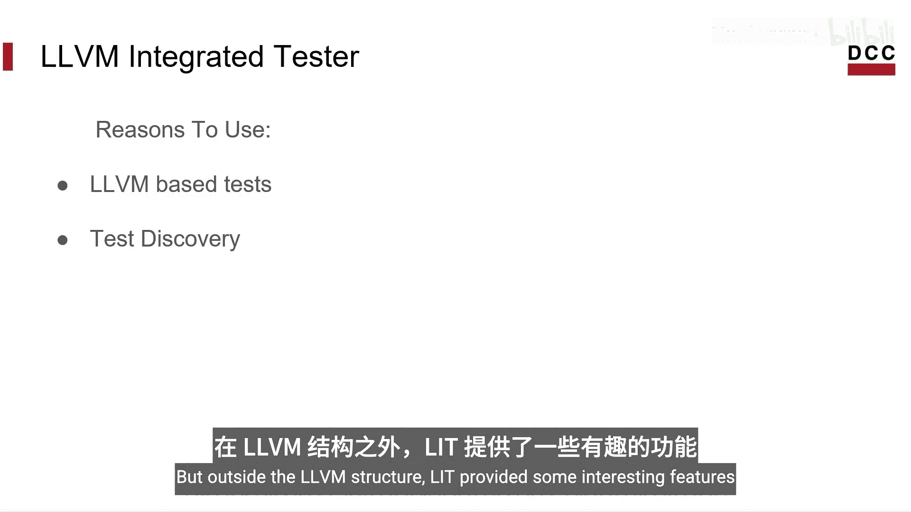

So instead of pass each single test files that we need to run， you can pass to the tool。

 an entire directory or entire test suite and let the tool search for the test files and run then automatically another good reason because it's easy to use。

You can configure your whole test with three lines of code。What。

And it's simple to write your test scripts， these status scripts or test files or a small piece of show code that delete we run not automatically for you。

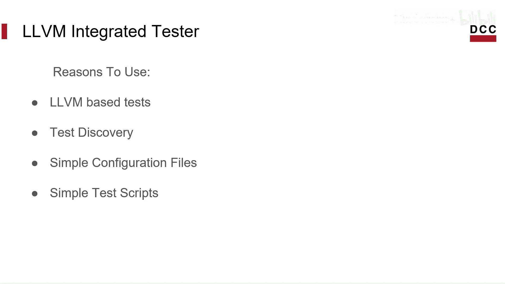

So let's learn use this tool。The first step is the installation process。

So there are two to install this tool。The first and more simple is by using VIP install L IT。

Or if you already have aLVM build， you can find it inside the binary files。Okay。

And in this video we will create a test suite from zero。

 so we will demonstrate how you can create your tasks and configure your test structure。

 so let's start。And one thing we need to know is that our test structure must follow the LLM test suite structureer。

 but theres no secret in this， we will see later。And for this video。

 I made a simple test suite to simplify how you can create your own tests。

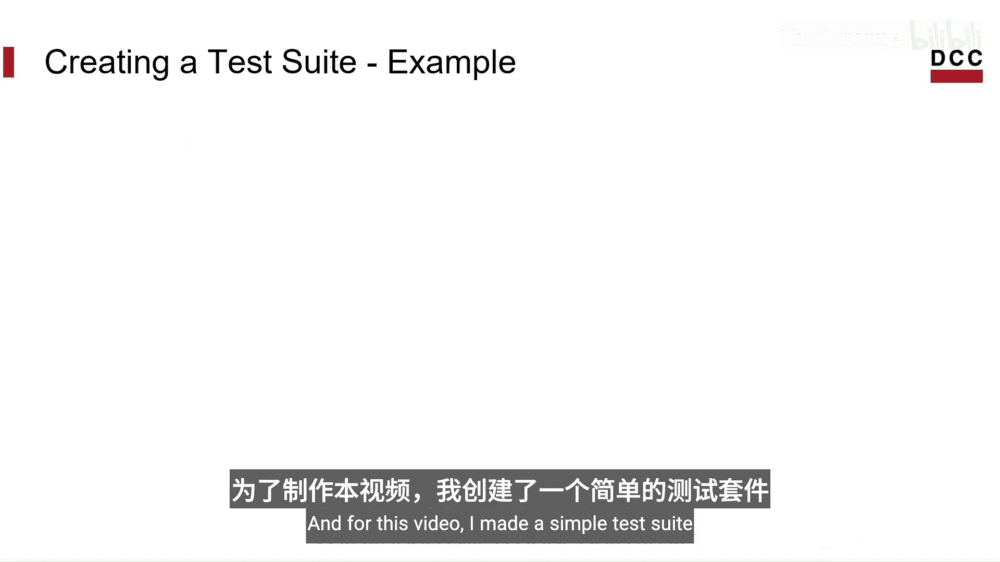

And the does suite have the following structure。First， we have the main directory。

 the root of artery called miso。

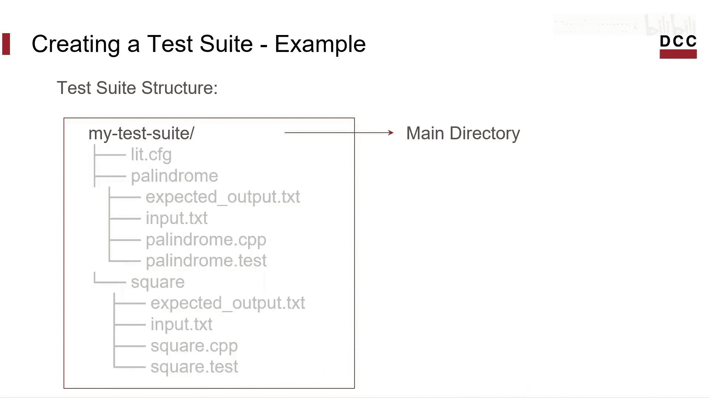

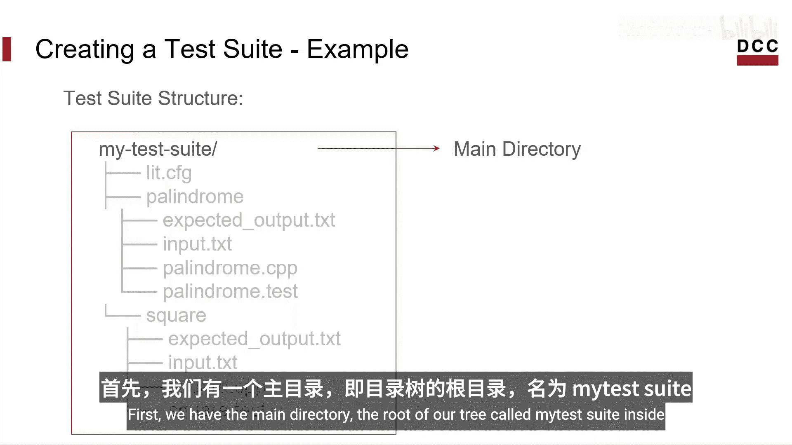

Inside of it。We have the lit configuration creation file。

This is the file that you read to load all the configuration for the test suite。

 let's see what do you have inside of it。

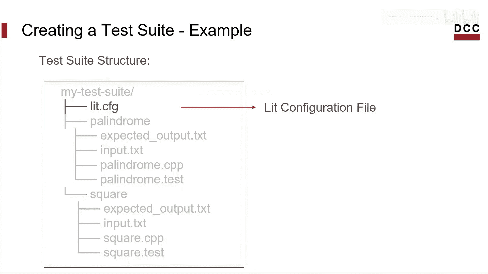

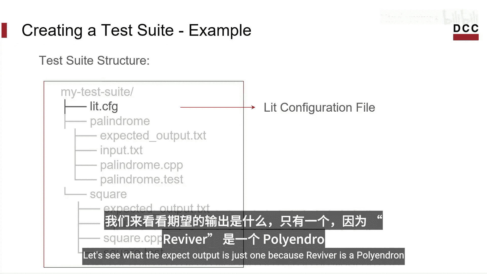

The little configuration file， it's a simple byyth script that we need to pass or configurations to the two。

 so we import， we need to import the little format and inside of that we have several configurations available。

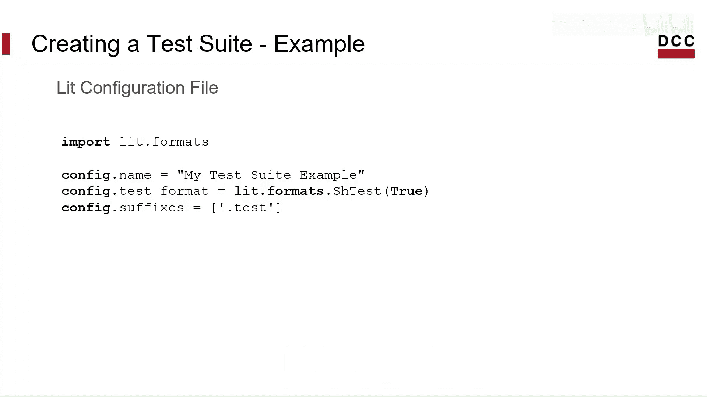

But only two configurations are required， the first one is the name。

 so here I call in my test suite example and the second one is the test form。In this configuration。

We need to inform the type of tests we will read for our programs。

 so we be using the shell tests here。And the configuration of suff I I just passinging。

And this third configuration， the config dot Sux， I am just informing to delete that the test files willwin with the dot test。

😔，And inside of my test directory， we have some program directories， the first one is the polyingro。

And inside of inside of it， we have the palingro。ctP that is a program source file。

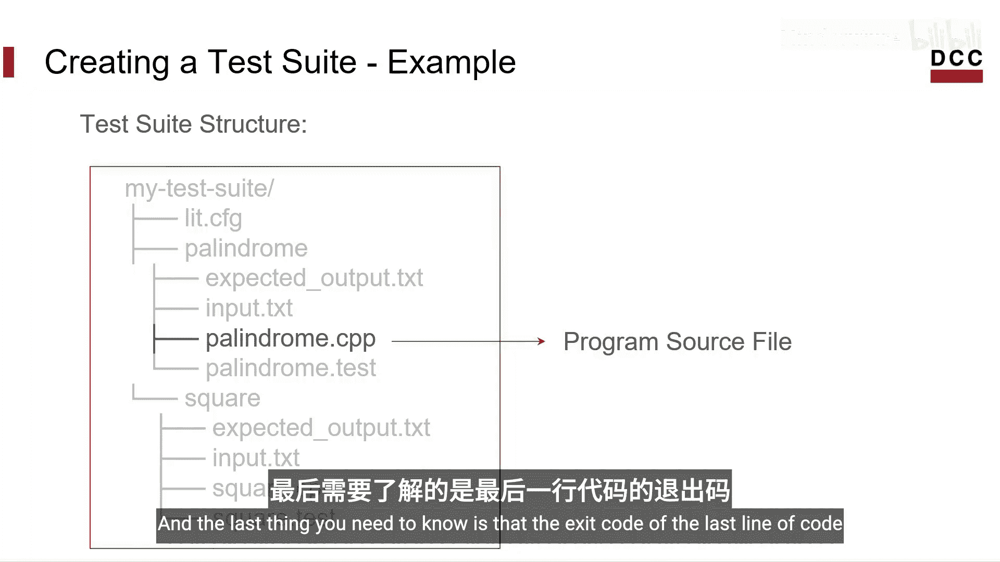

And this program is a pretty simple program that ver5 if a word is a polyindrome or not。

So it reads a word from the external input and the output is one or0 in form if the word is a polyindro or not。

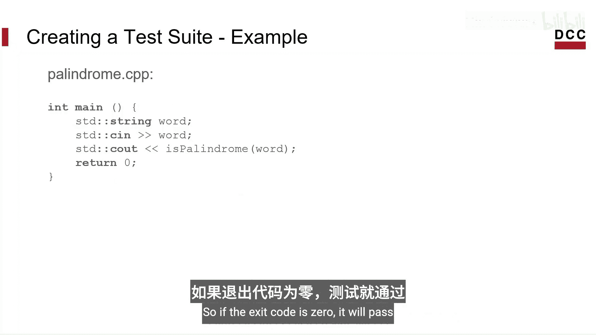

And we have an input file， so I'm passing the word Revivr。

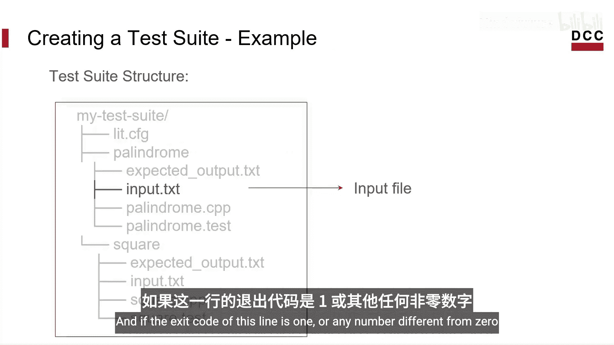

And the expected output， the expected output is just one because Revivr is a plugin。

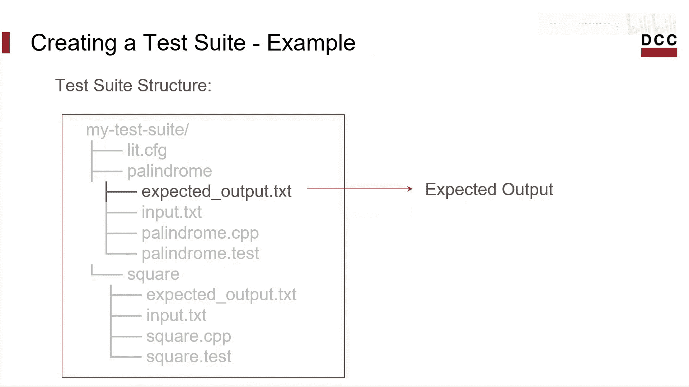

And inside of it， we have the polyinrome dot test is the show script to test if the program is correct or not。

And here we have the test file。So in the first line， I compiled in the program。

And in the second line， I calling the program and comparing the yesterday output。

With the expected output。Okay。The lid do give us some macros to use in these shall scripts and the most common macros are the percent S。

 so this macro indicate the test directory， the current test directory。😔，And the person T。

It's a temporary file。 So if you so as you can see。The first line of the Sha script。

 I'm calling the program by giving the name T to the program and the second line I calling the program by this person T。

And comparing with the expected output。 and the last thing you need to know is that the exit code of the。

Last line of code。So in this case， the comparison of the output with the expected output will be。

Will indicate if the test pass or not， so if the exit code is0。

 it will pass and if the exit code of this line is1 or any number different from0。

 the path will not pass。

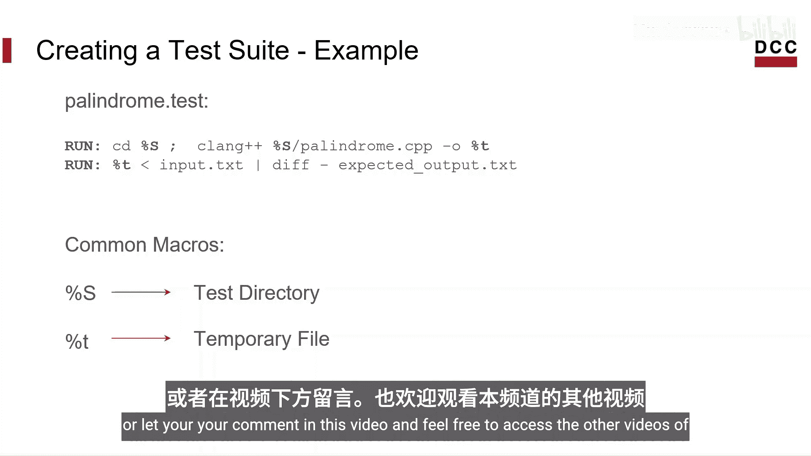

。And for the program square， I'm doing the same thing。And finally， to run the test。

 it's a pretty process now that we have configure all the files。

If you want to run the tests for the entire test suite for all the programs inside the test suite。

 we can call the AOIT delete to the entire test suite。

 but if you want to run the tool for a specific program， you can call it for desired directory。

 so in this case I calling the elite calling the test only for the square program。

And the output will be something like that， the first line indicates the number of tests that the two found in the directory you passed so in this case it will find two tests because I have run for the entire directory。

And each line after that， we will indicate the name of the test found。

 so by in dot test and the square dot test。And if the test fail or not。

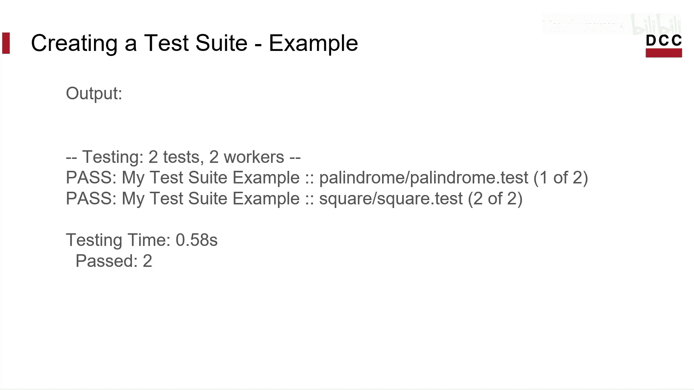

。And with this， we reached the end of the presentation。

I hope you enjoy it and all the reference uses to to this video will be on the description。

 but if you have any questions， you can contact me by these email address or let your。

You are commenting this video and feel free to access the other videos of this channel and our lab website thank you for watching and see you in the next video。

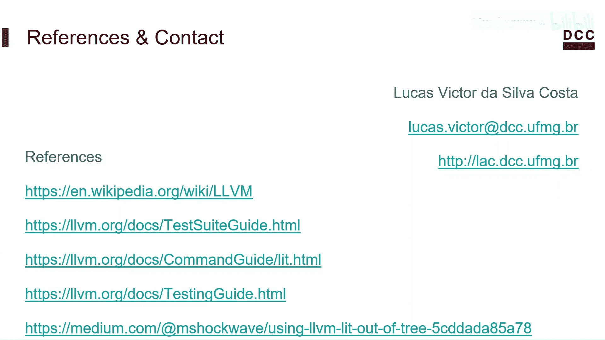