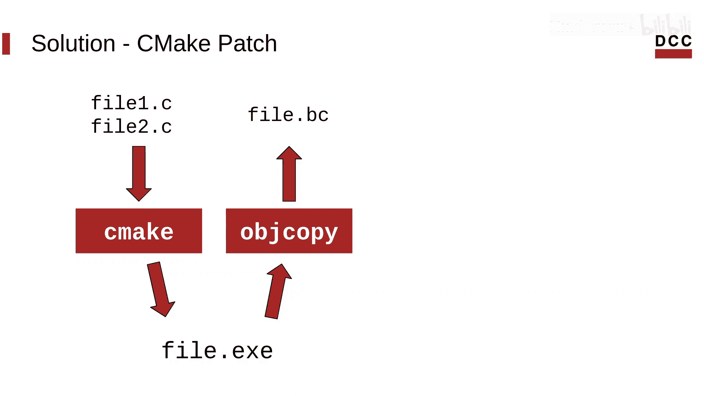
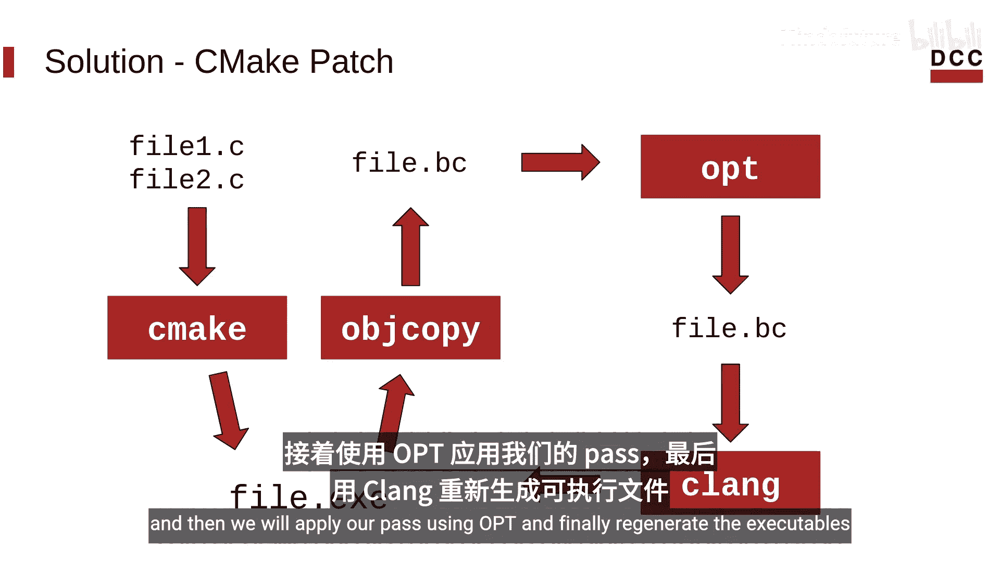
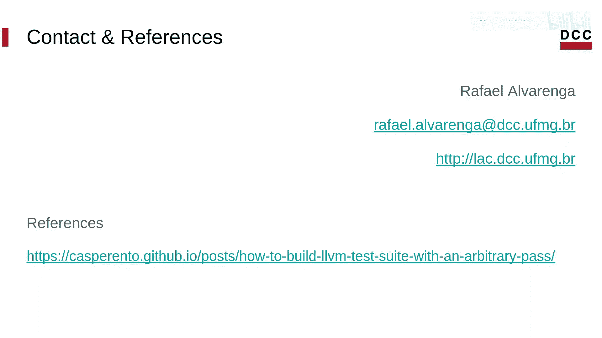

# LLVM入门教程-•-中英-p24-P24-How-to-Build-the-Test-Suite-with-an-Arbitrary-LLVM-Pass---Part-1--BV1HtRUYnEji_p24-

Hello， everyone。 My name is Hafaovaangga， and I am a graduate researcher in the compiler labb at UFMG。

 I'm currently working on implementing code compression techniques in L O VM。Today。

 I will show you how to compile the L L VM test switch with a custom pass。In this video。

 I will present a problem。And then walk you through a high level solution。

Our goal is to compile the test suite binaries using a specific pass to do this。

 We will first build the project。Run lit together baseline metrics。

 then rebuild the tests with our pass applied。 This will allow us to collect metrics。

And compare them。But before we start， we need to patch the sea make project。

 This is necessary because the test suite doesn't offer a standard method to compile binaries with a chosen pass applied。

The process works as follows。Will look first。build the test switch using its default C I options。

And then we will extract fully linked bit code files from the executables。

And then we， we apply our pass using O P T and finally， regenerate the executables with clang。

Thanks for watching。 And in the next video， I will show you how to apply the patch and use it。

