# LLVM入门教程-•-中英-p25-P25-How-to-Build-the-Test-Suite-with-an-Arbitrary-LLVM-Pass---Part-2--BV1HtRUYnEji_p25-

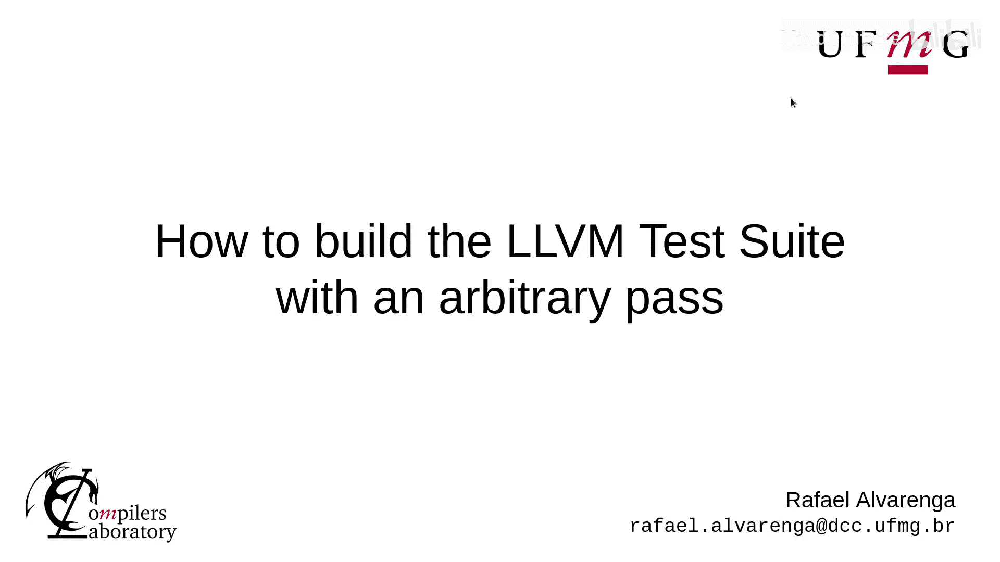

Hello， everyone。 I'm Hafao Vaningga， a Gwi researcher in the compilers's lab at UF M G。

 and am working on cut compression techniques in L O VM。 In this video， I will show you how。

 how to apply the patch we discussed in the last video and how to use it。

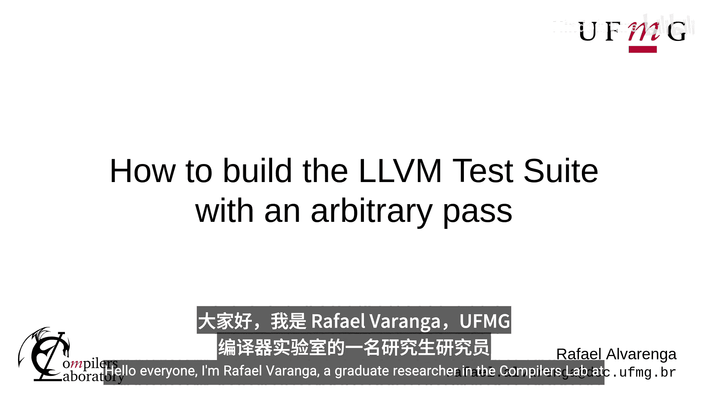

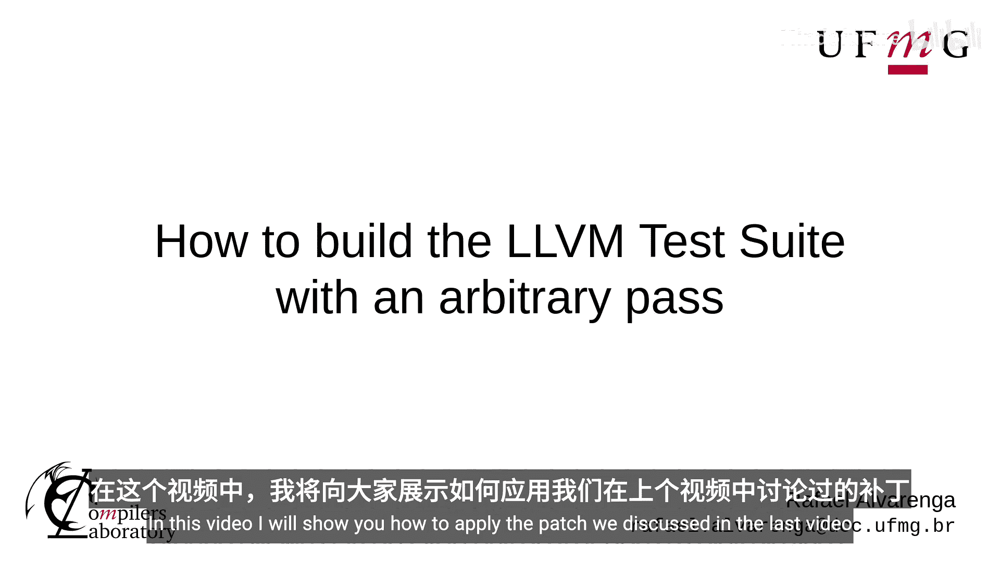

So we will assume that lead tests are already configured and that we want to collect specific program metrics。

I will guide you in setting up your environment to run and collect results。

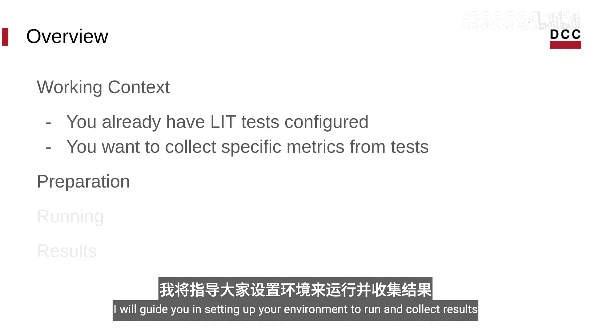

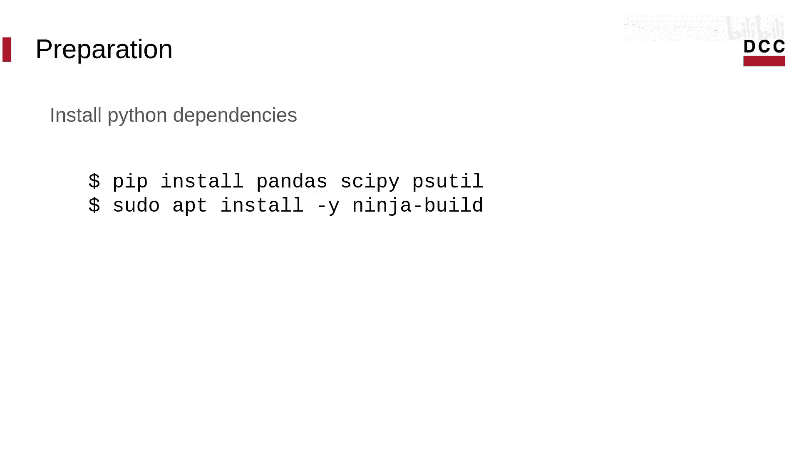

The test suite includes various Python scripts to help analyze code metrics to use them。

 installs pandas， Sipi and P S。 u with the first command from the slide。

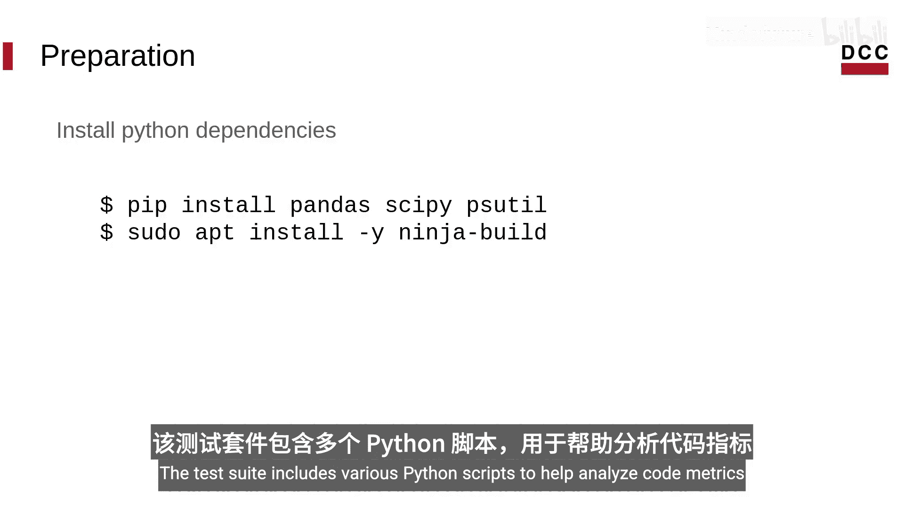

We will also use NinjaBuild as our build system。To apply the patch。

 you can either clone the patched version of the test suite or apply the patch manually following the commit link from the slide。

Once the test suite is cloned， enter its directory and create a build folder。

We will configure CMake with these settings， use Ninja as the But system。

 specify clk as the compiler， enable the minus FLTO flag to generate bit code files and force the linker to create non optimized linked bit code。

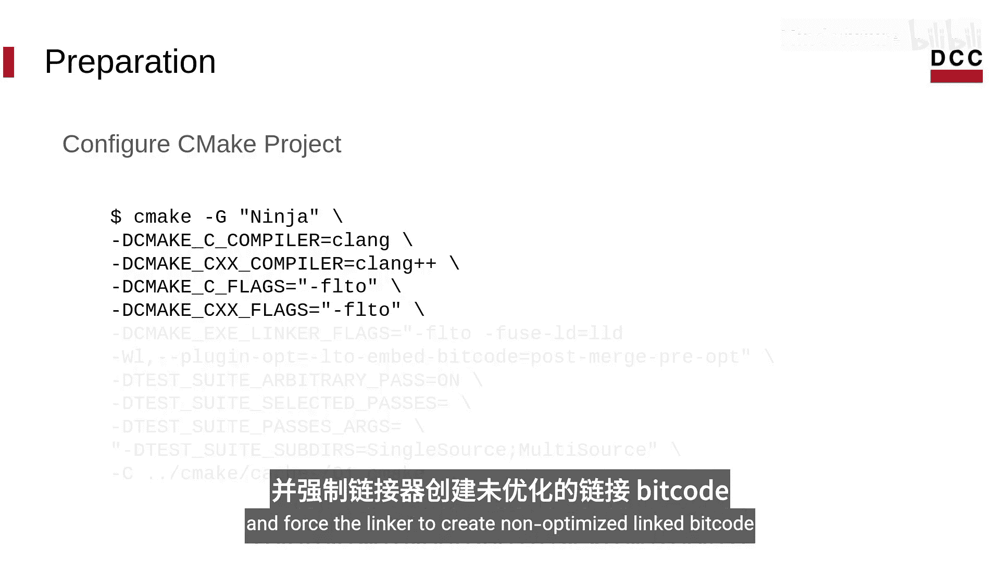

Also， we will enable options for applying the pass over bit code files and specify the pass to run。

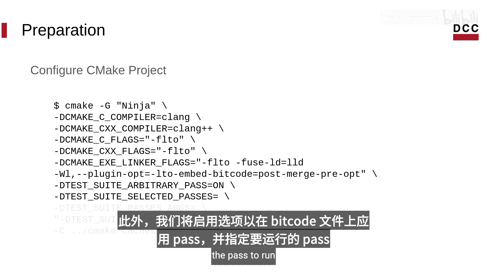

We will use the single source and multi source test suites and run minus01 optimization flag on all binaries。

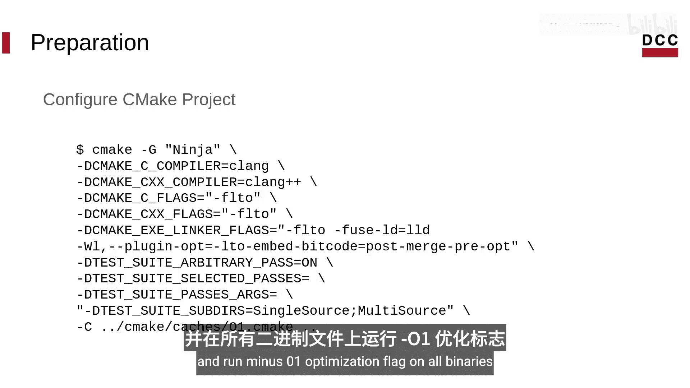

Now we can compile the test suite。 After that， we will run lit to collect minus01 matrix。

We will then clear the built cache to prepare for the second run。

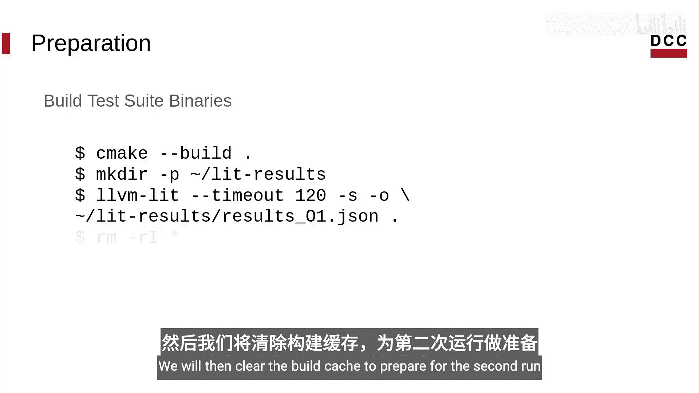

For the second run， we will repeat the cement command we used。

 but set minus02 as the optimization flag。After recompiling。

We run lit again together gather minus02 metrics。Finally， we will compare the results from both runs。

 We will use a Python script provided with the test suite to generate a detailed report with diff computations。

 comparing to instant count and size text metrics with specify the files to compare and where to save the results。

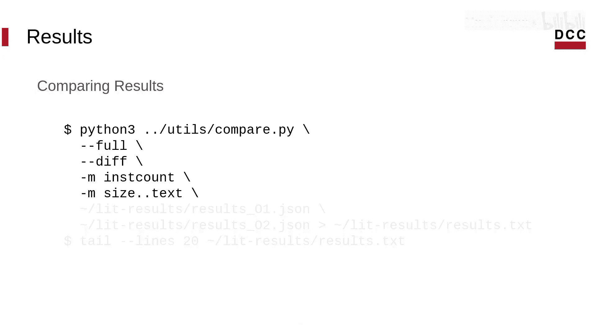

If you want， you can， you can display the results in the terminal using the tail command。

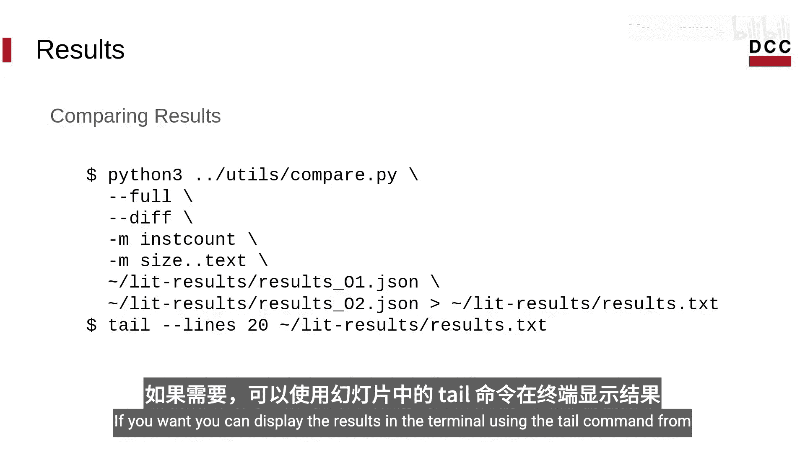

From this slide， that's it。 And thanks for watching。

