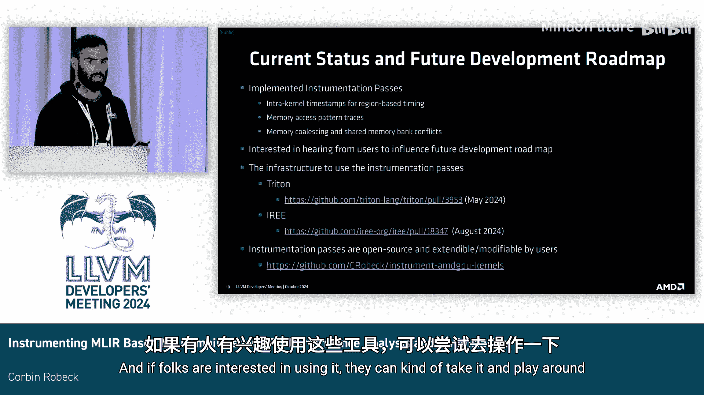
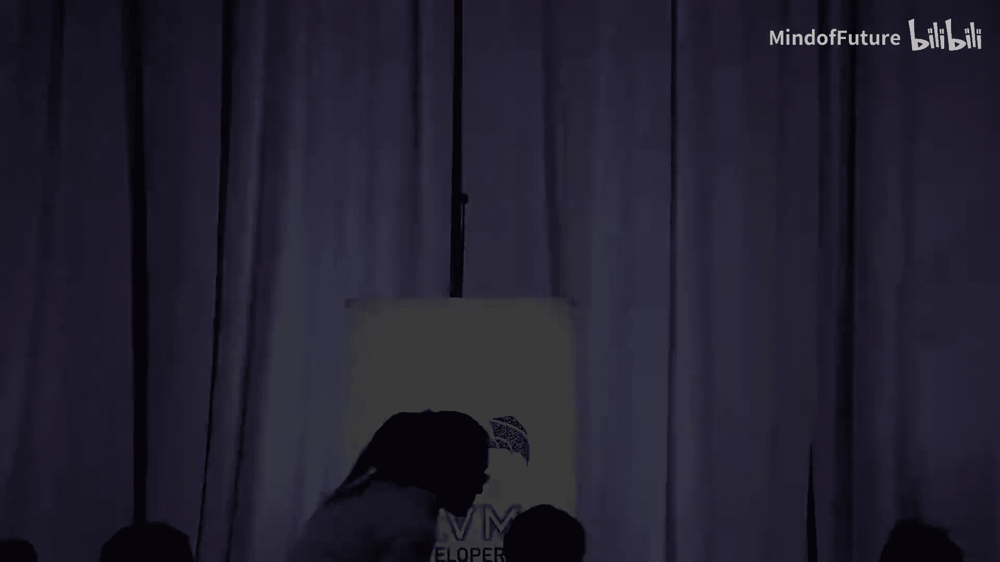

# 【2024-LLVM开发者大会-•-中英】-p01-P01-Instrumenting-MLIR-Based-ML-Compilers-for-GPU-Performance-Analysis...--BV18eNfepENu_p1-

I'm Corman， I'm from our ML compilers team at MDD， and this is work that we've been doing to do get our performance analysis in ML compilers that are based in MLIR。

So the background for this is there machine learning compilers and frameworks that use MLIR and Gstaryle GPU kernels pretty extensively。

 and this poses a challenge from a compiler based performance analysis perspective。

 you can use dynamic binary information tools but those are often fairly coargraed and it's difficult to get kind of higher level source level information you have debug information but you kind of lose information you have in the compiler that you can make use of。

 and so if you instrument in the compiler you can trace specific GPU kernel defects that lead to bottledernecks through the various lowering phases which are usually pretty tedious which you kind don't have tools that are kind of baked into the pipeline。

And so this we found very useful in， in instrumenting both and getting information from the program source。

 but at higher level data operations。So the Overarching Golds project was to develop a set of lightweight and customizable open source compiler based passes and get them kind of up and running in some popular ML compilers and flows of you that are kind of don't know what I'm talking about。

 instrumentation in this case is injecting analysis code into performance critical sections of the GPU code through a compiler pass to get various types of information。

So what are the types of challenges you run into when you're working on in MLIR based GPU frameworks that use GPUs。

 on the GPU instrumentation is not always as straightforward as doing it in the CPU you generate data on the GPU through analysis code and you somehow have to move that data back to the CPU there are kind of host call type things。

 which is how AMD implements printf and that is a substantial overhead and you really don't want to use that for anything heavyweight and so in kind of our example case。

 a small attention model generated 10 ish gigabytes of data。

 so anything in production needs to be able to work through this。LVM separates， at least in our case。

 GP and CPU code and so those are separated into separate modules and so you have to have some way to work between them and then usually you want to write your instrumentation functions in some sort of clang-based tool chain so you want to write C++ instrumentation functions and then insert them into an MLAR based framework that really has no reason to have the clang driver and runtimes along the way。

And so in addition to that， when you're instrumenting in an MLLR pipeline。

 especially in the ones that we work with， you only see the GPU kernels。

 so there's really no CPU host code for you to add calls to So all you get is just the FMLR based GPU kernel。

So the kind of popular frameworks in which we typically work in in our use cases are trident eerie and a little bit of Pytorch。

 but that's kind of a working progress。 one of the things that is challenging working in these frameworks is the GPU code is kind of intentionally hidden from the user this is supposed to be kind of an easy to use thing and you don't have access to where the actual like codegen is done。

 And so if you're doing performance analysis and tuning you want to know of what these decisions are being made behind the scenes for you and figure out know something has gone wrong。

 And that perspective changes who you are。 So if you're like a hardware architect and you're designing memory systems。

 you want to know what the memory access patterns of a particular model are like if you're a compiler developer。

 you want to look at data movements you can overlap compute and communication pipelineing opportunities。

 intraconnal timing and then if you're a user， you really want to know you want to get some。

Imediate feedback correlated up to various objects in the pipelines that you want to know most source level but also can you give me information about a particular object。

 so in Triton， one of those things is like a tensor object。

 can you tell me which tensor object at which source code line had some memory coalescing or bank conflicts or something related to the performance bottlewinnecks？

So we do our instrumentation through a combination of LVM plugins， analysis。

 kind of specific passes and clang generator kernels。

 we insert them through this kind of optimized module phase。

 which is a kind of popular part of MR frameworks。 and so this is kind of common you'll see that you can kind of insert this in multiple places among different frameworks。

Kind of the details of how the instrumentation pass works is it it clones the kernel and adds an extra kernel argument。

 which allows that's kind of where the the data transfer takes place。

 So you can use that to pass information from the GPU back to the CPU and you'll get。

There's really another other way， the way that the modular is ring compiled。

 that's really where you're going to have the best experience moving data from the GP that you generate back to the CPU for either writing to disk or having some sort of analysis。

And then we set up this kind of host this device side buffer on the GPU in which the the GPU writes into。

 and this is all set up through the L ofM pass where you。

 you have this device side buffer that the the GPU waves right into and then you have some user defined set space If you find that the the buffer is full。

 you have a signal in the GPU that。Signals a host thread to empty the buffer。

 and then you can continue on your way so that you can kind of fill up this device buffer。 and then。

When it gets full kind of periodically， it stops。 And so this is。

 this is separate from like a host call where you have to stop everything。 It's very disruptive。

So in example case， this is like a memory access pattern trace。

 this is a fairly common instrumentation thing。 you get like a heat map of how the loads and stores are accessing the virtual memory addresses。

 So the way that this works it adds a compiler pass at every global load in store and this is a C+ plus code。

 C+ plus analysis code that is compiled and then inserted into an MLR framework that has no client dependency。

 So this is kind of cool that we can get C++ code and then inserted into various places in which you want to do analysis。

So we calculate the virtual address， and then we're able to get metadata like source location。

 MLAR level objects， timestamps， and then hardware specific things like the wave or the CU or the chipplet in which the data was generated。

And so this is kind of an example。 So this is just like a flash tension model in which you've you've got。

You know， all sorts of interesting data that you can associate it with the memory addresses。

 you can get kind of hardware specific things and then correlate it back both to source。

 And there's kind of a separate part of this that allows you to get。

Kind of higher level object information。So the current status is we've got instrumentation passes for intraconnal timing。

 memory access patterns is kind of the most mature and then kind of various very basic performance bottlenecks memory coalescing bank conflicts And then the nice thing is this is kind of customizable so you can take an existing one and expand it to what you want the infrastructure has been upstreamed and we're kind of getting to the point where the infrastructure。

 but then we're also trying to move it into some of the existing tools and then we've got some open source passes that are available and if folks are interested in using it。

 they can kind of take it and play around with。

That's my time。Thank you， Carbin。

