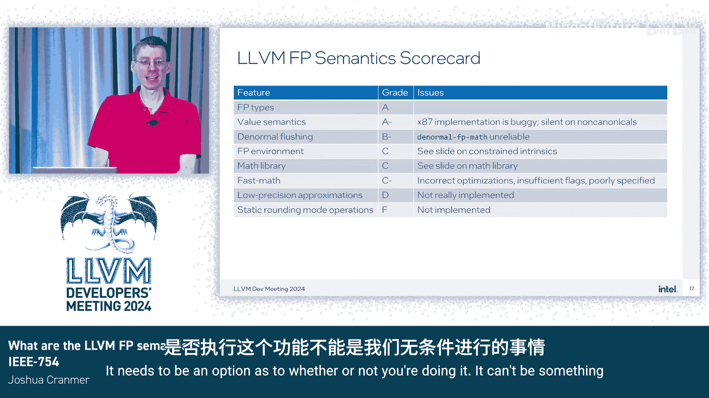

# 【2024-LLVM开发者大会-•-中英】-p02-P02-Floating-Point-in-LLVM---the-Good,-the-Bad,-and-the-Absent--BV18eNfepENu_p2-

Hello， everybody。And I'm sure we all hear the answer to the question。

What are the semantics of 1 floating point in L of VM？And the answer is， I think， obvious。

 a lot of people it Citchopoli 754 with an asterisk and why we have the asterisk there' a few exceptions。

And honestly。It'sWhen you get into the exceptions， that's when you're which we're actually trying to answer with the question。

 what are elements flamepoint semantics？So why is IT 754 not a complete answer to the question。

 was our flame point semantics？For status， not all types in LV and。

 not all the floating point types are actually based on IE754 types。

The standard itself has a few moments of under definition。 For example。

 the behavior of Nang payloads or the definition of tinsiness。

Hurdder implementations frequently do things that are different from the standard。

 Sometimes is there additional features that they provide， for example。

 the option to do deormal flushing or providing extra operations。

 but sometimes you have to do deviations from the standard。 For example。

 some embedded hardware might not have a floating point environment at all。

The following point environment is an instance of shared， hidden， mutable， global state。

 which as compiler writers， we all know is absolutely a methema for optimization。And finally。

 for many users， there were actually times where they would rather have the code be a little bit faster at the expense of a little bit of correctness。

 The basic premise of the fast math f。😊，So before discussing the floating point semantics。

 as described by LM， let me start by going through a little bit of the hardwarewood deviations that actually constrain our ability to give different semantics。

One of the most notorious deviations， of course， is deormal flushing。

 and deormal flushing comes as two independent bits。 really， you have the deormas a 0 bit。

 which says that if an input operaand to a floating point operation is a deormal value。

 It should be treated as a sine 0 instead。 And you also have the flush to 0 bit。

 which says that if the result of an operation is tiny， it should be flush。

 it should be flushed to a s0。And I do want to make a note here that there is a difference between saying that a tiny operation and a denmal operation。

 There are actually a few cases we you can have the result be a normal opera in floating point。

 and yet it will still get flushed to 0 with when you turn on flush to 0。

Some hardware allows you the ability to set deormal flushing on a prototype basis。

 you can for example， choose to only do deormal flush on 32 bits while 64 bits does full support for deorals。

 and there's also some hardware that doesn't give you a choice。

 you have to do deormal flushing for example， in XA6 if you use ADx 512 and Bf 16 that always flushes deors independent of the deormal bits in the status register。

One final annoyance is that some compilers， if you link using the fast math flag that will set bits in the mode in the process startup that enables de normal flushing on an entire process wide basis。

 independent of whether individual translation units were compiled with fast math。

 and this can cause problems。Another thing that is worth pointing out is the XA7 FPU。

 this is mostly relevant for 32 B X86 code， which means it has become less prevalent over the past few years。

 but it is a historical artifact that is still worth discussing because of its impact on floating Point semantics。

The central problem with the X87 FPU is that it only supports the 80 bit floating point type。

If you want to load or store 32 bit and 64 bit floats。

You can load and store those from memory and that doest implicit conversion。

 and this is a conversion in the ITpoli sense where the SNs have to be quieted。

 and this can cause problems， for example， must then into this where if you have an A that returns a value on the XA7 floating point stack and it's a 32 of floating point value。

 you cannot return an SN in that anymore。The other problem with the 80 bit type is that it is actually not large enough to sufficiently emulate a 64 bit floating point type without having double rounding。

 even if you try to do conversion immediately after every single operation。

 you can do it for 32 bit types， but not 64 bit types。

Now because the Java virtual machine people needed to have strict behavior floating point。

 they did work out various methods you can use to do full emulation of double precision。

 which is a lot more complicated it relies on a particular bit in the X87 FPU which changes the partition control and it means you have to do a lot of floating point environment and stuff to do fully correct emulation of double arithmetic and if you're familiar with LVM support for X87。

 we do absolutely none of that right now， it's currently broken right now and we know it's broken。

 but it's not been a high priority for anyone to fix because 32bit X86 is not as well of a platform anymore。

 and even when you do compile for 32 bitx86， we primarily default to using the SSE units which don't have this problem anymore。

The flooding point environment is another major issue for。How do we。

 now the IRA Police 754 standard does mandate some level of support for the environment。

In particular， it mandates the notion of dynamic rounding mode and also a little bit of exception support。

Now， in floating point， exceptions are not the same as regular traps in herdware。

 you can actually both return a value and throw an exception at the same time， the default behavior。

Haる。Okay。ふ。The default behavior for exception handling and floating point is to set sticky bits。

 which will always remain set until something turns them off。

And someone actually looks at them now some hardware also goes above and beyond and supports the ability to actually create hardware traps when an exception occurs。

As mentioned earlier， a lot of hardwaredware also has support for the normalmal handling bits。

 and there's also a variety of exotic bits and other architectures that change the value semantics in all sorts of weird funky and fun ways that makes it hard to design a general target independent fo point semantics for LLVM。

And finally， I want to go over the basic operations of floatinging point。

 Now Iroppoli 754 does define a basic set of core arithmetic operations。

 you standard for function arithmetic， comparisons， conversions。

 and also square root and FM are considered core operations。

 and most hybrid provides this four set of stuff。In addition to that。

 L ofium defines a set Itropl M54 defines a set of additional arithmetic functions that map to standard elementary functions。

 primarily transcental functions like the exponent function， trinometric functions。

 A10 etc these are much less common in hardware， and when you do see them in hardware they tend to be much lower precision than the other operations。

 which have to be correctly around it。Now finally hardware can add other operations on top of that。

 you see a lot of that， especially when it comes to vector types。

But another important case is you have low precision operations because division in square root is implemented using a first inaccurate approximation with reciprocal in square root that's a lot lower precision and if you don't actually need the full precision。

 you can get a lot faster just by using the low precision version。

A final trend I want to call out is that static mounting mode that ignores the dynamic mounting mode is starting to become an increasingly prevalent a lot of hardware。

 especially accelerator hardware， because it means you don't have to worry about the floating point environment anymore。

And now that we have some grounding in what Ho and I should police say about flamepoint semantics。

 we's start by looking at these semantics within an LVMIO itself。Now。

 there are some good parts of LVM's flow point semantics。

 all of the flow point types have well defined formats。

 the patternss of all ofV are fairly well defined。We also say that when you use these in inter operations。

 they all have particular expected behaviors。 They're not going to change randomly on you。

 The name payloads won't change on you arbitrarily。

I will also want to point out that as we've defined them， the FAs。

 FNC and F copyign operations are effectively integer operations on the sign bit itself。

 so if you have really fun N payloads， you can be guaranteed that LOVM won't change them on you if you pass them through these operations。

Now a few years ago we did actually sit down and we actually worked out the full behavior for how we handle N payloads。

 it's effectively a kind of recproagation if you don't use weird N payloads。

 if your hardwareware doesn't introduce weird N payloads， all VMote either。

But if one of those situations is not true， it's anyone's game as to what happens。

As part of that process， we also say that SNs are not required to be converted to quiet Ns on operations。

 this lets us optimize 1。0 times x to a regular x expression， we can get rid of that FM。

And aably the single most important rule we have for optimization is that in terms of the actual semantics of the value results of floating point operations。

 they have to be that that is precisely guaranteed by ITP 754 and the way you should read that is that an optimization cannot change that value。

 you cannot replace a divided by B with a times 1。0 over B。However。

 it is the case that we do have a lot of bugs in the back end and various coaching things that means you don't necessarily get that same consistency if you actually rely on the backend doing stuff correctly。

 as Nikkita mentioned in his Keynote this morning， you have a lot more issues when you start going off less common targets。

As something else said， we want to emphasize is the XA7 behavior is considered to be a bug。

 even though。Because it loads it without having to do any of the conversions to get exact exact 32 to 64 bit conversions。

It's bugy， it's just not anyone's high priority to fix it。

The flow point environment is where things start to get a little bit more weird。 Now。

 LOVM sensibly assumes that the flow point environment is in a default state。

That no ones actually really cares about that for the most put。

 If you are familiar with C's rules for standard C F F access。

 this is effectively equivalent to saying F F access is off by default。 And when we do this。

 we can assume that floating point operations are pure operations that have no side effects。

 And so they can be freely speculated， they can be freely added or removed as necessary。

If you don't want those rules， if you actually want to play with a floating point environment。

 that's when you need to use the strict F attribute and once that's true。

 you can no longer speculate these operations anymore however， as I'll get into the next slide。

 this does start to raise some questions about what the semantics of those operations are in that point。

Another interesting wrinkle with the floating point environment is that the deormal flushing is not indicated using stripFP。

 it's indicated using de normalmal FP math because it's used with fast math。

 not with I want to do more advanced environment stuff。

And because of the problem with front ends linking in the object file that turns us on for the entire process。

 this is not consistently correctly set by front ends that are working on a per translation unit basis。

And it being a function attribute to also share some other problems like it can't reflect the possibility that the environment changes in the middle of the function。

Now if you want to use floating point operations in an instructive P function。

 what you should do is you should replace them with constraint intrinsics。

 and these are intrinsics that are designed to have different semantics and designed to be environment aware。

 in fact， the original motivation for these was to be able to start by removing all of the optimizations we have for floating point operations and only add them in when we know that they are safe to do so。

Now， one thing you will note with the constraint intrinsics is that they are currently considered experimental。

 and these are not exactly new intrinsics。 And so it's worth asking the question。

Has the experiment failed。I would actually argue， yes， the experiment has failed。

 We have noticed several problems with these intrinsics。 The primary problem we have， of course。

 is thus a lot of duplication。 This beauty became apparent when we added the vector predication intrinsics。

 because now you have to have forces of intrinsics for every operation。

 one with constrained intrinsics， one with vector predication， one with both and one with neither。😊。

And this becomes even worse when you have target specific intrinsics。

 which don not have any of those variations in the first place。

 I don't think any of the backends have ever actually added a constrained version of any of their target specific intrinsics。

😊，Now， if you want to do any optimizations on these， if for example， you want to say。

 I want to use non default rounding mode， but I don't care about any fo point exception stuff。

And so you want to have optimizations that do assume non-default learning modes。

 well now you have to duplicate every single pattern in Icobyte。

 and that becomes a problem in the compiler trying to do all of these patterns。

 it's just so much duplicated work that needs to be done。

Some other problems that you may have noticed is the intrinsics don't actually specify。

 don't give your a way to specify more exotic floating point environment stuff。

 you can't add the normal stuff to contrain intrinsic easily。

And among the people who work on floating point in LLVM。

 there has been a tentative consensus that we do want to move from constrained intrinsics to using opera end bundles。

 and we actually do have these sort of a patchache to do this right now。

 but obviously it's not implemented yet， and so for the moment your only option is to use constrained intrinsics。

Now， the next thing I to talk about is the problems of math library functions and these are the functions that come from the IEE 754 additional operations。

 and I'm not including square rootot or FMA as these kinds of Lib band functions because these are core functions as far as most hdways are concerned。

If you ask I 754， all of these functions are actually supposed to be correctly rounded。

 If you ask the implementers of all the math libraries， they say that's too hard。

 we're not going to correctly round them。And as a result。

 that means all of the different libraries will give you different results for different inputs。

Another problem you start to see with the math library functions is you can use them in two different ways in LOVM。

 you might use the C name of these functions with the C mangling。

 adding the six for the different floating point types or you might use the LOVM intrinsic with the LVM name mangling and using the C name for name mangling can be an issue because for example。

 the long double type and C maps to four different LOVM IO types depending on what target you're compiling for。

Another issue that's going to come up is the intrinsics are actually defined as equivalent to the lu function call。

 except as not supposed to set any exceptions， it's not supposed to set air now。

And this is a problem because if you look at how they work in code Jen。

They lower those costs to the BM calls which do set air now in most cases。

Now we have some other issues with the math library functions。

 we are happily constantlyphon these intrinsics， which can change the results。

 especially if you're using a different library on your host versus the tu you're compiling to if it's an offflow case or if you are crosscompiling for different architecture。

Another interesting case that comes up is because the duplication between the C function names and the LV intrinsics that the patterns that we actually have for optimizing various expressions will only match one or the other of them。

 there's actually surprisingly few cases where we match both of them。

And the interaction of these functions with fast math flags can be interesting because when are we allowed to apply various mathematical identities。

 do we need fast math flags to actually say that sine of minus x is equivalent to minus sine of x。

 the even odd rules for functions？What about other， is there some set of small。

 constant values that we know we can constant fold that should be the same for all architectures。

 like sine of zero should always be zero？But you also have be more complex expressions， you know。

 when you have， say sine over x over cosine of x and you want to transform that tangent of x because that's algebraically correct。

 what fast math flags do you need to do that？It actually turns out right now the answer is re association。

 how many of you expected that？Now fast mathth flex， it turns out。

 is his own ward of pain right now is currently specified via primarily via these seven flags which can specify the individual instructions。

But it also turns out that we don't support fast math flag and all volume point instructions。

 in particular we are missing them on the conversion instructions for no reason that I can find out。

You can also specify these V function attributes， which are primarily only used by selection D during Co and we should be moving away from using those in all cases。

The actual underlying semantics of these flags are for the most put extremely underdefined。

 and in many cases it's not clear what they actually mean if you've ever read the definition of AFN。

 for example， and I have been slowly going through all these flags and trying to come up with better definitions for all of them。

 but it does take a lot of time to actually go through and analyze what should be the case。

I can say with a lot of certainty however， we do need a lot more flag bits， for example。

 reassociation does way too much， not only is it used to say that you can do associivity and distributivity for floating point expressions so that you can for example。

 do reduction trees， but it's also used for a lot of algebraic expressions like saying sine over a cosine could be converted go to tan or other algebraic laws like that。

Now， Andy is going to talk about this a little bit more in his next talk it's going to be in a couple of minutes。

 but there is also a problem that a lot of existing optimizations don't follow all the ruless for float。

 don't follow all the rulesoos we already have a fast math flex。And in general。

 this is an area that needs a lot more work。Now I'm sure you would love me to continue talking about all of the various problems we have with Fian point semantics。

 No it turns out there's not enough time in this talk to actually cover everything。

 but this is my various scorecard of about where we stand with Fion point in L of themM。

 There are some features where we do well right now， for example。

 I value semantics and there are some things that are completely absent like we don't have any support for static value mode operations and we basically have no support for low precision approximate operations and there are things which are kind of half working and kind of half not working like the Fion point environment and I will happily leave the slide up as people start coming up you know to ask their own questions。

Thanks， Jeua， so if anyone has questions ideally people can come up there's a mic on a stand over here。

 there's not over here， so if there are questions on this side I'll on the mic to you。H。Anybody。对啊。

So one issue I've had consistently with the math intrinsics is that math functions will then turn into math intrinsics which can then turn into math library calls and that interacts really poorly with like LTO linking because when you link your library via LTO you don't actually have the symbols there so the solution that exists upstream is that you just extract literally everything and then link it at a backend level so you'll just have every single math symbol in your application if you ever use those intrinsics for it do you have any。

And put on that， or I think it's another issue。I think in general we have a lot of problems with the math library stuff。

 I'm sort of hoping that as LLVM LibpsC gets better and has more complete support for math library functions。

 you can switch to using that in a lot more cases and just solve a lot of the math library stuff simply by saying。

 let's just use the LLVM LibC implementations for math library stuff。

So that would be like a back end reduction just immediately goes to that something like that Okay。

 that would be interesting， thank you。Thanks for the talk。

 so I'm curious about that point about the reusing possible implementations from L and LibpsC。

 Zia like AP Float appears to be missing all kinds of operations。

Potentially using LViumlibC in AP float specifically or something else or your thoughts on how that might look Well I would love to use so when AP float does the cause for Li C so when we do constant of folding for example。

 I would love to have AP flow call into the LVMlibC for all of that stuff it does not do that yet。

 I would also like to at least try to see if you could get some sort of code and support saying that's just link against LipsC as if it were like compiler IT or something for the Libum functions especially for targets that might not have a libM in the first place because I really want the constant folding we're leaving tons of performance on the table by not constant folding a bunch of these math calls with like immediate values at compile time it's one of those things where I think sometimes you want to do it sometimes you don't want to do it it needs to be an option as to whether or not you do it it can't be something we unconditionally do。

Okay， anybody else。Okay， well， thank you， Joshua。Sorry。I do have a related questions。

 so do you happen to know the smatics in other two chains related to the L like the ss score like this。

Like how GCC like Ftic compare to LLVM I'm not as familiar with the GCC's internal logic for stuff。

 my understanding is it does not is that it semantics a lot more based on turning off optimizations entirely rather than having an intermediate language with fully defined semantics。

I'm just not familiar with it， I'm sorry。我哋嘅。Okay， real real。Thank you， Josh。

