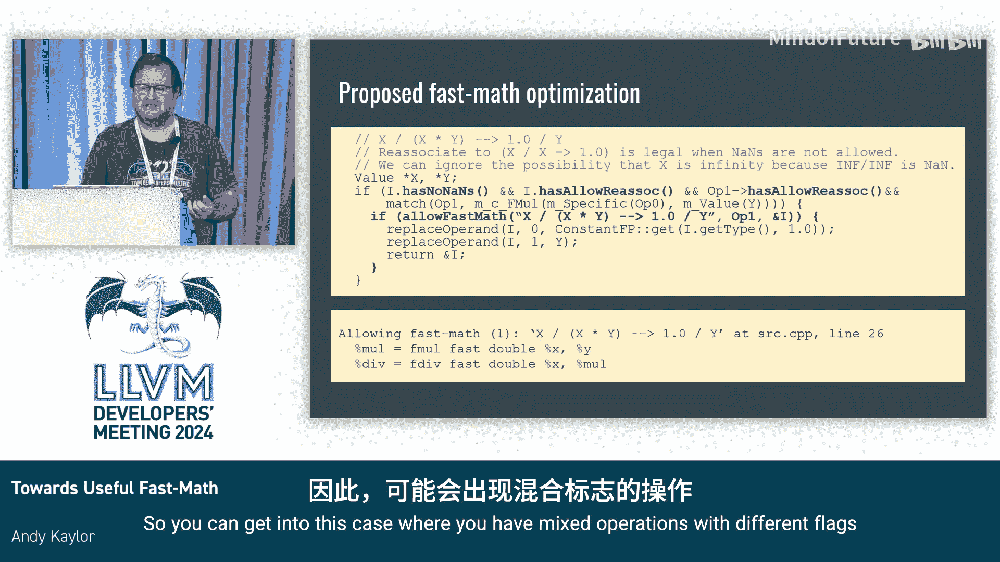

# 【2024-LLVM开发者大会-•-中英】-p03-P03-Towards-Useful-Fast-Math--BV18eNfepENu_p3-

All right， so I'm Andy Kay， I wanted to start out by mentioning I put my email address on here。

 but unlike most speakers here， my email address does not reflect company affiliation。

 I am currently an independent contributor at LLVM。😊，But so I'm going to talk about fast math。

I don't know how much to assume about what you know about fast me。

So I am starting from the perspective of looking at both the good and the bad。

 if you already think that fast math is dangerous， then you can kind of tune out the part where I'm explaining that。

And if you already think it's useful， then maybe you know， you can。

Look at your phone while I'm explaining why I think it's useful。

 But if you don't already think that it's both dangerous and useful， then I hope you'll hear me out。

And if you do already think that it's both dangerous and useful。

 then hopefully what I get to at the end will have some。Some usefulness in terms of。

How to make it better than it currently is。So to start out with。The band， this is。

 this is just an overview of a few things。 One of my favorite things from the old GCC documentation for the S F fast map。

😊，Option is the documentation used to say that this option would either make your program faster or die trying。

So the die trying part， I guess is。😊，The problem with this option。Recently。

 we had a discussion on the Elev discourse about deprecating OFAS。

 and there John Chesterton suggested that OFAS means make it faster in the wrong mirror， please。Now。

 I don't know what his intention it was， but I think this is a good interpretation of O fast and fast math in general and。

Making it wrong seems like something you wouldn't want to do。But I think in the case of fast math。

 that is the intention。And I'll explain why that might be okay and why it might not be。嗯。

But in general， and then the last thing I have here is a link to a blog post that Simon Byne wrote a few years ago that goes into the issues。

 So I think this is really good。 no one to include it as a reference。

I heard it suggested that fast smash is a foot gunn。

And I want to suggest that it's actually much worse than that。

 Fastt math is a case where you're giving the compiler a gun and asking the compiler to decide when to shoot you in the foot。

And it will。So want to go over some of the problems with fast matching。

Fast math will almost certainly change the numeric results of your program。

A typical example here showing reassociation。 This is doing just you know。

 basic algebra1 kind of changing around of an operation。 But with floating point math。

 this is going to give you a different result in a lot of cases。

And this is the basic most fundamental thing that happens all over the place。

 even if we don't find optimization opportunities， we're likely to do things like this just to canonicalize the input。

The next thing I have here is that fast math will optimize away explicit checks for Ns and infinities。

 Now， I should mention here I'm talking about fast math as if it were a monolithic thing。

 if you're familiar with the IR representation of this。

 we have like six different flags that control different behaviors。

 But specifically the no Ns and no infinities， which are put on， if you use dashf fast math。😊。

This will optimize away explicit checks for Nan and explicit checks for infinity。

And so even if you think， you know， I wrote my code I know I handled the name case。

 and then I did the things。 And so you can optimize the things。

That don't have Nan and I' have already checked for that。 But we optimized the way your check， so。

It wasn't helpful。The next thing， as as Joshua mentioned。When in a lot of cases， when we can。

 when we're using fast math， we'll automatically turn on the flush to0 and to normals or0 bits。

And so even though you might not be aware that you signed up for this， you'll suddenly。

Stop getting to normals in your calculations。 And when you get down into that into the value range。

 suddenly， everything goes to 0。And nothing told you why that happened。And then lastly。

 fast math can lead to a complete loss of precision。

Depending on what your algorithm is and how sensitive it is to things。

 we can potentially get rid of your result and essentially turn your algorithm into a random number generator。

This is an example I have where if you have A and B are relatively large values and you're subtracting them。

 and then you want to add some epsilon term to keep track of running error， for instance。

We might reassociate this。 And the epsilon， because it's off scale from A， gets discarded completely。

 And suddenly， you're。Your program is not doing what you want。So。Tur wrap this section up。

 I want to give the worst case example。This is something I actually came across recently。

 This is from a classic algorithm that is trying to programmatically detect the mantesa and machine epsilon。

And it's doing that by looking for the smallest value of the form 2 to the K for which a plus1 minus a is not equal to 1。

So it's doing this in a loop。Trying to find the limit where that。Is。Going over。

And so if you look at this。Take a second and see what kind of IR do you think we're going to produce after optimizing this with fast mathy。

If you guess that we're going to eliminate it completely， congratulations。So what happened here？

Is we look at this and we have this C equals a plus1 minus a。

 And the optimizer looks at this Cs that reassociation is enabled。 And so it says， oh。

 I can get rid of that。😊，A minus a term， and you just get C equals1。

 and this becomes an infinite loop。And infinite loop is undefined behavior。We got rid of it for you。

So。😊，That's the bad of fast math。 So the question is。

 why would anyone ever use this if it's doing these nasty things。And the answer is that this is you。

 really useful for optimization。 as the name would imply， it makes your program faster。😊，嗯。

A simple case of this is reassociation。 If you have written your code in such a way that you have something inside a loop that we figure out in the optimizer。

 we can hoist part of it out。 if we just had things in a different order， then we can do that。

 So in this case， you have。A sub I equals x times B sub I times y。 We can reassociate that。

 take the x times y out， and you're likely to get very much very nearly the same answer you would have。

 but in a shorter amount of calculations。The next thing is vectorization。

 this is something that comes up pretty often。 if you're vectorizing a loop like this with integers。

 no problem， the integers don't have this sort of reassociation problem。

 and so you can vectorize this loop and do the calculations。

 but if you're using floatinging point values here。

 you can only do vectorize a simple loop like this。😊，With reassociation enabled。So that that's。

It's an important case， and then finally。If you know that you aren't going to have Nans or infinite values in your program。

Indicating that to the compiler can turn off some restrictions and enable optimizations that are normally completely valid。

 but。Become invalid if you have name。 So， for instance， x minus x equals 0。If， if x is an n。

 you can't do this。 But if you know that x won't be an n。Then you can make that optimization。我就是。So。

How do we make this more useful？嗯。I wanted to start out with you know。I wanted of this。

In terms of command line options， I'm going to be very showing a client bias here， but。

The the same sorts of reasoning can apply to other front ends。

 I decide I don't know what other front ends might do。

 So I'm going talk about it from the perspective of clang and what clang offers。First。

 the basic idea of fast math and the fundamental options were inherited from GCC。

 And GCC has these two options， D F fast math and D F unsafe math optimization。😊。

The problem with these two options， in my view， is which one sounds like is's going to be riskier。

 Do you want fast optimizations or do you want unsafe optimizations。 Yeah， obviously。

 you're going to want fast， right。But the fact is， the main difference between them is that the unsafe optimizations doesn't make the assumption of no ns and no infinities。

 And so fast math is actually much less safe than unsafe。So in the great tradition of。

You knowThere are many， many options that you have for controlling floatingloding point behavior。

 and it's hard to keep them all straight。 So we added another one and。诶。One more option here in Kang。

 we have this option FFP model， and this can be let you set what we think are the broad categories of behavior you want。

So we used to have just fast， strict and precise where you know that determined whether you wanted to enable fast mass。

 whether you wanted to value safe optimizations only or whether you needed full exception semantics and everything。

But recently， we've added a new option aggressive and separated that from fast。

 So now if you do FP model fast， you get something like the F unsafe optimizations。😊。

And if you want to push a little further， then you can use aggressive and get what fast used to do。

 which is。Mostly equivalent to vast math with a few extra things。And finally。

 there are many individual options that let you turn things off。And this is useful because， you know。

 some of these things， like， if you're not checking the ano value。

 you should really be using the F no math ano because that lets us do optimizations on the math library functions that we couldn't。

 if we have to correctly maintain aerono。Other other things， you know。

 you can turn individual things on and off。 FP contract is pretty safe。 This。

 This enables FMA and FMA， broadly speaking， is more accurate than the。😊。

Answer that you would get from separate math multiply and addd operations for the inputs you have。

 Sometimes separate operations will。Kind of mask errors in the input values and make it look like you got the answer you wanted。

But it's actually more accurate to do it。As a fused operation， and so unless you want that。

Masking or you want binary exact results， then turn that on is good。And in fact。

 the C language standard enables doing fusing of operations as long as they occur in a single expression。

 So I've noted here we've got one off and fast。And the difference between on and fast is whether we will fuse things that are in different expressions in the。

See and the source。And so you can control things for a compilation unit like that。嗯。Then。

We have pragmas that let you locally control things。

 So if you know where you want to turn turn off the fast math just within a particular part of your program。

 you can do that with various pragmas。 And again， I would encourage other language implementations to add things like this。

 because it makes fast math。More controllable when let's you rein it in。So it's a general approach。

What what I would suggest as a general approach is if you want to see how much you can get out of fast math is you compile everything with FP model fast。

Test to see is are the results within the acceptable range。 And if they aren't。

 then you have to go through and freeze。File that you're compiling， turn it off in various places。

 see where the problem it is。Then。Once you've isolated the file in which your problems are being introduced。

 you can reable it with pragmas。And use that to narrow in on local scopes。But this is。

 this is really kind of a difficult thing to do。 It's a very labor intensive process and easy。

 easy to。You knowGet lost in the weeds when you're trying to do this。So。

What what else can the compiler do to help with this this is。Kind of a long term dream that I have。

 And this is the， I guess， the RF portion of my talk。

What I would like to see is I would like to introduce something in the optimizer itself where we would。

 every time we wanted to perform a fast math transformation， do something to ask permission。

So I'm viewing this as conceptually similar to the biEC option where you can set a limit and say。

 okay， do fast math optimizations till you get here and then stop。

 and it would print out output that would say okay， I did this and then when you get to the limit。

 it would say I wanted to do this， but it was disallowed。And。

I'm envisioning this as something that we would expose to users and users would be able to see， okay。

 when I hit this optimization， that's where my program broke。And use that to。Go back to。

Automating this kind of general approach。Ideally， I would like for this to have been something that in the way that in the optimizer。

 we， where we're checking to see if the fast math flags are enabled。

 I would like this to have been kind of part of the gatekeeping for that， but。😊。

I don't think that's practical。 The way that we do it is sometimes it happens in pattern matching。

 Sometimes we check it in a function before we call another function to do optimizations。

 Things are just not split up in a way that makes this really practical。

So the best I've been able to come up with is just just， you do all your checking， you see that。

Fast mass semantics enable a certain optimization。 And then just before doing it。

 you would call this。And so。Here's an example taken from the current LLVM code where we're doing the transformation。

And we've checked that the instruction has a reassociation and we're about to do it。

Joshua mentioned in his talk that a lot of our checks are wrong。

 and this is one of them because there are two operations that are being reassociated here and we're only checking the flags on one of them。

So as we're fixing that kind of thing， my suggestion is that we would go in add the extra has allow reassociation so that we're checking in all the operations。

 which by the way， the reason I think we got into this state is people imagine this is going to be monolithic。

 you have fast math either turned on for your whole program or turned off。And。

That doesn't work well with the technique I'm suggesting of disabling it in selective places and whittling down so you can get into this case where you have mixed operations with different flags。

But so we fixed the flags， and then。Simply add in before we do the transformation， add a check， say。

 should we allow fast math？Optim on this。 and then this would print。

 I'm imagining based on debug information and various things。 I picture it。

Priting out the message saying that we allowed the fast math optimization and giving you optionally the IR that enabled it。

And so this would help us。To。Find the problems where we have done the checks wrong and also let users see what we're doing。

 and then the user can use this and say， okay， I didn't mean for that to happen。

 I need to turn that off there。So。A lot of work to make that happen， but that is my suggestion。And。

That's what I have。So。Okay。We have a microphone here， and on this side I can run the microphone to。

不是。So。When the warning about using Nan andinfL did upstream。

 I did clean up on our internal code base to fix places where people were trying to use Nan and N was fast math enabled。

 and one of the things I did try to narrow down which parts of it were important。

For them and I guess it part of doing that is like almost all the cases。

 it only performance only actually mattered for reassociation and sign zeros and everything else is completely irrelevant and I thought that was sort of like an interesting result。

😊，That， like。What I would like to see is a way for the compiler to tell the users that like， hey。

 if you reassociated this yourself， like maybe you wouldn't need to send any flags or something like that。

 I don't know if that's viable。Some way of like， instead of even having this flag。

 if we could eliminate。Fast math by telling the users like， hey。

 if you change your code a little bit， like then you'll get the desired semantics without having to set this globally affecting。

 flag。I don't know。 Is that something you've thought about。

 So I think that that would be useful and something like I'm suggesting here with the allow check。

 we could possibly refactor that to you know， make it a optimization remark where we say。

 we saw this opportunity， but we couldn't do it because we didn't have this。

As far as you know the user fixing it in their code in a lot of cases。

 I think that's reasonable in what you would want as a user。

 but there are also places where in the code things aren't together。

 but then after a chain of optimizations we bring things together and thats that exposes the reassociation opportunity。

 Yeah so I don't think that you can I don't have any intuition necessarily do everything that but I don't have any intuition about like how often one or the other happens So just as like。

Niveively， it seems like it would be nice。If this is possible to explore and like if we could find out。

 that in fact， like most of the cases that actually mattered。

Just changing the code a little bit or like the sum case we you have a loop adding up all the things like you know we have N C++ now you know the like parallel algorithms or whatever where you could actually just specify yeah a call like I don't care right and like that could just automatically set you know reassociation and then users never have to worry about it Yeah。

 yeah that is a good point for because a case like that you really you know with just plain C semantics you can't there's no good way to say go ahead and vectorize this loop but like Openmp has the ability and and that raises a question when you use openmp and say Cd on this loop does that mean that you can are explicitly giving the permission to use reassociation。

 I think we probably should interpret it that way。But yeah。

 there are definitely things that could be done。So we very nearly have a class already in LVM that can kind of do this bottom part that you're imagining so there's optimization remark emitter that can basically on the front end will like we expect frontends to kind a minimum level of debug info that way they can match up like source in line info the issue is the ergonomics of it are kind of bad and Kang you would say capital R passM equals and then an LVM specific pass name。

 which like as an end user of the compiler like I have no idea what pass did that transform is that combined is that selection D IO know I don't know。

 but even as someone working on LLVM whose's writing passes like that。

 I'm just boom I wrote the optimization， oh I forgot about debug updating the debug info and oops。

 I didn't insert optimization remarks about know we did this transform where we didn't do this transform。

 but might be very helpful to say our passM equals floating point reassociation。

And then have the compiler stood out a bunch of things like this saying because。

 I did not do this transform because you did not enable F。Reassociation or whatever。

 right kind of thing。Yeah， and so you you could do this you know without remarks。

 and I'd like to say at least you know， the basic framework leverage also kind of mentioned。

 but I want to have a gatekeeping feature where you know。

 will automate you also mentioned like kind of finding thing。

 So optimization optimization fuel is like the generic term， I think。

 for like how many times you perform a transform。 And that helps you bisect like when you do a transform many。

 many， many， many， many times which one introduced。😊。

A problematic change so maybe that's something that can kind of get mixed in I think you have that for some passes but not a generic functionality like C opt maybe controls that and then another question too is you know we want to build a live sea for LVM that's very very precise。

And the trade off there is like again， we're going to have potentially users that they really care about fast math and they're in that camp firmly of like。

 I don't care about precise results， is there a way to detect？At runtime。

 has someone set fast math set a terrible idea for libraries to do that kind of thing。

 you should ask the next speaker。 Okay to the next Yeah， yeah， so。

 so being able to like choose different implementations of the the math library based on what your fast math。

 I think a very useful thing。 we。 And then the prags are a nice way to chop it down maybe statement attributes could be used to say。

 like， I'm calling sign here， like I don't care about care number。😊，Yeah。

So I have a question So you mentioned that you're going to instrument this in all the places where the transformations are going to happen I that how that's what I'm proposing Okay so like how do you plan to maintain it like because there will be more optimizations coming in so how do you that's one and the second thing is this is you know you're trying to do it for the debug information purpose right so now this code is instrumented all the time so if you're putting it all around the code so what about the readability so like。

And do you want it to be in a release build of you know the library I want it Like in a release bill。

 do you want to have this instrumented go Like this is more like an instrumentation right like you're adding this check before the optimization is done。

 So if if I don't want this my actual you know build of the library how do I get rid of it。

 So like a couple of questions Yeah， so so for that last question。

 I think you what we do without bisect， we do this know on every pass that we run。

 we call a gatekeeping function。 And if you haven't used the option to enable that。

 it just always returns true。 And that's kind of what I would imagine here。

 So hopefully that would be a very fast thing and know if's or maybe meeting them in line kind of thing Yeah。

 I mean。I don't know if if it would have a big enough impact。

 we could potentially add a way to have it automatically optimized out when you build the compiler。

 say build without this and it would。And know first question where like how do you plan to maintain。

 Sorry to catch you off But you are running over time。 Yeah， so， so maintaining it that that's。

 that is the big problem with this。 is， you know， like I said。

 I'd like to have it built into the check for the flags， but I。

Couldn't find a way to do that scalably。 And so really。

 code reviews would be the only way to maintain it。Okay， thank you， Andy。

