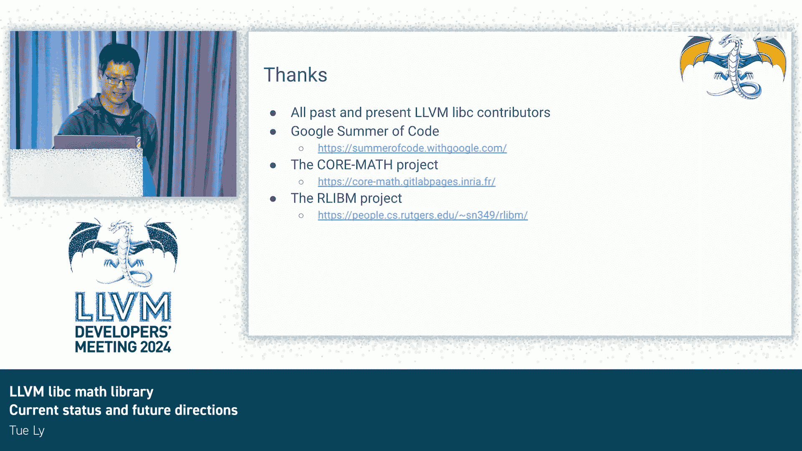

# 【2024-LLVM开发者大会-•-中英】-p04-P04-LLVM-libc-math-library---Current-status-and-future-directions--BV18eNfepENu_p4-

Hi everyone。 My name is Tu Li and Komi Lee， and I'm currently at Google。

 and I'm one of the Lipsy maintainer， and I'm focusing on the math functions。

 So today I'm going to give an update about our current status and the future directions that we are heading to。

😊，So I of you who。And new to this。 What is LM lipsy。

So we are agree to implementations of the C standard Library and the LM umbrella。

And we are focusing on。The C23 standard latest one。

 and we're also fill in with the posts6 and other things that the users need。

And the implementation language is mostly super first， and which bring in some w in life assembly。😊。

And so why is our goal our goal is to be to implement complete C23 standards。

 there will be a link if you are looking into。And a bigger goal is we want to have a one lit see for everyone。

Where is any of the operating systems that you care about？Or some of the modern CPUs。

That people interested in or embedded system use case。And we also worked on the GPUs。嗯。

I wish that someone from Intel can give us some of the in Intel GP viewsUs， then we can edit it。

And here's the link to the homep page。And so what is about AVM lipspsy math functions or teleine？

So we're implementing all the C 23 mass function， focusing on the highest priority is accuracy。😊。

And of course， for it to be useful everywhere we need performance。

Also portability and configurability， because we know that there cannot be any one size fit all for everyone。

And the standard right now that we are focusing on is on the binary floating point， IP754。

And the latest center is 2019。So this is the homepage status。

 and I'm going over more details about what we are really focusing on。So about the accuracy。

 how accurate are we improvinging the math functions and if you heard the hints from the previous talks。

😊，So we make it as accurate as possible， and the ultimate goal is to make it correctly routed for all routing modes。

So at the moment we tested it on the 4 default fold rowing modes on XA 664。

 I know the arm has another rowing mode， but we didn't have well we didn't edit。

 have time to edit for that rowing mode yet it's T away to zeros and actually I don't know。

The macro name for that yet。And。Right now we are doing what they call the dynamic roing modes where the roing mode is specified by the flame point environment。

But then， of course， from the d one， you can。Do the static rowing mode simply by enforcing the worry mode at the beginning and the end。

So one。Very big advantage of correct running math function is that it will imply consistency。

 and this consistency will be across all the platforms， all the CPUs。

 all the O and anything you can think of。😊，And even the library functions。

This will significantly reduce the total ofs or integrating the new Liy versions orpen versions into your applications。

Because and we do see this advantage or this one play out inside Google when we integrating the new mass functions。

😊，And the flow point， especially right now， there's a lot of。Weally learning AIs。

 where they essentially just store all the bits of the flow points results into the database and good more consistency on the math functions will be hopefully more。

😊，Confidence that the data of models will。Read the sames， wherever you load。

 you store a load or compute it on R or X A6 or GPS。Okay， and so here's the。

Accuracy report across them。The lip aims by。The researcher group India。And this is for LVM 18。

 and so far we are almost the only one that try to be as accurate as possible。With 19 and 20。

 we are going to have more and we are going to build some of the spotlight at the bottom from GLpsi and IML。

All right， so a lot of people concerned about the performance when we talk about the accuracy。So。

What course are we。The Greek accept in order to reach that accuracy。 Well， turns out not bad at all。

So overall， you can。 So this is the plot about the latency relative to the GDC。

 the system list see that I have on the machine。 And this is on the。😊，AM some of the AMD server。

 I believe it is N3。And so this is the lower， the better。

And as you can see that some of the functions that we are little bit slower than Geney。

 but a lot of them we are actually a lot faster。And this is for the latency and you have this on average。

 if you take the geometric means of all of them， we are about 15 or 16% faster than GpsC or lower latency and GlibpsC。

😊，What about a truth foot？You have actually， similar plot and。

It's actually a lot better on the right hand side。So on average we are about 25 to 30% faster than higher throughput and jealouspsy。

 so for the block that I put as recical throughput， so that is have the same shape as the laency。

 so to get the throughput differences you need to import them。😊，All right， and this actually。

Help us to reduce the computation cost a lot to the machine learning and AI。

 because one of the very hard functions。In machine learning and AI is hyper work tension。

And we are significantly faster than any of other libraries by now。About possibility。

Most of our functions， implementations are in platform of Na， simple first。

Or you can say that it's on sort like C style or C++。😊，And。

It can be built on any platform without F point units or even without a F point runtime library support。

 thanks to the current effort， so we are having all the pieces that we need for a generic softload library。

So we have the integer based implementation backup for all of the basic。Fll in point operations。

And we also have a template big individualteger class that surprisingly work quite well。

 even for 10000 of bits。You might want to optimize for the performance of your target if you need to。

But so at the end of the day， all you need to do is just a single individual task that we can spawn up the whole entire F point environment for you。

And。All of the platform dependent annual reporting fors can be submitted within our library with some conflicts。

 What there needs work to be done so that you can be a standal alone lip and library。

 that doesn't depend anything on Liy and that can。😊，He ran anywhere。A lot of configurability。So。

We provide， now， let's say， we provide support for a various use case at build time in your config。

So we can。Now create your own set of math functions that you like。 There might be some dependency。

 hopefully the will be resolved within just create some of the text file list， the functions。😊。

And passenger。Pat on the Cic command。We also provide sorry to provide some of the optimizations options for your math functions like no an。

 no accept before rowuting mode and small try to optimize for code size way so far from what I've seen the one that take the most of the coast size is the lookup tables。

And also， we can allow you to be a little bit less accurate by skipping the final accurate pass because that's actually pretty costly。

Then but then we can provide the provable up about errors for those。Imrovment patients。And well。

 if we do them more， we call them this fast map or MaF。

 maybe this is the real one that you are looking for。😊，出先 case。And anything else。

 if you have any the optimization that you need， that is not fitting here， please let us know。

Allright， so what is our current progress toward C 23。YouLast last year。

 there are some extra things in there。I love this one from the see we referenced on the difference with the。

The new things on C 23 for the maths library were just one line。Anyone from the C Standard library。

 sorry it's from the C standard here committee here。Do you know how many of them？

Neio mathfunction added in C23 versus the previous one。Or how many in total？Thanks。

So we do collect the most。 So in C33， we added recently， we added new two flow pie what。😊。

The happy precision， which is the flow 16。And the clock decisions， which is float to 128 ish。

 there are some caveats over there， depends on your platform。 and we also add the fixed point。

 which is a C extension directed。😊，1520 years ago。And recently。

 we completed all the basic math operations for all flight tool points。And yes。

 there's a summary for you， it's about 300 something。😊，And here's the detail list。

 if you're interested in， there are some。Differences in the number of you depends on how you count it。

 For example， I would， I would count the square root as。Non basic operations。

 even though most of the hardwares support it， but for example。

 the float container does not supported it。In hardware。

And this is the link to our current status if you're interested in。

About the higher mass functions or transcendental functions。 Well。

 transcendal transcendental plus some other one like cubeubto hyperbolic。 sorry， Hy。

And currently we have about one fourth of them and all of them are correctly routed to all the routing modes that we tested。

And there are currently three of them that I only implemented the FastPass， which has1 euroP。

 So basically it just give might be difference at the last bit。

And I plan to fix them before C20 cut off。So here's the list of them。

 And we finished most of the C 99 float functions。 So I think there are three missing C 99 functions that we needed。

 The rest of them are C 23， and the double precisions are focusing on the long double as Joshu talk mentioned earlier。

 It's like map to four types。 So we would like to focus on one at a time。

 And then we will fix for the long double later， unless you really need them。 And the float 16。

 even though it's new， it's making a very good progress and it will catching up with the float and double very soon。

😊，And we also started to work on the float 128 math functions。

So this is the link to the current status page。Alright。

 so let me go a little bit into detail about the CT。😊，Three types support for health precision。

So this is the name specified by the C standard。And this is the kickoff with the Google Sum code project that we have。

 that we're lucky to have this summer。😊，And啊。AtThe end result， we have a block pulse by Nicholas。

And he's going to talk more about that tomorrow。 So if you're interested， please attend。

And here's the link。Right，It has a very great performance potential with the future hardware when we have support。

 and we do see that with some of the newer phone that we try on and。😊。

I think it's going to be very good use for other small platforms。But。Well。

 there's no fun if we don't have any things broken。对。Well。For example。

 we have like which cast we run into like which cast function thes that work on all the platforms that we care about。

 And what about plan which is Gcc generate code or the ABI and compiler and Gcc。 So thanks。

 the he went into these very detail and。😊，He posted this So I'll keep a link in here。

 but I won't show it to you because so that if you not following the link。

 you can follow go to Nilas Talk tomorrow to see those。All right， about request decisions。

The C3 three ties specified as。F time to 128。In real is a little more complicated than that。

 but the float mat is a very good replacement for if you want the platform consistency to run across the platform。

 because in case you don't know。 And in case Josh didn't mentioned it explicitly， long double is。😊。

80 bit phone points on X A 6 Linux。It is。Literally just double precision on Windows and MacOS。

 and I think there might be more。It is 128 bit web precision on ArRx 5 and Androids。

And this also this one we just learned about very recently， it is double double on power PC。

 and I really don't know how to implement that in hardware or。😊，So， well。

 just like longevev has some weird things with that high， coefficient also have similar things。😊。

Which one are we going to use， can you guess？I actually don't know either。Yes。Because for C。

 you don't have much problem with the A， but we are implementing in S first and most likely there want to be supported in C first。

😊，And it's going to hit into the ABI issues or the name mangling issues with these three mixings around。

 and I hope the committee is somewhere here help us to figure it out。😊，Okay， see your see。

 clang or Gcc。And this is a quick investigation that we have。All right。

 and the new one that's from the C support is the fixed point。

 so this is specified in 2008 as extension for embedded processors。😊，And we implementing right now。

 Clang and LBMLC is the only open source options you have for fixed point out of the box。

This does provide signal speed up and cosside reductions when it's applicable。

 so we used them one of my colleagues here and we work together and put them to replace softload on Pixelpe。

😊，And。The current support， we have just a few functions that needed by that project。

 but if you are interested in provide your special fixed point functions， please talk to us。😊。

So for the near futures， we would like to finish all the C33 math functions and pieces。

 sort of orders， and also fixed toy， we started the complex support very recently。

And we want to expand to make sure that all the other platforms has the same priority as what we have for X A 664 right now。

 I think currently， the blocking one is just our。We need more people。 We need more help。

 and we need more bots， actually。Then also on the OS sign。

So a little further one with this is a continuous work that we'd like to optimize for performance and closeside for various targets。

😊，And I apply， I really want to start a vector math library， lip hand back。Hopefully， sometime soon。

 And next was flow for support。Because。Just for completeness。

And also the Cs special map functions is in our list that we are looking into。Next。

Also with the correct routing implementations， then we can support the C+ 26 con explore math functions and this is the collaborations hand in hand。

 please come to Mike。Colleagues talk tomorrow about this collaboration between Liy and Liy purpose。

And so maybe we can really replace provide one single implementation for all the run Tas for the math functions to be used in priority doing AP floatat and other runtime libraries。

 so maybe cheaper hands。😊，Okay。Any more flowing fo types like B416。

 or we can really make Intel 80 bits flow points to be run everywhere。If you're interested in。

 please come to us or float to 256 for shadowing qua decisions if we need to。

Thanks special thanks to all the LM， Lipsy and LiN contributors。

And the Google sum of code for providing excellent support for app machines。And the Com project is。

For us to have the inspirations and collaborations closely。

The Li project and two of you， thanks for listening to me。So almost。Okay， thanks too。Again。

 we have a mic here， if people want to line up for questions or if there are questions from this side。

 I can run a mic over here。Yeah， very。How do you support the new C23 F of Round stuff in the Lipsey Library？

one that lets you do a static grounding of each of the standard and math library functions。唉。Yes。

 we can support that but we will need some way in order to fix make sure that the running environment is fixed and I guess that is the easiest way to add current support for the CR the correctly routed math function in C23。

But there might be some performance。Penalties， and if the performance becomes a pro。

 then maybe we can try to reder a different algorithms for those running mode。

Are there any configuration ups to reduce the accuracy and increase the performance of this library because sometimes we just don't need the character around the result。

 or functions。 Yes， so for single。So we do want to add the extra the options。

It just it becomes like the maintenance cost right so if someone really need those the issues and you might look into wheel。

 those have to be like based on the function function basis and most our implementation for single precision。

 it's just a single pass and there's no accuracy pass at all So unless you change things inside the implementation。

 this is going to be a little tricky to control the errors but for double precision。

 we do have to run on the Fastpa and the slow pass and right now the Fastpas we do have the static or we do have the formal proof of the error valve and that one that is the current easiest options that we provide right now it just use the fastpas and forget about the accurate path。

😊，But if you really need a much lower。A much lower precedence than if there's an etho。

 we can specialize for it。And another question。 for instance。

 I w run this library on some specific hardware and my hardware has in a hardware instruction that implements some function。

 Can I specify。嗯。Target dependent implementation for a function in your library。 Yes， you can。 Yeah。

 there are way for you to extra。 I think， but I guess the best way is to。

Add them into the variance if possible the compilerbuance so that we cant just rely on the compiler varianceance instead of like have to do the EliI assembly No。

 I mean assuming we have intrinsic doing function。😊，Y， yeah。 then。

As someone has no idea about the implementation of this sort of stuff。

 I'm just curious as to why you can't tempemplaize the implementation of like a math function for all the different。

It withs。Fun， so。In general。For some of the方呃 for some of the functions。

Especially the transcatoral functions， the fast way to do it is to do the polynomial approximations。

And to control that errors。Theoretically， we can sort of temptify them， but its extremely hard。

 And it's it will not satisfy the performance for different types。 And lucky for us right now。

 there are not that many types， but if they are like。Tens of20 times。

 Maybe we'll sacrifice the performance a little bit for each of the types and then just tempize them all。

 yeah。Hey， so in your list of the build options where you can build the Liy with different configurations and ignoring different things。

 I didn't notice one for do you have an option to build？

Ignoring names and infinities to get rid of the special。

 Yes I just think about that when in your tops and definitely you can create an issues and then we will address that And when you build with those different options I there a way to get it to like build that into the function names so that potentially I could link against multiple implementations and so choose so the capability for updating our your system or our macros to EliS with different names is requested and we are going to address that soon because sometimes you want a single functions。

 but then have multiple names， for example， if you want to pack it into for example。

 the long double one you don't want to have two copies of long doubles and F 128 you want they are LS to the same functions and yes we are going to address that thanks。

Hi， for the vector library do you expect that the results will be the same as the Scalar library。

 do you have an opinion about that so the vector library is going to be something that's similar to what we are doing with the GPUs that if you are requesting the most accurate one you don't pass in the FA card or anything。

Then most likely will run we will run the fast pass on the vector persons and then we will do a quick check there's a test to see whether the result is correctly routeed or not and if is not then we will run the scalar for the those that fail and I think that's going to be the approach that we are going for the lip end there and as so currently the failure rate for the accurate pass we aim for it is about。

😊，At least the accurate pass should be like at least 99。99% something like that。

 so that is going to be very rare for you to hit the slow pass， but yes。

 you can chop that up Okay great yeah and what's your plan for FP1。

So I saw that in Joous was C++ do you expect that to be a hurdle in woodtrapping？第。

Mo strapping on the embedded are embedded。Contributors are helping us to。So bootsrapping on embedded。

So I think there is a current effort to make the lips first and things work on the better system。

 So I。Expect that we should be able to help somehow Okay。

 I guess like the question is that you will require a cross compiler C cross compiler as opposed to starting the C compiler。

Yes， yeah。Okay， thank you very much。Thanks。

