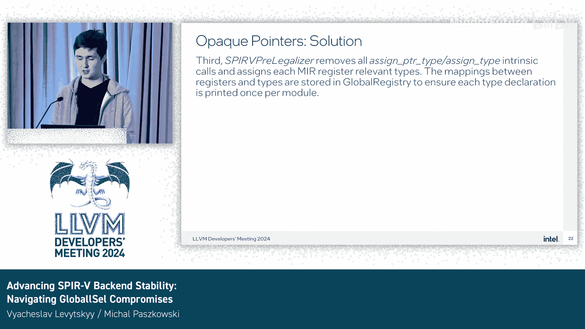

# 【2024-LLVM开发者大会-•-中英】-p05-P05-Advancing-SPIR-V-Backend-Stability---Navigating-GlobalISel-Compromises--BV18eNfepENu_p5-

Hello and welcome to the Spirit backend talk。We will discuss challenges of producing SpV from LVM IR。

After a brief recap of key concepts， we discussed technical problems of translating a semantically rich language using global ISO backend。

Prece to real issue samples and conclude with matters of stability and future work。

Talking about stability Ba became a major project and the step in various tool chains。

 conformant with open seal close to conformance with SQL GC++。

 is good better integration with external proofs and libraries。

Main progress is related to general logic of translation and overall stability。

 applicable to both compute and graphical flavors of spri。

 and it's not specific to any single vendor。The second has a lot of new features， extensions。

 built intrinsics， but we focus now on how to be a global IL backend for a high level target detached from any hardware。

Spiry is intermediate language for representing graphical shader stages and compute kernels。

 It formal specification is driven by Kronus Group and the Beckend is developed by Kronus member companies。

The rate to develop peer standards by publishing an extension to a set of core rules。

 Sp is a portable and stable cross vendor program representation for a wide range of hardware and it helps in the same way as LLVMIR。

 abstractstructing developers from vendor specific instruction sets and front end languages。

The key challenge in mapping LVM IR to Spri is both a high level representations Spri is inspired by IR and it's a semantically rich language。

Probably we should name the mapping translate into Sp rather and sp instruction selection to make it evidence that the task differs and not always obeys usual JSL translations h and machine ver expectations。

Another challenge is that period doesn't represent any real hardwareware。

 It means to be portable vendor and hardwareware agnostic。 The period target。

 meaning behavior and properties is just as abstract as the sp format itself。

 So we expect period code to be translated later into an accelerated instruction set。As an option。

 it can be encoded back into LVM IR， so we don't need register locations scheduling and we defer hardware dependent optimization。

There is no formal semantic and proof assistant to ensure translation correctness。

 but there is the Chronosphero2 to post check that the code matches the specification。

Spirit type system is rich。Mobel call placed unique ideas of use types， constants， strings。

Note that pointers are typed backend in first types in general and deuces plain T types in particular。

Adds to this complexity of inserting proper bid costss。Also。

 a Lium code base is effectively ban usage of type pointer type。

 even to passively keep point T in4 between passes， and we use an extension type instead。

Also will mention subtle differences between semantics of statements and instructions。

So first a little context。Necessity and complexity of type inference a causeded by difference between the concept of virtual register and Sp ID。

And the fact that low level types cannot express spvy types。VX are still an abstraction。

 but they impose a vision of a hardwared dependent layer and restrictions on content and operations。

This is a gap with the notion of Spirit Id。 that is a high level concept referring to entities like object type and function。

Spirit has a developed type system， like other high level languages。

 with composite types and applications leading to target extension types。

Compares this to low level types that are designed to machine instructions and low level languages。

Where all complex is decomposed and reduced to a minimum info。

To relate original IR types to final spiriteotypes we in place two actions enrich IR types with annotations。

Traccing relations between I valuess deducing implicitly present types and link IR values and Geir explicitly because collagen doesn't keep track what direct is related to each I value。

We will look for known patterns to relate value and apparent types。

 analyze composites and function co size and revisit uncomplete types after allal functions were processed。

Bken uses a global state to trace associations and introduces internal service intrinsics。

To preserve links between high level aspect of code and its low level representation。

Agregates lowering is a good demo for technical option solutions and trade offs。

 So globally As anticipates the advent of physical registers。

Sity has no instructions said architecture and expects that a single I represents an aggregate。

 and it will not be disintegrated into low level types。

An aggregate argument gets flattened in IR translator， producing multiple vers。

 It makes it impossible to translate the call。The initial approach is to remove aggregates so that a call is mutated to replace aggregates with Iot2 where record this changes and later story a valid type drawbacks of this approach were revealed by S test suites It's impossible to deduce and store a correct type before error translator due to omnipresent type Iot2 So to test correct aggregate types we use mutation in full to get original function type during type inference。

This doesn't eliminate the root cause and arithmetic with overflow and intrinsic is a good demo for the issue because I code thegen pipeline may insert them later when the backend pass is not able to mutate the call。

 and they return astruct not isottm。A translator has no special translation for Beckend intrinsics used to map higher values to Vx。

 A Beckend service call is an unknown intrinsic for a translator。

So when LVM Is get mapped into verex， aggregates get flattened， producing multiple verex。

 and such a coal will not be translated。Even an explicit call faileds， in case of this intrinsic。

 is there an attempt to mutate the call due to your wrong function signature because expected result is struck。

 not Iot2。Or if we don't rewrite the call， a translator just gets multiple res and stops。

So what options do we have？We could manually unfold intrinsic。

 translating them early into equivalent aR。 that works but ignores generic shared code。

It's not the case when we wish to modify global isoologic。We could employ a custom call lowering。

 it would our complicate solution， though， both in terms of development and maintenance。

So our final option presents presents a much cheaper solution。

 We opt for improving existing approach。 Beckend utilizes LVM fake use intrinsic to track the original IR value for the aggregates argument。

 This links a high level vision of code with its low level of presentation。

 We also insert backend internal intrinsic to store in metadata a name and original type of error value。

 Otherwise， it would be thrown away These issues resolved in this case。

 and we used can gen code logic avoiding a burden of maintenance of target independent changes and an overhead of developing a custom code lowering。

About controlourflow， like IR security also has models of functions， functions for basic block。

 etc cea， unlike IR， ce units， so GPU specific compilers like to see CFG structure。

Computationional flavor figures this out， but shaders require structured control flow。

 Next is that it's commonly unexpected， but a label in Sp， in fact， is an instruction。

 starting a logical basic book。Also， it's not possible to delete instruction after the unconditional branch。

 it's the last instruction in a blog by the spec。There is no instruction to encode if then only use an else。

 So as a result， we do not allow to restructure blocks as a branching optimization。

 like in branch folding if conversion， because it potentially breaks structured controlflow and anyway it's hardlyrr useful。

Now we proceed to brief demo from several recent PRs。 the fourth is simple。

 Asim printer was hard quoted to ignore possibilities at the label concept as it understands it。

Maybe be absent in a target。 An intent to keep a simpleprint or agnostic about targets made the fact that it always created a symbol for the end of function。

 if valid the bargain voice present。 In this case， the solution is to check for a format and gras grants review a right to differ。

We check for the format， but in general， label concept is defined on the level of that target。

My elaborate example is on the screen， so on the left R1 are two pointers infer as I8 and I32 types。

AR has no explicit point type， but a chain of a localca。

Return from function and assignment makes it possible to proceed with type inference。

Below a line of fine note types of the incoming error1 and R2 values must be the same。

 So on the right。In back end code， you see inserted a bit cast between assignment and the fine node。

 that creates a problem in LVM， such a bitcast is a no op instruction。

It is not known of for spiritualvis。Without the bidcast5 deals with inconsistent apparent types。

So machine Ver validates G underscore bitcast and we see an error bitcast must change the type。Well。

 it does for security where we require a bit cost to change a painting type。

Given we cannot have optional restrictions on op codes， we still could make it target dependent。

 Think of adding a virtual call to fine tunes the lowering process。

 Beckend could implement its target lowering rule and overwride the fault in various status of no op bidcast。

Meanwhile， all we may do is to choose a kind of an error to be invalid due a type mismch in Phi or using GND score bitcast on pointers。

Even more important example is about fine node。 So hope Phi in SpV is nothing else but a final node。

It starts a basic block， has pairs of incoming value and label per predecessor， et ceter。

 it has a difference that is subtle not the point of this example。After instruction selection step。

 gender score Phi of code becomes op Phi and mention whereifier starts reporting if we write depths don't dominate all users。

The problem is that traditional instruction sets do not implement fine instructions， but sp does。

Possible solution could be that Genco doesn't hurt code。 What is P。

But instead allows us to overwride the check。Introdu him a check of kind of whether the instruction of code represents aI。

We presented three cases where first accept the SP is different。

In the second machine verifier forces be to fit into a scheme that is not feasible。

 a somewhat questionable way to fix without watchinging JSO is to generate op bitcast immediately without reusing G underscore bitcast It would have an overhead to visit IR before translation and convert original bitcast to a coal site。

 Also in this case， we don't reuse shared code database and ignore existing bit code。

Bit cast of code。So the short case questions the definition of instruction selection itself in theory instruction selection results in target specific mission instructions and Sp V is a boss。

According to the spec， Sp of P implements the fine node in the SSI graph of a function。

So it looks like an issue to report after instruction selection what the target specification considers valid。

记住刷啦。So first， let's take a moment to discuss some of the challenges associated with the transition to OPEC pointers in LVM 17。

 while anti pointers have simplified some aspects of LvMR the transition has presented some very unique challenges for spV cogeneration in spV and particular in the case of the spv backend pointer element types were not just used for emitting necessary type declarations but also were essential in resolving open seal builtin types and function calls retaining proper pointer cuts and finally in lowering nested types think ofstructs or arrays which are not flattened and spV Now without the explicit pointer type。

Sy backken has to deduce these types， and this must be known foremost correctly。

 and this early in the compilation pipeline。So recovering these types early is much easier。

 so to make sure we recover and retain the types we have three passes working together at various code end stages to work around global ISL lowering and flattening so let's focus on the first one spv emit intrinsics the process of inferring types is logical but non nonlinearar and often nested or recursive first types are deduced from common instructions such as gaps or source for each type assignment the pass emits a target intrinsic either spearv assigned pointer type or assigned type in case of open seal or spv built ins then the pass iterates over calls and adjust opera types emitting spv pointer cast intrinsic when a different type is expected inside of the cold function following these spv emit intrinsics pass tries to deduce types of remaining functions and at the end。

Revisits each instruction to fix any inconsistencies or in other words。

 often just inject new pointer request。 Now， keep in mind that this process is very complex and sometimes subjective。

 For instance， fine notes may have incoming values with different pointer element types when that happens。

 the most frequently occurring type is the one that gets assigned。

 Another thing is that some open seal or spview builts have well known or predefined types and in these cases。

 the pass uses a lookap table with hard coded values。

Following both SpV emitent transics and IR translator we have a SpV call lowering pass and SpV tag declarations or types are also referenced in the sequence of instructions defining a function hence the pass tries to MED sequences in most of the types uses the types assigned using assigned type or assigned point or type in transics One exception is the case with open CL GLSL or any really any SpV building function call where what we want。

What we have in the module is just a stop in these cases。

 the callss get demangled par using a table gen file， the Spv built in T， and proper implementations。

 including the return and function parameter types are emitted into the machine module。

Following the two passes at last， we have the Sp V prelegalizer pass running as the name suggests before legalization。

 which removes all assigned pointer type and or assigned type intrinsics from the machine module and maps each machine IR register to relevant type。

 The mappings are stored in a global registry， This is to ensure that there are no duplicate type declarations and each successive pass can use global registry to get existing or create new types。

 This is not just for pointers， but any types really。

One important thing to note is that SpV has a variety of types such as Optype image or op type event which were previously represented as pointers to OPECstructs in LVM16 a new target extension type thanks to Joshsua Joshshua was introduced to a preserving these types while being in a sense ignored by target independent optimizations this is important for targets such as SpV but also Dx and otherss which require more complex own types in the cogen pipeline。

 Harvarder C drawback so these backends are now really incompatible with IR coming from older versions of LVM due to the OPEC pointer transition Another use case for target extension types is for representing nested types from the SpV image and trans path instead of relying on typed pointer type as staret which cannot be used for creating values。

Lit tests were very helpful in the OPEC pointer transition and Slava noted their number has significantly increased。

 we treat them as our most important and easiest way to debug method。

 way to debug or catch regressions This is in contrast to external confirmance test suit which often rely on specific hardware or require dedicated driver stack we have extended most of our lid test with spv valve lines。

 so this Pv output of each test is piped into Chrona's spv validation tool which makes sure that the binary adheres to the specification Also NaTan has contributed a tool called Superv Sim to test to currently developed Pv Strizer pass the tool focuses on control flow and cross lane interactions and most importantly is less fragile than simply file check lines。

 of course file check could still be used for these tests but the order of check lines would need to always match the output of CFfg not the。

put IR so this means that any contributor modifying these tests will need to be knowledgeable and make correct adjustments。

 so SpB S helps us avoid kind of the ripple effect of changes which would affect the back end。

Scurvy Bchan has changed a lot in the last two years and in many aspects is a better alternative to the Kronos LVM Spvy translator。

 often providing more concise or better performing code。

 So the next natural step is to establish the Spvy Baken as an official or non experimental target。

 We will be following with this after the dev meeting。

 We are also looking to contribute Spvy consumer in the near future。

Thank you very much and I'm hoping we' are open to the questions。Thanks so much。

 That was a great talk。 Any questions from the audience？I， I was curious to ask。

Before opaque pointers， I mean， the point types were never really reliable anyway， right？ I mean。

 there was no guarantees that the underlying object was actually the type that the pointer type was saying it was because。

 you know， we never made those guarantees than I are。

 So how did it ever work for you reliably or was it more like just a heuristic that it was okay to be wrong sometimes。

So because there is not much difference in the level between SpD and LVMIR。

 I think in our case it worked pretty reliably， the one case which I can think of which didn't work at the beginning or which required some adjustments were in case of open C kernel arguments which often。

 as I said， were either just pointers to opPECstructs， but in some cases。

Often open or client when emitting open C L L VMIR just added the actual types into the metadata。

 So that's what we use to make those adjustments in the past。

 But that's the only case I can think of where this didn't work reliably。

 So I don't know if you have any additional example。 we can talk of bit later。

Have you spent much time thinking about the SpearV consumer case and how exactly it's going to share code with the existing SpearV backend？

So I think the easiest idea of we do not have any set idea on how to contribute this Pv consumer when I say Spv consumer。

 I mean， at least this PV reader part of the Chronos LVMs PB translator so we would like to reuse as much of the code that already is in the translator repository when it comes to reusing or sharing the code with the backend one big thing is that we do have already all of the instruction definitions。

 all of the up codes in our table genfil so this kind of naturally would fit in and this wouldn't have to be repeated I don't if have stuff at me。

Yeah， I just wanted to say that it makes sense from purelyA software engineering perspective。

 so you have the same abstractstructionions。Hi， yeah so I have a question regarding the structureizer。

 So like like what's the future plan like is it done or you know what else needs to be so we are not working in a structureizer is mostly guys from Google So you need to ask them but it's in development there is at least part of the structureizer pass already is in the LVM repository the one thing which kind of we need to focus on is how to test this reliably because currently tests with file check are not really a good way to test it So we have this S tool but that's all that I really know about structureizer and do you have is it discussed in the we do have the B working group meetings every other week right now it's on Wednesday So we do have natan and other people joining those meetings So feel free to join and any question that's a part of contribution from Google folks from including these。

For example， the bioox fight that。One more over here。

So you said open C dumps type information in the metadata。 So， so as part of in the past， at least。

 I'm not sure if this was。In one of the Chs repositories if it was in the LVM repository before C fully supported OpenCL this was one of the ideas and this was how it was used。

 we had type information in in the metadata or least for some types like the image or event yeah so that's something we are also exploring in the other dimension whether because of the loss of types information get lost so I was just curious to know so what is the extent of that whether it also dumps the dimensions of the array。

And， you know， it's not just the primitive types， but the derived types also。Yeah， so this。

 this was a solution that was used， but I don't think it was a good solution。

 We struggled with this a lot。 So one thing which Joshua proposed。

 which was this target extension type。 This works reliably。 And the the issue with metadata is that。

Any podcast can just remove dose， and you just don't have to type information anymore。

Thanks again for the great talk and we're going to take just a five minute break to switch between sessions now。

 but the next talk will start in five minutes， so yeah。

