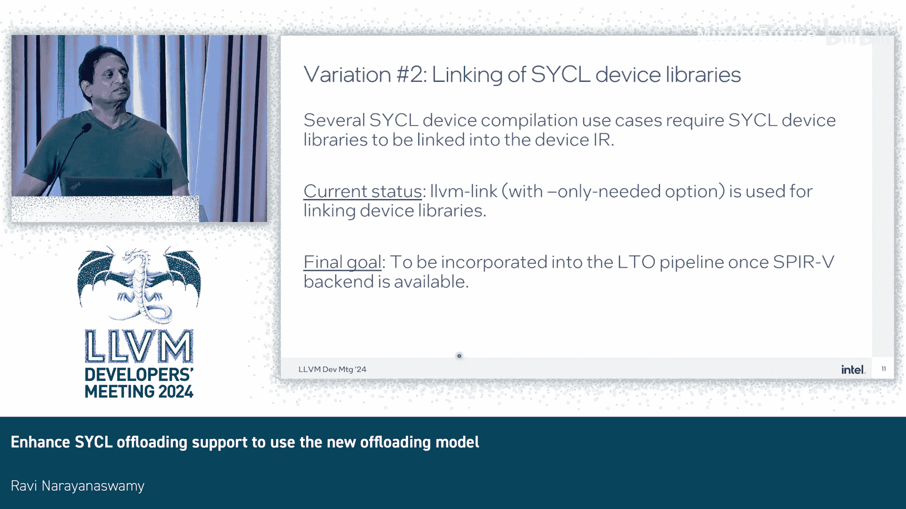

# 【2024-LLVM开发者大会-•-中英】-p06-P06-Enhance-SYCL-offloading-support-to-use-the-new-offloading-model--BV18eNfepENu_p6-

I ready。So I'll be talking about Enical offloading support to use the new offloading model and most of the people working on this project are listed in this contributor site。

 it's Iwin， Maxim Nick， Alexey and Mike。And so I'll start up on the agenda with the overview of the Sle lawloading and highlight some of the important features。

Then talk about the proposed design to use a new offloading model yeah it's sort of when we say new offloading model actually in the community theyve been using the softloading model for some time and that's a default model they're using we just refer to it as a new offloading model because we are right now migrating to that。

Then I'm going to talk about what are the deviations from the existing community floor that we need to make and what are the reasons why we made all this and what are our plans for trying to adjust some of them。

And then I'll talk about the work we have done so far and what we're planning to do next。

Okay so SQL offloading is basically it a SQL is designed for data parallel zm and heterogeneous computing。

 it sort of provides a consistent programming model based on the C++ and API so that you can program for CPUUs。

 GPUs FPGAs and AI accelllators and the compiler as I think enables multiple tools and so generally it involves at least one compilation for the host and then one compile for each target specified。

So let's look at how you would invoke the compiler。

 so you have clans plus plus and then you say f S that means you want to compile where the program contains sicks。

And then you wont also compile for some targets， and so you would specify that using the dash FsL targets and you can provide multiple targets here I'm given an example where you can say Intel GPU YYY and XxX I' trying to hide the names not sure what names we can export so just use generic names and then you provide the test file。

And then yes all the program looks like for a simple program。

 but you may find some incorrect things in this， but the point I'm trying to do is illustrate oh it looks a simple SL program so on the top you have what you call the global data a devir which exists on the device hang on the host and then you have a function where you pass in the queue to the function and then you use the queue to update the value on the device so you do a using the queue do a copy and then you wait for the thing to be completed and then you would do the kernel submission which is highlighted in yellow to submit it to do some sort of submission of the indices into the I think variable which exists on the device。

And so this is sort of the sickle kernel， the tunnel just office that this is the highlight to the other thing is the sickle kernel。

Okay so how does the offloading work with SQL and what are supported so SQL in general the way we do I mean SQL can be compiled to provide head of time PTX code or AMDHSS code。

 but for Intel we always generate the Spry and this pervy you can embed this into the host object file and then it'll be jitter so J is just in time compileilation where you backend compiler during when you're running the program or you can also do AOT whereas you can precompil it during compile time using the backend compiler and generate the device binaries for Intel GPUs or FPTS or openC CPUs。

So here's the overview of the SL compiler using the new offloading model so let's talk about the I'm going to talk about the compilation phase first and then I'll talk about the linking phase。

So you have a SL program here and basically youvo clang on the SQL program。

 so what thiss going to be is like a two pass compile compilation in one of the passes we generate the host object file in the second pass where we targeting for the device we generate the device IR。

And now the device IR is sort of packaged using the Kang offload packager and the package device is then fed of。

Is fed into the object file， I mean that packs it as a object file and it can be packaged into the host object file using the dash F embed offload object。

That's a compiling phase。 let's move on to the linking phase。

 So the linking phase is what the committee uses is called the Kang linker wrapper。

And so let's start off with you have the host object file which we compiled in the previous slide。

 and then you also have some device libraries， the SL device libraries。

So what you do is first thing you do is when you get the host object now it's a fat object file because it contains both the host code and the device code。

 the device code is being embedded， so you extract the device code so which is the device thing LLVMIR and then you pull in all the libraries which are needed to satisfy the requirements of the the application and you do a link so you use the LLV blank to generate fully linked device I LLVMIR。

And then we do what we call a SQL post link and the SQL post link there many reasons for this one of the main reasons is we want to be able to split the files。

 split the IR， the device LLVMIR into multiple things LLVMIR and an example would be you want to split each。

😊，Each kernel， itself shall be contained in a separate image。 that's an example。

 there may be other reasons like you want to split it based on a file or something if youre multiple files。

 you can split it based on a file。😊，And once you split it。

 now then you invoke the LLVM Spry so all backends except mean a backend compile except a Spry code。

 so we invoke a tool which is called the Spry tank tool which converts it into Spry and at this stage if the user specify that you wanted the device object file I mean a device image。

 then we would invoke the AOT compiler at that point。

And then once we get the either we get the scroll we file or the device image with the invoking the IOT and those now are think wrapped up what we use is a tool called a clang offload wrapper。

 we wrap up these all the multiple thing images if they have been split may sometimes we may not split it which will be a single image and then we invoke the clang offload wrapper to wrap it into a single file and now the rap file is an object file which can be then embedded into the host image。

And so no， once we got it that， we got a thing host image。

A doto file with a device image contained in it， and then we invoke the host linker to link in the host code and the device code and to create a single final binary。

And so the host code code comes directly， yeah it's an embedded a binary。

 so we have already extract a dualI code and processed it and now we have this part of the host code which we use them in this final thing host linker invocation。

😊，Okay， so this is the highlight part is what we want to change。

 so that's what we are going to I mean move it into a sub tool called thek clk linker。

And this classicalical wrinkleer is going to process all these things which are highlighted in this duckcker box。

So no， let's look at the or clk signal compiler。So the clsL compiler basically I mean in order to invoke clk you would specify what target is and the target here is per v so we say the target is per v so the Kanggno they use the per v compilation and then be say we want to do invoke the SL link so we specify the option dash dash SL link and then we we want to pass some linker options to this X linker if we pass these options to be used during the SL link in case。

The clang， by looking at this dash sick link， it would invoke the clang sickle linker。

To do all the linking， which was shown in the previous setup。

And so we've already put out a PR for this so that we I mean we can now I think push it to the community sources and there's some ongoing discussions and then some little bit of a debate on whether this should be the tool should be inLk tool or link Lium tool so we need to work on labon to see we best can satisfy our way it should live。

Okay， so now let's talk about the deviations which we are doing from the existing committee scheme。

 so the first thing is view LLVM link instead of LTO bit code linking。

The next thing is we use we link the device libraries during link time as opposed during compile time。

And the third thing is that we need to pass certain information from the device image to the runtime。

 especially if you're doing Jit right， you want to pass all the optimization flags and there are other things based on certain aspects in the kernel。

 we need to pass it to the runtime so it can make use of that and make certain decisions。

And then we also have that code splitting which yeah I mean。

 which we do at the circle post link stage， as I said。

 we have reasons for doing the code splitting and I'll explain later on that one。And finally。

 we use an external tool to convert LLVMIR to Sp way。

 and in the previous talk they you saw that they're working on this direct code generation to Sp way once we have that we incorporate that and change certain things in this。

Okay， so let's talk about the variation1， so we are doing a device code linking the linking is done using LLVM link because we don't have right now a coach and I said like I said they're working on it diligently in as the presented in the previous talk so we use LLVM link and once spur me back and it's available well switch over to using it with I think thin LTO or LTO。

That's a virtue so the second version is the linking of the device libraries again we do the linking of device libraries using LLVF link at the link time and we link it I think based on on a needed basis and we would again if we get the square be back and then we would pull this back into the thing LTO face to link in the device libraries。

And then the third thing is that we need to send information from the compilation through the image to the runtime and especially if you're going to do Jt right。

 we need to pass these options， we got to honor those options of like like you want to user specified 00 or something like。

 and then we got to honor that flag and pass that information to the runtime。

 so when you J you use that flag when you're compiling that program。With a backend compiler。

 So what we we use a string data map for storing this information。

And the next thing is that the S language specifies certain aspects。

 and so an example would be saying that this kernel uses FP64 and the kernel uses FP302 or something so the language specifies that if your hardware doesn't support FP64。

 then youre supposed to raise an exception so we need to add this attributes into the kernel so that kernel when before jet you inspect that kernel and then be able to close this exception。

If it's not supported in on the hardware， which you're running。And so we use again。

 the string data map to store this。And the way that we saw that is we use the structure device image property。

Where we have a name and a value and then we have a type which a type can be a UN 32 or a byte array and if it's a byte array then you have a value size。

And so here's the here's another reason why we want to do also device splitting。

 So let's say you have two kernels and one kernel you've written using FP32 and the other one kernel using FP 64 and the other one doesn't use FP64 so you be able to select the appropriate kernel depending on which hardware you're running so if your hardware supporting FP 64 then you would use that if it doesn't then you would use the one without the F 64 and so you would need to pass this information that's why we。

So we split the device image into two separate images。

 one image containing all the ones which require FP30 FP64 and the ones which don't require and so that you don't try to compile a kernel which requires FP6 pro when you're running on I think GP which doesn't support it and raise an exception because there's an alternate version available So this way we can pass I mean pass this information through the image and so you can pick up the right image and be able to run the program as opposed to raising an exception if it is a single monothical image。

So that's one of the reasons why we need to split and also the second reason we wont split is that during Jit time we don't want to compile all the kernels existing in the thing because you may not use all the kernels in the image you may use only select a few kernels so if you split all this into a separate kernel by itself then you just load the kernel which is needed and compile only those kernels so you reduce the Jit over time and there are also other reasons like if you want to when you're doing AOT right by splitting it into separate device images right you can invoke the backend compiler in parallel and reduce the compile time。

And now the last thing is the variation files we use the external tool which is the LLVM Sp wheel to convert the LLVMIR into a Sp view image。

 and again this is now dependent on the code and being available to directly generate the Sp view code in which case we can remove the requirement for the onto。

Okay so the work so far what we've done is we've submitted RFCs for a couple of them the top level thing last year which think the RFCs is for supporting the full SQL it's not just this part but the full entersQL programming model and then we have added the design for or we go about doing a SQL offloading kind and Spvy targets now this similar talk which I'm presenting now was also presented in the euro 2024 conference Alexi RFC presented this and you can view it if you want on the YouTube link think provided here and then the other thing is all these changes I'm talking about there are two PRs and the review one is to add the I libraries for SQL and the other is to introduce the SQL link link wrapper and would like to acknowledge。

Joseph for helping us in harm。Adddresssing lot of issues and getting I think avoiding our knowledge on the new model and I hope it continues to guide us in that and then also I think we want to thank Matt and Chris and Tom for providing feedbacks and we' hoping to try to get this into the upstream sources。

And the next step is if we' are going to add more PRs to I think do the sickle offloading to the new model。

 one of them is to run the SL final step after LLVM will be added the inside the Sle linker wrapper。

Then we want to change the Kang linker wrapper to invoke the things sickle linker through by invoking Kang and then passing the option that SL link to invoke the Sle linker and then we want to add the offloading logic to the Kang linker wrapper。

 the SL offloading logic and then we want to also support right now we don't have AOT support for any of the targets。

 we have only a J for Intel， we want to add AOT support for Intel MD NVD and once Spvy backend is available were going to update to use the Spvy and get rid off some of the tools and also use LTU。

And that's it。Ladies you so much for the talk， Robby。Any questions？Yeah， thank you。 Good talk。

 So my main question is， you mentioned about using like LTO。

 Does Spv have a defined linking specification for like linking Spvy with Spv。 And if it does。

 then could the ultimate goal be to just make LLD dash sickle or LD dash Spv similar to what we do with like the Web assemblymb to。

 Yeah that's plan。 But right no， we don't have that thing。

 So link we don't have a sickle linker per se。 So we'll have to use the ILium linker Okay。

 thank you I。我靠。So your variation one， why do you need this tool like a separate new tool in the first place。

Why is that not going to be part of what is upstream？I mean， what， like basically。

 you put this overlay thing， go back， go on back。Did one before。

When you had this over okay that would just basically there was the existing thing and then you're like。

 oh and then we cut out this part here and then we make it a new tool why a new tool2 can explain that So because you were told to make a new tool No because there's already existing。

To similar support for N media and all that。 So we want to follow on those lines。 I see， so。

 so existing， Yeah， Okay， fair enough。 We think to not dev too much。What didn？对这。

I remember this is because the Lier wrappper interface basically tries to use clang to generate valid images for your GPU target and the way we do that for like AMD and NviA is DS target and then we' invoke stuff like PTX AS and NV link Sickle didn't have one for that So I told him to make one for it so that's why it exists and this also relates to my question of my suggestion that in the future this is just something called LLD Spv that then does that job for you。

Any other questions？All right， well another round of applause for Robie， thank。

