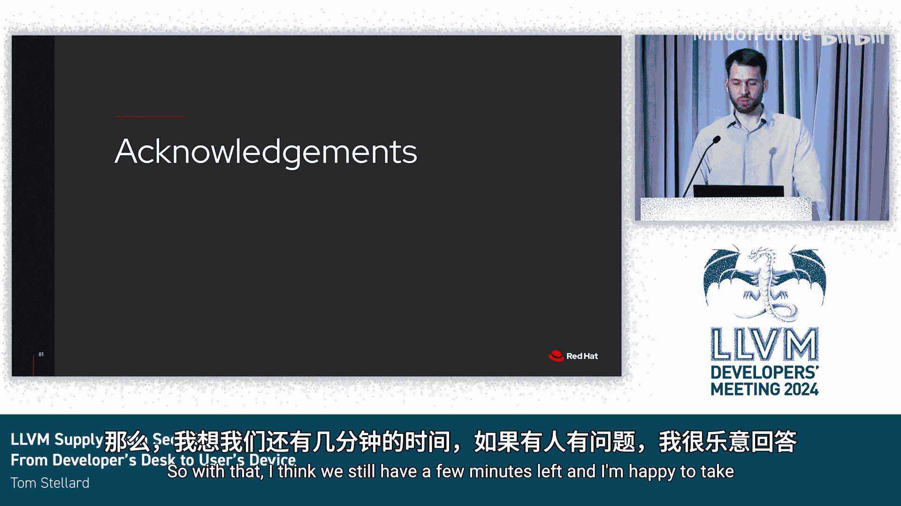

# 【2024-LLVM开发者大会-•-中英】-p07-P07-LLVM-Supply-Chain-Security---From-developer’s-desk-to-user’s-device.--BV18eNfepENu_p7-

Hello everyone， I'm Tom Stard。 I'm one of the release managers for the Eium Project。

And I also lead the LVM team at Red Hat， and so we are mainly responsible for packaging LVM。

 for For Linux and for Red Hat Enterse Linux， and just in general trying to help make LLVM better any way that we can。

And today， I'm going to be sharing with you what I've learned over the past year about supply chain security and what we can do to make the Llean project more secure。

So this is not strictly a technical talk。 It's not really meant for compiler engineers。

 This presentation is for users， product managers， team leads。

 and anyone else that interacts with the Eleium project in some way。

 So my goal with this presentation is to help you learn more about supply chain security so we can all work together to make Eium more secure。

All right， so supply chain security。 What is it， Well， for LVM。

 the supply chain starts with the code that the developer writes and ends with the code running on a user's device of some kind。

And supply chain security is about getting that code from the developer to the user without it being modified somewhere along the way。

And supply chain security is not just something for the software world。

It is something that is important for physical products too。

 and I actually think it's easier sometimes to understand what supply chain security really is when we're talking about physical goods。

 So I have an example here that I think does a good job of illustrating what supply chain security is and why it's important。

Okay， so let's say that we have a company that makes locks， and they make the best locks。

 They're impossible to crack， even for the most skilled locksmith。

So when this company makes the locks， they get a box， they put the lock and a key inside the box。

 and then put it on a truck and ship it out to stores。And these locks need to go a long way。

 and the trip will take multiple days， so the truck drivers need to stop somewhere and spend the night。

So let's say one of those truck drivers stops at a hotel one night and forgets to lock up the truck。

And while the truck driver is sleeping， someone sneaks into the truck。

 takes all the keys out of the boxes， copies them。Puts the original keyback and then walks off with the copies。

So now， when the driver wakes up and delivers these locks in the stores。

 the unlucky shoppers who buy them will end up with locks that can be easily opened by the thief。

 even though they are the best and most secure locks that there are。

So supply chain security is about securing those locks and keeping them safe from point A to point B。

Now， is there anyone here that works for a company that makes locks？Okay， I didn't think so。

 All right， but it doesn't have to be locked。 It could be something else like maybe phones。

How does anyone here work for a company that makes software for phones？Yes， okay。

 so you can talk about phones。All right。When you're distributing software that's going to be running on millions or even billions of devices。

 you need to be able to trust not only that the software is bug free。

 but also that it hasn't been tampered with at some point along the way。

Think of how disrupt it would be if someone is able to execute a supply chain security attack and get a back door installed in the most phones that exist。

As we'll see in this talk， this kind of attack is not actually that hard to pull off。

 especially compared to more traditional software exploits。Alright。

 so let's start by taking a look at the supply chain for our project。All right。

 so this is a picture of our software supply chain。

 It starts with the developer who can either commit code directly to the Gi repository or submit code via a pull request。

Once the code is in the main branch of the Git repository for a while。

 we we branch it off into a release branch， and from there the code gets packaged for our users in both source and binary form。

In general， the code gets more scrutiny as it moves through the pipeline。So for example。

 code may be merged to the main branch with or without review or maybe with or without rank CI tests。

 once it is merged， it's always tested with post commit CI running in the number of configurations just to verify its correctness。

Additionally， there can be post commit review of the code as well。

And then once the code makes it into the release branch。

 it gets locked down even further and any new changes require a reviewer and the review manager's approval。

We even limit who can commit to the release branch to just the release managers。

And now it's good that we increase the scrutiny of the code as it moves through the pipeline。

But one thing that's important to remember about LVM is that we don't really have a simple pipeline with just one start and one end。

So people are actually consuming our code from almost every step of the pipeline。Some。

 and it sounds like maybe most people take code directly from the main branch。

Some take it from the release branch and some consumer our release assets like the tarballs and the binaries。

But it's very important to remember this because if we start adding additional security to the release branch。

 for example， it's not going to help people that pull directly from me。Al right。

 so let's zoom in a little bit here and start by taking a look at how we secure the Git repository。

So we're going to start with a Git repository because this is a starting point for our code。

 and it's the one part of the supply chain that is common for everyone that distributes LVM。So one。

 and probably the most important way that we secure the Git repository is to restrict the commit access。

And how do we do this？Well， we have two requirements that people need to meet in order to get commit access。

 Okay， the first requirement is you have to ask。And the second is you have to give a reason。

We don't have any contribution requirements。You don't have to have a certain number of author changes first。

 you just need to ask and give a reason。And a valid reason is I just submitted my first PR and I need to commit it。

 Okay， so it doesn't。 It can be anything。So I think if we're being honest here。

 I think were to say the bar for commit access is pretty low for our project。

But we do have other things that we can do to secure the Git repository。

 other than just restricting human access。So one of the other ways we protect our repository is with commit rules。

So we have some project level policies around what and when people are allowed to commit in。

For example， if you want to make a major change to the code。

 you need to submit an RFC proposal so that everyone has awareness and the right people can review。

For smaller changes， we may require pre commitmit review depending on the change and the person doing it。

 and we also have some CIAI tests that usually should pass。And these are all good rules to have。

 and they can help keep a repository secure。 But for us， there's just one issue with these rules。

So we have what I call reactive enforcement of our commit rules。

 So these are just enforced by policy only。So if you were to break one of these rules。

 someone may catch you and they may ask you to revert。

But we don't really have any barriers in place to actually prevent people from breaking these rules。

So we rely heavily on our large developer base to manually check the repository。

 the pull request and the CI runs to make sure that all these rules are being followed。

And so one of these reactive steps that we can take is post commit review。

 which is just another tool that we have to help keep the repository safe。

So post commit review happens mainly by people who follow the various commit lists and review patches that are of importance to them。

 Does anyone still do that， actually， Does anyone still follow the commit list and review patches。

I did Okay， so， yes， so that that's an issue。 So this kind of review was a lot more common when our project was smaller。

 But nowadays， we get over 1000 emails a day on the commits list。

 So this is becoming a lot more difficult or even impossible。Alright。

 so we can restrict commit access。 We can create commit rules， and we can have post commit review。

 And these are all things that we can do to secure our Git repository。And to summarize once again。

 anyone can get commit access。 anyone can commit pretty much any time。

 and we just have manual enforcement of our policies。So this leads to the question。

 are we leaving our truck unlocked at night？It kind of seems like we might be。 All right。

 and let's just say for the sake of argument that we are。 who really should care about this。Well。

 everyone should care about this。All right。So think about how you build your product。Okay。

What would happen if malicious code was pushed to the Ean Project main branch？

How soon could it end up in your build pipeline？How much time would there be for someone in the upstream community to notice the mistake before you pull it into your own build environment？

Is your build pipeline secure against untrusted code？If youre building directly from Maine， remember。

 you are executing untrusted code。Are your systems hardened against this？

Our reactive upstream policies may not protect you from attacks。

If you pull code for Maine every other Tuesday at midnight。

 what happens if someone pushes maliciouss code at 1155？

And the risks really go beyond just your build pipeline。Even if all you're doing is running CI。

 whether it's an internal system or something that you publish on ourBuildbot webpage。

 your systems could be at risk if someone pushes something malicious to the main branch。

Because you have to remember when you're executing a build script。

 it has the ability to run arbitrary commands in your system。

Someone can easily modify the CMake files to start like an SSH server or download install some malware on the machine。

 or even worse they could patch the compiler to insert a back door either in the compiler itself or in any product that the compiler ends up building。

So these types of compiler back， especially can be very difficult to track down。All right。

 so to sum it up one more time， we give commit access to anyone who asks。

 we don't have any technological barriers to prevent people from pushing directly to the main branch without review。

 We have build and sea systems that could be at risk of compromise。

 Maybe they could have back doors inserted into our products。This all sounds really bad。

So how do we get this so wrong？Well， I'm going to argue that we didn't actually do anything wrong。

Believe it or not。So we really， in the history of our project。

 we've just been prioritizing other things。Besides security。

So if we take a look at why our policies are the way they are。

 the main reasons are that we want to make it as easy as possible for new contributors。

 and we want to give the experienced contributors the flexibility to improve the code。

And this policy has worked out really well for us。 Our project has grown very quickly。

 We get about 100 commits per day。 We have over 600 unique contributors per month。

 We have developer meetings with almost 500 attendees。

 These policies have been good for the project overall。

But now it may be time to revisit some of these policies and see if we can improve our project' supply chain security while also meeting some of our other project goals。

So if we look， for example， at our new contributor experience， you know。

 in the early days of the project， we were using SVN。And actually， even before SVN， there was CVS。

 So SVN isn't even really the early days。 But let's just say earlier in a history。

Being a new contributor with SVN was very frustrating。

If you didn't have commit access in order to get a patch into SVN。

 you had to email to the mailing list and then convince the reviewer to one download the patch and hope that their mail client didn't mangle it along the way。

 Then they had to apply the patch locally and hope that the patch still applied and then finally pushed the change up to the server。

 if something went， if something went wrong along the way。

 The contributor would have to redo the patch and you were looking at days or even weeks of delay before the patch could be committed。

So you can see why we were quick to pass out commit access in those days。

 It really just saved everyone a lot of headaches， and it really helped make the new。

Contributor experience much better。However， nowadays， this is completely changed。

 We can commit a pull request from a new contributor with a single click。

So our technology has improved greatly， but our policies are still the same。

And what about more experienced contributors， We still want to give them some flexibility in how they do their work。

Can we define different classes of contributors and maybe give experienced contributors a little bit more permissions？

Some possible improvements might be requiring precurement review for newish contributors。

We can also add more requirements for getting commit access。

 like number of patches merges or time since first commit。

We could make pre commitm C mandatory and even disable the merge button on our pull request until it passes。

So。This has its own challenge， like， for example， the CI is inconsistent。

 but maybe there's a way to implement this so it not doesn't become a hassle。

So when it comes to securing our Git repository， how can you help so first of all。

 please share your ideas if you see a problem， file a bug or write a post on discourse。

 it doesn't have to be a full RFC。Sometimes just starting a discussion is what it takes to bring about improvements。

And the other thing you can do is review your own internal processes if you have them。

Understand how you may be vulnerable and let us know what we can do upstream to help keep you safe。

All right， so that's the Git repository， let's move on a little bit and talk specifically about pull requests because this is pretty closely related。

So when it comes to poll request， the key question is， how do we secure our infrastructure。

 And mostly I'm talking about C infrastructure， like Github actions， build kitite and build bot。

So let's start by taking a look at GitHub actions because this is the place our project itself is actually the most vulnerable due to the kinds of access privileges that are possible with the GitHub A workflows。

Protecting build kitite and the buildbot systems is also important。But generally。

 exploits there only affect the machines or the networks running the jobs。With good up actions。

 an exploit could lead to a privilege escalation and allow an attacker to gain right access to the repository。

 which could be very dangerous。So for those who aren't familiar。

 Github actions allow you to run automated jobs on the Github infrastructure or even on your own self hosted machines and it。

Comes with workflow definitions that are written in YaAL。

 and for each file there's one workflow and within each workflow there can be multiple jobs。

And the Github action jobs can be started a number of ways。 They're not only for pull requests。 So。

 for example， in our reos， we have jobs that run when someone adds a label to a PR or an issue。

 We have some that run on a timer like once a day or once an hour。

 And this really just scratches the surface of what Github actions can be used for。

There's a long list of events that can kick off actions and they're really very powerful。Now。

 the part of GitHub actions that we need to pay the most attention to when it comes to securing our repository is the GitHub token。

So the GitHub token is a unique token given to each job。

 which grants the job permission to interact with the repository。So in addition to this GitHub token。

 aids can also define special secrets which can be accessed tokens or they can be something else。

 and these may have special privileges above and beyond what is possible with just the plain GitHub tokens。

So when it comes to the。GHub actions。 There are a few different kinds of risks that we need to be careful of。

 So， first of all， token secret compromise， like I said。

 which could give someone elevated permissions to a repository。

 There's also denial of service attack。 So， for example。

 someone could open 1000 poll requests and overload our Ci。There's also resource stealing。

 so someone could take over our actions pipeline and use it for crypto mining or some other resource intensive task。

So we're going to focus mainly on the token compromise， though in this talk。

 because this is where our supply chain is the most at risk。

I mentioned the Gitthub token before and so you can actually use it to create issues。

 add labels to pull requests， merge pull requests， or even push code to the main branch。

 and you can use it for pretty much anything with the Git repository as long as there's some kind of rest API to do it。

And we can actually configure the permissions for each job。

 So typically we define the default permissions as read only。

 and then we add additional permissions on top of that if we need to do something extra。

 like maybe add a comment to a pull request or something like that。

And one nice safety feature that the Github token does have is that it expires when the job is completed。

 So if the token does get compromised， it's only good while the job is still running。

So this makes it a little bit more difficult to compromise and use。One gotcha though。

 with the GitHub tokens is that workflows will not start on an event that is initiated by a Gitthub token。

So for example， if I were to use a Giub token in a workflow to create a new pull request。

 like maybe for backporting a change to the release branch or something like that。

None of the CI tests， at least the ones that use GitHub actions would run if I did it that way。

So let's take a quick look at an example of this。So here I have a pull request that demonstrates one of our automated workflows and what this does basically just checks the code formatting and adds a comment on the pull request indicating whether or not the test passedor failed。

All right， so you can see here that the comment was added using a GitHub token because it's attributed to the GitHub actions bot account。

And we can use a Gi upub token for this because we don't have another action that we want started in response to this comment。

And we can contrast it with this other pull request， which is an example of a different workflow。

 So this is our pull request subscriber workflow。 So for this workflow， there's actually two steps。

 So step1 is to add a label to the pull request。 And then step 2 is to create a comment notifying the team based on the label that was added。

 So this is a two step process。 because we want users to be able to add their own labels and we don't want the script that as a comment to have to differentiate between labels added by user and labels added by an actions workflow。

So in this example， this process is actually implemented using two separate GitHub workflows。

So in order for this to work， we can't use the Gitub token like we could in the previous workflow because if we added the label with the Gitub token。

 then the job that adds a comment wouldn't run。 So instead。

 we need to use one of our secrets that contains a user token for the Lium bot account。

So this means that when the label is added to this。Second part of the job is started automatically。

 which is exactly what we want。So you can see here that unlike in the previous example。

 the label was added by the Elan byt user and not by the GiHub Aions bot account。

So I mentioned secrets， so with secrets， they do allow this chaining of the workflows as we've seen。

 and this is actually one of the main reasons that we use secrets。

The only other time that we really use secrets is when we need some kind of extra permissions。So。

 for example， we have one job that needs permissions to both create a pull request in the Alvian Project repository and also have right access to branches in the Alvan Bots fork。

So we can't really get this combination of permissions from the GitHub tokens because they are scoped to a single repository。

 so we have to use a secret instead。And also these secrets。

 they don't have to be authentication tokens， they can be any kind of secret value like， for example。

 for deploying Python packages or some kind of security key。

And we do try avoiding secrets as much as we can。 But， but in some cases， we can， as we've seen。

 And the reason for this is because anyone that has committed access can very easily see the secrets。

And unlike the Github token， these secrets don't expire at the end of the job。

 so they can be freely used for as long as they're valid。And typically， for our secrets。

 we try to rotate them once a month。But that would still give someone plenty of time to exploit it if they're able to gain access。

And remember， as we discussed before， since getting commit access is fairly easy。

 so therefore is getting access to the secrets。And so with these token or secret compromises。

 this is a real threat。 This isn't just theoretical。

 There have been several examples recently of successful exploits of Github actions。

 So I have some examples here。 I would encourage you when the slides are available read through these articles because they're very interesting。

 but just to summarize for the first one with a pietorch project。

 Some researchers were able to obtain right access to the project by exploiting their Github actions configuration。

 So they were relying on the fact that the project was using selfhoed runners and the researchers were able to compromise one of those runners。

 using a pull request with a malicious Github actions workflow。😊，And once they did that。

 they were able to actually snoop the GitHub tokens from other jobs that were running on the system。

 and they were able to use those tokens to gain right access to the repository。In the second example。

 the GitHub Runner Images reppoitory was exploited using a similar technique。

So this is the repository that hosts the images that are installed for every single Github actions job in all of Gitthub。

 So anytime a job is running， it's using one of these images。

So you can just imagine how much damage could have been done if this attack was pulled off by someone who was malicious instead of a researcher。

And the last example here， it was discovered recently that many repositories were leaking some of their GitHub tokens through artifact uploadflows。

So in Gitthub actions， you can upload artifacts to share data between different workflow jobs。

 and the issue here was that Gitthub actions code that was used for checking out the source code from a repository would write the Gitub token to the Git Config file in the source directory。

So if the job was packaging up that directory and uploading it as an artifact。

 then it would be leaking that token。So。This is really more of like a user error than some kind of exploit。

 but GitHub did change their upload action as a result to ignore the Git Config directory avoid to help people avoid making these mistakes。

And for this last one， we actually were caught doing this in our repository。

 So we had one job that was leaking the Github token in its artifact。啊，However。

Because we are following some of the best practices that we'll talk about in the next slide。

 the only tokens that we were leaking were read only， and they really didn't present any risk。

All right， so how can we avoid these kinds of exploits？ Well。

 there are a number of best practices that we can adopt to help keep us secure。 The first thing。

 as I've talked about before， is prefer using a gi up token over secrets。

 Gi up tokens have a shorter lifespan and a limited spoke， limited scope。 So if they get compromised。

 the potential for harm is much less than if a secret were to be compromised。

We also want to make sure that if we're using the Gitthub tokens。

 they have the least permissions possible。And。It's really a good idea。

We can to only use the GitHub runners， but if we have to use something more powerful。

We need to make sure that we're using ephemeral runners that are torn down at the end of each row。

Another thing that we can do actually and that we do do is you can actually disable workflow runs for firsttime contributors。

 so we're actually doing this already as I said， so anytime you submit your first pull request to the project either a reviewer or another organization member needs to manually start any associate GitHub actions workflow and this is really just to protect against someone doing automated exploits against a bunch of repos。

 we can have someone to look at it and see if it's something legitimate or not。All right。

 so I just want to do a quick example of a workfo file in case you haven't really worked with Github actions much before。

 and I want to just highlight how we grant permissions to the tokens。So first of all。

 we always define， as I said， the minimum permissions at the top of the workflow file。

 So you can see we've done it right here。And this just ensures that everything defaults to the minimal permissions。

 and it really helps prevent mistakes。And if we do need more permissions for a particular job。

 then we can grant it at the job level like this， so in this case we're giving this job permissions to create or modify issues。

Okay， so other than in the workflow files， there's another way you can control the permissions for Gi upub tokens。

 and that's by using the correct pull request event in your jobs。

So Gitthub actions actually supports two different types of pull request events。

 One is called pull request， and the other is called pull request target。

And these aren't actually different kinds of events， like coming from the GitHub side。

 but what they do is they allow you to handle the pull request event in different contexts。

So with the poll request event。The workflow is executed in the context of the fork。

So it doesn't have access to any of the secrets in the target repository。

 it can't perform any right actions in the target repository， it is very much locked down。

Whereas the pull request target， on the other hand， executes in the context of the target repo。

 so it does have access to secrets， and it can perform right operations in the repository。

So because of this enhanced access， you cannot， well you should not use the pull request target event when executing untrusted code like N CI。

So in general， the rule of thumb is if you are checking out code from a fork。

 which is a user's repository， then you really should not be using the pull request target。Because。

Anyone。Who has a GitHub account is able to submit a pull request。And if you use pull request Targ。

 you could potentially be giving right access or secret access to an untrusted user。

So in our repository， though， we actually do have some workflows that are using the pull request target。

These are generally considered safe because they only check out code from the main branch and not from a user's fort。

But we could still port them over to the pull request event if we wanted to just to be extra safe。

All right， so I mentioned this before， but just quickly。

 we do have other CI infrastructure besides Gitthub actions。

And we also need to make sure that they are hardened against untrusted code。

 And just like I mentioned with Github actions， using ephemeral nodes can really help mitigate against a lot of these attacks。

 And it's really the recommendation if you're using a CI system。And not just for our public CI。

 but if you have any kind of internal CI systems as well。

 like these are also good practices for you to be using。Okay， so that's it for the poll request。

 Let's just move on quickly and talk about how we secure the other parts of the pipeline。

 So let's start with a release branch。So we create a new release branch every six months。

And the goal of the release branch is to provide a stable code release for our users who prefer that over the faster paced main branch。

So on this branch， we have very strict commit rules and only the release managers。

 which there are only two currently can actually commit to this branch。

And all the changes are submitted by pull requests and they're required to be reviewed before they can be committed。

And then off of this release branch， we generate some release assets。

So looking at our release tarball， these are generated using Giub actions and are cryptographically signed by our release managers。

We've also started using a new feature from Gitthub called Artact attestations。

 And we do this tos provenance for the tarballs。 And and we'll go into more details about this later。

And then we also have the release binaries that are coming from the release branch。

And for the release primaries， we do pretty much the same thing。As with the released tarballs。

 they're signed by the release managers and they use the GitHub artifact attestations to establish provenance as well。

One difference， though， with the release binaries is that we do allow third party contributors to provide binaries。

 So most of the time when we do this， these binaries are posted in a separate place。

 kind of away from our official binaries， but we do have a few binaries that actually do come from trusted third parties that we post on the release page。

All right， so I mentioned the artifact attestations before。

 we'll just take a quick look at what one looks like。

So you can see here there's a whole number of fields that describe the artifact。

 but I think the two most important ones are the Git hash from the checkout where the build was made。

 and then also there's a link to the actual Gitub actions run that generated the binaries。

So if you go to the release page to download the binaries。

 you'll see that there are these JSN L files like next to the binaries and this is the attestation。

 and so what you can do is you can download this file along with the binary and you can use the GitHub CLI tool to verify that the binary was actually generated from a GitHub workflow。

And one of the reasons we started doing this is because Gitthub doesn't really have very fine grain permissions。

 So as a result of that。Anyone who has commit access can upload assets to the release page。 Okay。

 so are you starting to notice the trend here， Getting commit access gives you a lot of permissions。

Not only can you commit code， you can view secrets， but you can also upload to the release page。

So how do we deal with this， Like， how do we deal with these finegra permissions from Github？ Well。

 we actually have an audit job that checks the uploads once per hour to ensure that only authorized people have uploaded binaries。

 We have looked at other solutions， like， for example。

 one other option would be to create a separate repository in Github。

 maybe called something like Elan project releases and then upload everything there and only give the release managers access。

 But one problem with that is even if we did do that。

 we can't turn off our release page in the Ian project repository。

 And that's going to be the first place people go to look anyway。

 So we would still be vulnerable there to malicious uploads。

 even if we were to move official binaries somewhere else。

And there's actually one other related issue with GitHub that I wanted to talk about。All right。

 so I have a question， should you download this file？All right， so let's take a look。

 So the URL looks good。 Okay， it's coming from the official repository。😊，Okay， file name looks good。

Seems fairly safe， right？Okay， no， as you probably guessed， it is not safe。

So what this file is is this is actually a user uploaded file that's been attached to an issue。

So any user with a GitHub account， even someone that has no access to LVM at all。

 could have uploaded this file。So you need to be very。

 very careful if you ever go to download a release or some other artifact。

Go to the release page to get the link。 Don't download a link Someone gives you no matter how good it looks。

Okay， so I'd like to try to tie this all together and take a look at a real life supply chain security attack that happened earlier this year。

 so。There was a successful supply chain security attack that was executed against the Xxi project。

Fortunately， it was caught very quickly， but compromise builds did make it into some popular Linux distributions。

And so how do they pull this off， Well， step one was gaining the commit access。

 This took the user about eight months to do。And once they had come in access and gained trust within the project。

 they were able to push changes to the repo without review。And eventually。

 what they did was they pushed some malicious code to the repository。

 hidden inside some of the binaries that are used for the project's tests。😊，After that。

 the next step for them was to get the official release tarball hosting move from a custom domain。

Over to GiHub。And since the user had committed access。

 this made it possible for them to upload tarball to the Github release page。

 And this is what they did。 They created a custom tar ball with some extra code inside that would insert the malicious code from the test into the Xy libraries when they were built。

Okay， and what did this maliciousious code do。Well。

 because the Xy's libraries were used by open SSH on some distributions。

 the attack allowed the malicious code to be invoked any time the function RSA public decrypt was called。

So when I first heard about this attack， the first question I had was， could this happen to us？

So I took a look at some of the main factors that allowed this attack to be successful and came up with a chart that kind of compares the two projects。

 So for the X project， I noted that。This attacker took about eight months to get come in access。

 So if you compare that with our project。Typically， it takes a few days to get commit access。

 depending on how busy Chris is。あ。The other thing， the other factor that contributed to this attack was the presence of test binaries in the repository。

 and this is something that we have as well。嗯。Another thing was mandatory code review。

 So this project didn't have mandatory code review。 We don't really have that either， although。

 as I mentioned， we do have some。You know， sort of reactive things that that we do。

 and people keep an eye on things， But really， we don't have any。

Technology that are preventing people from just pushing stuff unreviewed。

But I think one advantage that our project does have is that we have a large number of maintainers。

 So if you look at the X E incident， one of the contributing factors there was that there was just one overwork maintainer for the whole project。

So this made it much easier for the attacker to carry out the attack unnoticed。 And with our project。

 we have many eyes on the project。 We have many people that are invested。

 And so I think that's an advantage for us。 However。

 it does not negate some of these other problems that we may have。Okay。

 so what is next for our project？So I'm going to editorialize a little bit here and just say。

 I think we need to make some changes。So I think if you look at some of our policies in a vacuum。

 they seem fine。 For example， there's not really anything too wrong with having a low bar for commit access or having minimal commit rules。

 But when you put these things together， it creates a real risk for the project。

And what can we do to fix this？ So I've mentioned some of the things already， but。

Maybe we could implement mandatory pull requests so this would help increase the visibility of changes and make it possible to require I'm sorry CI or other requirements are met before a change is pushed。

We could take this even a step further and require a review for all changes so。

Another thing we could do kind of on the other side is we could increase the requirements for human access and give it out to less people。

Overall， though， as we consider these changes， we have to remember that we still need to balance convenience and security。

 We don't want the project's development to grind to a halt with all a whole bunch of draconian security measures。

And also， something that's really important if you're a downstream user， you have to。

Be aware of all these things and learn how to protect yourselves。

So first thing you need to do is to know your risks and understand what part of your pipelines。

You depend on。Oh I'm sorry， what part of the LVM pipeline you depend on and what your risks are。

If this is something that's important to you， consider contributing to the upstream supply chain security improvements。

You could hire someone to work on this full time， which would be great。

The other thing you can do is you can donate to the foundation。 So with the right funding。

 maybe the foundation could hire a full time admin of some of the work on this stuff and help keep the repository safe。

So and if you're worried about the cost of this， just think about what the cost would be if your product was compromised and you delivered malware。

 for example， to your customers or users。All right， so to wrap this all up， I hope。

You agree with me that this is important。 And our project has grown tremendously。

 It is very successful。😊，But when it comes to supply chain security。

 we are still doing some things the old way。Which is increasing the risk of an attack。

 So we owe it to our users and downstream consumers to take this seriously。

 And we need to work to improve the situation。As with any security issues。

 a single attack could have devastating consequences and we really need to be vigilant。All right。

 so thank you for coming to my talk today。 And before I wrap up。

 I just would like to do some acknowledgements。 So first I'd like to say thank you to my employer Red Hat for supporting efforts to improve supply chain security in the upstream。

 So Red Hat cares about the health of upstream projects and is willing to invest money and time of developers to make them better。

 And second， I'd also like to give a special thank you to my wife who is home right now taking care of our five kids all by herself for four days so I could attend the conference。

This is my first dev meeting in five years。 I'm really happy to be back。

 but I couldn't be here with all her support。😊，So with that。

 I think we still have a few minutes left， and I'm happy to take questions if anyone has them。😊。

Thanks Tom that was a fantastic talk so because the talk ended a little bit early we actually have a little bit of extra time for questions we have a microphone up here if you want to come up and ask or if you want to raise your hand I can bring a microphone directly to you。

对对。Thanks， Tom， really great points that you raised for the El Libse Project。

 sign us up for all those recommendations with the change of ownership and maybe having different parts of the project have different ways they feel about all those recommendations sort of way to enforce it on like a per subpro level。

You know， I would like to have all those things for allivan Lipsey。

 but maybe someone disagrees with me in other parts of the tree。Yeah， that's a good question。

 You know， the Github actions are pretty powerful。 So there are a lot of things you can do。

 but on the other hand， there's kind of there are a few global options that would need to be turned on。

 I think to enable some of them。 So I guess my answer is that I guess my answer is maybe it really depends on what you want to do。

 But you know definitely something like talking me offline about that。

 and I can help you get that set up。 But yeah， it's it's true。

 there's a lot of things that we really can't do unless the whole project degrees。

 like I think one of the things I mentioned like requiring pull requests， for example。

 So like if we can do that for the whole project that makes a lot of these other sort of add on features really easy to implement。

 but really have to get to that point first。What are your thoughts on requiring people to sign their commit messages？

All right。Yeah， so actually， I looked into that。 So I think the advantage of that is basically。

 you know， it lets you verify like who's actually doing the commit because it is actually possible to spoof someone else's email address。

 Like we all know you can do that in Git。 if you do that in Github。

 it actually shows up as like them as their users。 So if you go to search like their users commits and someone else committed with the email address。

 itll be attributed to the wrong person。 So the sign commits are a good way to kind of prove that you actually committed something。

It， it seems like there's a couple， there's a couple issues with it。 One of it is it。

 it doesn't work with a certain kind of merge style， like the rebase and merge。

 It doesn't work correctly。 we don't support that now。 But if that's something we wanted to turn on。

 it wouldn't really work。 And the other thing is。If you like delete your key， for example。

 it deletes all the like all the commits you made in the past like are no longer considered signed。

 So there's just a couple of things like that that I think make it， you know， maybe some rough edges。

 but it's definitely something I've looked into。I think of you click merge from。It was very。Great。

 if you click merge。From the poor request， it will show verified as in light。

The person that owns this Giub account clicked on the button。 Yeah。

 I think that's kind of like slightly similar to signed。 Yeah。

 so that's so like if you're using the rebase merge。Oh no， I'm sorry。 we use squash image。

 So if you're doing the squash emerge， it definitely works。 If you read through the documentation。

 though， it has some warnings about using rebase and merge。 And to be honest。

 I didn't really understand why it doesn't work。 It doesn't make sense that it wouldn't work。

 But there's there are some sort of gots there that I think make it a little bit difficult to turn on。

m。Anyone else？So for April Fools， I wrote a intentionally malicious commit that would。

 upon undefined behavior attempt to format your hard drive。

I think if I clicked merge on that or anyone else submitted that pull request。

 probably some people in this room would have a bad time。Yeah。

Is there a more responsible way perhaps to work with downstream contributors or downstream consumers of LOVM to figure out who might be vulnerable to such an attack and how would you coordinate it。

 you mean is there more responsible way to do an April Fos joke no？You know。

 you discussed like people automating CI and running things downstream and stuff like that。Yeah。

 you know， I think sounds like the foundation perhaps is a good place to start。 Yeah， you know。

 I think， I think someone on discourse mentioned something like having a。

Just like a common branch of like reviewed commits that someone has gone through and like done post commit review on。

 So it's like， you know， maybe if someone's taking snapshots once a week。

 they would go through and just sort of like。Review all the commits that they pulled in and maybe publish something like。

 hey， I've looked at this。 This is okay。 I mean， I think something like that might work。You know。

 I don't really know if there's a lot that downstream can do unless we make changes upstream because really it comes down to how easy is it to get commit access and how easy is it to push changes like。

As long as those things are easy， like a lot of the stuff we do downstream is just。

 it's gonna to be very labor intensive。 And really the best we can do is kind of pull resources like among different groups and try and share some of that。

 But again， that's something that's kind of hard to coordinate。

 my question is more so about like kind of coordinating like。

you think you're backing up your file system and then turns out and there's an actual failure you weren't right and like how often do you go through and test that pipeline。

 know， do we have any means of coordinating with the through the foundation or anything like that to say like okay the Github token has leaked how do we recover from that and are we testing those things and the secrets really no。

 we don't really have anything like that I don't think。

One suggestion they made was to require pull requests。

 but isn't that sort of similar to now making people go read the commit lists if。

Everything has to be looked at。 Well， there's some advantages to requiring pull request。

 So as I mentioned before， it really enables us to add a whole bunch of other checks on top of that。

 like even at the sub project level， So that that's one thing that we can do。

 the other thing that it does is like when you create a poll request。

 we have like our subscription process。 So it will notify people who are like interested in that change。

 Where like on the commit list。 Like it's no way to really filter the changes based on area。

 So it is， you know， it's not perfect， but it does kind of help。

Make the changes more visible and and enable us to do more things。 So I think I think it's a good。

 It would be a good step， if we can agree。Yeah， I would I would。

Be perfectly happy to have a system where。Everything that wasn't pre commitmit reviewed。

Had some other label or status。 And so you could see the things that hadn't been post commit reviewed。

 Currently， there's all of the things that go straight in。

 And there's no way to tell whether someone has looked at them or not。

 And so for the people who are trying to do that work。

 it's a ton of work because they're each trying to do it themselves because there's no coordination。

Yeah。要为。I think just one thing I wanted to add about requiring a pull request is it then associates your GitHub account to those commits。

 even if you sppoof that commit information。You didn't have a spoofed Github login presumably。

 so that would still give a record of who pushed that。Exactly， yes， That's another。

 It's another way to just sort of verify that the author is actually the author， yep。

Responding to what David was talking about earlier。Is there a way。

 I there some kind of action we could have for something that was direct committed to get a special label。

But you can't really add labels to commence。So you would have to。

 you can comment on a commit so you could potentially do something like that where you。

When someone does a commit， you could have an action that maybe adds a comment on it that says this wasn't reviewed and I don't really know。

 I haven't done a lot with the APIs around the commit comments。

 so I don't know like if those are  queryable or if you can even add them via the rest API but I mean that's yeah。

 it's something you could potentially do and really like a lot of these things you know。

Because Github actions and the workflow files are all in our repository。 like， really。

 anyone can experiment with this。 And you can actually test it out like in your forks pretty easily。

 So like， if someone has an idea like that， like。Definitely， you know。

 try and implement it or ask questions or submit a poor request for it。

 And there's I think there's a lot of little things that we can do。

 but it really just takes people putting the effort and trying to get it done。All right。

 there aren any more questions， Thanks once again。And。

