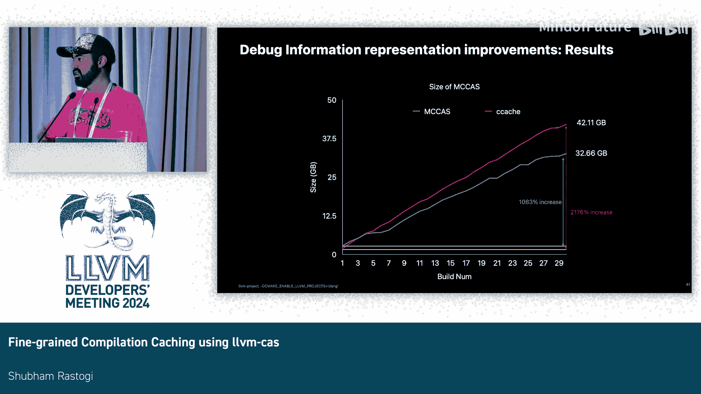

# 【2024-LLVM开发者大会-•-中英】-p08-P08-Fine-grained-compilation-caching-using-llvm-cas--BV18eNfepENu_p8-

My name is Shiver Mustogi。 I'm a compiler manager at Apple working on all things debug info。

 And today I want to give a talk about fine grain compilation caching using LVM Cas。

I want to give some quick background to the stock， this talk is about compilation caching using content addressable storage or CAS。

And it's a follow up from some previous talks that me and my colleagues have given at ourM dev meeting last year and the year before。

 specifically this is a direct follow up to the talk that was given last year about representing Dbug info in AVM CAS。

So let's quickly go the agenda for the talk， we are first going to do a quick content addressable storage detail。

 then we are going to discuss the improvements to the debug information section representation in fine grain object storage。

Then we are going to discuss the improvements to replay speed。And finally。

 I'm going to talk about the object storage， finding an object storage for support for Swift。

So without further ado， I would like to introduce MC Cas。

So what we're trying to do with the CA is to create a build cache which is comparable to Cash。

 we want to split object files into CA objects for fine grainined storage and we call this paradigm and CCS colloquially the reason we are comparing to CCash is because CCash is a very easily understood tool that is ubiquitous and so it's a very good comparison in metric for us in the work that we have done。

So if you want to compare Cc with MC Ca， there are some differences。

 so Cc's granularity is at the object file level， MC cash with granularity is much smaller。

's it's below function level and because Ccashs granularity is at the object file level。

 there's a high rate of growth over incremental builds because even for a small change in object file you have to store the whole object file again with MC Ca that is not the case because we only store what we've changed so the incremental growth rate is much smaller and that's something that。

We intentionly use design this with in mind。So let's do a quick Ca Ob to refresher to understand how CA works。

 so Ca objects address is the hash of the contents。

There' is a one to one mapping between the data that is stored in a cache object and its address。

 and this is immutable。Therefore， if the data changes， the address changes as well。

 however if you try to store redundant data in a ca instead of storing it again。

 you get a reference to that data and this is what we call deduplication and this is what we are after this is how we are trying to reduce the size of incremental bills essentially。

So how does data get represented in a CA， content in a Ca is a da of directed basicallycycl graph of CA objects。

And each CA object has some data and a list of references to other cast objects as well。

So I just want to talk about where we left off last year and lost your stock and we had something that look like this so what does this graph represent so because we have build cache we wanted to simulate an RV engineer's build workflow so to do that the way an RVM engineer works is you come come in the morning you get the top of three you build and then you work right so to simulate that we took one commit per day and so we took a 110 commits over 10 days so we have a 10 day build of planang and in blue we have a Ca where we we created one Ca object per object file。

And in green we have MC Cas where we split up the object file into smaller pieces and stored it inner a cast and we can see that when you do this course and like the builds are in debug nodes00 and with debug information as well as per dashhi and so we can see that when we don't do these finite grain optimization。

 the size of cast balloons to about 65 gigabytes after 10 bills and not only that the rate of growth is also very high。

 it's 708% versus in MC Ca the size is a lot smaller it's about 17 and half gigabytes and the rate of growth which is the main thing that we after is also much smaller at 4000%。

 right？嗯。So what happens if we overlay the Ccash numbers because we want to compare to Ccash so as you can see we have Ccash in red。

 what's interesting is that the size of Ccash after 10 bills is smaller than the MC cash size but one thing to note is that the growth rate of Ccash is larger it's about 730% actually because it's doing it's going to store a whole object file again even if something small changed so we believe that if you took this further and it like another 10。

20 30 day bird or something that at some point there would be a crossover and MC cashash would actually end up smaller。

 but we also believe we can do better and so that's what we're going to discuss in the rest of the talk。

So yeah， with that in mind， I would like to talk about the improvements that we made last year since last year。

So if we look at the size of the ca at 17 and a5 gigabytes we can see that the debug info section accounted for about 9。

9 gigabtes out of those 17 and a5 gigabytes so over 50% of the size of the ca was purely represented by the debug info section so if we can do something to reduce the size of the debug info section representation in a Ca we can probably get some major you know size reductions overall。

So to understand how the debug info section works， let's try to actually see what goes in the debug info section so over here we have a simple CPP file with two functions funk and fun2 and so when we compile it down with Fang with optimizations turned off and with debug info enabled and then we usedwarft to dump the debug info section。

Of the object file。 and we filter for funk on the left and funk on the right。

 we can see something like this。 So this is the debug info representation for the functions。

So debug information is represented as debug information entries or dies。

 and so in purple we have a dye that represents the function。

 so funk on the left and funk on the right。Some data in a diet does not deduplicate and to make sure that know that does not reduce our de duplication rate。

 we hoist that data out and store it in a separate ca block that we for our purpose。

 will be calling distinct data here。Dies can also have children。

 so over here if I pass the dash C flag to dwarf dump it will show me that the subprogram dye that represents a function for both funk and F2 has a dye that represents a child die which represents the parameter that the function takes。

I also wanted to just mention the debug abbreviation section。

 this section contains can can be thought of as like the type of a die and if we try to look at the dwarf representation of the debug abbreviation section for either funk or fun2 this is what we see on the right so what that tells us is that multiple dyes can be represented by one abbreviation so abbreviations can be shared amongst dyes。

So when we put it all together we get something like this so this is how we represent debug info in the CA so at the top in green we have a cast object that represents the debug info section。

 then we have a block that represents the distinct data which as I mentioned is all the data that does not deuplicate then we have a Ca block for the abbreviations and then we have individual ca blocks for dies。

 we are not creating one die one ca of it per dye but essentially we have some heuristics that we use to determine whether children。

 a child die should be split off from its parent and if it should be then we create a new Ca object and attach it to its parent。

So once again this is what we had last year and it was not it was pretty large so we made two main improvements to this representation to reduce the size in the CA and so one of them was flattening the section layout and the second one was reducing the size of the distinct data cast object block using compression。

So to get into that further， I would once again want to remind everyone that a cast objects address is the hash of its contents and a cast object's contents contains not only the data。

 but a list of references to other cast objects so if any of those things change the Ca reference changes also cast objects are always ordered。

So what we were seeing essentially is that for an incremental build。

 if a small child die had like even one bite that changed across a build。

 its reference would change because it could change And so its reference would change Now the problem is that its parent contains a list of references to it right and other children that it has。

 So if even one of that reference changes， then the parent changes So now its reference changes。

 So its parent changes and its reference changes So we kind of have this you know cascading effect where even a small change in a small die would lead to a lot of deduplication being lost and that's something that we want to mitigate。

So to change that we went with a representation that looks something like this。

 so in this scenario what we have is that we have flattened the structure so no child is attached to its parent and so if a child does change its reference changes but none of its parents change right and so that way we improve the overall deduplication rate that we get over incremental ones。

The second thing we did is we use compression so once again if we look at the size of CA at about 17 and5 gigabytes the size of the debug info was about 9。

9 gigabys， but unfortunately the distinct data is 9 gigaby right so about the distinct data is like the CA object block that stores data that does not duplicateupcate。

And that accounts for about 90% of the overall debugging for representation。 So very。

 very large part。And it's this huge blob of data that， you know。

 just has to be stored every time you do a new build。

So if you take 9 GB and we have one distinct data cast object or object file。 So there's about 14000。

Cas object blocks in over those 10 bills。 We have 630 kiloB per distinct data block。

 So that makes it a very good candidate for just， you know， simple compression。

 And so that's what we employ employed here to also reduce the size of the debug in for representation。

And so when you put it all together， we get something like this。

 So this is just like the initial graph that I've shown。

 but zoomed in to just look at the debug info section。 So as I mentioned before。

 the debug info section representation after 10 bill was about 9。

9 gigys pre these optimization that we made and after the optimizations we see that the sizes gone down to a much better like you know almost 5 gig right So it's gotten much smaller after we made these changes when we zoom out to look at the whole size of the class we can see that before these optimizations。

 the size was 17 and a5 gigys and now it's gone down to about 12 and a half right 12。6。😊。

And now when we overlay CCash on top of that， we can see that after the third build。

 there's a crossover and MCCCs is strictly smaller than CCash and after this 10 bill C cashash is about 15 and a5 gigytes and MCC Ca is like 12。

6。To take this a little further， I also wanted to you know do a 30 day instead of just a 10 day just to see like if this pattern holds true maybe we have some false positives right and so you can see once again if we do a 30 day sea cash size balloons to about 42 gigytes while MC cash is you know 32 and a half and we can see that the rate of growth is smaller MCca is 1000% versus cca is about 2100%。

 2200% almost so we can see that like our initial hypothesis correct and the incremental growth rate is smaller right。

Another thing I wanted to do was instead of doing like a 10 day or 30 day build。

 I wanted to do 200 successive incremental bills and see what that looks like。

 So once again we can see that initially MCC is larger than Cc counterpart but over those 200 successive commits over time the MC Ca growth rate is smaller and so overall after those 200 builds。

 MCC ends up being much smaller I know there are some large spikes in the graph here but I think some of those incremental commits just changed a lot of stuff and so a lot of object f rebi right so we can't do anything about that but essentially this is what it looks like even if you do a bunch of incremental bills。

So now that we have talked about that， I quickly wanted to also talk about Df5 support in MC CaS。

Because Darwin does support Df5 starting like now， we also wanted MCS to support Df5 as well。

So when we map out the size of NMC Ca with Dwarf5 versus a Dwarf4。

 we see a very peculiar result where the Dwarf5 size is actually larger than the Dwarf4 size。

 which is counteritive because Dwarf5 is supposed to be a more efficient method of debuggging for storage。

However， the debug info section of Dwarf5 is actually smaller than his Dwarf4 counterparts as something really weird is happening。

So if we look at the numbers， we can see that the dwarf5 cast is about 7% larger than its dwarf4 counterpart。

And after some investigation we realized that the reason is because there's a new section in Dwarf5 called the debug string offset section unfortunately this is also data that this does not deup it's just a blob of data that we have to store so once again it's a great candidate for Ze compression。

So when we apply a compression to that， we can see that we essentially match the dwarf4 size。

 so post compression Dwarf5 size is essentially identical to the dwarf4 size that we used to have we don't beat Dwar4 unfortunately but the reason in this graph you can't see the dwarf4 graph is because literally hidden by the green Dwarf5 post compression graph so we match it。

 so that's the best we can do at this point。So now I want to talk a little bit about improvements to the replay speed in MC Ca so replay in this context refers to rebuilding a previously cached build。

 so maybe you switch branches and then you switch back you to when you build you rebuild everything build is cached so you would expect the build to be a lot faster and like we call this just replay colloquially。

So when we look at the replay speed of MC Ca before we did any work to optimize it versus Ccash。

 we can see that they're basically neck and neck， they're identical more or less。But once again。

 we think we can do better。So there are two main issues that we noticed with replay speed。

 so one was we were materializing the same abbreviations multiple times and the second is that the UL decoder we were using was not optimal。

🤧嗯。So as mentioned before， the debug abbreviations describe the dies in the debug info section。

And multiple dies can be described by one abbreviation。

 so it is always true that the number of abbreviations is strictly less than or equal to the number of dies。

The problem that we were having is that every time we wanted to materialize a die。

 we were also materializing the abbreviation that along that went along with it。

 and so that's just expensive because it requires a lot of U lab decoding。

And a simple solution there was to just materialize all the abbreviations once， memorize them。

 and that just reduce the materialization time significantly。The other thing。

That we did is we were using a ULB decoder that was unopimmal。

And so when you do any materialization it requires a lot of UL decoding and we were using the binary stream reader class in RVM and this was not optimal because it does not guarantee that a stream is contiguous so but all the cast objects we were reading from is a contiguous stream so that was just causing some performance overhead in fact that is this is the main bottleneck that we saw when came to materialization time。

So the quick solution there was to just replace the binary stream reader class with like another class per data extractor。

 which only worked on contiguous streams。And so when we do that and we graph out the replay time。

 we can see that after these optimizations， the MCcast replay time is now strictly faster than what was before。

And when we overlay C cache on top of that， we can see that MC cash is now strictly faster replaying。

A cash bill from seac。 the difference is not large， as you can see， it's about， I believe，8%， but。

It does exist。嗯。So now I quickly want to just mention MCC Ca support for Swift。

 so Swif compiler can also create MCC gas Currently we've tested only with a small open source project called Amo Fire and seems to work fine。

 but we do require further testing to make sure that it works correctly before we can give it the green thumbs up。

So with that， I just want to conclude and say that I think MC CaS demonstrates a real world use case of having Ca lab in Albion。

嗯。We believe that Ca fi RVM can lead to a lot of advantages over like you know just using a solution like Ccash。

 In fact， we can also cache cl modules and my colleague Ben had given a talk about caching clang modules using a content as storage last year that I've linked here as well。

For future work， we want to test and benchmark MC CaS Swift。

 make sure it works correctly and make any optimizations that might be need to be made for swift specifically。

 we also want to implement more CA specific optimizations for other dwarf sections such as the debu lock section。

 the debu ranges section so on。If you are interested in contributing。

 we have a initial patch up the RVM CaS implementation on GiHub， the link to that PRR is here。

 so please get involved please leave your comments suggestions so that we can upte this work into RVM Rock that's something that we're looking forward to seeing more。

Community feedback on this work。And with that， I would like to end the presentation and ask anyone if they have any questions。

 comments， suggestions。Thank you啊。We cannot just use it now in No's。

 it's part of the Apple 4 Kaalium， like open source Apple 4 Kaalium project。

 but it's not in main albumium， yeah。And when it will be upstream， it will be decentralized。

 You you can have a server and so you can have a cash in a server。 So multiple people who can use it。

 So like， I mean the。The way like I the way I've presented right now。

 this is just for local local caching。 but yeah， like so that's not something as far as I understand it。

 that's not something that we are playing upstream right now or anything。

 but the way that's presented right now iss just for local caching。

 not not anything with like like server remote caching stuff。 But yeah。

 does it work with LT does it work。 I mean， this is trying to I think if you do an LTO bird。

 it will just not clear to cache。 I try to I generally don't believe because as far as I understand like LT does not emit like like regular object files right。

 So like yeah， so I don't think so。 Like I think just LT will just skip。

That completely as far as I understand， but yeah， I'll be honest。

 I tried LTO once just to see what would happen and the only thing I was looking for is like nothing breaks and nothing brokes but yeah。

Okay， thank you。一け月で十万。Thank you， thank you。 Did you break out。

 Just thinking about the Zedlib compression that you added。

 Did you break out whether or not that paid for itself when it came to the the replay speed。

 I just wonder whether or not the space saved like a slowdown somewhere else that was significant。

 Yeah， so we didn't notice any slowdown like nothing too large that you know even showed up in the data whatever。

 So we think it was definitely worth it。 And I did not use any specific compression ratio。

 like I just use the default compression ratio。 So we could like try to increase that compression ratio see if we get any better size improvements。

 but we were happy with what we got So anything that and I think the use cases you were exploring was compiling a different LvM project build day by day moving forwards one day each time are there any benefits to be had from incremental compilations where you just making small changes and going forwards is it not designed for that kind of use case It's more。

Trying to guys further back in time。 So one of the slides I did present。 And this one， I'm sorry。

 maybe I didn't make it super clear。 but this slide specifically is 200 incremental commits。

 So instead of doing one this is 200 incremental commits like one after the other。 So again。

 there is a benefit， but the benefit is realized over larger periods because you know there's only so much code that changes。

 But as I mentioned before there are some large spikes。

 And I think that's because some incremental commit just change something very fundamental and a lot of object files change。

 But the point is the growth rate goes down right So because like if you seec。

 if you just made a small change in like one function， you'd store this object file again。

 or if it was something like I know small vector， you'd store all the object files again。

 but like not of them C that would not happen。 So。Thank you。Thank you。😊，Hi。

 do you know if anyone has taken your work and tried to apply it to CNC+ clang， for example。

 I'm not sure what you mean by try to apply it to clang？Like this is'm sorry， I mean。

 not in the swift context， but in producing object all of these graphs that I have shown are compiling plank with itself。

But using a CA， so this is all C plus plus code that like all of these build results are C and C plus plus code。

Okay， yeah， yeah， like Swift is not tested that much yet。 like Swift is like later。

 everything is C plus C and C plus plus so far。 I see。 Okay， thank you。Just one quick question。

 Maybe said that to the miss。 what is it that you are building as you are building these graphs like 13 secondsBuild what what was that So the test case that we're using is just building LVM itself Okay so we're building RVN with LVM but and because a big test case right So it's just like yeah sorry for mis Okay。

 so this the end of the questions we're going to have a five minutes and then we're going to start the short talks。

