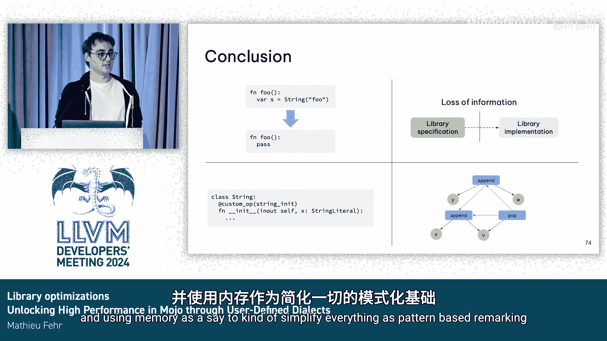

# 【2024-LLVM开发者大会-•-中英】-p10-P10-Unlocking-High-Performance-in-Mojo-through-User-Defined-Dialects--BV18eNfepENu_p10-

Hi everyone， I'm Matt， and today I'm going to present you what I've been doing as an internship in Moular。

Which our call now library optimization， another way to get high performance in module。

 And I should preface this by saying this is something we've been working on the module language。

 It is not available yet。 but this is something we've been kind of trying out internally as like experimentation on what we can do with module currently。

So before going there， we probably want to see what's the actual problem。

 So let's look at two examples of C plus plus code。 and let's see how Klan currently optimized this。

If we take the first example， we just have a function that just creates a string and it doesn't do anything with it。

 The string is long enough that it doesn't trigger small string optimization。

 And what you might expect claimang to do is to just remove it because it's unused。

We don't care about it。And if you ask her best friend， Goldbalt actually does not。

 and that might be surprising to some of you。Well， it turns out that the reason this is not optimized at least in C++ 17 is because there's one function call that doesn't get in light。

And because it isn't in line， the compiler can cannot actually deduce that this is just kind of just a malllo and that there's nothing really important going on there。

So it turns out that if we manage to inline this， we just everything gets probably eliminated and everything works。

So one problem we have in some of these， I mean， and that's not only for string。

 but that's also for the data structures is that the compiler needs to inline everything to be able to understand what it is doing。

 And that's kind of one fundamental problem we have in like C plus+， let's say。

Another example we have that show a different kind of problem we can see is if we take an example of a vector。

 let's say a vector of ns， we push back a value， we get the last value of the vector so itself。

 and then we remove the last value we just added and just return the value。

We can already see that getting the last value after doing a pushback is just equivalent of returning the value that you would just add instead。

And one might think that if you have a vector that you push something and then you pop it。

 this should be equivalent to doing literally nothing to the vector as well。If we as GodBd again。

 we see that it's not as easy as it seems， but this time the problem is not an inlining problem。

 This time is the fact that semanically doing a pushback is actually a bit more complex than just adding an element。

 it may also double the capacity in some cases。And when you double the capacity。

 you have a reallocation。 And this is something you still observe。 and the compiler can observe it。

 So the compiler knows it cannot optimize it away because doubling the capacity is actually having kind of a side effect。

 so。Pushing back and then popping back is not just doing nothing。

 It's just saying double the capacity if the vector has already the maximum size given its capacity。

So there's a lot of auto example we can see even in the standard library so yeah， this is lium。

 there's a lot of auto example that we can see even in the standard library in C plus+ where we might want to do some optimization that's either requires a lot of inlining or that requires optimizations that are actually illegal at the。

 let's say， LLVM level。We can just， if we check that an element is in a hash map and then we just add it if it's not there。

 This is just literally a try place。 If we have a multiplication than an a。

 it could be just replaced by a fuse multiply an ad。

 If we have a sort and then we search for an element， we can just do a binary search instead。

 And if we have a full loop and a pushback in a follow loop。

 we know that we can just have a reserve before。 so then we have to exact capacity at the beginning and we don't have to do multiple reallocations。

Well， all of these example are quite interesting。 They're also very small。

 but also you want to apply this after a liing after auto optimization in your compiler。

 and most of these are not done by any system programming language I know， at least。

And one of the reason is that we have information that is lost way too early in the compiler pipeline。

 When we define the library， let's say the STD vector library。

 we have only function that are partially defined。 We say that the capacity may change。

 but we don't say it actually doubles。 we don't say。

 in which cases necessarily it's going to change for let let's say。

 STD vector from our library specification， we define the actual implementation。

 which like the CTP files。 and in that case， everything is fully defined。

 and then we just removed a lot of， let's say。Unknown unspecified parts of the library。From that。

 we give it to the Kang front end and then we give to LLVM。

 And what happens is that at the Kang and the LLVM level。

 those are actually illegal optimization at that point because we lost the information very early on。

And this is， as I said in Kk， this is going to happen the same thing with rust。

 is going to happen the same thing in Zig。 And so what we've been doing is trying to figure out oh with module。

 can we actually do something a bit different， Instead， can we just in all library implementation。

 add something more that would just allow us to kind of solve these issues and something more here is user define optimization using user defined libraries。

So that way we have also early optimization in our pipeline and that also reduced pressure in LLVM because we just removed a lot of cases we did some in line we don't need to do more removing our functions or like optimizations。

So how can we solve actually the problem？ So as someone has done MLII for a long time。

 my first thought is， can we just add more dialects。

 just like we have the traditional Mo dialects that already exist。

 Can we just have dialects for each part of the standard library。

 Well the problem is this doesn't scale at all because the standard library can get larger and larger and it's actually going to outgrow the number of dialects you traditionally have in like let's say。

 an MLII based compiler。The other problem is that it canified the compiler itself。

 no the library is part of the compiler and not part of something different。

And also it doesn't generalize to use the library if someone wants to write their own vector implementation。

 they cannot benefit from all the optimization the compiler can do with the standard libraries。

So the solution we have is to kind of be able to plug in some way your own dialect。

 but it's not going to be Mi dialect iss going to be something a bit different。

 And if you can do it with a standard library， you can probably also do it for any user library dialect。

 So that's why we call this kind of library optimization。 It just targets all kind of libraries。

So how does it actually look like？let's say we want to add a new operation in module for something that is just multiplying an integer by two。

 and what you would have before is just a function in a library。

 And what we want now is a kind of Mi sort of operation。

 Well the solution is just adding a decorator。 and this is all actually you need for defining a new operation because it's kind of better than doing this。

 let's say， for instance， in ODS， because it's familiar for point user， you just add a decorator。

 there's no need for defining for learning a new language like C plus plus ODA table gen for new dialects。

And it's sufficient for like all the cases presented before。

 and there's only few changes that are required in the compiler because now you're still operating on functions and things that like we don't have to add a new set of optimization and to handle custom operation everywhere in the pipeline。

And it's also very sufficient because we have all we need in usual MLIR operations。

 We have a verifier。 This is just an input output of a function。 We have a lowering。

 This is literally a function call， an interpreter as well because it's also just a function call。

 and we have a few interfaces that we can define。 for instance。

 we know it's no side effects in that case， because we only do integer operations。And from that。

 we can now define optimization。 So if we have， let's say， two operation。

 X times 2 and an operation that just do the addition。Well。

 we can just define in module an actual optimization for these operation。

 which we can call kind of canonicalization pattern。

 which are optimization that I called whenever one of the custom operation appears。

 So here in that case， whenever we see the add function being called。

 we would call in the pipeline at some point， the add Mo to optimization。

And those use just the MLIR module API is just API calls to MLIR that can then be used inside the module compiler。

And。On top of this， we can just reference the operation directly by using a bit of mod geo meta programming and a bit of magic。

 And it just kind of works。And from that， we can handle kind of simple patternbased operations。

 The problem is， so if you， let's say want to have a fuse multiply an ad。

 that's quite easy to match in MLIR， but if you want to do something like the push back popback example。

 we had the current module being app and pop， this is a bit more complex because now we need some kind of memory analysis in some way because you want to know that the pop happens right after the app and this is not something we can easily deal with。

And if you have， let's say an portion in the middle。

 you don't actually know what's the kind of relationships between the pop and the previous happens。

 you don't know if V in that case in W aS or not and that means that you don't know if you can trigger your optimization or not。

 So for that we just have a smaller implementation or what's called memory SS say in LLVM。

 which in that case， tell you depending on if there is aing or not， if the optimization can trigger。

 So in that case here if they know aliasing， you know that P is right after an happens。

 if there is an aliasing， then you know that P might have one of the two predecessors。

 which is added happened on V or the happen a W。So with this。

 we can actually do the first optimization I presented you in the very beginning。

 so we have the pushback pop app， this is literally just looking at P。

 seeing if there is a unique predecessor that's called the pen and then we just write it with the MLII API we just check if there is the same value for the vector and then we can remove the operation similarly for the string example is just checking if we have a deletion of a string that is after an initialization and that just works and it's quite simple if you look at it。

So in conclusion， what we have is that there's a lot of kind of optimization and library optimization we want to write The reason is there is a lot of information quite early in the pipeline in most programmingal languages and we kind of want to solve this issue but just being able to write in your language。

 new operations and using memory SS to kind of simplify everything as pattern based rewritinging。

Thank you。😊。