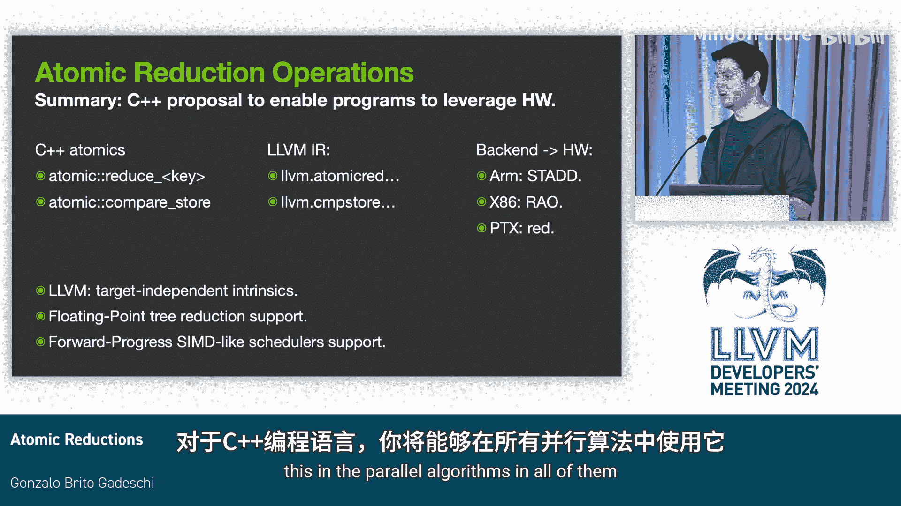

# 【2024-LLVM开发者大会-•-中英】-p11-P11-Atomic-Reduction-Operations--BV18eNfepENu_p11-

Im going to talk today about atomic reduction operations， like what they are。

 why we want them and how to get them。 First， a brief overview about atomic prim right instruction in LVM。

Atomic prim I right is just to implement high level software constructs like， for example。

 the C++ atomic F channel operations。It performs a load from a memory location。

 it then modifies the value loader using a banner operation like app。

 and it finally starts the modified value back to memory。

And it performs all of these steps atomically， that is。

 it doesn't allow another concurrent right to modify the memory location in between the load and the store。

Many workloads like， for example， parallel historicaltor construction use Sus+ atomic operations like Fitchchat。

 but discard the value loaded， atomic removed is right。

 always returns the value that was loaded before the memory was modified。In this example。

 we have a parallel for loop that generates a bunch of threads。

 and then every thread loop over an array of interiors。

And then depending on which atomic bucket and inte falls into， it just increment that bucket by one。

For this algorithm， the value that was in that bucket before the modification is not really needed。

And there are many word lawss like this， so today we're going to look at how to optimize atomically modified right operations for word losss in which the all unmodified value is actually relevant。

Multip LM targets have a good acceleration for these sort of atomic reifier right operations that don't return the old volume and in those targets。

 those atomic reifier right operations happen to behave。

Like not loads from a point of view of memory ordering in the memory model。

When I talk about atomic reduction operations I'm referring to those types of atomically modified right operations and some examples are the stored a instruction in the arm Ia are also has like stored mean。

 as well as for example， the low add instructions which do load the old value in the destination operator。

 but when the zero registeries uses as a destination。

 actually they change semantics become atomic reduction operations。

The PTx I has an instruction it' called atom that reference a re if I right that loads the old value。

 and it complements that with a red instruction that doesn't have a destination open and doesn't load the old value back。

When we look at there。Partal history and construction model， for example， and we compile it to use。

Either the P T X atom instruction that performs a reifier right the lo value or the P T X red instruction that does not。

On the H 100， we observe 1。2 x N to n throughput improvement。

 So the reason we want these instructions is because they give us better performance in war loss in which the old value is not needed。

A third question to ask is whether NLVM can actually optimize code using atomicri if Iide。

 so that's then dropping the old value into code that uses atomic reduction operations。

And while this is sound， in some cases， it is not sound to do this unconditionally in genital。

And I'm not going to go into the details of this program， but there is。

 this is an example of a program in which if we actually perform this optimization。

 we introduce an outcome that's for reason by the C++ memory model。 So in this example， program。

 for example， this optimization is unsound。This optimization has been performed incorrectly in multiple compilers。

 including Gcc and LVM and within LVM， not in only in one place like the milllel A。

 but also in multiple backends and in multiple places within the year。

 so we have been trying to fix those over time to get correct results。

But the problem that we have is that when we do that we regret certain world laws in which those optimizations are correct。

 and it's really really hard to tell apart the problems in which they are correct from the problems in which they are。

So what are we doing about this at the C++ Committee。

 we are working on introducing atomic reduction operations as an extension to the C++ memory model and the C++ atomics and atomic Re in the standard Library。

So this is essentially new APIs in， for example， atomic types。That perform is a right。

 but return voice， but least they don't return the old volume。This allows problems to express intent。

 and it allows implementations like clang to expose bulletins that then lower to LLVM。

 target independent in6 that then compilers like the backends can cherry pick to lower to hardware specific instructions。

While it is unsound to optimize an atomally modifiedifier right into an atomic reduction。

 the other direction is sound。 that is it's safe to compile atomic reduction operations into an atally modifiedifier right。

 it just gives you more ordering。One of the techniques that the current implementations are using for intes is that they are implementing some of them using three reductions。

 and that happens to be sound for intes because performing operations in different order is actually not observable。

 However， one of the goals that we have is to improve the performance for atomic floating point operations。

And one way to do that is to enable those to leverage tree reductions as well。

The problem is that in a clear reduction， operations are performed in a slightly different order in memory。

 So it is possible to observe that the floating point additions were combined in a different order。

So we have extended the specification of this functionality to support these more weaker orders that allow to reductions and they allow optimizations like if you have a single threater into atomic reductions back to back。

 you can actually combine the two values and then issue a single reduction。On hardware like GPUs。

 this allows， for example， to perform an horizontal reduction across a threat in a warp and the issue a single atomic reduction operation instead of issuing 32 of them to memory。

The other limitation that Cpa for atomics today is that they are not safe to use in un sequenced context。

 for example， when using parallel algorithms， there are multiple parallel execution policies。

One of them is called Par Si， which supports multi threadreading and assumes vectorization is safe。

And C bands essentially the use of atomic in those because atomic operations that loadthe can introduce worldwide progress issues。

These atomic reduction operations do not load， and this is in contrast to the remote operations and that allows us to actually allow them in unsequenced context in which we guarantee autobacterization。

So that means that。By making， by giving this operation slightly weaker for products on this。

 we can actually。Increased the amount of say of programs that people can write in most hardware today。

 And the good thing is actually， many hip architectures。Only support Paric。

 and they do provide atomic operations， but they cannot actually expose them C+ because the standard4bis and this fixes up。

So， that was it my。I've talked about the atomic reduction extensions for C plusomics。

We are going to prepare an RSC to introduce target and intrinsicss in LBM initially compile atomic Riifier rights。

 because that's always safe to at least allow backends to。

Con lower those to some of the available instructions。

The extension for floating control reductions is available。For the S primary language。

 you are going to be able to use this in the parallel algorithms and all of them。

 not only in the parallel execution ones。

Thanks。哎不し。

