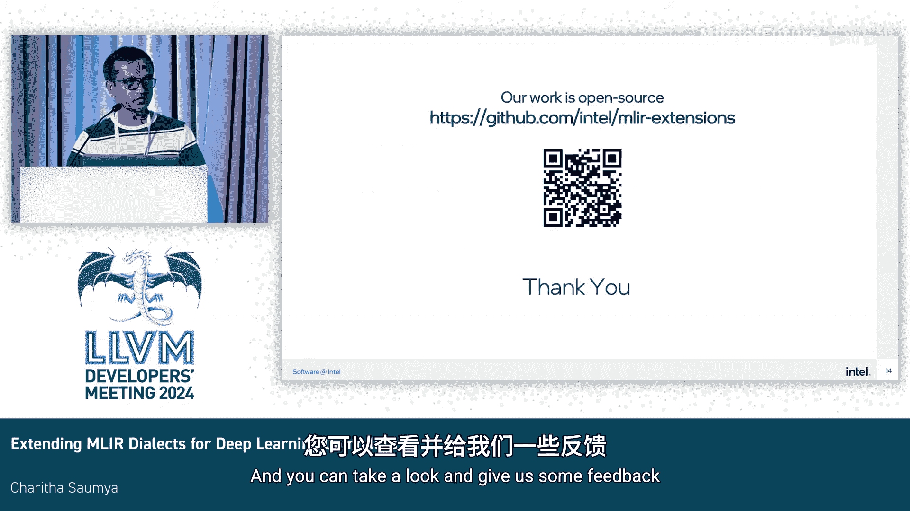

# 【2024-LLVM开发者大会-•-中英】-p13-P13-Extending-MLIR-Dialects-for-Deep-Learning-Compilers--BV18eNfepENu_p13-

Hello everyone I'm Sharita from Intel Today I'm going to talk about our work on extending MLI dialects for deep learning compilers。

 This is a collaborative work with the Co MLI team at Intel。

So compilers for deep learning is very popular area right now on one side we have rapid progress in algorithms which comes with highly specialized kernels like flash attention and also when you look at AI hardware also the hardware space is highly volatile there's a lot of push for improving performance using low precision types。

 systolic areas and blockload store operations when it comes to the user side user also wants more control level performance and also user want to keep the programming programmability at less less relatively less complex level so all these things point to the need for flexible programming models as well as deep learning compilers to support those models。

So in recent times T based programming has been adapt widely。

 this is because it has more flexibility in expressing the algorithm and parallel strategy using tiles also this is very this approach is very easy to adapt in existing graph compilers。

However， if you look at current MLI ecosystems and ML dialect， especially targeting GPUs。

 it is not very straightforward to implement tile based programming using existing MLI dialects so there are few limitations one major limitation is if you look at member for vector dialect there is no direct way to specify the data ownership which is required when you have like complex GPU hierarchy。

 something like workgroup subgroups and item threads and also sometimes you want to specify your program at work group level or block level at high level and hide away all the complex hardware details and there is no direct dialect you can use to implement something like this so to bridge these gaps we like to propose X tile it's a tile dialect for workgroup level programming so we consider three main factors when designing X tile first of all you would like to have configurable tile sizes at work。

grouproups subgroup or even block size within subgroups and Exile is designed for mainly gem like algorithms。

 So you want to support advanced gem optimizations like free fetching or software pipeing。And also。

 you would like to have explicit control over how you decompose things into subgroups over kitem threads。

So when it comes to the implementation of X tile one of the key problem we need to address is how to specify the data ownership and the decomposition logic in member of vector dialect so to solve this we extend member of dialect by introducing a data type along with some ownership attributes and also we define a set of operations to you operate over these tile data type so when it comes to vector so there if you look at vector data type there is not a lot of room for improvement in terms of adding these attributes therefore we simply attach this decomposition or ownership attributes to the vector operation itself but this is something we want to discuss and get feedback from the community is it possible to extend the vector data type which makes this design much more simpler and the tile data type basically describes a 2D memory region within some member and apart。

From the size and data type of the tile， it has some additional information。系。😮。

It's supposed to be 10 minutes， right， now five minutes。And me。嗯，呵对。Sorry sorryrry about that。

 So basically you have additional attributes that describes your decomposition logic So in this case you can specify your subgroup layout that owns this style as well as how much data is each subgroup is owning in this style and also to assign data slices into the subgroup this subgroup layout we use round robin data assignment So I will explain what I mean by this using a simple example So in the first example we have subgroup layout and4 by4 and each subgroup on a 32 by 32 data slice and you have a larger tile1 to eight by one to8。

 So as you can see each subgroup in this layout uniquely on a data slice within the larger tile However when you go to the second example。

 you only have you have a relatively thin tile and you have only 32 columns but the subgroup layout and subgroup data remains the same。

 So in this case when you apply round robin assignment on column dimension。😊。

All the subgroups within a column will share that data slice。

 so this is quite powerful to specify things like data sharing and express things like collaborative load into SLM or collaborative free fetch。

So this is basically a 4KGM example specified at group level X tile so I will use this example to quickly go through some of the important X tile operation the first one is in tile that basically used to describe a tile within a member so you have a source member and 2D offsets which describes your tile location and also you have this update offset especially within the K loop so this is basically used for move the tile within member so especially in Klu you don't want to initialize a whole new tile you just try to move them and save some address computation and also you have load tile and tile which is kind of straight forward and when you load something the register tile where you just use vector dialect to represent these things and also lastly we have tile and memory operation that operates on these vector register tiles to do the MMMA and one important detail here is that every tile。

Every vector operations are attached these ownership attributes or in other decomposition attributes and these attributes are very flexible。

 you can change your subgroup layout or subgroup data and control your decomposition using these attributes so for example。

 you can have a pref inside your K loop and for some reason your hardware require some different subgroup layout for the prefash operation to collaborate with neighboring subgroup so you can have a separate layout for pref and separate layout for your load operation。

So in the workgroup to subgroup decomposition transformation we simply consume these ownership attributes to generate the code at subgroup level or even further webgroup level so in this example on left hand side you have the workgroup level code。

 it operates on a larger tile onto it by one to8 and you have this subgroup data and subgroup layout and on the subgroup side you have these smaller tile gem which do this smaller 32 by 32 and you can use subgroup IDs to figure out the computation the offsets of the data slices owned by each subgroup and also it's important to share that A and B tiles subgroups on columns and rows will share the A and B data so you can also prefe into SLM or load into SLM to improve the performance even further。

So this is the lowering pipeline plan currently for X tile at high level so once you are in subgroup X tile you can directly go to vendor specific GP dialects。

 for example you can go to X GPu and then we can after that we lower it to SpV or LLVM and then pass it to backend compiler driver so this is we also measure4K gem performance this is still ongoing work but we are happy to share that we are reaching about at workgroup level X tile we are reaching about 90% of handwritten optimize MLR performance and we try to keep improving this so in summary MLr lacks workgroup or block level tile dialect and ways specific data ownership within tiles so to bridge this gap we introduce X tile it's a workgroup level tile at dialect design for GPUs X tile extend member and vector dialects to enable tile based programming and initial performance of X tile is very promising。

And our work is open source and you can take take a look and give us some feedback， Thank you。

