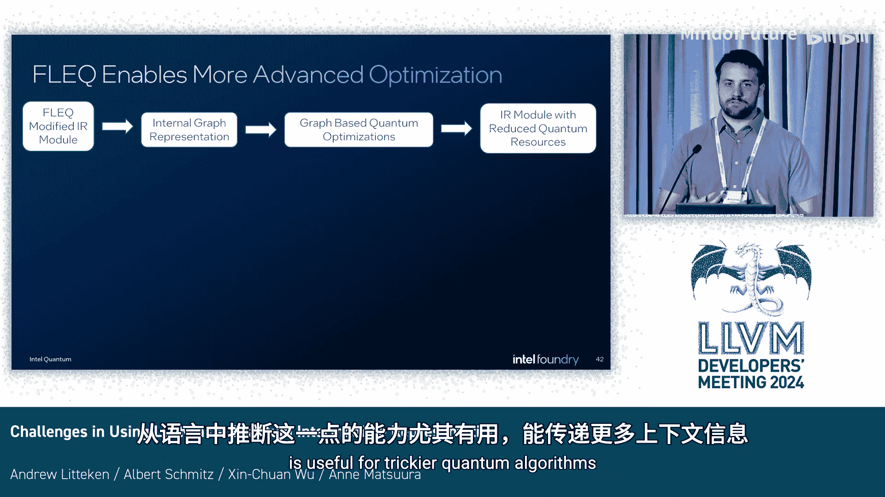

# 【2024-LLVM开发者大会-•-中英】-p14-P14-Challenges-in-Using-LLVM-as-a-Quantum-Intermediate-Representation--BV18eNfepENu_p14-

Hi everyone， my name is Andrew Lidikin， I work on compilers and optimizations for quantum computing at Intel。

 and I'll be talking about using LLVM as a quantum intermediate representation and the benefits and challenges are coming from using it that way。

So are we talking about three different aspects of using LLVM as an intermediate representation。

 the first is the set of constraints that we have on quantum compilation and how we can use LLVM to satisfy those constraints。

The second， how we can alleviate some of the difficulties that these constraints put on higher level programmers。

 and then finally how we allow the quantum audience who oftentime is oftentimes are not compiler experts to still adapt and use our compilation framework to develop their own quantum optimizations。

So I'm not going to go into too much detail about quantum computation。

 and we don't really need to understand the mathematics and mechanics behind it beyond a few simple terms to really get to really understand what we're going to talk about in this talk about。

So a quantum program acts on qubits over time， and the qubits are represented by the horizontal wires in this image。

 and then we apply the single qubit gates， which operate on one。Cubbit， which is the。

The unit of computation for quantum computing。 And then there's multi keybit gates。

And so in this image， gates are applied from left to right， like a classical circuit。

 and altogether just called a quantum circuit， so of these are mostly all the terms that you'll need to understand for what we need to talk about in a quantum compiler。

So taking this circuit from a programmingbing language to running on a back end。

 such as a physical device， like the quantum chip or a simulator， like a supercomputer。

 or potentially even your own laptop if the program is small enough。

 is a multistep process that imposes many compilation restrictions that must be considered due to the limitations of the devices。

So we'll be mainly focusing on the LLVM based quantum compiler that's in the Intel quantum SDK。

 but to understand the design decisions， we're going to talk a little bit about the rest of the components in the pipeline real fast。

So the main front end we have is a C++ based hybrid quantum classical programming language that Intel gives users through the Intel quantum SDK。

And then our quantum interior representation is essentially LVM with quantum intrinsics。Added to it。

And like LBM as a whole， it allows us to develop different front ends。

 including Intel's own open chasm front end， which is a portable circuit representation。

 and then we take that and we translate it to our quantuman representation。

So the compiler handles most of the legwork in terms of reconfiguring and normalizing the quantum program to fit the restrictions and requirements of the rest of the quantum stack。

At a high level， this means that we have classical code that's going to be in the runtime that we just use Class compilation on。

But it also means that we have to extract quantum instructions from the rest of the program。

 use architectural information about the physical device or the simulator to match the connectivity restrictions of the device。

 like similar to others not there's a limited number of registers。

 there's a limited number of qubits and they only have only certain qubits can interact with other qubits。

So we have to match those restrictions。 Then we also want to reduce the resource。

 the quantum resources used by the device， the more you use the device。In the near term。

 the more likely it is that a program will fail， and we want to get around that。

Then the quant compiler eventually generates the program at a quantum ISA。

 and these qua components are then linked into the rest of the binary。

 which allows it to be accessed later by the runtime。嗯。

While some of the abstractions that we use in the quantum compiler are general to quantum computing as a whole。

 we do have optimizations and a specific ISO that is best used on Intel backends。

 simulators and hardware。When the program is run， it invokes the quantum runtime。

 this processes the quantum ISA， deploys and then deploys the quantum program to the device and processes any measurements at return。

Only at this level at the quantum runtime can we run any classical components in between quantum instructions since this is awful this runtime and processor is often spatially and temperature wise from like room temperature down to around absolute0。

And due to low lifetimes ofqubit's on quantumm devices。

 this effectively means that entire quantum programs and pieces of quantum programs cannot require any classical operations to reproduce their result。

The， the quantum instructions are passed through the control electronics to the quantum device。

 And here， the instructions are actually before the execution。 We can't have any， like I said。

 we can't have any conditional execution or classical instructions before they are returned back to the runtime。

This inability to perform conditional execution based even based on user input will be a crucial part in how we have made our decisions in the Intel quantum pilot design。

So just to sort of rerate and break it all down。The main challenges our compiler faces that we can't have branching in the quantum instructions。

 We need to reduce our the number of quantum operations that we use。

And match the device constraints as well as not have any classical operations in quantum code。

I will caveat this that this is a lot of these decisions are based on today's quantum technology。

 they are not necessarily going to be forever， and that's something that the entire field and Intel is working on and changing。

So I'm going to start by talking about how the compiler leverages LLVM to match these constraints。

 So this is an example of what a user can write。Using the Intellkquan West D。

The quantum kernel attribute to a function denotes as a section attribute that we passed down through the compilation process and denotes that this section should be treated。

Quantumly， it needs to be treated differently than the rest of the compilation。

We have qubit types that are we have the qubit type and CBbit types。

 which are just over particular integers that denote that this is a viable piece of data that we can perform a quantum gate on。

And then we have a header file that has a lot of different quantum operations。

That are our standard for quantum computation， what exactly they're doing is not important。

 but it just lets users actually execute， actually define quantum algorithms。

Then we have the classical component。The entire kernel can be called as a like bioclassical function。

 which gets extracted and handled and then is called by the runtime later on by pointing to the blob of quantum instructions at this level。

 the program was able to interact with the quantum data and capture the measurement values and act on them。

Several plum operations are included inside loops and also inside other conditional statements。嗯。

But we can't have this in the final program， we need to unroll it and all the qubit arguments in particular need to be known at compile time。

Luckily， Olium infrastructure does have lots of tools to handle information handle all of these structures and unroll them。

However， they are contained。 these structures are obviously in the classical sides as well。

 So we need so and applying the unrolling operations to every part of the program would obviously be。

Time intensive and kind of unnecessary。 So we use， use the L and pass managers to handle these situations。

嗯。However， we need to satisfy a bunch of different conditions to have a valid quantum kernel at the end。

 we can't just use a pass manager framework out of the box because we might need to go backwards。

 rerun operations conditionally。Previous， this was kind of done like at the beginning。

Using several calls to just the opt tool to run different pieces multiple times。

 But now we have five different managerss in our own driver to actually achieve this。

The first driver just replaces the header file declarations with quantum intrinsics and it recursively inlines quantum kernels so that way that the unrolling and the and the constant folding operations are able to。

Have all the information they need to fully。Ful。Unroll the circuit。The third。

 the second third and fourth pass bans are actually rerun several times and is the portion of compilation that uses the alVM passes the most and they are restricted to quantum operations only。

嗯。The middle loop androll in constant folding passes are only run the function passes that are only run on quantum kernels。

Whi， as I said， was denoted by adding that attribute in the front end and they're checked prior and any loops that are checked that are optimized are checked prior for whether they even contain any operations because if they don't have the quantum operations。

 we don't actually need to unroll them。嗯。If a kernel is not found to be valid。

 we just run a set of passes very similar to the01 function sification pipeline。

 and this continues until the function is unrolled and unfolded or until an attempt limit is reached。

In which case， theres an error shown to the user that they wasn't fully enrolled and they need to decide if that was a problem or not。

嗯。And then we move into the last manager， which is really just the。

Is really just the actual quantum handling and the quantum processing that we need to do。

 which is a set of passes that lowers the mathematically friendly gates we gave the user down to the physical set of gates that are actually available on hardware as well as mapping the program qubits to physical locations moving them around is needed so that each qubit that needs interact with another qubit can This is also where optimizations that for best performance on Intel backends occurs。

So while the and then while the LBM pass managers have been very helpful to pass information around。

 we do have our own analysis passes as well so that way we can have information about the quantum module elsewhere in the program。

The quantum optimizations in the final pass manager also need to be able to differentiate quantum types from the that are represented as integers from the rest of LVM。

 and this is， especially true when we have to identify references toer quantum arrays and pointers。

And with non type corners， it has made the task a little bit trickier。

 So we the library of functions are basically used as the source of truth。

They have these qubit functions that are called by the quantum that are called by the library functions。

 And really all they're doing is denoting that the argument is a quantum type。

 and basically we're able to just。Did't we were able to mark that with abit with aqubit reference function attribute that we were then able to propagate up the call graph。

And to determine the origins of each uses at the call site and say that this argument has quantum quantum information。

 We can do the same thing for。Global values and allocations。

 And then we were able to we were able to identify certain data types。

 certain objects as quantum quantum data types and we were able to perform optimizations accordingly。

So moving to the next section， we can use these strategies like annotations， alternative intrinsics。

 combined with front end analysis and clang plugins to give the high level programmer more tools to easily express their programs。

So since we need to know everything at compile time。

Writing functions that maybe involve something like recursion can require tricks like weird tricks with templating to recursive index of qubits in a program。

This is sort of shown on the left， that is more just a standard program。But like we could。

 but we could do this with recursion， but we it's not possible withs not very's not simply' not very。

 it's not possible in a very simple way。So we have the functional language extension for quantum to make it easier。

 This is a small DSL that helps users express their code more succinctly in some cases。

But also allows the compiler to just intuit more information from the program。

Without having to make inferences on in the I R at the end。 So on the right side。

 we can have recursion recursive functions Now。 It's more of a functional pipeline。

 And these produce pretty much the same circuit。It becomes much simpler for the Intel quantum compiler to reason about the right side because of the primitives that we have there。

And we are also able to optimize these programs more efficiently。

Fck also allows us to have several pieces of classical control flow to be handled inside the compilers of well。

 and an example of this is having rudimentary string processing and to have some on the fly adaptation during the compilation steps to different inputs。

嗯。Since the quantum expression， which is the Q expert type， we need to be able to pass that by value。

嗯。We there are treated as integers within the C++ environment。

 and this could be difficult to do at only IR level because it could be converted or some operations potentially optimized away。

But we can use plague plugins to do some of this processing in the front end。

 so basically we can adapt the AST by looking for certain binary operators and replace them with specific header file functions shown here。

just replaced with a specific function call that a user could just call this function directly。

 but we want to use make the programming environment the best experience possible。

 and this also let us have the best programming experience the easiest programming experience for our users and so this also allowed us to provide better error messages for users that we be able to do at just the IR level by having this link plugin。

We replace several different operators with quantum specific calls。

 And while this is a relatively simple action for the front end。

 we been able to ascertain these actions at the Kang level rather than the IR level。

Allows us to do more with with the resulting function calls and is power is a powerful thing for us and makes identifying quantum actions much easier。

Fleck processing in our LVM pipeline is really just a pass， as it expected。

 we convert the Fl calls to an internal graph and we perform recent at this operations allowing us to reduce the number of gates in the length of the circuits。

 oftentimes specifically for Intel devices。The ability to infer this from the language rather than the IR is particularly useful to pass more contextual information down than we could have otherwise。

 which is useful for trickier quantum algorithms。

Additionally， this lets us process and inform any top level operation such as an inverse operation。

 quantum computing is a revible is a as restrictions restrictions making a reversible computation environment and without something like flex in the in the。

And the Klang plugin- used to identify binary the urary operators to do this inverse operation。

 it's actually very hard for us to deduce where without it being handwritten where to do this inverse operation。

So while we have to step slightly outside the standard LVM pipeline to get more power。

 the SSA form lets us build concise operation graphs of a quant program and perform optimizations。

 and it remains flexible enough to do LVium remains flexible enough for us to perform these optimizations and changes in form。

So the last challenge is not super technical， but it is more of a human problem。 the fact that。

That compiler developers， in the same way that compiler compiler developers don't necessarily need to know about quantum computation to write pieces of the compiler。

 Physicists don't want to know about compilers to write an optimization。

But we still want to make it easier for them to use the compiler stack。

So this is an example of just a very simple quantum program written in the Intel quantum SDK。

 compiled to LOVM， and then on the left side is the circuit structure that was shown before。

 the LOVM code can be somewhat inscrutable for someone that is not very familiar with it。

And then also many quantum optimizations are written using the abstraction of the quantum circuit。

 and so while we can get the same information out of the IR， it's a lot of bookkeeping。

 you have to understand how to track the qubits and how to track the data throughout the different function calls and we want users developing optimizations for the anal quantum SDK both inside and outside of Intel。

 there's a lot of physicists or not familiar with these computer science concepts。

And so an important part of having them develop optimizations is meeting them where they are。

So this is similar to something like Cque or Ki kit。 if you anyone has seen those。

 we have a graph based structure representing the quantum circuit。

 each basic block basically that contains quantum operations has a graph and only in this graph only contains the quantum operations。

 Each node is just an operation as a quantum operation and then each edge is a。

Each edge is the shared qubit is a shared qubit between the two options。

 so you can see like the prep Z operation goes to the Haamard and then the prep Z on Q1 and the Haamar and Q0 both go into the C operation。

These dependencies just inform the order of execution of the operations in the circuit。

So it's easy enough to translate from the IR to this。

 but want we want the users's be to manipulate this without having to actually handle anything in the IR itself。

And since we have this more restricted mode of having just the quo operations。

We were able to provide a bunch of standard graph operations that will be able to be translated into the I itself。

 mainly involving handling the parameters past each gate。So just as a simple example。

 let's just do insertion if we add a CNot operation onqubit 1 and a new qubit 3 that's not in the graph right now before the new added want to add before the C operation onqubit 0 and1。

So the user can call a create method for a quantum operation like they do for an instruction LLVM。

 this instantiates a new instruction and ensures the and gives the quantum module ownership for the sake of memory management。

Then they can use an insert method on that new operation to put it in after the prep Z on Q1。

So we do several things， the first is to update the circuit object as you'd expect for a graph for a Dg。

 and then we add this to the IR as well， and then we add we have to change the IR as well。

 so this is seen in the simplified form。The purple box is the new instructions。

 is adding that scene operation and the。AtAdding forquubbit 3。

 but then it also has moved the addressing forqubit0 above the CA operation for Qbit for the prepy。

This is extra handling that we need for LVM， but's not really something the optimization developer necessarily needs to worry about。

 Let's them use the power of LVM that only focus on the requirements of the quantum algorithm。

there's other operations and there's other things this can be embedded inside like many a parent function of a quantum kernel。

 but I'm running out of time， so I'm going to skip this part for now。So wrapping all this up。

Using LVM is a powerful piece of thetel quantum compiler and lets us combine classical computing with the needs for quantum hardware。

 Kang pluginluins and the modularity of the LVM pass system lets us have unique optimizations。

And language opportunities to higher level developers through Flick and even through this。

 we want to provide tools to manipulate our IR for optimization。

 and we provide that through the quantum circuit of object。

 letting in an attempt to essentially to create a domain and specific version of the IR that only touches the quantum pieces for those developers。

Lastly， many of these pieces are open source。 We'd love feedback and contributions from the wider community。

For how we can do better in， in particular， like improvements to how we've structured things。

 we are kind of a team of most of the team is physicists。

 So there's been some potentially interesting decisions made。嗯m。But also。

 we also love if there's more efficient ways we can doing stuff doing using pieces of LL VM or tools we're not aware of。

 And then also。And also quantizations from researchers using that quantum circuit object as well。

That's everything thank you for your attention and are there any questions？So any questions， yeah。

 here's a microphone。Yeah， thanks for your talk， enjoyed that。I have a couple different questions。

 The first is about。ILike your simulator so like。What what sort of simulators do you compile your IR down to like is it a density matrix Tensor network And then do you guys have like a cloud system where you support like accelerated or like you know high memory backends for those sorts of simulations。

 Yeah， so the top QR code is to the SDK itself that is like run on the Intel developer cloud And so you can。

Run some the simulate some of the higher power simulators there with more memory and stuff like that。

 The simulators themselves， there's a couple。 I think we have a。Tsor back end。嗯。

Then there's some more stripped down ones that like are more if you're familiar with quantum like Clifford。

 I think Clifford simulator is an option。I don't know if the time I had what exactly which exactly so like Intel maintains their sort of。

 Yeah， we ever own some address not。This then on that theyre Intel's bay Intel simulators theyre not other people。

 I guess that's the question And then are there any assumptions about like what happens to the state at startup and like shut down of the quantum kernels So in other words。

 anytime like a quantum kernel starts to execute is it starting at state zero or are you allowed to like perform some classical computation while like the state is like I believe this is something that we're working on to be able to seed it with a state but in general。

 I think you should I think the general。But I think it's done by like using a bunch of prep operations at the very beginning and then having like whatever operations you need to actually get to that state。

 not so much。Okay， so it's assumed it's assumed reset to0。 Yeah。

 It's expect that you would reset it to0 other it， thanks。Hi， great talk。

 I have a question regarding the quantum circuit object Yeah so you mentioned that so it's embedded as part of the IR properties or is it something like it's a completely different framework It's like on it's like something that you feed a basic walk to it it res this object and then as you manipulate the object it will write back。

But your changes。 I see。 So it's， it's a completely different framework Yeah takes the I as an input。

 then。 Yeah， and then it And then like as it changes。

 it comes goes back to it so that when when you write the module back out it changes。

 it changes the result。 And， and is is something， you know， available in part of like。

 it would be available in the quantum past section。bunch of these changes。

 many of the changes that we talking about are coming in like a new release we weren't able to get them out in time for this。

 but they will be there in the quantum past section in particular。

 is there like a kind of like the visual representation that we can look at like like whatever the input to the whatever circuit is like visually see that or it's like something like a graph and you have to just there's no tool for that yet。

 so it's like you have to look through the data structure Yeah。

 there's no way to like network where network X has like you can put out the graph we don't have that。

Thank you， for that sounds。Any more questions。If not， let's thank Andrew again。So the next talk is。

