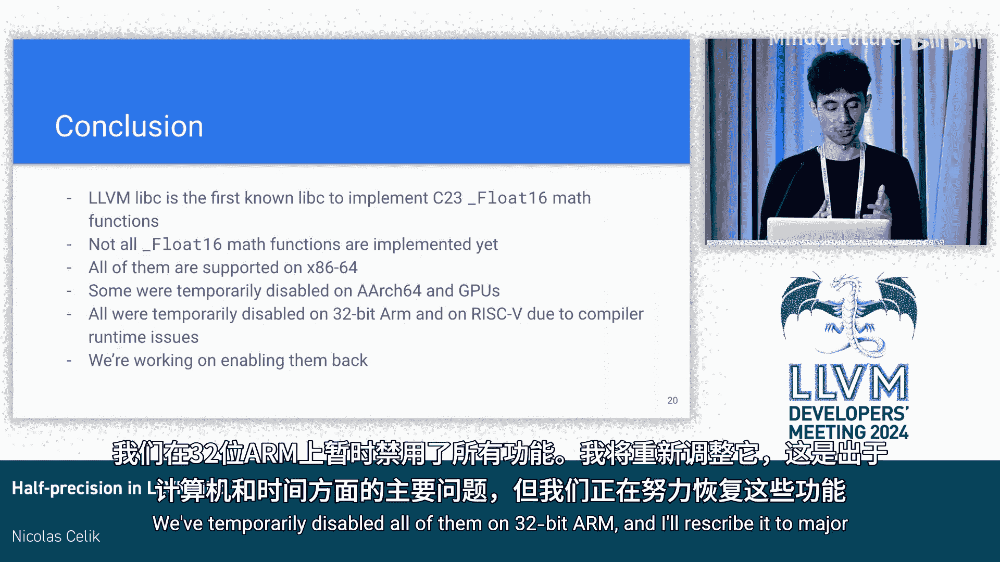

# 【2024-LLVM开发者大会-•-中英】-p15-P15-Half-precision-in-LLVM-libc--BV18eNfepENu_p15-

Hi， I'm Nicholas， I study computer science at Eita in France。

 and this year I was the Google Summer Code contributor to LLVM。

And so the project I've worked on this summer was called Huff precisioncision in LDM NpsC。

 and that's what I'm here to present。So first of all， if you haven't heard about LVM LipsC yet。

 it's what it sounds likeippsy that's part of the LDM project。

 pur a few things to note it's residencency+ plus it's for several CP architectures it also support amN N V GPUs and you can learn more Lipsy。

lvM。org。Now the C23 standard defines new underscore float N types。

 one of which is underscore float 16 that corresponds to the binary 16 format from IP 754 iss a diagram on the right。

This format is also known as half precisionciion or FP16。

 it most recently gained popularity with neural networks。

 but it has also been used in graphics for quite quite a while。

And as C23 defines these new float and types， it also defines new math functions accordingly。

 so for example， to get the absolute value of a float， we had F appss F already now for float 16。

 we have F Us F16。This brings us to the goal of this GSAC project which was to implement these new C23 3016 mathfunction in LVM LipsC。

 so obviously the benefit for it is that it's a step toward C23 support and as far as I'm aware this makes LVMLpsC the first new LipsC to implement these new C23 mathfunction。

So here's the work that we've done， you should know that we split math functions into two categories。

 based operationss and higher math functions。So we've implemented all 70 F 16 based operations that we plan to implement。

 this include the absolute value function， rounding functions maximum and many more is linked to a tracking issue if you're interested in the whole list。

Then we've implemented 17 of 54 planned flow 16 higher malfunction。

 these include exponential functions， laborarithic functions， hyperbolic sine， cosine， and more。

We knew we couldn implement all of them during the summer。

 and here's the link to the tracking issue if you're interested in before full list again。

As part of the project goals， we also wanted to optimize some of the base operations as some of them match quite well to special hardware instructions on certain CPUUs。

 but we didn't want to use in line assembly or target specific intrinsics。

 we don't like to do that that much in LVMC so instead we wanted to use compiler built ins。

 and we've managed to optimize the F 16 but also a float and double variance of a following base operations with built ins so a bunch of rounding instructions to run to a nearest integer and maximum and minimum functions。

Here's some example results of these optimizations， for example。

 if you take the C F16 functions on Pixel 8 phone of the first generate implementation could take up to 8。

92 nanoseconds， whereas with belt in version we get only up to 0。79 nanoseconds。

 then if you take the F max F 16 function at 13 of Gen Q I 7。

Without it if you don't enable any of the optional support for F 16 instructions。

 it could take them to 133 nanoiseseconds， but if you enable support for F16 C that's higher instructions to convert from and into flow 16。

 it's down to 6。17 nanoiseconds， but either way with the best implementation only 3。81 and thesed。

Finally here's a quick example of how float 16 mathfunction compare in latency to the float mathfunction so you can see on again。

 QI 7 exponentialial for float 16 can take up to 16 nanoconds pretty much whereas the float 1 where it takes up to 3。

18 nanoconds which currently on X36， F 164 isn't that great really whereas on the pixelix phone which has anU with pretty much full hardware support for F 16。

 the float 16 version is actually a bit faster than the float1。

Now here are the issues that we've encountered， we've encountered quite a few actually we went to compiler bugs。

 even crashes because on the LVM NpsC website we still state that we support Kang 11 and we do really use it in some of our Post mergeCI but when we give that all version of claimss。

 some of our soliciting code and ask it to compile it for ARX648 crashes you can see here instruction selection failed。

Then on current versions of Kang on the other hand we got miscompilation。

 so if you didn't know already if it wasn't clear enough not all CPUs could have full harvest call 416 most of the exit6 CPUs only have instructions to convert from into4 16 other don't have any special instructions 416 at all and in most cases the current versions of Kang may generate conversions that can change the result on the code you can see here for the absolute above function I's supposed to just set the sign bit to0 that's what happens on the left plan16 if 19 on the right you can see generate the call to a software conversion of functionss super conversion functions already but when you give that function。

 a signaling then it turns it into a quitean which isn't encode coded the same way So when you change the sign bit and convert it back。

 you don't get the same result。We've also into suboptimal cushion， you can argue that's not as bad。

 you can see on the right Kang 18 is generating much longer and slower code than just does again an X6。

 but even the G code is not optimal actually in this case。嗯。

I was talking about optimizations using compiler builtins but wasn't as quite straightforward as I hoped。

 I made this big table where I tried a bunch of builtins both float 16 ones directly and the float ones using CA from and2 float16。

 I tried them across all super architectures LMSMS sportss and。Also across clang and you see。

 when you see why green checkmark means we can actually try to use it。

 it seems to generate interesting code， if it's yellow red。

 it just generates a cultable Liy functions we can use it to limit it ourselves。It first of all。

 it crushes the compiler。Then so if it's again， if it's a green check mark， we can try to use it。

 but in might journal that' it's not worth using sorry， so for example， F orx F16。

That's actually the Vicota generator on X86 is actually slower than our current implementation of that math function in LVMDC。

Lastly， we went into a bunch of compartment time issues as some of the software conversion functions I was talking about may be missing。

Depending on whether use leg comparative， depending on the target。

 So on or refer to bit arm risk5 C legacy is missing buttons to convert from into flow 16 and Cap is missing buttons to convert from into flow 16 long X86。

To sorry0 from float 16 to excess long double and back no matter a target and these functions even if they're available。

 they may give incorrect results， they may ignore recipients current mount mode and only use assume that default running mode is being used。

 So that's what happens with leg and32 arm。 It has a separate deployment of risk functions for that target only I don't know why comp uses the same implementation on all targets。

 So it has that same issue on all targets always runs to nearest types to even。

We also had a weird issue with comparative using the wrong registers four functions that convert from into F 16。

 I landed a patch to fix that in LVM19， but people said it causes other issues now。

The thing part is it depends on which subject the analog and projects you built compilepirazacy from。

So what lessons did we learn from all these issues we run through well。

 you can kind of see a pattern by less our support we have for type， a new type on a certain target。

 the more likely we are to run to issues。On Web target， because if you have full hire support。

 you will dont need all these software conversion functions for example。

 and currently it seems hydroventors are mostly interested in supporting hiring of which they made。

 they have higher support。So to make it easier for us to add new floatinging point types and libraries in the future。

 I guess we could try to re opposite to first implement fully working software implementations of operations for that new type and compilers So from the beginning。

 and then only then optimize for targets with hardware support by using the special hardware instructions。

 And so that way libraries could use with new types from the beginning， even if the code would slow。

 at least it would actually work。 and so you could save libraries from tangled conditions the compiler version and and the targeted targeting to decide whether to enable support for these new types or not。

 but that would probably require convincing hardware vendors to change their priorities。

 So I'm not sure if that's going to happen sad。To sum up this stock of the endllippsy is the first ellippsy to implement C free F 16 mathfunction。

 but we haven't implemented all of them yet。All of them are supported on Exodus 664。

 but we've temporarily disabled some of them on atR 64 and GPUs。

 We've temporarily disabled all of them on for arm and underscribe to major compile and time issues。

 but we're working on enabling them back。 Thank you。

