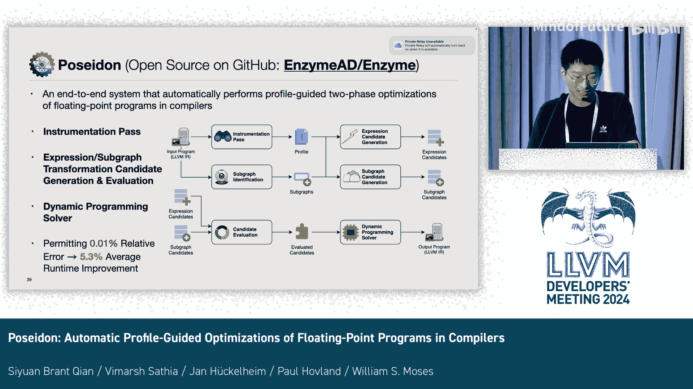

# 【2024-LLVM开发者大会-•-中英】-p17-P17-FPOpt---Balancing-Cost-and-Accuracy-of-Floating-Point-Computations-in-LLVM-I--BV18eNfepENu_p17-

Hello， my name' is Brandt， I'm a first year PhD student from UIUC in this talk I will introduce our ongoing work withidon。

An engine system that automatically optimizes pho point programs in compilers。

 This is joint work done in collaboration with Vmar Saciia， Y Hugoheim。

 Paul Hoffman and my advisor at William Moses。There is a trend in machine learning to reduce precision to increase performance。

However， the solution to increasing performance is not increasing precision uniformly。

Since some operations will give a bigger band for your buck and can be changing a lot。

And other operations needs to be capped at high precision。Moreover。

 precision changes are not always the answer。Thuss considered this example。

Where we add a small number to a big number。And then subtract another big number from the result。

With F P 32， we don't have enough bes to represent that one after the addition。

 So we got the wrong answer。We can easily fix the problem by using FP3064 instead。

 but we can actually make things work even with just voting。32。If we reassociate terms like this。

 we will be able to compute the correct result with just voting。32。But of course。

 doing these types of transformations requires knowing the wrongtime information about our programs。

On for example， which numbers are big numbers and which numbers impact the results the most。

These examples are just the tip of the iceberg， and there's a whole class of literature devoted to ways when important computations can be improved。

One direction is to change precision in a careful way to speed up computations while maintaining a decent program accuracy。

Another way is to rewrite floating point expressions using tools like Herby。

But these tools require a lot of human involvement in the loop。

There are also mass library functions that provide functional level approximation。

These approaches all require human intervention about details like fo point ranges to determine if they are valid。

On that alone performance。We were trying to answer two questions。

Can we automate the existing floating point optimization techniques in comprus。

 and we hope to find out how much performance we are leavingieving on the floor by poor choices of floating point precision and expressions。

To answer these questions， we build Poseidon an anion system which automatically transforms pho point expressions in programs to maximize program accuracy subject to a commut cost budget。

We implement Poseidon as a PGO like Qface compilation within LVM。In the first compilation phase。

 Poseidon uses an instrumentation pass to extract programming information。

In the second composition phase。Pidon automatically generates subgraph and expression level transformation candidates and uses a dynamic programming solver to compute the best combination of transformations that maximizes program accuracy subject to the accommodation cost budget。

We implement Poidon on top of enzyme， a high performance automatic differentiator of LVM and MLIR。

 so Poidon can leverage existing infrastructure to analyze and transform floating point computations in LVM IR。

Here is an overview of the entire system。 aside an instrumentman seeing input program to produce a profile。

 and Zandit identifies photo point subgraphs in this entire input program。

Given floating point subgraphs and the profile， Pocyon generates expression and subgraph transformation candidates and evaluates the cost and accuracy of these transformation。

Using a unified metric。After the evaluation， Poseidon uses a dynamic programming solver to software for the best combination of transformation candidates。

Z maximizes program accuracy。Next， I will go through the entire process in more detail。First。

 let's take a look at the instrumentation pass。Pocyidon compiles an augmented version of the input program by synthesizing gradient code using reverse mode enzyme and inserting longerger function costs into the synthesized gradient code。

The amite runs the augmented program to extract information of phone and point instructions。

Let's take this highlighted line of code， which corresponds to the sine function cause on the right as an example。

Pidon first synthes size is created in code using enzyme。

Zamppayon inserts longer function costs to pass both the value and the gradient of the original instruction to a logging data structure。

And after executing the augmented program， Poseidon gets a profile of the program that contains the ranges of instruction values。

 execution count， and geometric averages of values and gradients。

This look at the next past subgraph identification。

Pidon needs to understand which parts of the program to optimize。

 We call the LVM values that can be optimized by Poseidon， Poidonable values。

Which includes basic operations and some elementary functions。Other L VN values。

 like thoses and stores， are not prednable。Pidon runs a flood field algorithm to traverse the entire program by following down instruction operas and uses。

Until none preidntal values are met。In this process。

 Poseidon also identifies LVN values that propagate data into or out of subgraphs and labels them as input values and output values。

And in our example， Faidtan identifies two subgraphs。

 one containing sine and the other containing cosine。

Nowphaid starts to generate expression transformation candidates。

Let's take a closer look at our subgraphs。 There are two output instructions。

 sine and cosine that propagates value。Out of Poidon boat subgraphs。

Pidon constructs floating point expressions starting from these output instructions。

 upitude input values and constants。Andzen Pocyidon passes these expressions to expression re writers to generate expression candidates。

 For example， Pocyidon can pass the cosine expression to Herbie。

on with the input bounds it extracted in the instrumentation pass。

Zan Poseidon gets several expression candidates from expression rewriters and parsees these expressions for later use。

Now， Preidon starts to generate mixed position allocations for each subgraph。

Pidon estimates how much changing and intermediate instruction impacts the final result by using the absolute value of the product of instructions。

 value and gradients that Poidon captures from instrumentation path。

Given these sensitivities of instructions。Poidon produces transformation candidates that change position of the last sensitive parts of a floating point subgraph and inserts floating point casting instructions around the changed region。

Now， if the site has all transformation candidatesds ready。

 it starts to evaluate how these different kinds of transformations。

Change the global program in terms of cost and accuracy， using as internal cost and accuracy models。

For a cost model， Poseidon either uses the per instruction cost from LVN target Transform info。

Or uses a more precise custom cost model from micro benchmarkching LVM phoning pointing instructions。

For both kinds of transformation candidates， Poseidon sums up the products of execution count and instruction values for all instructions in that transformation candidate。

For accuracyacy model， Poseidon uses a butium MPFR evaluator that computes a ground truth value using arbitrary position floats and emululates original computations using regular machining precision。

After that， Poseidon calculates the local error by computing the difference between the ground truth value and the emulated result。

And then amplifies that local error by the gradient to estimate how the transformation candidate contribute to the global error。

Now let's look at the final face of Poseidon， the dynamic programming solver。

Pon needs to solve for the set of transformations that generates a minimum sum of global error contributions subject to a user defined cost budget。

Poseon's problem is really a more complex variant of this 01 Napsackack problem where we are trying to find the best way to put items into anapsack to maximize the total profit without violating the capacity constraints。

The zero and FSAC problem can be solved in polynomial time using dynamic programming。

The difference is that Poidon needs to round all computation costs to nearest integers。

In order to be able to split the original program with a larger budget into many subpro with smaller budgets。

Poidon also needs to adjust the cost and error contribution of subdraft candidates to account for the expression candidates that are already selected by the software。

So so the same piece of instructions won't be modified multiple times。We evaluate。

 we evaluated pre on FP bench。A collection of micro benchmarkchs written in a functional programming language。

We exported these micro benchmarkchs to see and used Proidon to optimize them。

We computed the geometric average of fronttime improvements across all 46 micro benchmarkchmarks that are immediately optimizable。

Across all micro benchmarkchs evaluating a relative error of 0。01%。Gives a 5。

3 average percent average runtime improvements in return。

Pidon can get an accuracy improvement of up to five manab bits on several micro benchmarkchmarks。

Let's take a look at one micro benchmarkchmark。The dash line on the top is the runtime of the original program。

 The dash line on the bottom is a relative error of the original program。

Drue and green dots are run times and relative of errors of optimizeized programs。

For this micro benchmarkchmark， Poyon offers six optimized programs to choose from。

Including those that are faster but less accurate， and those that are more accurate but slower。

Here is a pre front of optimized programs on the lower right of the plot。

 Poseidon offers two programs that are both faster and more accurate than the original program。

We are currently in the process of evaluating Poseidon on large proxy applications。

That concludes my talk， I introduce Poseidon an entryient system that automatically performs profile guided two face optimizations of floating point programs in compilers。

 Thank you。Any questions？Hi， can you say a little bit more about the applications that you're targeting because like I think of the big use of this kind of thing right now would be in machine learning。

 but if you're not taking quantization of like weights into account sort of tricky。

 so what applications are interesting that is mostly high performance computing or。

Currently we we cannot really manipulate high level constructs in machine learning like tanss。

But we can optimize real。Real proxy application in scientific computing。Like Luish。

Which is the hydrodynamics？Benchmark。Co， thanks。 thank you。

When you were specifying the computation cost Bu among the slides， the numbers were like -6，-5-2，0。

 What do those refer to。Home。Yeah， that slide which's the these are。How much how much runtime？

Slow down the user can allow。 for example， if it's a very large positive number。

 the user can afford a。A very large slowdown for in return for a better accuracy。

 If it's a negative number， that means a user just wants the program to be faster。

But we can still achieve the best possible accuracy for them。Okay。

Great talk Maybe I miss this Can you comment about the end to end compile time ahead of this approach。

Sorry what？嗯。Like what would be the end to end compile time overhead of this approach？

Like how much time spending like deciding these subgroups？For a benchmark like this。

There is one expression in it， And the run time is a compile time is mostly dominated by how long Herbie takes to optimize this expression。

 And is Herbie takes if Herbie takes like 20 seconds or compile time is。Probably just 21 seconds。

So our。Subgraphb identification algorithm is critical efficient。

And it's mostly dominated by external tools like Kirby。Thank you。I also have one question。

 I guess you showed one example where you had no runtime penalty， but。Yeah。

 I think if you go once back， yeah。Basy， the the runtime is is better and you you， you don't。

 but still at the zero line， right。I think you also mentioned that you found a few candidates where you basically don't have to pay with runtime right so would those be like interesting patterns to add to LLBM's existing say combinees or something like this？

Because you know it's a。It's a good path thing you don't pay for， right？Yeah。

 if the user can't afford the。嗯。External tools， runtime。No， no， I mean， if you， if you know this。

 actually， if you， if you have。One expression。 And， you know。

 this transformed form doesn't cost more。In terms of precision， but it gives you better run time。

 it might be worth adding that to all the existing transformations in Al。Yeah， I think so。Yeah。

 if we can identify patterns like that。We can definitely add that to LVM's existing infrastructure。

All right。If there are no more questions， I guess it's time for dudge。And yeah。

 the staff will direct you to where that can be found。 Thank you。

