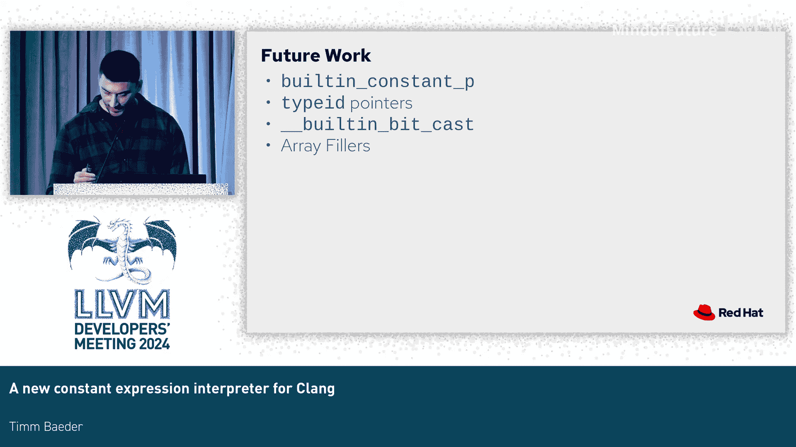

# 【2024-LLVM开发者大会-•-中英】-p18-P18-A-new-constant-expression-interpreter-for-Clang--BV18eNfepENu_p18-

Welcome to my talk about a new constant expression interpreter for Claang。My name is Tim。

 I work at Redhead， as you can see。And if you're in the audience today with a slight Djabu feeling。

 that might be because of this talk。That was in 2019， five years ago。

And it's pretty much the same title。 and now I've ripped off not only the title。

 but also the second slide from someone else， that's a good start。And this is Naandda Liquor。

 He did the initial work on this。And I don't know how far he actually got。But in 2019。

 there was one commit push to the actual repo。I think the commit message for something about the skeleton of the new interpreter。

And that was it。I picked this up in 2021， so I'm going。Compress three years of work into the next。

20 minutes should that be running？Okay。Yeah， this is about interpreting expressions at compile time。

 The difference to the current interpreter is that for constant experter and constantiv functions。

 we。We don't look at the AST every single time we call them。

 and instead we compile them to by code once。And later， only interpreted bycode。

This is supposed to be faster。For expressions， we。We still interpret them directly。

 we don't emit any bycode。You can see that later。For the basics we everything about the interpreter is C Kang interpretp namespace。

We have yet another class called contextt， and that keeps the program around。

 A program is just a list of global variables， basically and。All the functions we have compiled and。

 of course， the bytecode。 And we have the usual reference to an AC context。In the。Cang's Exp class。

 there's a bunch of API for evaluating an expression。

 you know they evaluate as known constant in evaluate for overflow as rulinging condition and so on。

 but in the end they all call one of these four the first one is potential constant expression and I'm not exactly a big fan of the name。

 but it takes a function decal and this is essentially what compiles the function to bytecode。

Evalate and evaluate as R value， Take an expression and evaluate it and hand the result。

 The S R value variant performs an implicit L value to R value conversion at the end。

 And the last one is evaluate as initializer， which。その。Take a dec。

 evaluate the initializer and hence to the result。So。With that。Knowledge as a warm up。

Can anyone tell me how many things are being constant evaluated when I run this code using that command line。

嗯。Does anyone have an intuitive guest who doesn't know a lot about clang internals？

You can just yell at out。0ero。Zero is wrong， okay？But it's a valid guess。

 Does anyone know more about Kang can。Give me a different guess， it's higher， sorry what。

Can you express that in a number？1分ない。8。7，7， let's like let to go。That's go。算。Okay，7。It's also wrong。

Of course， I'm asking that because you can't get it。

 I would probably have to ask like 16 people before I get the right answer because it's 16。You know。

 we have almost all of these for overflow。Including all the literals。

 and then you of course need to know that this is a C+ plus range for loop。

 so there's a bunch of implicit variables you don't see。And。Yeah。

 I just want to say this is stuff is everywhere and we probably do it more than you think。A yeah。

 I already mentioned the program。The function is basically what you expect it to be。

 It's the compiled byte code and a bunch of。More information about a function。 Yeah。

 we have a class called a compiler。 So your compiler now has a compiler。

 and that is what compiles functions to bycode。 depending on the emitter， of course。

 if we have we have a bytecode emitter that actually generates byte code and an evolve emitter that。

Instead of doing that immediately evaluates the instructions we emitit。

The bike called is stack based？And this is what we use the interpret stack for。

 And the interpret frame is essentially your usual function frame。 You know。

 local variables has a size and so on。For types we also yeah this is reallys probably not interesting if you already know programming。

 but there's a bunch of you know integers of different sizes， else floats。

 we have pointers and so on we don't have anything for vectors and complex types specifically we just use you know。

A an array of primitives of the right size， which for complex types is simply2。

And for classes andstructs we actually generate records。

 and that is simply information about the class ofstruct。

 and especially we compute offsets for basiss， fields and virtual basiss。And then later， you know。

 when we refer to a field， we just do that by using that offset。嗯。For pointers。

 the most important one is the block pointer， which is not the one。 you know。

 maybe know from objective C， but it's just， you know。

 a block for us is like actually allocated data。 So if you have an integer somewhere。

We need to allocate it。Usually that is in IOD interpret frame for local variables or in the program for global variables more recently there's dynamic memory allocation that also works at Comp time。

Which is， you know， it also allocates a block。To describe the contents of a blog。

 we have what we call a descriptor and a descriptor。

New York gives us like all the information we may possibly need about the data inside a block if it's an array。

 it gives us the size of the array the element type。If it's a record， it gives us a record and so on。

And for。For fields， they are always preceded by what we call an inline descriptor。

And the inline descriptor then gives us data about the field， like the descriptor for the field。

 or most importantly， there's a bit whether the field has been initialized at all。Yeah。

 so that's an example， a broaderstruct and。For this swap。

 we are going to compute the offsets and the offset for field x is going to be 16。With。

 which is simply size of inline descriptor， right， So if you want to refer to the field X。

 you would point to offset 16 and then。For from。That offset is the actual data of the field。

The same is true for why， of course， the four bytes of the actual integer are then followed by four bytes of padding。

And for the float field， we simply like we end up at offset 64， remember that？And the size is。

 in this case， 32， which is size of AP float， like for floats， we also use AP float。

And in green here you see like yet another bit of。Meterada we need for global variables。

 In this case， it's just the initialization state。Global variables have to be initialized if they are declared constant expert。

 but that may fail， and if it fails and we don't later use the variable we need to properly diagnose that and this is what we use that for。

And if you now refer to the why field of a player variable， you would， you know。

 point right after the， the second inline descriptor， which is right before the actual data of why。

Okay。I would like to actually look at interpreting a function， right？

And I just added a member function to the player select。

And I declared a global construct for variable called PEep， Iized it。

 and the expression I want to look at is the binary operator in the static as。That's anequ， right。

 And the left hand side is a member cor。 And the base of the member call is just a decor ref expression。

 which is just P。 So when we evaluate such a decor ref，'， it's basically。

 I'm going to end up as a pointer on the deck， right， And at this point， we start。Actually。

 evaluating the get health function。So。Down， down there is this dis stack， right。

 So we start with a pointer and the actual thing is not really interesting。 but you know。

 it's a root pointer because we haven't yet applied any offset to it。

And so if you remember remember the body of the get health function， it was just return health。

 but of course， that's an implicit this arrow in front of that。

 So what we first do is we get our instance pointer。 and instance instance pointer in this case。

 you know， was P and so what we get is simply the exact same thing。So I have the pointer twice now。

好嗯。What we want to do next is。Get the health field on the， right。

 So we did that using a get Twitter field pop instruction。

Maybe you can figure out a pattern for the naming yourself， you know。

 but the get put or field pop instruction will pop the top of the stack。

 apply an offset and then push the result back on the stack。

 and this is where we have the offset 64 that we saw before。And so the result is just come， you know。

Points to the same memory， but has the offset of 64 applied。

And next we want to actually load the value， which is not surprisingly going to be our 30 from before。

And。No， just like in。Every other function in location。

 we will churn using a or we ended in a return instruction。 and that will。

Pop the return volume from the stack， clean up behind the function call。

 meaning remove all the arguments passed to the function from the stack， destroy the interpret frame。

 and then just put the return volume back on the stack。

And this is then where the the color of the function may actually use it， right。

 So the binary operator now has the left hand side evaluated。 and of course。

 now it's going to evaluate the right hand side and compare us。 It's going to be equal。

As you can see。 and so the result we will then evaluate to or convert to an AP value。

 This is the only time in this case that we will convert anything to an AP value。

And we will return that to evaluate as our value。And your compiler is not going to yell at you because the assertion did not fail。

Yeah， I've got a bunch of performance measurements。

 and I don't think the the two interpreters are in a， in a state where you can meaningfully。

 you know， compare to performance， but。Given the topic I'm talking about， I felt like I have to。Yeah。

 this one has an sorry， Github issue number 6，1，4。2，5。 So definitely there's a real need for this。

 And so you can now like， you know， do nothing but faster。嗯。

This this runs in like 4 seconds instead of 11。 If you want to compile Fibonacci numbers in a really。

 really inefficient way， you can like， you know， do that now， and it's faster。Here see， I used Embed。

Very modern。 And the the file I'm embedding is the escalator3 amalgamation that is around 8。6 MBby。

And I'm just summing them up。 You know， I'm touching every bitete once。 And yeah。

 it's also like 18 versus 31。Yeah， so far as good， right， I mean， I have the Esqui3。F， anyway。

 so I can just run it。 And that proves that I'm not making the numbers up because now it's slower。

 I'm I'm not sure why yet。 I haven't investigated。 but again， I'm just。

 I'm just like you can compare this。 and I'm still trying to make things work。

 I haven't actually invested any or a lot of time into improving performance。For testing， we have。

 you the usual directory in the clang。Test directory。

 And were also adding more and more new run lines to existing files。 By the way。

 if you w to try this， this is the， this is what you need to pass to clang。 And in April this year。

 I started periodically testing the entire Kang test suite。 I started or yeah。

 I was at almost 600 test failures when I started， and I am now at。Well， in this graph。

 it's like 179。 If you go to the website link below。It's 175。 And if you look at my laptop， it's 156。

嗯。Yeah， so general trend is downloadward。 I did one go up here， but you know， I'm working on it。

 yeah。Oh， okay， I'm not gonna。 Yeah。 I need to do a fixed building constant P。

 I'm not going to tell you what it is because I don't want to ruin anyone's day all life。

But it is this weird。Combination of things we need to do at compile like when when generating the bike code and later when interpreting it。

 it's also as far as I know， a new thing。 And if you look at how clang。Or what Kang does。

 when you use it， it's completely different than what GCC does。嗯。Yeah。

Type I D pointers really I have nothing interesting to say about that。

 It's just just a bunch of tests that would be fixed if that was implemented。

But in Bigcast is just a lot of work。Is Aaron here。Yes。There's a patch waiting for you。

It's like the most pressure in one ping I can use。Yeah。But it's better than than the current one。

 because it supports pitfield。Right， and every fills is。

 you know when you when you declare a huge array and then you only initialize one element of it。

Then you know， what be nice if we didn't create huge array for you？On。

And。😊，I think I'm done and I would now take questions。Thanks for the talk， I was wondering。

 what do how do you test to make sure you've got the semantics right？

When you're doing the constant evaluation sake versus。

 oh you removed all the contents expert and you compiled it natively and ran it。

 like how do you make sure you got like get the semantics， right？Well。

 can you can write your test in such a way that they are definitely run at compound time。

Like if you make sure you can make sure that an initializer is evaluated at compile time by making the variable constant expert。

Sorry， I don't don't go my father， but I can ask offline。I just wanted to say thank you。

 because the new constant expression interpreter， I think， really is the future of Kang。

 It is significantly faster， despite putting in no real effort on optimizing it。

 And it's a huge undertaking。 So thank you for working on it。😊，Your' wake up。Hi。

m I'm going to try to repeat the question from the previous one。

 So how do you make sure that when you do constant evaluation。

 the results are the same as if you would run it。Without concentration。

 when you do the whole complete compilation。I don't really do that。 just， I hope it's the same。

 I like Like what what I'm trying to do is go draw in replacement for the current interpreter。

 So whatever that does， I try to do。 So you just。Gand they all the the tests and hope they just have good coverage。

Basically， yes， it makes sense， Thank you。Does anyone have any other questions， we have time。是。

Have you thought at all about moving away from A P value as the representation of the final result。

I mean， yeah， kind of， but you know， it''s used a lot inside climbing。

So I think that's something we can do after we switched interpreters。

 there's a bunch of other things we could simplify。But yeah。Make sense。Well。

 let's thank Tim for his talk and we'll take you。