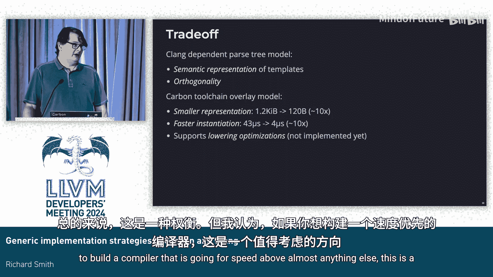

# 【2024-LLVM开发者大会-•-中英】-p19-P19-Generic-implementation-strategies-in-Carbon-and-Clang--BV18eNfepENu_p19-

Hello， I'm Richard。 I am working currently on the carbon Fr language at Google and before that I was the code owner of Forlklang。

Today I'm going to be talking a bit about how C++ templates are implemented in Kang。

 some of the benefits and limitations of that approach and the new approach that we're using in the carbon tool chain。

So to get started， I'm going to assume this audience generally knows what C++ templates are。

So the basic principles of them are they not fully type checked when they're defined instead we wait until you know what the arguments are from a substitution and then based on the results。

 those substitutions determine the validity and the meaning of the result。

And substituting into a template produces basically a normal entity。

 So a substitution into a function template produces a function。

A substit into a class template uses a class and so on。And Coness is largely the same。

We have templates template generics， we call them， that again are not fully type checked and defined and we have a substitution process that determines the meaning and validity。

Unlike in C++， the thing that you get from substitution。

 we call a specific rather than a template instantiation， but the idea is basically the same。

Carbon goes beyond this and also has what we call checked generics。

Where they are type checked in advance when they're defined。

 check generics require there to be constraints on the generic parameter。 So in this case。

 the parameter T specifies that it must be numeric and ordered and those are used for the checking。

 You can also specify those for templates， but they are not mandatory in that case。Okay。

 so with that background， how are C++ templates implemented today。

 how are they represented by current C++ compilers？There are basically two ways。

One of them is the token soup method where essentially what you do is you collect the sequence of tokens in the body of the template。

And then when you come to instantiation， you replay that sequence of tokens with the knowledge of what the template parameter means。

 and in doing so， you form the body。And that's the method that's used by the EDG front end。

 It's also used by the MSBC par， or at least the old MSBC par。 they have a new one now， which is。

Using a different technique， the other way that this is done。Which is the way that GCC does it。

 it's also the way that the client does it。Is where you build a pos tree that contains an explicit representation of the dependent constructs in advance。

So let's look at the method used by climate a little bit more deeply。

So when we see a template such as this function template。

 we're going to pause it and we're going to build an AST as we would normally need do for a nondependent construct and in this case it looks like this and there are some interesting things about this we have。

An explicit representation of these dependent portions of the AST。

 so we have this unresolved construct Exp that says， I'm going to construct a T。

 whatever T is using Open print and closeP， and we don't actually know what that means yet。

 but whatever that means that's what that's going to do。

We also have some AS nodes here that have types。That are dependent， but we generally know。

What structure they're going to have， we just don't know what their tapes will be。

And then when we come to instantiate。We we build a new tree starting from the original tree and building a new node for each original node performing。

A substitution as we go。 So all of the T's have become ins here。

And the construct Exp is now a scale value initialization expression。

 which in C+ plus means we're going to form a zero value of this type。

The nodes that had dependent types now have specific concrete types。

And we actually get a slightly different tree in this case。

 we have some implicit conversions that are removing some constants。

And so this in general may produce a slightly different shape of tree。

 as well as slightly changing the means of the notes。In cl this is done by the tree Trans class。Now。

 Fu transsom has an interesting optimization in it where it attempts to reuse parts of the tree that don't depend on template parameters that are therefore going to be the same from one instantiation to the next。

And this is incredibly important because this is the single largest source of avoidable cost in template instantiation。

 is rebuilding things that are always going to be the same。So for example， like this one。

 we have this variable int I， which we initialize to zero， we increment it。

And then later we have this n n， and then we have this n question mark n Co on one thing at the end and all that's not really dependent on the template parameters in any way。

But treee transform only actually manages to reuse three integer literals in this case between instantiations。

 you get to reuse the inte literal online three inizing I。

 there's an in literal online line4 and one on 9 as well。

 and everything else is rebuilt fresh each instantiation。So we try to reuse non portions of the tree。

 but this actually usually fails in K currently， and there are a few reasons for this。

The biggest one is that if you red a node。Then the parent of that loop must also be rebuilt because it contains a pointer to the child。

But another one is that whenever you have a local variable。

 the local variable has a pointer to its parent， which in this case will be a function。

 and because you have a new function， that means you need a new local variable to have that different pointer in it。

 and so that means that anything that touches a local variable is always rebuilt。

And that's why in this case we didn't see almost anything being reused。

And there are a few other things in Kang， the way that we represent the type for expression means that if the type changes。

 you need to rebuildbuil the entire expression。And also。

 initializers are always rebuilt from scratch due to some differences in the way that the syntctic and semantic forms are represented。

And packC expansions also always get rebuilt in full。

Because Kang has an invariant that in a particular function body。

 each expression can only appear at most once。So overall。

 the the cost of building an instantiation in Kang's model ends up being comparable to either the cost of building the template or the cost of。

Building the instantiation as if you pass it from source， except that we can share some of the costs。

 So we're not passing it again。 We're not forming tokens again。 We get some savings from that。

And we don't do unqualified name lookup again， and we get some savings from that as well。

 but a lot of the rest of the cost actually has to get paid each instantiation。

And we do manage to reuse some of the independent portions of the tree， but less than we might like。

So as an example of this， we can look at a type trait。

 which is something that's going to occur fairly commonly in C++ code because of use in the standard library。

And the older way of doing this is with a class template， which has a static constant ci it。

 like being eum might be a variable。And then we can measure how much this costs each time we instantiate this and on my machine it comes out at about 43 microseconds for each instantiation and the representation we build ends up being about 1。

6 kilobytes for each instantiation and that might seem like a lot but we do have a new class here we do have a new variable。

 we also have a new name lookup table for the class because that's not we used between instantiations either because it points to different value variables。

A more modern way of doing this is with a variable template which is aiming to remove some of that class specific cost。

And that does remove some of the cost， but it's still pretty high cost。

 23 microsecons on my machine and about  one kilobte per instantiation。

And this is in comparison to the cost of actually just directly using the compiler built in type trade。

 which is still about 50 times faster and about five times smaller。

So when thinking about this for carbon， we were looking at whether we could make this representation faster and smaller。

And what we came up with was an approach of using overlays for representing generics and specifics。

And so the idea is that as with Gang， we will pass the generic as well as we can to form a dependent representation。

And then represent the specific as a set of patches over the generic。

And that means that we're only in the specific representing the things that change between instantiations。

And we're only spending time rebuilding the things that change。

And because we generally use a data oriented design approach andang for various good reasons。

 we want to do this with dense arrays to the extent that we can。

So the way this is going to work is when we pause， we're going to build an array of the dependent constructs that appear within the generic。

And change the generics so that it opaquely refers to those things by their index within that array。

And then when we come to build a specific from the generic， when we come to monomorphs。

 we're going to compute concrete values corresponding to those array elements by evaluating the values that sit in those slots。

So as an example， for this generic， we start by identifying some value that's's dependent。

 the first value that's dependent is this R here。And so we're going to look for all the places that appears within the generic。

There are a few places here。 This could also be within the type of instructions。

And because we in our IO， we represent。Types as a form of value。

 this means that we're just generically and consistently looking across the operarans of all of the operations in the representation for where this thing appears。

And we're going to then replace all of those with a reference to the first slot that we create and keep that that that slot contains the symbolic value of R。

And then keep going， we find slot0。t value is the next one。And again。

 we replace that with mis Chris slot1。For things like this zero。

 we have an implicit conversion here from the zero literal to the type， which is now slot one。

But we're doing this in the the semantic IR representation that we have。

 So we've actually de sugargued that。 And this is a call to some particular symbolic function。

 which is。Picked out of an implementation of the。The numeric interface in this case。

And so our slot 2 is going to become the， the value of。That function。

 that function treated as a value。And so on through the rest of this generic。

 we can convert these things into slots and replace the uses with slot indexes until we're left with a representation of the generic that doesn't directly reference any of its own parameters just references slots within its representation。

 plus a table of slots saying what the symbolic values that live in those slots are。Now。

 the things that live in those slots in general instructions in ourI。

And because we have an array of instructions， it's pretty natural to think of that as a block of code。

And that has a very interesting consequence， which is that the method for computing a specific from a generic。

Is then to execute a comp time function whose body is of those things。

And so what that means is our process of forming a specific from a generic is a compile time function evaluation。

 We've converted the generic into a compile time function。

 That compile time function computes the specific。So for a type trait case。The， the top trait class。

 the generic function。It's a function that is going to compute the value of that type trait。

And just store that one value， and that's your specific。

 So this gives you a very efficient way form specifics from generics。😊，And so as an example。

 if we're forming a specific of this average generic。

We're going to compute the corresponding burninging values， and that's a little bit easier to see。

So on the left here we have the generic and itss array of symbolic values on the right we have the specific and the corresponding array of evaluated values for this particular type。

 which is an array of three ins。And these are both just dense。

 contiguous arrays that values that are very compact representation。

And so when we come to use a generic。In general， we need to look for information in two different places now so if we want to type check this call to average first we're going to resolve which specific it's calling into and it's the one we have on the right here that takes an array of3 I32s and then to find the return type we first look for the return type of the generic which is slot1。

And then we look up the value of slot one in the specific to get this I32 type。So。

Maybe some of you noticed I've been slightly cheating so far because all I talked about before would cover cases where you can symbolically determine types and constant values。

Of things within the generic。 And that works explained for for checked generics。

 But for template generics， in general， you can't do that because you don't know what the meaning of the code is yet。

So we have constructs that might depend on。Temp parameters to the point where the meaning depends。

 the validity might depend。It's a more general and a bigger problem to solve。

 so how are we going to deal with that？So what we do is we add another kind of instruction to our intermediate representation。

And what this instruction does is to perform a kind of an atomic instantiation。

So it instantcentiateates a single kind of expression。So for this example。

 we have a call to a function F looks like a member call， but we don't know what F is。

 we can't check the member access， we can't type check the call。

So what we're going to do is we're going to build an instruction that represents type checking that member access and instantiating it。

And we're going to then replace the memor axis with that instruction。

 and we're going to do the same thing for the core。And these instructions。

 when evaluated at compile time， compute another instruction。

So when we come to evaluate the generic form specific。

We're going to compute the things that go in these slots as the instructions that perform these operations。

And this gives us the properties we want， we do the type checking late when we form the specific。

 and if instantiation fails， it fails， that's the behavior that we wanted。

So what this means is our representation isn't a dependent par tree that represents the eventual meaning of the program and the way it is in Kang。

But instead， it still remains a computation that determines them the meaning based on the arguments。

And formingly specific， as I said， is still compileelled time function evaluation。😊。

We also get a slight benefit that this sort of forces us to have instructions in IRIR that perform certain instantiation tasks。

 which is generally a useful match programming tool to have anyway。

So what's the downside of this approach， the big downside is orthogonality。Like the。

Probably the most important feature that you'd be looking for when implementing。

A language construct in a compiler is that you don't need to touch the entire compiler to implement it。

 You want your implementations of different features to not touch each other to the extent possible。

And because otherwise， you're going to have a combinatorial explosion of dealing with all of the interactions of the different features。

And Gham's approach gives us that to a large degree。In K。

 you can have a pointer to an expression and it points to an expression。

 you don't need to know whether that's inside a template instantiation where it came from which template instantiation。

And likewise， for a declaration， you can ask for its initializer and you get an expression。

 you don't need to know anything more than that。A code that wants to care about templates can。

 but code that doesn't want to doesn't have to。Whereas in carbon。

 any time you want to navigate across the IR from， say， an instruction to its opera end。

 from a declaration to its initializer， anytime you want to look at a lookup result。

 you also have to think about well， which version of that thing am I talking about。

 which specific am I within because the edge that you're following doesn't know that and it can't know that？

So there's extra costs there， and that's， I think probably the biggest downside of this approach。

So overall， we have a tradeoff， as we often do in these decisions。

 the carbon model gives you a strong semantic representation of templates。 the primary thing。

 its representation is modeling。Is the structure of the templatedcode。

 and it's going to be the same for the template as it will be for the instantiations of the template for the most part。

It also gives you this great orthogonality property that keeps your tool chain simpler。

But on the other hand， the carbon model， the overlay model gives you smaller representations and take this with a lot of salt because our tool chain is still in very early days。

 but so far what we're seeing is about on an example comparable to the type rate we saw before get about 120 bytes for each instantiation as opposed to the 1。

2 kilobytes we saw which is about a 10 x production and also because we're doing less work。

 it's a lot faster。And likewise， take this with a pinch of salt we're seeing about a 10x production in instantiation time。

There's also a side benefit here that because our representation is explicitly decoupling。

The the things that change and the things that don't change between generics and their their specifics。

 we can do a lot more interesting things during lowering， such as we can in advance。

 detect whether two specifics will lower to the same thing。

 And that lets us do things like guarantee to lower， say。

 vector of point of a string dot size and vector of。Pointer to inch dot size to the same function。

 rather than just two different functions that happen to have the same body。And as I say， overall。

 this ends up being a trade off， but I think if you're trying to build a compiler that is going for speed above almost anything else。

 this is a really good direction to consider。

Thank you。We'll take questions now。嗯。So sorry， I have one question。

 So how do you think this approach carbon stakinging？It's going to make diagnosing， you know。

 statation failure easier or harder， you know what's your view on that thing。So because。

Because instantiation basically becomes the same thing as comping function evaluation。

We kind of have the same problem to solve in both domains。

 which is essentially producing a back trace。But at least we dont now only have to sell it once。

So we're looking at doing the kind of the recursions either through templates or through comp time function evaluation in in that kind of。

嗯。Data recursive way， so instead of actually recursing on the stack having an explicit representation of how we got there。

 and I think that kind of representation lends itself really well to producing some diagnostics describing the path you took to reach a particular evaluation。

Hi， I do think the overlay techniques that you use to。Used for templates and carbon。

 do you think this can also be applied and to a speed up template and staation for a C++？

Theoretically， yes， but I think it's a very hard thing to retrofit because there's a lot of code incang today that navigates from。

 say， an express star to its to its children and。That code would all need to be at least checked。

 save needs to be changed and potentially changed to track which version of that expression you were talking about。

 which specific you were in before， and maybe it's the same one afters， but maybe it's not。

So some degree of extra work is probably necessary across a fairly large amount of client。

 I think it's very hard to add this if you didn't build in from the start。

Does the loss of orthogonality make it harder to have， I guess like outside plugins， like。

 for example， plank plugin heres the carbon plugin？I think to a certain extent， yes。

It's mostly the question of making sure that the APIs you are very explicit about you don't need to just provide the instruction。

 you also need to provide the instruction and the specific ID。

 and I think if your API is diligent about that and doesn't allow you to take the shortcut。

 it's hard to get it wrong， but it's also an extra burden on the users of the compile as a library。

thanks for the talk it's a great sounds like a great idea to have a compile time function evaluation My question basically comes down to you does this apply to class templates as well Yes so you have a compile time class evaluation too yeah okay。

This is all kinds of generics， I'll tell with this。Hi， thanks for the talk， another question。

 does this apply to greater values as template arguments？

Or do you don't have that support for carbon。Yes， this so because we model generics very similar to the we model compile time functions。

 basically anything that you can pass as a value at compile time。

 you can also use as a generic argument。Thank you。Thank you， everyone。

 Please join me in thanking Richard， for his talk。