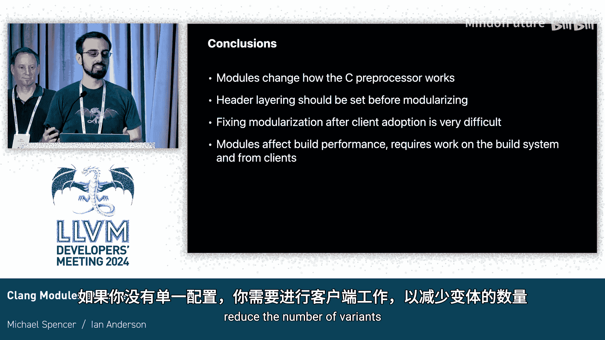

# 【2024-LLVM开发者大会-•-中英】-p20-P20-Clang-Modules-at-Scale--BV18eNfepENu_p20-

Hi， my name is Ian Anderson。And I'm Michael Spencer， and we work on the Kang modules team at Apple。

 and today we're going to be talking about Kang modules at scale。

So we're going to cover the last 10 years of modularizing Apple's platforms。

 avoiding module pitfalls， using the pre processoror with modules and finally building modules。

So client modules are importable interfaces， this is similar to the module features the import that you see in Sw。

 C++ iPhoneython and other languages。They're not the same thing as E++ modules are pretty similar。

 but they predate them by about five years。They were designed for Swift to interact with existing seat code and they can also be used from CNC++。

They're defined in module map files and comprised of headers。

 and they build as independent translation units and this one's pretty important we're going to come back to that several times。

So the original modules were made alongside Sw 1。0。Most libraries got their own modules。

 it was pretty straightforward， but once we got the user include。

 we just made one big module for the whole thing and then another one for the clang headers and another for Lipsy++。

That didn't work cause a bunch of issues， but we just made some compiler cls to shortcut some of that at our module map work that we would have to come back to later。

We'll talk about this a little bit more in detail。Mosta1。

0 shipped the library owners to possession of their modules。

 and we had some early adopters to start using modules。

So we quickly found that modules were pretty unintuitive for C developers and there's some pretty easily hip pitfalls there。

We discovered a wide variety of contents and uses in headers。

 and we also found that build performance is actually not really a given。

So before I jump into some specific model pitfalls。

 we need just a little bit more information about modules。So modules are precompiled and reused。

 they build as independent translation units like we said。

Include statements are translated to module imports。

 which is an important point because modules do not inherit the preproor environment from the includedr。

And this is a pretty big departure from sea and is actually the source of many of these pitfalls。

And then finally， in Swift， the module name is part of the identifier for a declaration。

 so that means for。For declarations with the same name if they're in different modules。

 they are distinct types and type merging does not apply。

So the first pitfall is that you need to modularize your header'depend order or bottom up。

That means that modular headers can only include other modular headers。

Which we didn't follow up first， and we found that non modular includes end up causing a whole lot of bugs that are super confusing and really hard to figure out。

Some of them that include doesn't seem to do anything。

 you get these weird type reddlaration errors that don't make any sense and you also get incompatible type errors。

 you especially get that one in Swift and you just get other just random errors that just they don't make any sense。

And so show you kind of how easy it is to fall into that， we have an example here。

Where you have a pretty basic module map and that second header includes a non modular header。

And there's nothing exciting about the non modular head， it just has a type definite。

But our unsuspecting victim at the bottom includes one of the other modular headers and the non-modular header and all of a sudden their nonmodular type is a notfound type。

 and that kind of looks like a compiler error at first。

 but it has to do with the way mods are implemented。

 there's two or three different ways you can do it。

 but they all result in different errors in different contexts and there's just really no way to win except to modular as your headers in dependency order。

Then what's kind of subtle in is that moduleles have to be ascyclic and that makes a lot of sense。

 you you kind of include cycles you can of module cycles， sure。

 but it gets pretty tricky once the C standard library headers are involved because what looks like a simple include actually ends up kind of ping ping between some of the search paths。

So a simple include from in types to standard Nh actually hops up and down through the include next and the includes。

 and if you remember from earlier， we just originally made large modules for everything in MIMC。

 everything in MIC++。And you can probably see that the module cycles are right there。

So our original includess that I kind of hinted out earlier was that we blocked and include from leaving the Lipsy module。

And it goes straight to standarded， but as you can imagine this causes a lot of weird issues in C++ when it doesn't actually hop up to the C++ headers。

 and it also actually invites additional cycles to cause additional to pull in additional dependencies and this turned out to be really difficult to fixed because we just had a lot of code internally that ended up accidentally relying on these cycles。

 but we did finally fix it this year。And now our module maps sorry。

 our module graph looks nice and linear there。So our next pitfall is make sure that your expected macros are defined。

 and here's where it comes out to get us that modules built as independent translation units。

So that means that headers cannot rely on the included's pre processorcesor environment。

So a real common case that we ran into is CS is needed but just about everything。

 but sometimes you forget to include it and you know you get away with it because just about everything else includes it and so your macros and your basics types are there but once you're building in an independent preprocessor environment。

 it suddenly becomes very important to include but use That was pretty easy the confusing one that was user provider macros now need to be passed on the command line。

So you have some pretty basic code that looks like this。

 you have this one module that conditionally adds additional API depending on a macro definition that the client passes in。

And usually you define it and include it， and there it is seems like fine。

Except the modules are not fine and your function isn't found。

 and the reason this is is because our cool module here built on its own where Quipson classes wasn't defined。

So the fix of this is pretty straightforward， the client needs to pass that macro on the command line and now every translation unit sees the declaration and we cool。

So next one， pretty straightforward For one definition rules。

 pretty much every one definition rule you've ever heard， same thing。

You can only have one definition of all types， macro functions what have you。

Sometimes you can kind of cheat where it's awkward or inconvenient to do this by using FNF。

Guess what's coming up？Modules built as independent translation units。

This piece of code that we used to have from Apple's copy of ICU used to have the u brake iterator defined or declared in a couple of different headers。

 and now this is a type reddlaration error The fix is easy enough you just have to pick one of the other header to own it or if it doesn't make sense for one to include the other。

 you just had a third header to hold some of those common types。

But that's another thing to be aware of。The next one is that Undeaf can get you into trouble。

 Sometimes we use it to fix other headers。 so we do this incang itself or float limits do H like to include the system1 and then undaf a bunch of stuff and then。

Pull it back in， but here's another friend modules build as independent translation units。

 gotcha again。And here's our reeclaration error This one's actually a little bit trickier to fix because claimly does need to own these。

 so the Applelepsy headers need to become modular aware and we had to be careful to not redeclar things that Clain insisted on owning。

Exterern C is pretty similar， it gets used sometimes to fix other headers to kind of make mistakes。

 but modules build as independent translation units。Gets us one more time。

So we have this bad header that has this stotype function and they forgot their extrency either。

And then you have this well- meaning header that's in the middle layers and it tries to bracket in Xterern C to kind of help you out。

 But you know， once again， a bad header there， it builds in an independent translation unit so it doesn't get that Xern C bracket。

 It's still missing。 It's still a problem。 He to get your link error。

This one is particularly snarly because it kind of gets you in the ho of including a bunch of headers inside of XternC。

 and I showed that standardatomic。h from right there because。In C++ 23， it's C++ aware。

 and it has a bunch of。C++ atomics in there and it gets really confused if you bracket it inside of Xtter C and you just。

 you get a lot of errors and just it's weird behavior you know again is kind of confusing and it gets hard to diagnose。

So that particular one， we saw it as such a problem that we actually treat it as an error when you're building modules in C++ mode。

 oh and I when to throw in there， youll also get the same problem including headers inside our namespace brackets。

But we had too many kind of messy headers and apples。

 so we worked around that one with a module clage， we haven't quite fixed them all yet。

 but we've been working on this one over the last few years。

Which takes us to preprocessor and over to Michael。俾钱。😊。

So what do you do when you need to do non modular things in your headers？

So playing module maps have a feature called textual。

 and so you can put textual in front of your header in your module map and now it's basically just a normal header。

And these headers don't build as part of the module， so if you import that module。

 you actually won't see the content of that header。

And including that textual header doesn't convert into an import。

 so you won't get the rest of the contents of the module unless that module else the textual header imports the module。

😡，And these don't build as independent ten translation units， they're just normal ladderers。

So there's some dangers to this， and it's similar all of the stuff we talked about with non modular headingers。

You can't allow a declaration to exist in multiple modules， they have to be part of one。

 and so for example， a H is really hard to use from mod headers， modular headers。

 because if you ever have different values in debug。

 and then you import those into a later translation unit。

 claim can get very confused and we'll yell at you for saying， well， which asserter did you mean？

Now there are some uses of this， so a very common one in the Algaium Project least and a bunch of other projects are X macros where we have this do dev file which needs to be textual because it's just a bunch of function like macros。

 and then we have laying options。 H， which is part of a module and this is fine because it just textually includes laying optionstion。

de and then in that context it creates these declarations and so they only belong to the actual module they don't belong to the dott phone。

The next one that's common is these we call like private implementation headers。

 so sometimes you'll have split a header that gets split up because it's a really long header and for some reason it wasn't split up properly instead it's just like chopped up at different locations and it expects to be included in the correct order。

And for all of it to get included。Another one is for parallel implications where you'll have some common declarations and then oh on R。

 I need like this in line assembly and on X86， I need this different in line assembly。

And there's a solution for this， and we make sure that they have a single inr。

And that they're marked as private textual， this private textual prevents other modules from including it。

 and so thus we can guarantee that these declarations that exist in these textual headers are only belonging to a single module。

Sometimes you have headers that really actually do have a textual component and declarations that they need。

A common one is this Gcc styletode。t age， where you have these neat macros where say like， oh。

 I need pointer of key， and then it will only define the things that you need。To do this。

 we create a top level text tool header that handles all the preprocessor parts of this。

And then we create separate non modular headers。That actually provide the declarations。Sorry。

 modular heers， normal level heers， not on。So here we have stooddh。

 and this is a very simplified version where， hey， if you say you need pointer of T。

 then I'm going to include this special implementation header that is part of a submodule and it actually defines pointer of T。

 and here we look at the module map and see that Stdt H is textual and these other implementation modules。

 headers are normal modular headers。So now we have all these modules。

 we need to build them and build lots of them。But let's take a look at some basics first， so。

CLN compiles these modules to On disck PCMs or pre compileiled modules， their LV and bit code format。

Playing AS keys and various other information。The contents of these PCMs depends on the compiler flags like D Ta。

 your language version， and in particular D Ds， this is very common to set different DDs on different source files or targets。

 so you can have a lot of variation in that。A subset of the command line forms the module context hash and so this includes all the command line arguments that could impact the AST。

And because this is formed just from the command line， we don't actually know if they definitely do。

 we just know they could。And so PCMs for the same module with differing hashes are called variants。

 so we may have lots of module variants for the same module。

And PCMs can only safely be reused between compiles if the hash hashees match。

 it's very dangerous to try mix hashes， claim will prevent you and if you override it。

 sometimes it'll work a lot of times it'll crash or claim will be random errors， it's pretty bad。

So the initial way we built claim modules was with implicitly built modules。And here。

 modules are built by each compiler process separately when they're needed。😡。

If another compiler process needs the same module， it blocks waiting for that module to be built。😡。

And if the module is already on disk is already built。

 then each claim process needs to actually check to make sure did any of the input files to building that module change because if they did。

 then we need to bebuilt。And it's really common to have different module context hashes across translation units in a large project so you can end up with lots of variances。

And this leads to slower builds due to poor PCM reuse and this duplicate verification work。

So we have these initial issues and we had some work around。

You build it too slow so implicit modules just it just cheats， it says you know。

 those different command line options， they probably don't matter and so we have this non strict context has。

And so we got significantly more frequent reuse out of our implicit modules。

But this does sacrifice correctness and sometimes you can get compiler errors。

 you get compiler crashes because you end up in situations where you have different header search paths which result to different headers in different parts of the build。

 maybe they are different sizes， now your source locations are all very confusing。

 you can get all kinds of ridiculous results。Now， the duplicate validation。

 what is fixed by this concept of build sessions where builds a very minor change of the build system where it can tell Claang at this point in time。

 anything after that has already been validated。So here we have an example build。

 this is like Swift C and objective C code。And。It it's compiling some code， discover covers oh。

 I need a module， so let me go off and build it。 So other code。

 another translation unit also needs that same module so it's going to stop and wait。

And this kind of happens all over the built。And this is basically kind of what a build with implicit modules looks like。

So we came up with a better solution， explicitly built modules。Here。

 the build system ahead of time before it builds anything。

 scans each translation unit for what modules it needs and then builds them before actually building that translation unit。

😡，And the scanner can actually detect configuration differences that don't matter because it's actually looking at the code。

 and so like VFSs， header search paths， working directories， that can say， oh。

 that mattered or that didn't and then unify different variants。

This allows us to use the strict has during scanning。

 but not pay the cost for so many different variants。😡。

And this will allowed us to basically fix correctness like Cl still has bugs。

 but these random non deterministic bugs are almost entirely gone now。Now this is more precise。

 so you will sometimes build more modules， but you actually did need those modules and you were getting lucky before。

So this lets us take our implicit module build from this and go to explicit。

Where all the modules are built beforehand。And since our build system is smart。

 it can schedule things and kind of pack it all together。For a more in depth discussion of this。

 my colleague Young gave a talk at El of M Euro 2022 implicitly discovered explicitly built playing modules。

 and RM upex is going to talk about applying this to Swift。So performance。

Building modules currently has a large overhead， This isn't intrinsic， it's not required。

 this could be fixed。But that's where we are today。

And lots of variants and small modules significantly decrease to the scanning performance and build performance。

So there's two major ways to fix this。The first is having a globally unique configuration。

 if you just across your entire build and especially at large and larger scales where you might be filing like 100。

000 horse files or something， if you can have one configuration for LibB C across all of those。

 you parse LibB C once or LibC++ once。And it's great if you can get to there。

The next is you want to combine headers both where it makes sense and where it doesn't make cycles and so essentially you have the spectrum between a single mega module。

 which is basically a PCH and one module per header and both of these don't work well module per header is too slow and single mega module has logistical issues especially at larger scales and so what we've found is that having one library per header is the best sometimes you have cycles between libraries which it's best if you don't have that but it happens and in those cases we split up those libraries basically kind of minimally to break those cycles。

So some takeaways。Modules fundamentally change how the CPUQ processor works and this is kind of the biggest thing we went over we said it a bunch。

 repeated it here and both internalizing this as your modizing stuff and for your developers just to understand the code that they're writing We get bug reports of like I pound to find it and included something and it didn't have any effect it's like well yeah that's how modules work。

It's kind of our biggest thing and then header layering should be done before modularization。

 you really want to get this right at the start， it's hard to change later。And。

Fixing the modulularization after adoption is very hard。

 it makes it very difficult to do incremental changes， you want incremental adoption。

 you can fix things like fix your SDK as you go。And basically again get it right from the start and modules affect build performance and so you cannot naively just turn on modules and expected performance。

 you have to do build system work and if you don't have a single configuration。

 you need to do client work to try and reduce the number of variant。

哎。Thank you， Michael and Ian， we will now take questions。Hi。

 so one thing I'm curious about you've mentioned that one of the necessary changes is that if you have something that is a define。

 the user may have to move it to the command line and it's kind of the user responsibility。

 is there some way to provide the users automated tooling or something like Cllink Tidy， for example。

 pging that would warn them that they have to do that。So there isn't anything like clang tidy。

 but there's a module map feature called config macros and so that lets the module say like which things it needs on the command line and then。

If the clang code has a pound defined that matches any of those names。

 it'll spit out a warning diagnostic， so it's not quite as automatic as clang tidy but it'll say。

 hey， I see you're trying to use this macro you need to put it on okay so those are supposed to get some bit of a warning it's manual you have to really go through all every code to make sure you caught them all and then the users have to not have a0 warnings so that they can actually see it but。

But there's something there， makes sense， thanks。Hi thank you for the talk that's a lot of very information I was curious what your current thoughts are on the local sub disability flag。

Yeah， so so we did want to talk about LSP here。 It's just like not time。 we like， well， sorry。

 we would like to be on LSP。 I asked a quick explanation。

 So there was a little thing with sub modules right now。For us。

Every submodule can see the submodles that came before it。😡。

And local sub submodule visibility pretends that they're actually separate modules and so you don't see things that you don't import and that fixes a lot of issues。

 there's a few other bugs around include tracking with submoddules that needs to get fixed too。

 but it's really hard to get there if you can start that way， it's nice。Right step one more thing。

 local subal visibility doesn't work at all for objective C code， it just fails to parse it at all。

 so that's another major reason why we can't really use it at least it get this yeah。Hello。

 thanks for your speech。I love Clark modules。I'm so afraid。

Afraid if grant modules would die by replacing with Pra 20 modules。Would it to be possible？他ello。So。

 I didn't quite catch that question。C modules might get forward in so I guess at a high level and I think actually just talk about it Richard too is what we would like to see is header units from C+L+ 20 modules were exist because of client modules like they're supposed to be the same thing and we would and the goal is for that to be true。

That the module maps and stuff are kind of an extension， the semantics are almost entirely the same。

 we think we can get them either to be the same or very close to the same。

 and so like playing modules isn't going away， but we flex full interoperability with behaving as header units。

Okay， I understand quite modules， we be alive for a while。

Yeah they're needed for they're going to be needed for plain C code also unless at some point later C++ 20 modules turn into C modules but yeah until then I like building building elevator3 with modules so I have some idea for improvements。

Thank you everyone， let's thank our speakers for their talk。

