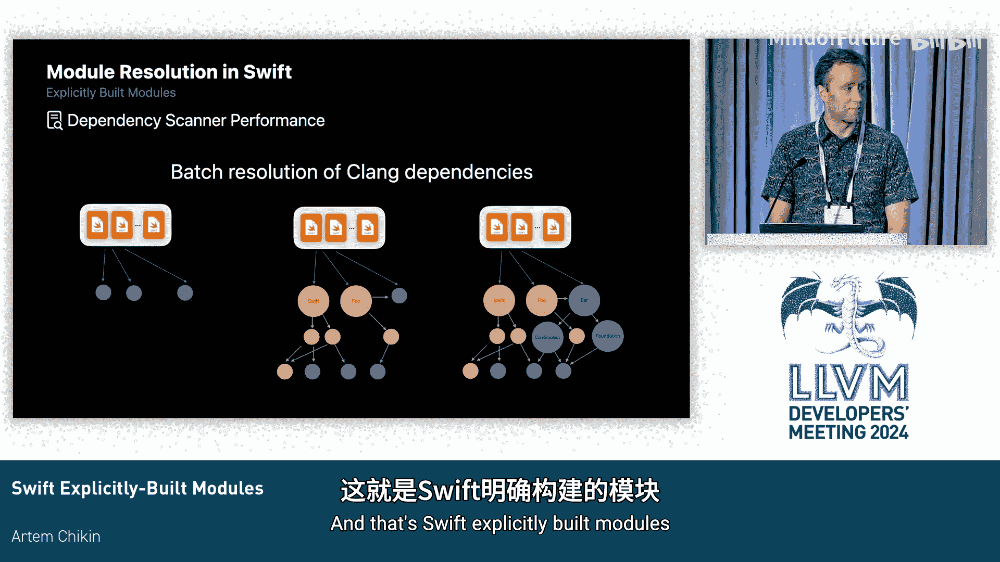

# 【2024-LLVM开发者大会-•-中英】-p21-P21-Swift-Explicitly-Built-Modules--BV18eNfepENu_p21-

I'm going to share about how Swift deals with modules in particular get into some more details about our module loading strategy。

To start with SwIt is a modern language， and the statute was designed to be modular from the start。

 and modules in Swift are very much a core vertical concept that spans encapsulating a collection of source files that contributes to a given library。

 the API contract that it provides to its clients the API surface that a given library represents mapping down all the way to the symbols we capture in the resulting binary file。

And unlike the C family of languages in Swift， modules are not module interfaces are not authored by human in textual header file。

 instead they are captured directly from your source code by using access control keywords。

 so the public keyword in this example comprises the full set of declarations and types and functions that will contribute to an interface of your module。

And once you have a module in order for your clients to be able to actually use it and reference all of those declarations and types。

 it needs to be compiled into a binary representation ingestible by the compiler。

 which is a binary swift module which is an LVM bitcode container that captures the abstract syntry of all of the relevant declarations and as a Swift5 on Apple platforms。

 we also have a compilation mode where users can opt in to build a resilient module which provides a guarantee of A stability。

 so as your library evolves over time and you make your additive changes your modules are stable in that your new versions will be compatible with the clients built against your prior versions and to do that we also need to be needs to produce modules that are not tied to a given compiler version and are usable across different compilers and so to do so instead of a binary module file。

 the compile compiler will produce a textual module interface which works fairly similarly to the binary。

It uses the access control mechanism to capture all of the relevant declarations。Now crucially。

 since day one Swift has had a deep interoperability with C and objective C code and as a recent as well with CS plus code。

 and there is a mechanism in Swift to simply import a given textual header file and all of the various mechanisms in it。

 but in order to do interoperability at scale， if you want to ship a large mixed language SDK。

 for example， requires modularized header interfaces and as we've all learned earlier we use a mechanism mechanism of client modules for this client modules are composed of a module map file that defines a module name crucially as well as all of the various properties of this module and a header files that comprise it。

Ac modules are built into binary precompiled module files。

All of the possible ways that Swift can import modules we can learn by looking at a small example。

 so suppose we're compiling a small swift program comping consisting of the source file that imports modules F and bar。

 suppose moduleF is a resilient swift module somewhere on the search pass of our compilation and bar is a claim module。

Upon encountering an import statement， sort compiler is going to discover that we have a textual interface for this module。

 this module needs to be built into a format ingeestible by the compiler and then consumed into the main source compiler。

 which can then proceed to the next statement。So for Bar we can discover this module。

 we have this precompiled module representation of it。

 there's an additional step we need to go through for clang modules called the clang importer。

 which is a subsystem of the swift compiler that essentially goes over the full list of declarations in this clang module and translates them into the format that are native to the Swt Sa in order to be able to directly use those declarations。

嗯。The key concept here is that each named module requires to be compiled into a format that a compiler can actually ingest。

 and so if we take a step back and look at compiling a more meaningfully。

 interesting piece source code where you're building a swift target that consists of many different source files。

 each one has its own an import statement， this process looks something like this。

Swift completionation model。Deines the module itself as a compilation unit， but similarly to arrest。

 as we saw on a keynote yesterday， for debug belts。

 we actually separate a module into per source file compilation tasks in order to make better use of the many cores on our machines and if you're building a library that is meant to be consumed by clients。

 we're going to have a separate task that also emits some module itself。Looking at this example。

 once we encounter an import statement， the compiler needs to search the file system in a given set of search paths。

 do I have this module and suppose one of the tasks here encounters an import of F and what it's going to do is it's going to spawn a compation subins。

 it is going to take its own compiler process， take a certain subset of the compation context of all of the flags。

 the target triples the dash D flags and spawn a new thread to go and compile that module and it can't necessarily make any forward progress until that compation thread is done。

Now。It is very likely that within the same module you're going to have a different source file that has exactly the same module dependency and when some other source file encounters an import of F。

 we don't really want it to also spawn the threads to go and build the same module we don't want to duplicate that work and so we are simply going to place a file system lock on that module and have this process wait for it and also notably not be able to make any forward progress because it too needs the contents of F and so all this process is going to do is simply spin on that file system lock and wait。

Now。This process sort of goes on and on and on amid module tasks will require all of your modular dependencies they end up doing a lot of waiting Eventually some other source file compiler is going to encounter a new part of the bar is going to start a compilation。

 other tasks that are going to start depending on it， all of this gets very complicated very quickly。

And if you think that's a bit much， things get really interesting when we remember that F and bar are themselves modules。

 they also have module or header includes， they also have import statements if they are themselves Sw modules and how we handle that is actually exactly the same when we're compiling F we encounter import statements in a sexual interface。

 that compilation instance is going to spawn its own subcompilation instance thread which is going to place a file system lock that some other process somewhere else is going to end up waiting on and so on and so forth and just anecdotally when you're building any kind of meaningfully sized swift program guess the MacOS or iOS SDK on Apple platforms。

 it is fairly common to have a given compiled having a module dependency graph that consists of in the order of hundreds of both Swt and client modules from across the SDK。

Now this process， it works， it works well， it has served us for many years。

 though over the course of our experiences with it。

 we've found some downsides to it as well as found that it doesn't necessarily scale to the kind of build system technologies we want to build and to highlight some of the downsides in addition to the various correctness pitfalls that Michael Leian highlighted is that this process is entirely opaque of the bill system when a bill system creates a set of tasks to compile a given target。

 it doesn't have any idea of how much work a given task is going to take。

 how many threats is going to spawn how to best take advantage of your machines resources。

Beer tasks end up waiting on these file system locks making no forward progress。

 but also at the same time taking up valuable execution links which is clearly suboptimal file system locking mechanisms are brittle。

 you need to be really， really careful when your process holds for some reason or you encounter some kind of errors。

Nested compilation context is hard to reason about this does end up translating into fairly difficult errors for a users to debug。

 but notably it's also particularly that tricky for a compr engineers to debug whenever something goes wrong when you're compiling a SDDK dependency module that is dozens of threads deep into a compilation threading the needle through that compilation of what exactly went wrong and in which order can be very tricky。

Notably these tasks are non- isolated， that means when we spawn these tasks。

 neither the build system nor the compiler actually know what files are going to be used as inputs to this completionation task。

 what files are going to be produced by this completion tasks。

 which can be useful properties to have。Last but not least， we got very late error discovery。

 a lot of things need to happen in the compilation process we again we need to follow these subcompilation threads that are dozens and dozens of context deep in order to finally hit a cycle at which point in order to produce meaningful diagnostics to our users。

 we need to do a lot of work to reconstruct all of the chain of events that led us there。

And so the solution to this is a model we call explicitquisite modules I'll refer you to once again to an excellent talk my colleague Janan gave at EuroLVM in 2022 where he described how a similar model is applied to KL and here I'd like to highlight how Swift is doing something similar by building on top of the work done Kang and using the infrastructure that KLang built for explicitite modules directly。

The key concept of explicit modules and the new model is that we break up the build into three stageses in the first stage before we perform any kind of compilation。

 we're going to perform a dependency scan so we're going to find all of the import statements in your Sw code we're going to resolve them to their modular dependencies we're going to follow those links resolve of the module dependencies transitally and so on and so forth and the end result is this dependency graph and the graph consists of for every module here's what it is here's the files that comprise it and here's a full command line recipe that you need to build it。

Once we have that， the compiler driver or whatever build system is orchestrachesting this can schedule these modules to be built in dependency order and finally rebuild our source files and crucially these source file compation tasks now will not spawn any new threads they will not themselves wait for anything all of the inputs are specified directly and explicitly and crucially if you' are not building that many source files or in the switch compation model if we're building an entire module in a whole module optimization flow。

 you're just going to have one compile tasks and you are still going to be able to use the many course that you have on your machine when you're building your dependencies which we can hopefully do a much better job scheduling so we can compare those new approaches whereas previously we had these collection of long-running tasks that are fairly inscrutable both to us and to our users we now ultimately have a much more coherent kind of task graph。

And。To highlight some of its advantages is we've unlocked a lot more scheduling parallelism opportunities。

 as I mentioned， our dependency graphs can span in an order of hundreds of modules。

 our machines are getting more and more coar， we can make much better use of it because we have much more parallel work that we've discovered up front。

Our compilation tasks are isolated， all of their inputs and outputs are precisely specified ahead of time。

 which can be very useful property， particularly if we want to do something like make them eventually distributable。

😊，We have greatly simplified the debugging of this and crucially this isn't just the debugging by compiler engineers who are looking at this who can now look at a given task。

 have much more precision knowing what this task was doing and what could have possibly gone wrong。

 but also the many users who at their desk may encounter various issues that involve motorization also for our build engineers who are oftentimes triaging various motorization issues when building R SDDKs and ensuring their health。

 being able to have an upfront dependency graph as well as a precise attribution of failures is extremely valuable。

😊，Last but not least this process is now deterministic and explainable。

 we are no longer bound by waiting for which specific source file encountered to give an import statement first and started its compilation which will or will not necessarily happen on sort of successive compiles of the same thing。

 we now have a much clearer picture of the compilation model。

Now the most interesting technology involved in this build model is the dependency scanner The Sw dependency scanner is a library service that is used by the build system it essentially is a library that wraps the entire compiler whose execution mode is strictly to take an import statement and to resolve it to a given module and a file system and because Swt directly interoperates with Clang modules。

 the Sw dependency scanner actually fully wraps the Clang dependency scanner one of the great advantages of the system is that swiftt source code does not need to distinguish when importing a module。

 whether that module is written in swiftifft or clang it's all quite transparent the dependency scanning service itself consists of a collection of workers when you have many different import statements to resolve we can attempt to do so those in parallel and the sort code for this is actually really straightforward we start with a collection of source files each one with its own collection of import statements for each。

Import statements identifier， we ask a question off。

 does my collection of search paths have this module in a file system？If it does， that's great。

 we go and find us with module， we take its imports and add them to the work list。If we don't。

 we now query our built in clientang dependency scanner and the client dependency scanner needs to work quite differently。

 It cannot simply give us a single module and is dependencies。

 it needs to give us a full subgraph of dependencies of the module we're query and the reason for that is because the sort of dependency set and the interface of a claim module you're importing can actually be affected by its dependencies in turn。

 so we need to get the entire subgraph from the client dependency scanner And if the answer to the second question is also no。

 we know that we don't have any such module and we can tell the user please check your search pass the API that the sort dependency scanner uses for this is actually really straightforward the client dependency claim modules are named the module identifier is specified in a module map so we query the scanner with this API called module dependencies that takes a module name a command line definition that defines the compilation。

tThat is looking for this module and therefore defines the context hash of this module that contains the target triple。

 all of its macro definitions， etctera， etter。Now one of the key lessons that we've learned in transitioning our compilation model to use explicitly built modules is that dependency scanner performance is crucial。

 we have unlocked a lot more parallelism by having a much richer upfront task graph of all of the module dependencies but if you remember those little timeline slides to unlock that parallelism you do need to run this bottleneck task that we first needs to compute this graph and as we've spent some time studying performance characteristics of this process we've discovered that well swiftt module discovery is relatively very very cheap and reasons for that are one is swift is a fully moduleular language from the get go and it's also more restrictive in the kinds of things that module interfaces can express for example。

 modules on the file system， swift modules on the file systems are named after a module name whereas client modules are all。

In order to find an identifier， you first need to find every single module map that appears on your search paths。

 open one， parse the all， find the right identifier， go parse its headers and preprocess its headers。

 which ends up being much， much more expensive。嗯。And also as I mentioned。

 to compute what the recipe for building a given Kang module dependency。

 you need to compute its entire transitive closure graph and so one insight that we've pursued recently is that relying on the fact that a Kang module cannot actually have a dependency on a swift module。

 we can compute the full swift module dependency graph ahead of time。

And everything that is left unresolved has to be climate modules。

 which we can then try to resolve as one large batch。

And what that process looks like now is that just as before we start with your collection of source files。

 they have a collection of import statements with just named identifiers。

 we resolve all of those to swift modules， again takes reasonably ins significantant amount of time。

 and then we know that every single unresolved node in this graph must be a clang module。

 we can grab those， put them in one large batch of queries。

 we dispatch to the Kang dependency scanner and issue those in parallel。

And that Swift explicitly build modules， thank you for listening， I'll be happy to take questions。

Do we have any questions？Now somewhere around of Alberta。

 I assume that you rebuildbu the dependence graph when there is a modification of our recompilation。

Not from scratch。No， no not from scratch and so the question then is what are the difficulties on partially we in the dependence graph。

 giving that you have the separation with the clean marches？

We don't do a partial recomputation of the graph but the way this works is that the clang dependency scanner as it computes subset of a dependency graph it serializes the graph state and so on an incremental build when we launch a dependency scanning process whenever the scanner encounters a query for oh I'm compiling a source file that needs to find fo given a certain command line andvocation。

 the scanner is able to reuse the previously computed work and so we do not recompute slices of the graph。

 we incrementally recompute the entire graph but we don't need to do much of the work we simply need to have mechanisms in place that do all of the required consistency checking is my serialized stuff up to date did this module dependency changed and if it hasn't we are able to reuse it and if it has we need to invalidate that node and do a from scratch query so there is this incremental machinery that takes the entire graph and invalid。

It's sections of it that need to be recomputed incrementally。Does anyone have any other questions。

 we have time。All right， thank you everyone， let's thank our speaker for his talk。

